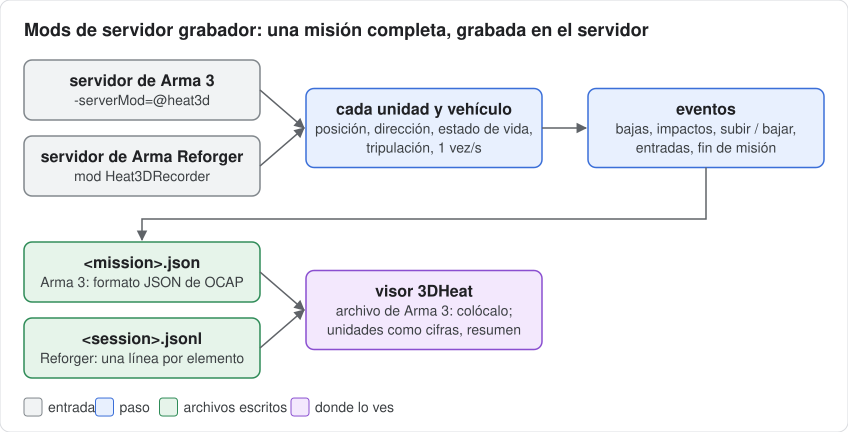

# Mods grabadores de servidor (Arma 3, Arma Reforger) {#server-recorder-mods-arma-3-arma-reforger}

La mayoría de los juegos los graba el watcher en el propio equipo del jugador. Arma
es distinto: un servidor puede grabar una misión entera - cada unidad y cada
vehículo, no solo los tuyos - con un mod que se ejecuta en el servidor. Los jugadores
no configuran nada: el mod de Arma 3 es solo para el servidor, y Reforger descarga
solo los mods de un servidor cuando te unes (el mod no hace nada en los equipos de
los jugadores). El repositorio incluye dos de esos mods, en
[`mods/arma3`](https://github.com/Holdi601/3DHeat-Watcher/tree/main/mods/arma3)
y [`mods/reforger`](https://github.com/Holdi601/3DHeat-Watcher/tree/main/mods/reforger).
Sus README son la documentación completa; esta página es el resumen.

**Estado: ambos están sin probar en el juego.** La extensión de Arma 3 se compiló y se
manejó como Arma llama a las extensiones, y 3DHeat leyó su salida; sus scripts SQF
todavía no se han ejecutado en Arma 3. El mod de Reforger se escribió a partir de la
API de scripts publicada por Bohemia y nunca se ha compilado. No lo pongas en un
servidor público antes de que pasen los pasos de prueba de su README.

## Arma 3 {#arma-3}

1. Compila la extensión una vez por plataforma (`mods/arma3/extension`). Esto necesita un compilador de C: Visual
   Studio Build Tools en Windows, gcc en Linux; si nunca has compilado nada, pregúntale a tu proveedor de servidores.
   - Windows, en un "x64 Native Tools Command Prompt for VS":
     `cl /nologo /O2 /LD heat3d.c /Fe:heat3d_x64.dll`
   - Linux: `gcc -O2 -shared -fPIC -o heat3d_x64.so heat3d.c -ldl`
2. Compila el mod: `python mods/arma3/build.py` escribe `mods/arma3/@heat3d/`
   (no hacen falta las Arma 3 Tools).
3. Copia `@heat3d` en la carpeta del servidor e inicia el servidor con
   `-serverMod=@heat3d`.
4. El registro `.rpt` del servidor dice `Heat3D recorder 0.1.0: recording <archivo> every 1 s`.

| Ajuste | Por defecto | Qué hace |
|---|---|---|
| `captureDelay` | 1 | segundos entre fotogramas |
| `recordHits` | 1 | 0 desactiva los eventos de impacto |
| `recordShots` | 1 | 0 desactiva el conteo de disparos |
| `minPlayers` | 0 | graba solo cuando hay tantos jugadores conectados |

Una misión lo cambia en su `init.sqf` (`heat3d_captureDelay = 0.5;`).
Las grabaciones van a `recordings/` dentro de `@heat3d`, o a `HEAT3D_DIR`.

**Salida:** un archivo por misión en el formato JSON de OCAP (el formato del grabador
OCAP2), con el nombre `<fecha>__<hora>_<misión>.json`. Durante la misión es un diario
(`.heat3d.part`), que se vuelca en cada escritura; el diario de una misión que se
cerró mal se termina la próxima vez que empieza una misión.

## Arma Reforger {#arma-reforger}

El mod (`Heat3DRecorder.gproj`) se abre y se compila en Workbench de Bohemia
(Arma Reforger Tools), se prueba en un servidor dedicado local, se publica desde
Workbench (sin listar mientras se prueba) y se añade a la lista `mods` del
`config.json` del servidor: paso a paso en su README. Cada segundo escribe la posición,
la dirección, el estado de vida, el vehículo y el id de jugador de cada personaje, y
la posición, la dirección, el estado y la tripulación de cada vehículo; y las bajas
(quién mató, con qué arma, a qué distancia), los impactos, cuándo se sube o se baja de
un vehículo, cuándo entran y salen jugadores, y el final de la misión.

**Salida:** un objeto JSON por línea, `$profile:heat3d/<fecha UTC>_<hora UTC>_<mundo>.jsonl`:
una línea `header` (formato `heat3d-reforger`, ejes x este, y arriba, z norte), después
líneas `entity`, `frame` y `event` según ocurren, y una línea `end`. Las filas de unidades
son `[id, x, y, z, dir, alive, vehicleId, playerId]`, las de vehículos
`[id, x, y, z, dir, alive, [ids de tripulación]]`; los eventos siguen el formato de
eventos de OCAP2.

## En el visor {#in-the-viewer}

Arrastra una grabación de Arma 3 al [visor de 3DHeat](https://holdi601.github.io/3DHeat/):
una misión es una sesión, las unidades se convierten en soldados, los vehículos en su
tipo, y las bajas e impactos van a la lista de resumen. El reproductor web de OCAP2
también la reproduce. El archivo de Reforger es el formato de línea propio del mod, con
el formato de eventos de OCAP2.
