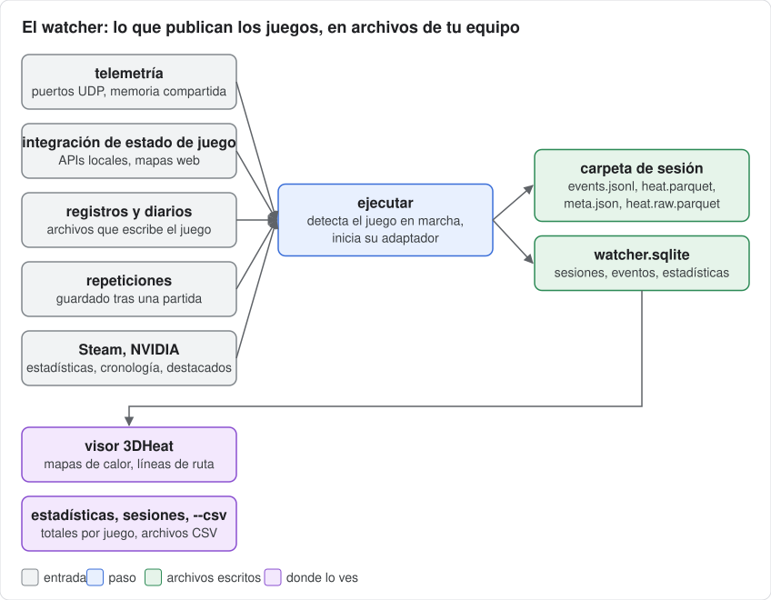

# Fuentes y reglas {#sources-and-rules}
El watcher graba solo lo que los juegos y las plataformas entregan al jugador. Esta página explica qué fuentes
cubre eso, qué puede hacer el watcher con cada una, y qué juegos o partes de juegos deja fuera a propósito.

## Los seis tipos de fuente {#the-six-kinds-of-source}

Cada adaptador tiene un `kind` (tipo), y el tipo decide lo que el adaptador puede hacer:

| Tipo | Qué es | Juegos multijugador |
|---|---|---|
| `telemetry` | un puerto UDP o memoria compartida que el juego publica para paneles, plataformas de movimiento y volantes (Forza Data Out, UDP de F1, memoria compartida de Kunos e iRacing, SimConnect, la interfaz UDP de X-Plane, el plugin SCS SDK) | sí - es la salida propia del juego |
| `gsi` | una game-state integration o API web local que el juego sirve a la propia máquina del jugador (Valve GSI, la Live Client Data API de League, la Stats API de Rocket League, el mapa web de War Thunder) | sí, dentro de lo que la API muestra al jugador |
| `log` | archivos que el juego escribe mientras se ejecuta: diarios, registros, estadísticas, partidas guardadas (Elite Dangerous, Minecraft, Path of Exile, Hearthstone, Star Citizen, EVE Online) | sí |
| `replay` | demos y repeticiones que el juego guarda para sus jugadores, convertidas tras la partida (CS2, Dota 2, War Thunder, World of Tanks, World of Warships, Squad, League of Legends, VALORANT, IL-2 Tacview) | sí, salvo si están cifradas, y solo las partes en claro |
| `platform` | lo que guardan Steam y el controlador gráfico: estadísticas, logros, líneas de tiempo, clips y highlights | sí |
| `memory` | la memoria del juego, solo de lectura, mediante un perfil que escribiste tú | **nunca** - solo para un jugador |

Solo `memory` abre otro proceso, y solo para leer. Los otros cinco tipos leen lo que el juego,
Steam o NVIDIA App ya han escrito o envían.

## Cómo se leen las fuentes {#how-the-sources-are-read}
- **Nada se inyecta, se engancha o se cambia en un juego.** No se carga código en ningún juego, no se engancha ninguna ventana ni entrada,
  no se parchea ningún archivo del juego. Los únicos archivos que el watcher escribe fuera de su carpeta de datos son
  los que escribe [`setup --apply`](commands.md#setup) cuando lo pides: el archivo de ajustes del propio juego
  (con el original guardado como `<archivo>.heat3d-backup`), un archivo cfg de game-state integration, el script
  hook de DCS, el mod de protocolo de BeamNG.
- **La memoria compartida se abre solo de lectura y nunca se crea.** La forma habitual de abrir un mapeo con nombre en Python
  crea uno si no existe. Un juego iniciado después encontraría el mapeo vacío y de solo lectura del watcher
  en lugar de crear el suyo, y su telemetría quedaría muerta. El watcher abre los mapeos solo con `OpenFileMappingW` (que
  solo encuentra uno existente), los mapea con `FILE_MAP_READ`, y vuelve a intentarlo más tarde si el juego aún no los ha creado.
- **Los puertos se toman prestados, nunca se quitan.** Un puerto UDP de telemetría en el que ya escucha otro programa (FH Companion, SimHub,
  una app de paneles) se deja a ese programa. Si otro programa empieza a escuchar en un puerto que tiene el watcher, el watcher lo suelta
  en pocos segundos. Los adaptadores de Forza esperan 15 s tras el inicio del juego antes de tomar el puerto 5300, y reenvían cada paquete sin cambios a
  127.0.0.1:5301, así que una segunda app de Data Out puede seguir grabando.
- **Solo local.** Los servidores de game-state que ejecuta el watcher (CS2, Dota 2) escuchan en 127.0.0.1 y en ningún otro lugar. Cuando el
  archivo cfg del juego tiene un token (el que escribe `setup`), cada envío debe llevarlo; los envíos sin él se cuentan como
  `bad_auth` y se descartan. Sin un archivo cfg con token, se acepta cualquier envío local, y el registro lo indica. Las APIs locales que consulta
  (League en el puerto 2999, War Thunder en el 8111, Rocket League en el 49123, X-Plane en el 49000) están en 127.0.0.1.
- **Los archivos de registro se comparten, nunca se bloquean.** Cada lectura abre el archivo con todas las marcas de compartición que tiene Windows
  y lo cierra de nuevo, así que el juego puede seguir escribiendo, renombrar o reemplazar su registro.
- **Dos servicios externos, y solo en estos casos.** La comprobación de versiones consulta GitHub
  (`api.github.com`) como máximo cada seis horas, y puede desactivarse (véase [Actualizaciones](updates.md)). El
  adaptador de repeticiones de League consulta la API Match-V5 de Riot solo cuando has introducido tu propio `riot_api_key`.
  Nada más se envía a ningún sitio.
- **Activar una fuente es decisión tuya.** `setup` sin `--apply` solo indica lo que cambiaría.

## Reglas para el multijugador {#multiplayer-rules}
- Un juego jugado en línea se graba solo a través de lo que publica: telemetría, APIs de game-state, registros,
  repeticiones, archivos de plataforma. Dentro de eso, el watcher graba lo que el juego muestra al jugador, y nada
  calculado más allá de ello:
  - **La game-state integration de CS2** envía el jugador observado (tú mismo mientras estás vivo, un compañero
    tras morir). Las posiciones de los demás jugadores (`allplayers_*`) solo se envían a espectadores y GOTV, así que
    el watcher no las pide.
  - **La Live Client Data API de League of Legends** no tiene posiciones. La política de Riot permite a las herramientas mostrar
    lo que el jugador podría saber por el propio juego, y nada calculado más allá de eso (sin temporizadores de enemigos).
    El watcher graba el feed de bajas y el marcador que ve el jugador, y las cifras propias del jugador.
  - **La Stats API de Rocket League** no tiene posiciones de coches (el estado de los coches solo se envía a espectadores). Lo que tiene un lugar es el balón, dónde se golpeó, marcó o tocó el larguero.
  - **El mapa web de War Thunder** muestra lo que muestra el minimapa, sin nombres ni ids.
  - **F1 23/24/25** ponen la posición de cada coche en su paquete Motion, también en línea. El juego los entrega
    por sí mismo, y solo retiene los datos de los jugadores cuya "Tu telemetría" está restringida.
  - **DCS World**: un servidor multijugador puede prohibir la exportación de los datos de la propia aeronave; la sesión
    entonces tiene eventos pero no posiciones, y lo indica.
- **La memoria nunca se lee en un juego multijugador.** Un adaptador de memoria para un juego marcado como jugado en línea
  se rechaza, y un perfil debe indicar si su juego puede jugarse en línea. Un juego de un jugador que también tiene un modo en línea
  solo se lee mientras no tiene conexión con nada más que esta máquina. Los juegos cuyo modo de un jugador se ejecuta bajo un anti-trampas
  tampoco se leen nunca. Véase [Lectura de memoria](memory-reading.md).
- La marca `multiplayer` de un adaptador (que `games --markdown` muestra como "Juego en línea") solo decide la lectura de
  memoria. No impide que los otros tipos graben el juego en línea.

## Lo que se rechaza y por qué {#what-is-declined-and-why}
Algunos juegos, y algunas partes de juegos, no se graban porque la única forma de obtenerlos rompería una protección o las
condiciones de un juego:

| Juego | Qué se deja fuera | Por qué |
|---|---|---|
| VALORANT | posiciones, nombres, marcadores en las repeticiones; los endpoints del archivo de bloqueo del cliente | El flujo de juego de la repetición está ofuscado con valores tomados del ejecutable de cada compilación. Recuperarlos supone hacer ingeniería inversa al juego, lo que prohíben los Términos de Servicio de Riot (secciones 3.1 y 7.1), y el juego se ejecuta bajo Vanguard. Los endpoints del archivo de bloqueo del cliente de Riot no son una API publicada. **Se lee:** lo que la repetición lleva en claro - el mapa, el id de partida, los agentes, la línea de tiempo de bajas y rondas del servidor. |
| League of Legends | la parte momento a momento de las repeticiones `.rofl`; los endpoints del archivo de bloqueo del cliente | Ofuscada contra las trampas, distinta en cada parche; descifrarla supone desmontar el juego, lo que prohíben las condiciones de Riot. **Se lee:** el recuadro de estadísticas del final de partida que cada repetición lleva como JSON sin cifrar, la Live Client Data API durante una partida y - con tu propia clave de desarrollador - la línea de tiempo oficial de Match-V5 (posiciones una vez por minuto, bajas donde ocurrieron). |
| Fortnite | repeticiones | Cifradas, y las condiciones de Epic prohíben hacer ingeniería inversa. |
| World of Tanks, World of Warships | repeticiones, en el watcher | Cifradas, con una clave que lleva el juego y que las herramientas de la comunidad publican desde hace años. El watcher no las lee; las leen conversores separados fuera de él (`exporters/ext/wot-replay`, `exporters/ext/wows-replay`), de modo que un problema con las condiciones de Wargaming - su licencia prohíbe la ingeniería inversa (5.3 b) y el software no autorizado que interactúa con sus productos (12.1 k) - afecta solo a esos. **Se lee, con un conversor instalado:** la posición de cada vehículo o barco mientras el cliente que grababa lo conocía, y las bajas. |
| Gran Turismo 7 | telemetría | Solo en consola, y su telemetría está cifrada con una clave obtenida del juego. |
| Apex Legends | todo | Su LiveAPI envía eventos completos solo en lobbies privados y personalizados; por lo demás no hay nada disponible en local. |
| Overwatch 2, Call of Duty, Battlefield 6, Hunt: Showdown 1896 | datos en vivo | No hay salida local de repeticiones, registros ni game-state que leer. Sus estadísticas llegan donde Steam las guarda ([Estadísticas de Steam](game-steam-stats.md), [Steam Timeline](game-steam-timeline.md)), y sus clips como [NVIDIA highlights](nvidia-highlights.md). |
| Star Citizen | cualquier cosa más allá de `Game.log` | Usa Easy Anti-Cheat; el watcher lee solo el archivo de registro que escribe el juego y nunca se acerca al proceso del juego. |
| osu! | replays | Fuera de alcance: un juego 2D, sin nada que colocar en un mapa. |
| Cualquier juego multijugador | memoria | Nunca. Tampoco se leen los juegos de un jugador cuyo modo se ejecuta bajo un anti-trampas (GTA V, Elden Ring a través de su lanzador). |

Las repeticiones cifradas no se abren: el lector de VALORANT comprueba la marca de cifrado de la repetición y
rechaza un archivo cifrado ("esta repetición está cifrada; no se lee").

Juegos investigados pero aún no construidos (repeticiones de Deadlock, archivos `.replay` de Rocket League,
StarCraft II, Team Fortress 2, Rainbow Six Siege, Beat Saber, Trackmania, varios simuladores de carreras) están
listados con sus fuentes en [Todos los juegos en una tabla](watcher.md#researched-not-yet-built). Cada uno
necesita archivos de muestra con los que comprobarse antes de publicarse.
