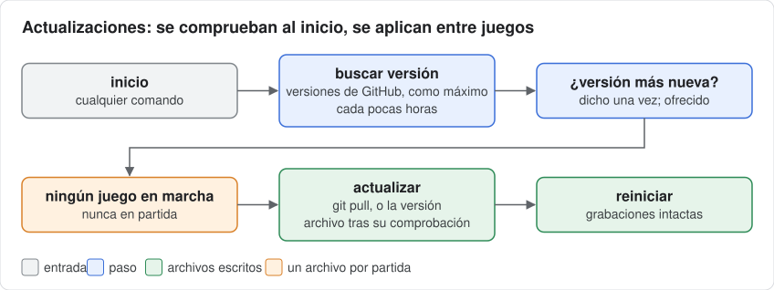

# Actualizaciones {#updates}

El watcher se mantiene al día con las versiones publicadas en
[Holdi601/3DHeat-Watcher](https://github.com/Holdi601/3DHeat-Watcher/releases). El
actualizador es el paquete `heat3d_update`, junto a `heat3d_watch` en el repositorio.

## La comprobación {#the-check}

- **Cuándo**: cada comando, salvo `update`, comprueba al empezar. `run` también comprueba mientras se ejecuta,
  como mucho una vez por hora y solo mientras no hay ningún juego en marcha.
- **Cómo**: una petición HTTPS a `https://api.github.com/repos/Holdi601/3DHeat-Watcher/releases/latest`,
  con un tiempo límite de 5 segundos. La respuesta se guarda en caché durante seis horas en
  `%LOCALAPPDATA%\3DHeat\update-check-3DHeat-Watcher.json`, así que la mayoría de los arranques no piden nada. "Todavía no hay
  versión" (HTTP 404) se guarda en caché como cualquier otra respuesta. Sin conexión, con el límite de peticiones
  agotado o detrás de un proxy, la comprobación falla en silencio y el comando sigue con la versión que tiene.
- **Versiones**: la versión instalada es el archivo `VERSION` de la carpeta del repositorio.
  La etiqueta de una versión (`v1.2.0` o `1.2.0`) se compara como números, parte a parte; lo que
  va después de un `-` o un `+` se ignora.
- **Desactivar**: `HEAT3D_NO_UPDATE=1` (cualquier valor salvo vacío, `0`, `false` o `no`) desactiva tanto la
  comprobación como la actualización automática. Cada herramienta de 3DHeat tiene su propio archivo de caché, así que la respuesta de
  una herramienta nunca sustituye a la de otra.

## Qué pasa cuando hay una versión nueva {#what-happens-when-a-newer-release-is-out}

- **`run`** muestra un aviso al empezar, y sigue ejecutándose:
  `[heat3d_watch] 3DHeat Watcher 1.2.0 is out (this is 1.0.2). <página de la versión>`. Mientras se ejecuta, con
  `auto_update` activado (es el valor por defecto) y sin ningún juego en marcha, se actualiza sola: la línea de registro
  `3DHeat Watcher 1.2.0 is out (this is 1.0.2); updating`, una notificación de Windows "Actualizando a 1.2.0",
  la actualización, cada adaptador detenido y sus sesiones cerradas, y el mismo comando vuelto a iniciar con el
  código nuevo. El watcher nunca se actualiza en medio de una partida. Si la actualización no se puede aplicar, la notificación lo dice
  ("1.2.0 is out; not updated: ...") y el watcher sigue con la versión anterior. Con `auto_update` desactivado solo queda el aviso.
- **Otros comandos** preguntan `Update now? [Y/n]` cuando se ejecutan en una terminal. Enter, `y`, `yes`, `j` o
  `ja` actualiza y después vuelve a ejecutar el mismo comando con la nueva versión. Sin terminal (una ejecución programada,
  una tubería), muestran cómo actualizar y siguen.
- **A petición**: `python -m heat3d_watch update` (o `python -m heat3d_update`) pregunta a GitHub sin la caché y actualiza. `--check` solo
  dice si hay una versión nueva. Esto funciona incluso con `HEAT3D_NO_UPDATE` definido.

## Cómo se aplica una actualización {#how-an-update-is-applied}

Depende de cómo se instaló la copia:

- **Un clon de git** (la carpeta tiene `.git` y `git` está en el PATH): `git pull --ff-only`. Se rechaza
  mientras el clon tenga cambios en archivos controlados (`git status --porcelain --untracked-files=no` no está
  vacío): esos cambios son trabajo de alguien, y una actualización no decide qué pasa con ellos. Haz commit o guárdalos
  con stash, y luego haz pull.
- **Una copia descargada**: el archivo de código fuente de la versión se descarga y se descomprime en una
  carpeta temporal. Se omiten las entradas que caerían fuera de ella. El `VERSION` del archivo debe ser la versión
  que dice la publicación, o no se copia nada. Después sus archivos se copian sobre la carpeta del repositorio.
  Los archivos que no forman parte de una versión - grabaciones, ajustes, entornos virtuales, exportaciones, cualquier cosa
  que hayas creado - no se tocan. Un módulo de Python que una versión anterior tenía y la nueva ya no tiene se elimina de
  los paquetes de la propia versión (`heat3d_watch`, `heat3d_update`), así que ningún módulo de adaptador obsoleto
  se carga tras la actualización; fuera de esos paquetes no se elimina nada.

Las grabaciones y los ajustes normalmente viven fuera de la carpeta del repositorio de todos modos
(`%LOCALAPPDATA%\3DHeat\Watcher`), así que una actualización nunca se acerca a ellos.

Tras una actualización, se vuelve a iniciar el mismo comando. En Windows, el watcher inicia el proceso nuevo, espera
a que termine y pasa su código de salida, de modo que la consola se comporta como si el primer proceso hubiera hecho el trabajo.
