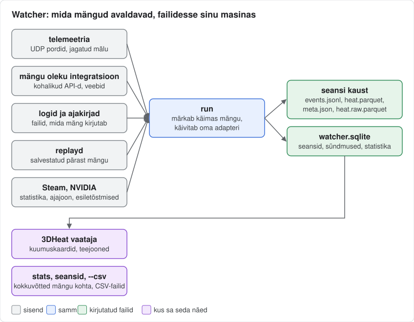

# 3DHeat Watcher {#dheat-watcher}

**Mis see on?** Sina mängid mängu. See programm kirjutab vaikselt üles, kuhu läksid ja mis juhtus.
Hiljem saad seda vaadata värvilise kaardina 3DHeat vaatajas.

**Miks ma seda kasutaksin?** Et pidada enda arvestust igast mängukorrast — kuhu sõitsid, lendasid või
võitlesid, oma kogusummad mängu kohta — ilma veebisaidita ja ilma mängu muutmata.

**Näide:** sõidad võidusõidumängus ringi, kui Watcher töötab; hiljem hoiab fail kaustas `sessions\<game>\`
joont, mida sa sõitsid, ja vaataja joonistab selle.

Üksikasjalikumalt: 3DHeat Watcher on taustaprogramm, mis salvestab, mida mängud sinu mängu kohta avaldavad —
kuhu läksid, mis kus juhtus ja nende taga olevad arvud — failidesse sinu enda masinas. Failid on
sinu enda statistika jaoks ning 3DHeat vaataja kuumuskaartide ja marsruudijoonte jaoks.

See töötab vaikselt, märkab, millise mängu alustasid, ja loeb selle mängu enda väljundeid: telemeetria pordi
või jagatud mälu, mille mäng avaldab armatuurlaudadele, mängu oleku integratsiooni, logi või ajakirja, mida mäng
kirjutab, replay'd, mille ta salvestab pärast mängu, Steami hoitud statistika ja NVIDIA Appi salvestatud klipid.
Salvestised jäävad sinu masinasse. Programm võtab ühendust ainult kahe välisteenusega, ja ainult nendel juhtudel:
GitHub, uuema väljaande otsimiseks (vt [Uuendused](../updates.md)), ning Riot'i Match-V5 API, ja ainult siis, kui
sisestad oma Riot'i API võtme (vt [League of Legendsi replayd](../game-lol-replays.md)).



## Mida see salvestab {#what-it-records}

- **Asukohad**: auto, lennuk, kangelane või mängija, mitu korda sekundis seal, kus mäng need avaldab,
  koos kiiruse, suuna ja kõige muuga, mida mäng nende kõrvale saadab.
- **Sündmused**: tekkimised, surmad, tapmised, ringid, etapid, voorud, väravad, ülesanded, õhkutõusud ja maandumised, tsoonide
  muutused, saavutused, esiletõstmised. Iga sündmus salvestatakse oma ajaga ja koos kohaga, kui mäng seda annab.
- **Statistika seansi kohta**: tapmised, surmad, ringid, parim ring, vahemaa, tippkiirus, mängimisaeg ja mängu enda
  statistika, kus ta seda hoiab.

Mida iga mäng annab ja kust, on iga mängu enda lehel jaotises [Mängud](../games.md). Üks allikas ei saa kõike
salvestada: mitmikmängud salvestatakse ainult selle kaudu, mida nad avaldavad, ja watcher ei loe nende mälu
kunagi (vt [Allikad ja reeglid](../sources-and-rules.md)).

## Paigaldus {#install}

Pole sul käsurealt kogemust? Loe enne [Enne alustamist](before-you-start.md).

Watcher on Windowsi Pythoni programm (Python 3.10 või uuem). Paljud tema allikad on olemas ainult Windowsis: jagatud
mälu, register, Windowsi teavitused.

```bash
git clone https://github.com/Holdi601/3DHeat-Watcher.git
cd 3DHeat-Watcher
pip install -r requirements.txt
```

Allalaaditud väljaande arhiiv töötab samamoodi: paki lahti ja käivita `pip install -r requirements.txt`
kaustas. Üksikasjad ja mõned mängud vajavad lisad on jaotises
[Paigaldamine ja käivitamine](../installing-and-running.md).

## Kiire algus {#quick-start}

```bash
python -m heat3d_watch games            # mida iga mäng annab ja kust
python -m heat3d_watch setup all        # mis tuleks sisse lülitada (midagi ei muudeta)
python -m heat3d_watch setup f1-25 --apply   # lülita ühe mängu väljund sisse (algne fail varundatakse)
python -m heat3d_watch run              # jälgi; jäta see tööle, kui mängid
python -m heat3d_watch stats            # kokkuvõte mängu kohta
python -m heat3d_watch stats --csv out  # seansid, sündmused ja statistika CSV-failidena
```

Peaksid nägema: pärast `games` tabelit, kus on üks rida mängu kohta; `run` töötab edasi, kuni vajutad
Ctrl+C või suled akna.

Kõik kirjutatakse kausta `%LOCALAPPDATA%\3DHeat\Watcher`. Teise kausta kasutamiseks sea
keskkonnamuutuja `HEAT3D_WATCH_HOME` või käivita `python -m heat3d_watch config --set data=D:\somewhere`.

- `sessions\<game>\<date>_<adapter>\` - üks kaust seansi kohta, mis hoiab `events.jsonl` (iga sündmus
  nii, nagu see juhtub), `heat.parquet` (read, millel on asukoht, valmis 3DHeat vaatajale) ja
  `meta.json` (mäng, allikas, teljed, arvud, statistika)
- `watcher.sqlite` - iga seansi statistika kolmes lihtsas tabelis
- `watcher.log` - mida watcher tegi

Vaataja avab seansi `heat.parquet` otse, ilma et midagi seadistada (selle teljed ja ühikud on failis). Teisendatud
replay'd kirjutatakse sellele kõrvale tabelite ja mängu dokumentidena; vaataja enda üks-fail-mängu vorming on kirjeldatud
tema [`.3dheat` konteineri](https://holdi601.github.io/3DHeat/container.html) lehel ja iga tabeli veerud lehel
[Andmed](../the-data.md).

## Dokumentatsioon {#the-documentation}

| Leht | Mida see käsitleb |
|---|---|
| [Enne alustamist](before-you-start.md) | Python, terminal, kohatäited, mis on edu ja levinud vead |
| [Paigaldamine ja käivitamine](../installing-and-running.md) | nõuded, töötamine taustal, käivitamine koos Windowsiga, lukufail, logi, iga seade ja keskkonnamuutuja |
| [Mängud](../games.md) | leht iga mängu kohta: mida salvestatakse, kust, kuidas sisse lülitada, kuidas see töötab, teljed, statistika, mida on kontrollitud |
| [Andmed](../the-data.md) | seansikaustad, `events.jsonl`, `heat.parquet` ja selle jalus, `meta.json`, `watcher.sqlite`, taastamine pärast krahhi, CSV-eksport, seansi avamine 3DHeat vaatajas |
| [Käsud](../commands.md) | iga käsk ja valik `python -m heat3d_watch` jaoks |
| [Allikad ja reeglid](../sources-and-rules.md) | kuus allikaliiki, mitmikmängu reeglid, millised mängud on välja jäetud ja miks |
| [NVIDIA esiletõstmised](../nvidia-highlights.md) | mida NVIDIA esiletõstmised suudavad ja ei suuda edastada ning kuidas esiletõstmine saab asukoha |
| [Serveri salvestusmodid](../server-mods.md) | Arma 3 ja Arma Reforgeri serveri modid, mis salvestavad terve missiooni vaataja jaoks |
| [Mälu lugemine](../memory-reading.md) | ainult ühemängijamängude mäluprofiilid: vorming, kontrollid, kuidas kirjutada ja kontrollida |
| [Uuendused](../updates.md) | kuidas watcher otsib uusi väljaandeid ja uuendab end ise |
| [Arendus](../development.md) | adapteri kirjutamine: API, testid, aus `verified`, mänguleheküljede uuesti genereerimine |
| [Kõik mängud ühes tabelis](../watcher.md) | iga mäng ühes tabelis, nii nagu `games --markdown` prindib, ja uuritud, kuid veel ehitamata mängud |
| [Käsu viide](../cli-reference.md) | iga käsu `--help`, koodist genereeritud |
| [Nende dokumentide hooldamine](../maintaining.md) | väljalaske kontrollnimekiri nende lehtede jaoks |

## Osa 3DHeatist {#part-of-3dheat}

3DHeat Watcher on üks tasuta tööriistadest vaataja 3DHeat ümber (watcher kasutab CS2 demode teisendamiseks
3DHeat CS2-te). Igaüks on oma projekt, oma väljalaskete ja litsentsiga:

| Tööriist | Mida see teeb | Dokumentatsioon |
|---|---|---|
| [3DHeat](https://github.com/Holdi601/3DHeat) | vaataja: kuumuskaardid, võistlusanalüüs ja mängu ülevaade 3D-s | [sait](https://holdi601.github.io/3DHeat/) |
| [GameFiles](https://github.com/Holdi601/3DHeat-GameFiles) | rajad ja tasemed mängude failidest, 3D-mudelitena | [sait](https://holdi601.github.io/3DHeat-GameFiles/) |
| [GameCapture](https://github.com/Holdi601/3DHeat-GameCapture) | ringi telemeetria võidusõidumängudest; tasemed taastatud mänguvideost | [sait](https://holdi601.github.io/3DHeat-GameCapture/) |
| [Unreal Exporter](https://github.com/Holdi601/3DHeat-UnrealExporter) | Unreal Editori plugin, mis eksportib taseme ühe 3D-mudelina | [sait](https://holdi601.github.io/3DHeat-UnrealExporter/) |
| [CS2](https://github.com/Holdi601/3DHeat-CS2) | Counter-Strike 2 demod tabeliteks ja mängu dokumentideks; kaardid 3D-mudeliteks | [sait](https://holdi601.github.io/3DHeat-CS2/) |
| [Watcher](https://github.com/Holdi601/3DHeat-Watcher) | salvestab, mida sa mängides kirjutad, taustal, mängude avaldatu põhjal | [sait](https://holdi601.github.io/3DHeat-Watcher/) |
| [Ext-WarThunder](https://github.com/Holdi601/3DHeat-Ext-WarThunder) | War Thunderi replayd tabeliteks ja mängu dokumentideks | [sait](https://holdi601.github.io/3DHeat-Ext-WarThunder/) |
| [Ext-WoT](https://github.com/Holdi601/3DHeat-Ext-WoT) | World of Tanksi replayd tabeliteks ja mängu dokumentideks | [sait](https://holdi601.github.io/3DHeat-Ext-WoT/) |
| [Ext-WoWs](https://github.com/Holdi601/3DHeat-Ext-WoWs) | World of Warshipsi replayd tabeliteks ja mängu dokumentideks | [sait](https://holdi601.github.io/3DHeat-Ext-WoWs/) |
| [Ext-Squad](https://github.com/Holdi601/3DHeat-Ext-Squad) | Squadi serverdemod tabeliteks ja mängu dokumentideks | [sait](https://holdi601.github.io/3DHeat-Ext-Squad/) |
| [Ext-DCS](https://github.com/Holdi601/3DHeat-Ext-DCS) | DCS Worldi kaardid 3D-mudeliteks | [sait](https://holdi601.github.io/3DHeat-Ext-DCS/) |
| [Ext-IL2](https://github.com/Holdi601/3DHeat-Ext-IL2) | IL-2 Sturmovigi kaardid 3D-mudeliteks | [sait](https://holdi601.github.io/3DHeat-Ext-IL2/) |

Litsents: MIT ([LICENSE](https://github.com/Holdi601/3DHeat-Watcher/blob/main/LICENSE)). Kolmanda osapoole pakettide
litsentsid ja see, mida loetavad mängud nõuavad, on loetletud failis
[LICENSES.md](https://github.com/Holdi601/3DHeat-Watcher/blob/main/LICENSES.md).
