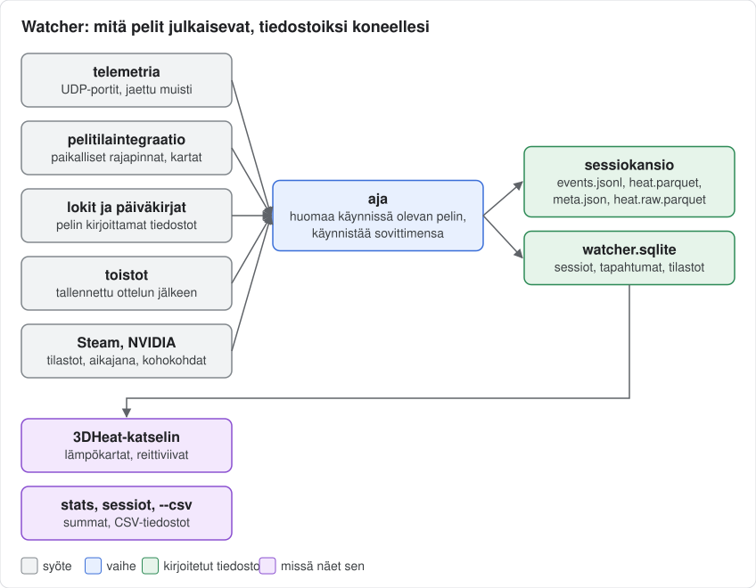
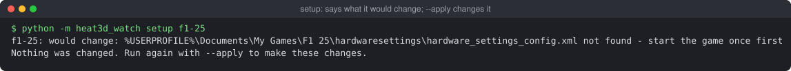
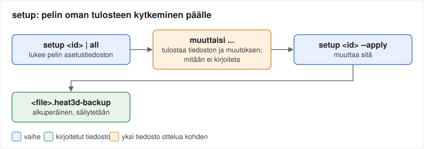
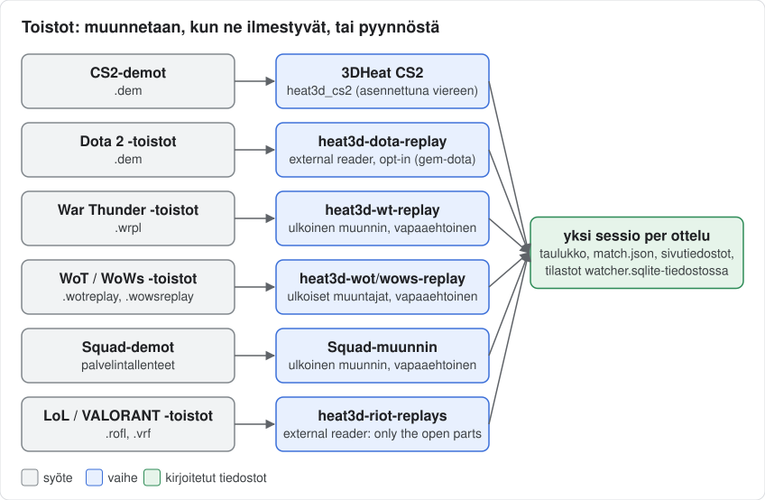
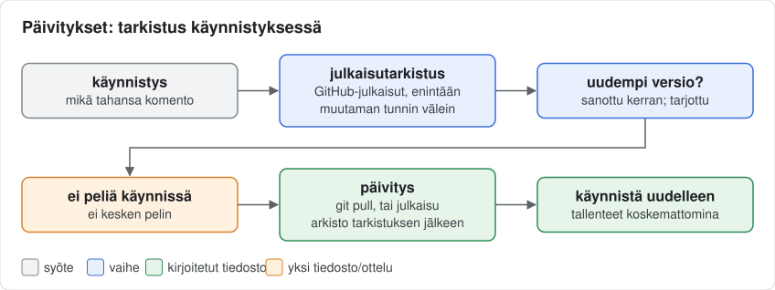

# Komennot {#commands}

Uusi komentorivin kanssa? Lue ensin [Ennen aloittamista](before-you-start.md). Jokainen komento kirjoitetaan
terminaalissa, joka on avattu kansioon, jonne purit tai kloonasit ohjelman (Resurssienhallinnassa kirjoita
osoitepalkkiin `powershell`), muodossa

```bash
python -m heat3d_watch <command> [options]
```


| Komento | Mitä se tekee |
|---|---|
| [`run`](#run) | valvoo taustalla ja tallentaa jokaisen käynnissä olevan pelin |
| [`games`](#games) | mitä kukin peli antaa ja mistä |
| [`setup`](#setup) | kytkee pelin oman tulostuksen päälle |
| [`status`](#status) | mitkä pelit ovat nyt käynnissä ja mitkä sovittimet käynnistyisivät |
| [`sessions`](#sessions) | tähän asti tehdyt tallenteet |
| [`stats`](#stats) | yhteissummat pelin mukaan tai taulukot CSV-muodossa |
| [`table`](#table) | rakentaa session `heat.parquet`-tiedoston uudelleen sen `events.jsonl`-tiedostosta |
| [`replays`](#replays) | muuntaa levyllä jo olevat replayt |
| [`dota-replay`](#dota-replay) | lataa julkisen Dota 2 -ottelun replayn sen tunnuksella |
| [`dota-map`](#dota-map) | Dota 2 -kartta asennuksestasi 3D-tasona, erillisellä 3DHeat Dota -työkalulla |
| [`update`](#update) | päivittää uusimpaan julkaisuun |
| [`config`](#config) | näyttää tai muuttaa asetukset |

Kaikille komennoille: `-h` / `--help` tulostaa ohjeen, ja `python -m heat3d_watch --version` tulostaa
version (tiedosto `VERSION`).

Tämän sivun kuvat ovat ajoja keksityillä esimerkkisessioilla (`Example Racer`, `Example Arena`), eivät
oikeilla tallenteilla.

Jokainen komento paitsi `update` katsoo ensin, onko uudempi julkaisu (enintään kerran kuudessa tunnissa;
ohitetaan asetuksella `HEAT3D_NO_UPDATE=1`, katso [Päivitykset](updates.md)). `run` tulostaa vain ilmoituksen.
Muut komennot kysyvät `Update now? [Y/n]`, kun ne ajetaan terminaalissa, ja kertovat, miten päivitetään, kun
eivät ole terminaalissa. Tuloste on UTF-8-muodossa, joten pelien nimet tulostuvat mihin tahansa kirjoitusjärjestelmään
missä tahansa konsolissa.

## run {#run}

```bash
python -m heat3d_watch run [--once] [-v]
```



Valvoo, kunnes se pysäytetään (Ctrl+C): joka `scan_seconds`-välein se lukee prosessilistan ja käynnistää
sovittimen jokaiselle löytämälleen pelille sekä aina käynnissä oleville sovittimille. Ennen ensimmäistä
tarkistusta se viimeistelee ne sessiot, jotka edellinen ajo jätti auki. Kun mikään peli ei ole käynnissä, se
voi päivittää itsensä (kun `auto_update` on päällä). Yksityiskohdat ovat kohdassa
[Asennus ja käynnistys](installing-and-running.md#running).

| Valinta | Vaikutus |
|---|---|
| `--once` | yksi tarkistus käynnissä olevista peleistä, sitten lopetus. Nyt käynnissä olevien pelien sovittimet (ja aina käynnissä olevat) käynnistetään, kukin kysyy kerran (enintään 10 sekuntia odotetaan), ja sitten kaikki pysäytetään samalla tavalla kuin pelin päättyessä: niiden sessiot suljetaan, kirjoitetaan ja lasketaan mukaan. Tarkoitettu havaitsemisen tarkistukseen, ei tallentamiseen. |
| `-v`, `--verbose` | vianetsintärivit tiedostoon `watcher.log` ja konsoliin |

`run` kirjoittaa tiedoston `<data>\watcher.lock` ja kieltäytyy käynnistymästä toisen kerran samaan datakansioon
(paluukoodi 1); katso [Lukitustiedosto](installing-and-running.md#the-lock-file).

## games {#games}

```bash
python -m heat3d_watch games [--markdown]
```


Luettelee jokaisen sovittimen pelin mukaan lajiteltuna: sen nimen, tunnuksen ja tyypin, mistä se lukee, mitä se
tallentaa ja miten se kytketään päälle. Sovitin, jota ei voi ajaa tällä koneella, on merkitty
`[unavailable: <why>]` - esimerkiksi SimConnect.dll ei löydy, Minecraft-kansiota ei ole, 3DHeat CS2 ei ole
asennettu, Steamia tai NVIDIA-sovellusta ei löydy. Sovitinmoduuli, jonka tuonti epäonnistui, nimetään lopussa
virheen kanssa.

```text
EA SPORTS F1 25  (f1-25, telemetry)
    from: UDP telemetry 127.0.0.1:20777 (Documents\My Games\F1 25\hardwaresettings\hardware_settings_config.xml)
    - every car's position (world XYZ, m) at 10 Hz, by driver name, team, own car marked, ...
    switch on: In the game: Settings > Telemetry Settings > UDP Telemetry On, IP 127.0.0.1, port 20777 - ...
```

`--markdown` tulostaa saman yhtenä Markdown-taulukkona (peli, mitä tallennetaan, mistä, miten se kytketään päälle,
verkkopeli, tarkistettu). Taulukko kohdassa [Kaikki pelit yhdessä taulukossa](watcher.md) on tämän tulostus.
Solut on escapattu Markdownia varten: backtick-koodin sisällä oleva teksti pysyy koodina, ja sen ulkopuolella
`<`, `>`, `&`, `*`, `|` ja välilyönnin edellä oleva kenoviiva kirjoitetaan niin, että ne näkyvät kuten kirjoitettiin
(`<CS2>` katoaisi muuten HTML-tägina kramdownissa). Ainoa HTML on `<br>`, joka erottaa kohdan "What is recorded"
kohdat toisistaan.

## setup {#setup}

```bash
python -m heat3d_watch setup <adapter id | all> [--apply]
```





Kytkee pelin oman tulostuksen päälle silloin, kun peli tarvitsee tiedostoon muutoksen sitä varten. Ilman
`--apply`-valintaa mitään ei muuteta: jokainen rivi kertoo, mitä muuttuisi, ja kun muutettavaa on, viimeinen
rivi sanoo `Nothing was changed. Run again with --apply to make these changes.` Kun muutettavaa ei ole, se sanoo
`<id>: nothing to change` (`Nothing to change.` kohdalle `all`). Kun `--apply` on annettu, muutokset tehdään, ja
ennen kuin tiedostoa muutetaan ensimmäisen kerran, sen alkuperäinen versio tallennetaan nimellä
`<file>.heat3d-backup`. Olemassa olevaa varmuuskopiota ei koskaan ylikirjoiteta, joten se sisältää aina tiedoston
sellaisena kuin se oli ennen kuin watcher kosketti sitä ensimmäisen kerran.

```text
f1-25: would change: hardware_settings_config.xml <udp>: enabled="false" -> "true"
Nothing was changed. Run again with --apply to make these changes.
```

`all` ajaa jokaisen sovittimen setupin, jolla sellainen on. Sovitin ilman setupia, nimettynä yksinään, tulostaa
`<id>: nothing for setup to change; ` ja perään sen, miten peli kytketään päälle (sen `enable`-teksti, tai että se ei
tarvitse mitään). Tuntematon tunnus tulostaa `no adapter '<id>'; games lists them` ja päättyy paluukoodilla 2.
Sovittimet, joilla on jotain asetettavaa:

| Sovitin | Mitä `--apply` muuttaa |
|---|---|
| `beamng` | asentaa `heat3d`-protokollamodin BeamNGin käyttäjän `mods`-kansioon (vain jos sitä ei ole); kytke sitten pelissä päälle Options > Other > Protocols > "others" |
| `cs2-gsi` | kirjoittaa `<CS2>\game\csgo\cfg\gamestate_integration_heat3d.cfg`: lähettää pelitilan osoitteeseen `http://127.0.0.1:3311/` satunnaisella tunnuksella, jonka watcher vaatii sen jälkeen (tiedostossa jo oleva tunnus säilytetään); CS2 lukee sen käynnistyessään |
| `dota2-gsi` | sama Dota 2:lle: `<Dota>\game\dota\cfg\gamestate_integration\gamestate_integration_heat3d.cfg`, portti 3312 |
| `dcs` | lisää `Scripts\Hooks\heat3d-watch.lua` jokaiseen kansioon `%USERPROFILE%\Saved Games\DCS*`. Sen oma vanhempi kopio päivitetään; saman nimisen tiedoston, jonka watcher ei kirjoittanut, jättää rauhaan. Käynnistä DCS uudelleen. |
| `dirt-rally-2` | `hardware_settings_config.xml`: `<udp enabled="true" extradata="3" ip="127.0.0.1" port="20777">`; käynnistä peli ensin kerran, jotta tiedosto on olemassa |
| `ea-wrc` | `Documents\My Games\WRC\telemetry\config.json`: `wrc`-rakenteen `session_update`-paketti päälle, tälle koneelle |
| `f1-23`, `f1-24`, `f1-25` | `hardware_settings_config.xml`: `<udp enabled="true" ip="127.0.0.1" port="20777">`; pelin on oltava suljettu |
| `hearthstone` | lisää `[Power]`-osion (`LogLevel=1`, `FilePrinting=true`) tiedostoon `%LOCALAPPDATA%\Blizzard\Hearthstone\log.config`; käynnistä peli uudelleen |
| `il2` | `<game>\data\startup.cfg`, `[KEY = telemetrydevice]`: yksi kohde lisää `addrN = "127.0.0.1:41995"` ja `enable = true` (osio lisätään 10 Hz:llä, jos sitä ei ole); käynnistä IL-2 uudelleen |
| `il2-tacview` | `<game>\data\startup.cfg`, `[KEY = track_record]`: `tacviewrecord = 1` |
| `rocketleague-stats` | `TAStatsAPI.ini` (tai `DefaultStatsAPI.ini`, jos edellistä ei ole) kansiossa `<RL>\TAGame\Config`: `PacketSendRate=30`, kun API on pois päältä, ja `Port`, kun porttia ei ole asetettu; luetaan Rocket Leaguen käynnistyessä |

`richard-burns-rally`:lla ei ole setupia: sen telemetria tulee RSF/NGP-liitännäisestä, joka kytketään päälle
käsin tiedostossa `RichardBurnsRally.ini` (katso [sen sivu](game-richard-burns-rally.md)); `setup richard-burns-rally`
kertoo tämän. Jokainen muu peli joko ei tarvitse mitään tai kytketään päälle pelissä; jokaisen pelin sivu kertoo, miten.

## status {#status}

```bash
python -m heat3d_watch status
```

```text
3DHeat Watcher 1.0.2; data in C:\Users\...\AppData\Local\3DHeat\Watcher
Games running: EA SPORTS F1 25 (f1-25)
Always on: il2-tacview, steam-stats, steam-timeline, nvidia-highlights, cs2-demos, lol-replays, valorant-replays
```

Kertoo, mitkä sovittimet `run` käynnistäisi nyt, samoilla säännöillä: pelin prosessi on käynnissä, sovitin ei ole
kohdassa `disabled`, mikään sen tarvitsema ei puutu, replay-sovittimet vain kun `replays` on päällä, muistisovittimet
vain kun `memory` on päällä ja jokainen muistitarkistus on mennyt läpi. Se ei käynnistä mitään.

## sessions {#sessions}

```bash
python -m heat3d_watch sessions [--game NAME] [--limit N]
```


Uusimmat sessiot tiedostosta `watcher.sqlite`, yksi rivi kullekin: alku (paikallinen aika), peli, minuutit,
tapahtumat, sijainnit ja kansio.

| Valinta | Vaikutus |
|---|---|
| `--game NAME` | vain tämä peli, täsmälleen luettelossa olevalla nimellä (`"EA SPORTS F1 25"`) |
| `--limit N` | enintään N sessiota (oletus 40) |

## stats {#stats}

```bash
python -m heat3d_watch stats [--game NAME] [--csv DIR]
```


Ilman valintoja: taulukko kaikista peleistä (sessiot, tunnit, tapahtumat, sijainnit, viimeksi pelattu), eniten
pelatut ensin, ja jokaiselle pelille sen 25 yleisintä tapahtumaa ja jokainen numeerinen tilasto sekä niiden
sessioiden määrä, joilla se on, summa, paras arvo (`best`) ja keskiarvo. `best` tietää, kumpi suunta on parempi:
pienin arvo ajoille, jotka pidetään parhaana aikana (`best_lap`, `best_stage` ja mikä tahansa muu avain, joka
alkaa `best_`:llä), ja sijoituksille (`race_position`, `grid_position`, jokainen avain, joka päättyy `_position`:iin);
kaikille muille (tappot, matka, huippunopeus, pelin omat laskurit) korkein.

| Valinta | Vaikutus |
|---|---|
| `--game NAME` | vain tämän pelin tapahtumat ja tilastot, ilman yleiskatsausta |
| `--csv DIR` | kirjoittaa `sessions.csv`, `events.csv` ja `stats.csv` (kaikki kolmen taulun rivit) kansioon `DIR`; `--game` ei rajaa tätä |

## table {#table}

```bash
python -m heat3d_watch table <session folder>
```


Rakentaa uudelleen `heat.parquet`-tiedoston session kansiossa sen `events.jsonl`-tiedostosta, akseleina sen
`meta.json`-tiedoston akselit. Tulostaa taulun polun tai `no positions in this session`. Käytä sitä session
kanssa, joka tallennettiin ilman `pyarrow`-pakettia, tai kun `events.jsonl` on muokattu käsin.

## replays {#replays}

```bash
python -m heat3d_watch replays <adapter id> [folder] [-v]
```



Muuntaa levyllä jo olevat replayt heti, yksi kerrallaan, ja kukin sessioksi samalla tavalla kuin kansion
valvonta tekisi. Kun watcher näkee replay-kansion ensimmäisen kerran, se vain merkitsee, mitä siinä on (katso
[Asennus ja käynnistys](installing-and-running.md#replays-already-on-disk)); näin ne muunnetaan pyynnöstä.
Ilman `folder`-argumenttia luetaan sovittimen omat kansiot (pelin omat sekä `replay_folders`); sen kanssa luetaan
replayt annetusta kansiosta. Jokainen muunnettu merkitään nähdyksi, joten käynnissä oleva watcher ei muunna sitä
uudelleen. Replay, jonka muunnos epäonnistuu, kirjataan lokiin ja ohitetaan.

| Sovitin | Replayt |
|---|---|
| `cs2-demos` | Counter-Strike 2 -demot (`*.dem`), 3DHeat CS2:n kautta |
| `lol-replays` | League of Legends -replayt (`*.rofl`), ulkoisen lukijan `heat3d-riot-replays` (3DHeat-Ext-Riot) kautta |
| `valorant-replays` | VALORANT-replayt (`*.vrf`), ulkoisen lukijan `heat3d-riot-replays` (3DHeat-Ext-Riot) kautta |
| `warthunder-replays` | War Thunder -replayt (`*.wrpl`), ulkoisen muuntimen `heat3d-wt-replay` (exporters/ext/warthunder-replay) kautta |
| `wot-replays` | World of Tanks -replayt (`*.wotreplay`), ulkoisen muuntimen `heat3d-wot-replay` (exporters/ext/wot-replay) kautta |
| `wows-replays` | World of Warships -replayt (`*.wowsreplay`), ulkoisen muuntimen `heat3d-wows-replay` (exporters/ext/wows-replay) kautta |
| `dota-replays` | Dota 2 -replayt (`*.dem`), ulkoisen lukijan `heat3d-dota-replay` (3DHeat-Ext-DotaReplay) kautta |

```text
lol-replays: converted 12 replay(s); `sessions --game` lists them
```

Tunnus, joka ei ole yksi näistä, tulostaa `no replay adapter '<id>'` luettelon kanssa ja päättyy paluukoodilla 2;
samoin `folder`, jota ei ole. Sovitin, jota ei voi ajaa täällä (3DHeat CS2 tai pelin lukija ei ole asennettu),
kertoo syyn - mistä lukijan saa ja miten se asennetaan - ja päättyy paluukoodilla 1. IL-2:n Tacview-raidat eivät ole
luettelossa: se sovitin muuntaa jokaisen valmiin raidan, jonka löytää, itse.

## dota-replay {#dota-replay}

```bash
python -m heat3d_watch dota-replay <match id> [<match id> ...] [-o FOLDER] [--convert] [-v]
```

Lataa julkisen Dota 2 -ottelun replayn Valven replay-palvelimilta. Se tarvitsee internetyhteyden. Ottelun tunnus on
numero Dota-asiakkaan ottelun sivulla (ottelun tiedot) tai OpenDotan sivulla; Valve säilyttää replayn muutaman
viikon, minkä jälkeen lataus epäonnistuu. Palvelimen ja replayn suolan saa OpenDotan ottelutiedoista
(`api.opendota.com/api/matches/<id>`, ei avainta), tiedoston osoitteesta
`replay<cluster>.valve.net/570/<id>_<salt>.dem.bz2`; se puretaan saapuessaan (Valve tarjoaa sekä bzip2- että
Zstandard-muotoa samalla nimellä) ja tallennetaan nimellä `<match id>.dem`. Ilman `-o`-valintaa se menee Dotan omaan
replay-kansioon, kun Dota 2 on asennettu - sinne käynnissä oleva watcher muuntaa sen - ja muuten kansioon
`<data>/replays/dota`. Tiedosto, joka on jo siellä, säilytetään. `--convert` muuntaa ladatut replayt heti, kuten
`replays dota-replays` tekisi, ja merkitsee ne nähdyiksi; se tarvitsee Dota 2 -replayn lukijan
([3DHeat-Ext-DotaReplay](https://github.com/Holdi601/3DHeat-Ext-DotaReplay), `heat3d-dota-replay`), ja ilman sitä
se kertoo, mistä sen saa, ja päättyy paluukoodilla 1 ennen kuin lataa mitään. Itse lataus tarvitsee vain watcherin.

```text
match 9000000000: C:\Program Files (x86)\Steam\steamapps\common\dota 2 beta\game\dota\replays\9000000000.dem
```

Valve säilyttää replayt muutaman viikon; vanhempi ottelu tulostaa `Valve no longer has the replay of match
<id>` ja päättyy paluukoodilla 1. Ottelu, jota OpenDota ei ole vielä nähnyt, ei ole suolaa: viesti kertoo pyytää
sitä OpenDotalta (`curl -X POST https://api.opendota.com/api/request/<id>`) ja yrittää muutaman minuutin
kuluttua uudelleen. Yksityiset aulat ja ottelut, joissa pelaajan profiili on piilotettu, eivät ole replay-palvelimilla lainkaan.

## dota-map {#dota-map}

```bash
python -m heat3d_watch dota-map [<map>] -o <file.glb> [--game FOLDER] [--source2viewer EXE] [--detail UNITS]
```

Kirjoittaa Dota 2 -kartan - maaperän, kalliot, vedet, puut ja rakennukset - `.glb`-tasona siinä koordinaatistossa,
johon Dota-replayn taulut piirretään, omasta Dota 2 -asennuksestasi. Watcher ei lue pelin tiedostoja itse: se ajaa
erillisen työkalun **3DHeat Dota** (`heat3d-dota-maps level`,
[3DHeat-Ext-Dota](https://github.com/Holdi601/3DHeat-Ext-Dota)) näillä valinnoilla ja välittää sen tulosteen ja
paluukoodin eteenpäin. `<map>` on oletuksena `dota`; `--game` on Dota 2:n kansio, jos se ei ole Steam-kirjastossa;
`--source2viewer` on Source2Viewerin CLI:n polku, jota se työkalu tarvitsee; `--detail` on rakennusten
vertex-klusterointisolun koko pelin yksiköissä (oletus 8, 0 säilyttää jokaisen kolmion). Kun työkalu ei ole
asennettu, se tulostaa `dota-map: the Dota 2 map converter is not installed: ...` kertoen mistä sen saa ja päättyy
paluukoodilla 2. Yksityiskohdat: [Dota 2 -kartta](dota-map.md).

## update {#update}

```bash
python -m heat3d_watch update [--check]
```



Kysyy GitHubilta uusimman julkaisun ohittaen välimuistissa olevan vastauksen ja päivittää tämän kopion, jos se on
uudempi (katso [Päivitykset](updates.md)). `--check` kertoo vain, onko uudempi julkaisu ulkona. Tämä komento toimii
silloinkin, kun `HEAT3D_NO_UPDATE` on asetettu: pyytäminen on päätös. `python -m heat3d_update [--check]` tekee
saman.

## config {#config}

```bash
python -m heat3d_watch config [--set KEY=VALUE ...]
```


Tulostaa jokaisen asetuksen muodossa `key = value`. Valinnalla `--set` se muuttaa ensin annetut asetukset ja tallentaa
tiedoston `settings.json` (`saved <path>`). Arvot luetaan asetuksen tyypin mukaan:

- totuusarvo-asetukset: `1`, `true`, `yes`, `on` tai `ja` on tosi; `0`, `false`, `no`, `off`, `nein` tai tyhjä on epätosi;
- luvut: desimaaliluku (`scan_seconds=5`);
- listat: pilkulla erotettuina tai JSON-listana (`disabled=steam-stats,steam-timeline`; tyhjä arvo tyhjentää listan);
- sanakirjat (`replay_folders`, `player_names`): koko sanakirja JSON-muodossa, tai yksi merkintä muodossa
  `KEY.ID=VALUE` - `replay_folders.cs2-demos=D:\Demos,E:\More Demos` asettaa sovittimen kansiot (pilkulla erotettuina),
  `player_names.warthunder-webmap=Name` sovittimen nimen; tyhjä arvo poistaa merkinnän;
- teksti: sellaisenaan (`data=D:\Heat`, `riot_id=Name#TAG`).

```bash
python -m heat3d_watch config --set memory=true scan_seconds=5
python -m heat3d_watch config --set riot_id=Name#TAG riot_platform=EUW1
python -m heat3d_watch config --set replay_folders.cs2-demos=D:\Demos player_names.rocketleague-stats=Name
```

Tuntematon avain tulostaa `no setting '<key>'`, ja arvo, joka ei ole asetuksen tyyppiä (`memory=perhaps`,
`scan_seconds=often`, sanakirja, joka ei ole JSON), tulostaa `not saved: ...`; molemmat päättyvät paluukoodilla 2
tallentamatta mitään. Käsin muokattu `settings.json` luetaan samalla tavalla: teksti, joka on annettu paikassa, jossa
asetus on luku, totuusarvo tai sanakirja, luetaan kirjoitetun mukaan, ja sellainen, jota ei voi lukea, jää
oletusarvoonsa. Jokainen asetus on kuvattu kohdassa [Asennus ja käynnistys](installing-and-running.md#settings).
