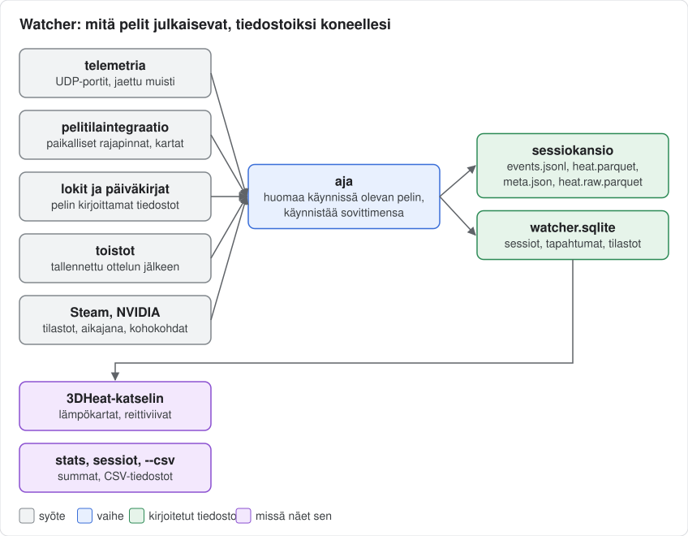

# 3DHeat Watcher {#dheat-watcher}

**Mitä se on?** Pelaat peliä. Tämä ohjelma kirjaa hiljaa ylös, minne menit ja mitä tapahtui.
Myöhemmin voit katsoa sen värillisenä karttana 3DHeat-katselimessa.

**Miksi käyttäisin sitä?** Pitääksesi oman kirjanpidon jokaisesta pelisessiosta – minne ajoit, lensit
tai taistelit, ja kokonaissummat pelikohtaisesti – ilman verkkosivustoa ja ilman että peliä muutetaan.

**Esimerkki:** ajat kierroksen kilpailupelissä, kun watcher on päällä; myöhemmin tiedosto
kansiossa `sessions\<game>\` sisältää linjan, jota ajoit, ja katselin piirtää sen.

Tarkemmin: 3DHeat Watcher on taustaohjelma, joka tallentaa sen, mitä pelit julkaisevat pelaamisestasi –
minne menit, mitä tapahtui missäkin ja niiden taustalla olevat luvut – tiedostoiksi omalle koneellesi.
Tiedostot ovat omaa tilastointiasi varten sekä 3DHeat-katselimen lämpökarttoja ja reittiviivoja varten.

Se toimii hiljaa, huomaa, mitä peliä aloitit, ja lukee sen pelin omia tulosteita: telemetriaportin tai
jaetun muistin, jonka peli julkaisee kojelautoja varten, pelitilaintegraation, pelin kirjoittaman lokin
tai päiväkirjan, ottelun jälkeen tallentamansa toiston, Steamin keräämät tilastot, NVIDIA Appin tallentamat
klipit. Tallenteet pysyvät koneellasi. Ohjelma ottaa yhteyttä ulkopuolisiin palveluihin vain näissä
tapauksissa: GitHub, uuden julkaisun etsimiseksi (katso [Päivitykset](updates.md)), ja Riotin Match-V5-rajapinta,
ja vain jos syötät oman Riot-API-avaimesi (katso [League of Legends -toistot](game-lol-replays.md)).



## Mitä se tallentaa {#what-it-records}

- **Sijainnit**: auto, lentokone, sankari tai pelaaja, useita kertoja sekunnissa siellä, missä peli ne julkaisee,
  nopeuden, suunnan ja kaiken muun, mitä peli lähettää niiden mukana.
- **Tapahtumat**: synnyt, kuolemat, tapot, kierrokset, osuudet, erät, maalit, työt, lento-onnistumiset ja
  laskeutumiset, vyöhykkeiden vaihdot, saavutukset, kohokohdat. Jokainen tapahtuma tallennetaan ajastaan ja
  paikastaan, kun peli sen antaa.
- **Tilastot sessiota kohden**: tapot, kuolemat, kierrokset, paras kierros, matka, huippunopeus, pelitunnit
  ja pelin omat tilastot siellä, missä peli niitä pitää.

Mitä kukin peli antaa ja mistä, on omalla sivullaan kohdassa [Pelit](games.md). Yksi lähde ei voi tallentaa
kaikkea: moninpelejä tallennetaan vain niiden julkaisemien tietojen kautta, eikä watcher lue niiden muistia
koskaan (katso [Lähteet ja säännöt](sources-and-rules.md)).

## Asennus {#install}

Uusi komentorivin kanssa? Lue ensin [Ennen aloittamista](before-you-start.md).

Watcher on Python-ohjelma Windowsille (Python 3.10 tai uudempi). Monet sen lähteistä ovat vain Windowsissa:
jaettu muisti, rekisteri, Windowsin ilmoitukset.

```bash
git clone https://github.com/Holdi601/3DHeat-Watcher.git
cd 3DHeat-Watcher
pip install -r requirements.txt
```

Julkaisuarkisto toimii samalla tavalla: pura se ja aja `pip install -r requirements.txt`
kansiossa. Yksityiskohdat ja joidenkin pelien tarvitsemat lisät ovat kohdassa
[Asennus ja ajo](installing-and-running.md).

## Pikaohje {#quick-start}

```bash
python -m heat3d_watch games            # mitä kukin peli antaa ja mistä
python -m heat3d_watch setup all        # mitä pitäisi kytkeä päälle (mitään ei muuteta)
python -m heat3d_watch setup f1-25 --apply   # kytke yhden pelin tuloste päälle (alkuperäinen tiedosto varmuuskopioidaan)
python -m heat3d_watch run              # tallenna; jätä päälle pelatessasi
python -m heat3d_watch stats            # summat pelikohtaisesti
python -m heat3d_watch stats --csv out  # sessiot, tapahtumat ja tilastot CSV-tiedostoina
```

Pitäisi näkyä: `games`-komennon jälkeen taulukko, jossa on yksi rivi per peli; `run` jatkuu, kunnes painat
Ctrl+C tai suljet ikkunan.

Kaikki kirjoitetaan kansioon `%LOCALAPPDATA%\3DHeat\Watcher`. Jos haluat toisen kansion, aseta ympäristömuuttuja
`HEAT3D_WATCH_HOME` tai aja `python -m heat3d_watch config --set data=D:\somewhere`.

- `sessions\<game>\<date>_<adapter>\` – yksi kansio per pelisessio, joka sisältää `events.jsonl` (jokainen
  tapahtuma sitä mukaa kun se tapahtuu), `heat.parquet` (rivit, joilla on sijainti, valmiina 3DHeat-katselimelle)
  ja `meta.json` (peli, lähde, akselit, lukumäärät, tilastot)
- `watcher.sqlite` – jokaisen session tilastot kolmessa tavallisessa taulussa
- `watcher.log` – mitä watcher teki

Katselin avaa session `heat.parquet`-tiedoston suoraan, ilman asetuksia (sen akselit ja yksiköt ovat tiedostossa).
Muunnetut toistot kirjoitetaan taulukoina ja ottelun asiakirjoina sen viereen. Katselimen oma yhden ottelun
yhden tiedoston muoto on kuvattu sen [`.3dheat`-säiliö](https://holdi601.github.io/3DHeat/container.html)-sivulla,
ja jokaisen taulukon sarakkeet kohdassa [Tiedot](the-data.md).

## Dokumentaatio {#the-documentation}

| Sivu | Mitä se kattaa |
|---|---|
| [Ennen aloittamista](before-you-start.md) | Python, pääte, paikanpitäjät, miltä onnistuminen ja yleiset virheet näyttävät |
| [Asennus ja ajo](installing-and-running.md) | vaatimukset, ajo taustalla, käynnistys Windowsin mukana, lukitustiedosto, loki, jokainen asetus ja ympäristömuuttuja |
| [Pelit](games.md) | sivu per peli: mitä tallennetaan, mistä, miten se kytketään päälle, miten se toimii, akselit, tilastot, mitä on todennettu |
| [Tiedot](the-data.md) | sessiokansiot, `events.jsonl`, `heat.parquet` ja sen alatunniste, `meta.json`, `watcher.sqlite`, palautuminen kaatumisen jälkeen, CSV-vienti, session avaaminen 3DHeat-katselimessa |
| [Komennot](commands.md) | jokainen komento ja asetus `python -m heat3d_watch` -komennolle |
| [Lähteet ja säännöt](sources-and-rules.md) | kuusi lähdetyyppiä, moninpelisäännöt, mitkä pelit jätetään pois ja miksi |
| [NVIDIA Highlights](nvidia-highlights.md) | mitä NVIDIA Highlights voi ja ei voi toimittaa, ja miten kohokohta saa sijainnin |
| [Palvelinrekorderimodit](server-mods.md) | Arma 3 ja Arma Reforger -palvelinmodit, jotka tallentavat koko tehtävät katselimelle |
| [Muistin lukeminen](memory-reading.md) | yksinpelin muistiprofiilit: muoto, tarkistukset, miten profiili kirjoitetaan ja varmistetaan |
| [Päivitykset](updates.md) | miten watcher etsii uusia julkaisuja ja päivittää itsensä |
| [Kehitys](development.md) | adapterin kirjoittaminen: rajapinta, testit, rehellinen `verified`, pelisivujen uudelleenluonti |
| [Kaikki pelit yhdessä taulukossa](watcher.md) | jokainen peli yhdessä taulukossa, kuten `games --markdown` sen tulostaa, sekä tutkitut mutta vielä rakentamattomat pelit |
| [Komentoviite](../cli-reference.md) | jokaisen komennon `--help`, luotu koodista |
| [Ylläpito](maintaining.md) | julkaisun tarkistuslista näille sivuille |

## Osa 3DHeatia {#part-of-3dheat}

3DHeat Watcher on yksi 3DHeat-katselimen ympärillä olevista ilmaisista työkaluista (watcher käyttää 3DHeat CS2:ta
CS2-demojen muuntamiseen). Jokainen on oma projektinsa, omilla julkaisuillaan ja lisenssillään:

| Työkalu | Mitä se tekee | Dokumentaatio |
|---|---|---|
| [3DHeat](https://github.com/Holdi601/3DHeat) | katselin: lämpökartat, kilpa-analyysi ja ottelun tarkastelu 3D:nä | [sivusto](https://holdi601.github.io/3DHeat/) |
| [GameFiles](https://github.com/Holdi601/3DHeat-GameFiles) | radat ja kentät pelien toimittamista tiedostoista 3D-malleina | [sivusto](https://holdi601.github.io/3DHeat-GameFiles/) |
| [GameCapture](https://github.com/Holdi601/3DHeat-GameCapture) | kierrosten telemetria kilpailupeleistä; kentät rakennettu pelivideosta | [sivusto](https://holdi601.github.io/3DHeat-GameCapture/) |
| [Unreal Exporter](https://github.com/Holdi601/3DHeat-UnrealExporter) | Unreal Editor -liitännäinen, joka vie kentän yhtenä 3D-mallina | [sivusto](https://holdi601.github.io/3DHeat-UnrealExporter/) |
| [CS2](https://github.com/Holdi601/3DHeat-CS2) | Counter-Strike 2 -demot taulukoiksi ja ottelutiedostoiksi; kartat 3D-malleiksi | [sivusto](https://holdi601.github.io/3DHeat-CS2/) |
| [Watcher](https://github.com/Holdi601/3DHeat-Watcher) | tallentaa pelaamisesi taustalla pelien julkaisemasta datasta | [sivusto](https://holdi601.github.io/3DHeat-Watcher/) |
| [Ext-WarThunder](https://github.com/Holdi601/3DHeat-Ext-WarThunder) | War Thunder -tallenteet taulukoiksi ja ottelutiedostoiksi | [sivusto](https://holdi601.github.io/3DHeat-Ext-WarThunder/) |
| [Ext-WoT](https://github.com/Holdi601/3DHeat-Ext-WoT) | World of Tanks -tallenteet taulukoiksi ja ottelutiedostoiksi | [sivusto](https://holdi601.github.io/3DHeat-Ext-WoT/) |
| [Ext-WoWs](https://github.com/Holdi601/3DHeat-Ext-WoWs) | World of Warships -tallenteet taulukoiksi ja ottelutiedostoiksi | [sivusto](https://holdi601.github.io/3DHeat-Ext-WoWs/) |
| [Ext-Squad](https://github.com/Holdi601/3DHeat-Ext-Squad) | Squad-palvelindemot taulukoiksi ja ottelutiedostoiksi | [sivusto](https://holdi601.github.io/3DHeat-Ext-Squad/) |
| [Ext-DCS](https://github.com/Holdi601/3DHeat-Ext-DCS) | DCS World -kartat 3D-malleiksi | [sivusto](https://holdi601.github.io/3DHeat-Ext-DCS/) |
| [Ext-IL2](https://github.com/Holdi601/3DHeat-Ext-IL2) | IL-2 Sturmovik -kartat 3D-malleiksi | [sivusto](https://holdi601.github.io/3DHeat-Ext-IL2/) |
| [Ext-Dota](https://github.com/Holdi601/3DHeat-Ext-Dota) | Dota 2 -kartta omasta asennuksestasi 3D-kenttänä | [sivusto](https://holdi601.github.io/3DHeat-Ext-Dota/) |
| [Ext-DotaReplay](https://github.com/Holdi601/3DHeat-Ext-DotaReplay) | Dota 2 -tallenteet | [sivusto](https://holdi601.github.io/3DHeat-Ext-DotaReplay/) |
| [Ext-Riot](https://github.com/Holdi601/3DHeat-Ext-Riot) | League of Legends- ja VALORANT-tallenteet (mitä ne sisältävät salaamattomana) | [sivusto](https://holdi601.github.io/3DHeat-Ext-Riot/) |
| [Ext-Forza](https://github.com/Holdi601/3DHeat-Ext-Forza) | Forza-radat, kisat ja autot omasta asennuksestasi | [sivusto](https://holdi601.github.io/3DHeat-Ext-Forza/) |
| [Ext-Battlefield](https://github.com/Holdi601/3DHeat-Ext-Battlefield) | Battlefield-kentät (Frostbite) 3D-kenttinä | [sivusto](https://holdi601.github.io/3DHeat-Ext-Battlefield/) |
| [Ext-BeamNG](https://github.com/Holdi601/3DHeat-Ext-BeamNG) | BeamNG.drive -radat | [sivusto](https://holdi601.github.io/3DHeat-Ext-BeamNG/) |
| [Ext-ACRally](https://github.com/Holdi601/3DHeat-Ext-ACRally) | Assetto Corsa Rally -osuudet radoiksi | [sivusto](https://holdi601.github.io/3DHeat-Ext-ACRally/) |
| [Ext-Reforger](https://github.com/Holdi601/3DHeat-Ext-Reforger) | Arma Reforger -maailmat (Enfusion) 3D-kenttinä | [sivusto](https://holdi601.github.io/3DHeat-Ext-Reforger/) |
| [Ext-R6](https://github.com/Holdi601/3DHeat-Ext-R6) | Rainbow Six Siege -ottelutallenteet | [sivusto](https://holdi601.github.io/3DHeat-Ext-R6/) |

Jokainen pelinlukija on oma pieni projektinsa, jolla on oma lisenssitiedosto, omat julkaisut ja oma
vianseuranta, joten sen voi asentaa, päivittää, ylläpitää - tai vetää pois oikeudenhaltijan pyynnöstä -
erikseen ilman, että se vaikuttaa katselimeen tai muihin työkaluihin.

Lisenssi: MIT ([LICENSE](https://github.com/Holdi601/3DHeat-Watcher/blob/main/LICENSE)). Käyttämiensä kolmansien
osapuolten pakettien lisenssit ja huomautus, ettei sen mukana toimiteta mitään peleistä on lueteltu tiedostossa
[LICENSES.md](https://github.com/Holdi601/3DHeat-Watcher/blob/main/LICENSES.md).
