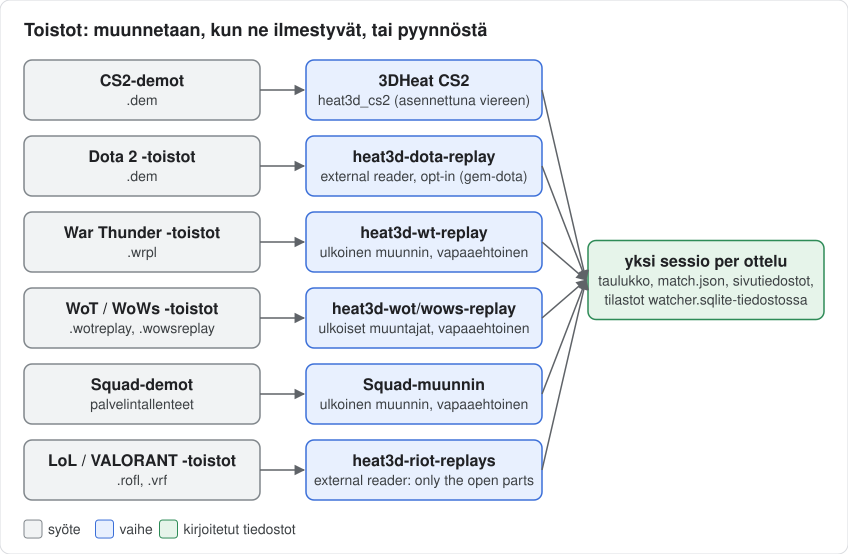

# Asennus ja käynnistys {#installing-and-running}

## Vaatimukset {#requirements}

- **Windows.** Watcher on kirjoitettu Windowsille, ja useimmat sen lähteistä ovat olemassa vain siellä: pelien luoma jaettu
  muisti (`Local\...`-kartoitukset), rekisteri (josta Steam löytyy), Windowsin ilmoitukset, prosessilista suoritettavien
  tiedostojen poluilla. Muussa järjestelmässä ohjelma käynnistyy, mutta nuo lähteet eivät löydä mitään, ilmoitukset vain
  kirjataan lokiin, ja muistin lukeminen kieltäytyy ("only implemented on Windows").
- **Python 3.10 tai uudempi**, osoitteesta <https://www.python.org/downloads/>: ruksaa asennusohjelmassa **Add python.exe to PATH**,
  ja tarkista komennolla `python --version` uudessa terminaalissa. Uusi tähän? Lue ensin [Ennen aloittamista](before-you-start.md).
- **Paketit** (`requirements.txt`): `psutil>=6.0` (mitkä pelit ovat käynnissä, mikä ohjelma pitää porttia, pelin yhteydet;
  vanhempi psutil toimii edelleen vanhemmalla nimellään prosessin yhteyksille), `pyarrow>=15` (`heat.parquet`-tiedoston
  kirjoittaminen), `numpy>=1.24`, ja `pytest>=8.0` testejä varten. `requirements-optional.txt` ei tällä hetkellä listaa paketteja.

Ilman `pyarrow`-pakettia sessiot tallennetaan silti: `events.jsonl` on tallenne, ja taulun voi rakentaa myöhemmin
komennolla [`table`](commands.md#table).

### Joillekin peleille tarvittavat lisäosat {#extras-some-games-need}

| Peli | Mitä se tarvitsee |
|---|---|
| Counter-Strike 2 -demot | [3DHeat CS2](https://github.com/Holdi601/3DHeat-CS2) ja sen riippuvuudet (`demoparser2`). Watcher etsii sitä muuttujasta `HEAT3D_CS2`, sitten kansiosta `3DHeat-CS2` tai `cs2` watcherin oman kansion vierestä, sitten mistä tahansa paikasta, mistä Python osaa tuoda `heat3d_cs2`:n. Ilman sitä `games` listaa sovittimen saatavilla olemattomana. |
| Microsoft Flight Simulator 2020 / 2024 | `SimConnect.dll` - ei mukana. MSFS 2020:ssä sellainen on asennuskansiossa; MSFS 2024:lle asenna MSFS 2024 SDK. `MSFS_SDK` / `MSFS2024_SDK` osoittavat SDK-kansioon. |
| Euro Truck Simulator 2, American Truck Simulator | RenCloudin `scs-telemetry.dll`-liitännäinen (revisio 12) kansioon `<game>\bin\win_x64\plugins` |
| BeamNG.drive | `heat3d`-protokollamodi, jonka asentaa `python -m heat3d_watch setup beamng --apply` |
| League of Legends (live) | valinnainen: Riotin juurisertifikaatti tiedostona `<data>\riotgames.pem`, jotta paikallinen yhteys vahvistetaan |
| Minecraft | kansio `%APPDATA%\.minecraft` (Java Edition) |

Jokaisen pelin sivu kohdassa [Pelit](games.md) kertoo, mikä on kytkettävä päälle itse pelissä.
`python -m heat3d_watch games` merkitsee sovittimen `[unavailable: ...]`, kun jotain sen tarvitsemaa puuttuu tältä koneelta.

## Asennus {#installing}

Uusi komentoriville? Lue ensin [Ennen aloittamista](before-you-start.md). Jos `pip`-komentoa ei löydy, käytä sen sijaan
`python -m pip install -r requirements.txt`.

Kloonatusta kopiosta:

```bash
git clone https://github.com/Holdi601/3DHeat-Watcher.git
cd 3DHeat-Watcher
pip install -r requirements.txt
```

Julkaisusta: lataa arkisto repositorion julkaisuista, pura se ja aja sitten `pip install -r requirements.txt` kansion sisällä.
Molemmat kopiot päivittävät itsensä (katso [Päivitykset](updates.md)).

Aja jokainen komento repositorion kansiosta: `python -m heat3d_watch` tuo paketin sieltä, ja päivittäjä (`heat3d_update`) on
sen vieressä.

## Käynnistys {#running}

```bash
python -m heat3d_watch run        # watch until stopped
python -m heat3d_watch run -v     # the same, with debug lines in the log
python -m heat3d_watch run --once # one look at the games running now, then stop and exit
```

Käynnistyessään `run`:

1. kirjoittaa [lukitustiedoston](#the-lock-file);
2. viimeistelee sessiot, jotka edellinen ajo jätti auki, esimerkiksi kaatumisen jälkeen
   (katso [Palautus](the-data.md#recovery-after-a-crash));
3. lukee joka `scan_seconds`-välein (2 s) prosessilistan (vain nimet ja polut, prosessia ei avata) ja käynnistää sovittimen,
   omassa säikeessään, jokaiselle löytämälleen pelille. Kun pelin prosessi on poissa, sen sovitin pysäytetään ja sen auki olevat
   sessiot suljetaan, jolloin niiden taulu kirjoitetaan ja niiden rivi tilastoihin. Sovittimet, jotka eivät odota peliä (Steamin
   tilastot, Steam Timeline, NVIDIA-kohokohdat, replay-kansiot), ovat käynnissä koko ajan;
4. kun mikään peli ei ole käynnissä, tarkistaa uudemman julkaisun enintään kerran tunnissa (vastaus itsessään on välimuistissa
   kuusi tuntia) ja, kun `auto_update` on päällä, asentaa sen ja käynnistää itsensä uudelleen (katso [Päivitykset](updates.md)).

Sovitin, joka epäonnistuu, kirjataan lokiin, eikä se pysäytä muita. Jos sovittimen kysely epäonnistuu 20 kertaa peräkkäin,
tai sen käynnistys epäonnistuu, sovitin pysäytetään eikä sitä käynnistetä uudelleen, ennen kuin peli käynnistetään uudelleen
(uusi prosessin tunnus).

Pysäytä watcher painamalla Ctrl+C. Sovittimet sulkevat sessionsa ennen kuin se poistuu. Jos watcher tapetaan
(Tehtävienhallinta, kaatuminen, sähkökatko), mikään jo kirjoitettu ei katoa: seuraava `run` viimeistelee nuo sessiot.

`--once` ottaa yhden katsauksen: se käynnistää sovittimet nyt käynnissä oleville peleille (ja aina käynnissä oleville), antaa
kunkin kysyä kerran - odottaen enintään 10 sekuntia - ja pysäyttää ne sitten samalla tavalla kuin pelin päättyminen tekisi,
joten niiden avaamat sessiot suljetaan, niiden taulut kirjoitetaan ja niiden rivit lasketaan tilastoihin ennen poistumista.
Käytä sitä tarkistamaan, että peli havaitaan, ei tallentamiseen.

### Levyllä jo olevat replayt {#replays-already-on-disk}



Kun replay-sovitin näkee yhden kansioistaan ensimmäisen kerran, se vain merkitsee siinä jo olevat replayt: pelaaja, jolla on
vuosien demot, huomaisi muuten watcherin kiireisenä muuntamassa päivän ajan. Siitä eteenpäin jokainen uusi replay muunnetaan
kerran, kun peli on kirjoittanut sen valmiiksi. Vanhat muunnetaan pyynnöstä komennolla [`replays`](commands.md#replays):

```bash
python -m heat3d_watch replays cs2-demos              # every demo in CS2's folders and replay_folders
python -m heat3d_watch replays lol-replays D:\Old     # the replays in one folder
```

### Ajaminen taustalla {#running-in-the-background}

Watcherilla ei ole omaa ikkunaa; se on konsoliohjelma, joka toimii, kunnes se pysäytetään. Se kirjoittaa kaiken tiedostoon
`watcher.log`, joten se ei tarvitse näkyvää konsolia. Tapoja pitää se poissa tieltä:

- käynnistä se konsolissa ja pienennä konsoli: `start "" /min python -m heat3d_watch run` komentokehotteesta
  repositorion kansiossa;
- käynnistä se ilman konsolia: `pythonw -m heat3d_watch run`. Konsolin tuloste katoaa, mutta `watcher.log` kirjoitetaan
  silti. Pysäyttääksesi, lopeta `pythonw.exe`-prosessi; seuraava käynnistys viimeistelee sessiot, jotka se jätti auki.
  Projekti ei ole testannut tätä tapaa ajaa.

### Käynnistys Windowsin mukana (idea) {#starting-with-windows-an-idea}

Watcher ei asenna itseään käynnistymään Windowsin mukana. Käynnistääksesi sen automaattisesti:

- **Tehtävien ajoitus**: luo tehtävä, jonka laukaisin on *At log on* ja toiminto *Start a program*, ohjelma `pythonw.exe`
  (tai `python.exe`), argumentit `-m heat3d_watch run`, *Start in* asetettuna repositorion kansioon;
- **Käynnistyskansio**: aseta pikakuvake kohteeseen `shell:startup` samalla ohjelmalla, argumenteilla ja *Start in* -kansiolla.

Kumpikaan ei ole osa watcheria, eikä watcher testaa niitä. [Lukitustiedosto](#the-lock-file) varmistaa, että tahattomasti
toisen kerran käynnistetty kopio poistuu heti.

## Lukitustiedosto {#the-lock-file}

`<data>\watcher.lock` sisältää käynnissä olevan watcherin prosessin tunnuksen. Kun `run` käynnistyy ja lukitustiedosto
nimeää prosessin, joka on yhä olemassa ja jonka nimi sisältää `python`, se tulostaa

```text
A watcher is already running (process 12345) for C:\Users\...\3DHeat\Watcher.
```

ja poistuu paluukoodilla 1. Kaksi watcheria samassa datakansiossa tallentaisi jokaisen pelin kahdesti, ja toinen pitäisi
ensimmäisen ajon auki jääneitä sessioita kaatumisen jäänteinä. Lukitustiedosto, jonka prosessi on poissa tai kuuluu toiselle
ohjelmalle, korvataan. Kun `run` päättyy, se poistaa lukitustiedoston, jos tiedosto yhä nimeää sen oman prosessin.

## Loki {#the-log}

`<data>\watcher.log` kirjoittaa vain `run`; muut komennot tulostavat konsoliin. Jokaisella rivillä on aika, taso ja viesti:

```text
2026-05-01 20:15:01,123 INFO watching; data in C:\Users\...\AppData\Local\3DHeat\Watcher
2026-05-01 20:15:03,456 INFO f1-25: starting (EA SPORTS F1 25)
2026-05-01 21:02:11,789 INFO f1-25: stopping
```

Sovittimet kirjaavat, mitä ne eivät voi tehdä ja miksi: "UDP 20777 is in use by ...; not taking it from that program",
"not reading memory: the game is played online", "could not start", "poll failed (3)" kutsupinon kanssa. `run -v` lisää
vianetsintärivit. Watcher ei koskaan kierrätä tai tyhjennä tiedostoa, vaan lisää siihen; poista se milloin tahansa.
Samat rivit menevät myös konsoliin.

## Missä kaikki on {#where-everything-is}

Kotikansio on `%LOCALAPPDATA%\3DHeat\Watcher`, tai `HEAT3D_WATCH_HOME`, kun se on asetettu (ilman `LOCALAPPDATA`-muuttujaa,
esimerkiksi toisessa järjestelmässä, `~/.local/share/3DHeat/Watcher`). `settings.json` on aina kotikansiossa. Kaikki muu
menee datakansioon, joka on kotikansio, ellei `data`-asetus nimeä toista:

| Polku | Mitä se on |
|---|---|
| `<home>\settings.json` | asetukset |
| `<data>\sessions\` | tallenteet, yksi kansio kutakin istuntoa kohden ([Tiedot](the-data.md)) |
| `<data>\watcher.sqlite` | tilastotietokanta |
| `<data>\watcher.log` | `run`:n loki |
| `<data>\watcher.lock` | lukitustiedosto, kun `run` on käynnissä |
| `<data>\state\` | mitä aina päällä olevat ja replay-sovittimet ovat jo nähneet (`steam-stats.json`, `replays-cs2-demos.json`, ...), joten uudelleenkäynnistys ei tallenna mitään kahdesti |
| `<data>\profiles\*.json` | muistiprofiilit, jotka kirjoitit ([Muistin lukeminen](memory-reading.md)) |
| `<data>\riotgames.pem` | valinnainen, Riotin juurisertifikaatti League of Legendsin live-sovittimelle |
| `%LOCALAPPDATA%\3DHeat\update-check-3DHeat-Watcher.json` | viimeisimmän julkaisutarkistuksen välimuistissa oleva vastaus |

Watcher ei poista mitään näistä kansioista, paitsi sessiokansion, johon ei tallennettu mitään (peli, joka jäi valikkoihinsa).

## Asetukset {#settings}


`python -m heat3d_watch config` näyttää asetukset; `config --set key=value ...` muuttaa ne ja tallentaa tiedoston
`settings.json` (katso [config](commands.md#config)). Tiedosto on tavallista JSONia, ja sen voi muokata käsin, kun watcher ei
ole käynnissä. Tuntemattomat avaimet siinä jätetään huomiotta. Asetukset luetaan, kun komento käynnistyy, joten käynnistä
`run` uudelleen muutosten jälkeen.

| Asetus | Oletus | Mitä se tekee |
|---|---|---|
| `data` | `""` | Datakansio. Tyhjä: kotikansio. |
| `disabled` | `[]` | Sovittimien tunnukset, jotka eivät koskaan käynnisty, esimerkiksi `config --set disabled=steam-stats,nvidia-highlights`. Jokainen muu sovitin käynnistyy, kun se löytää pelinsä. |
| `auto_update` | `true` | Kun mikään peli ei ole käynnissä, asentaa uudemman julkaisun ja käynnistää uudelleen (katso [Päivitykset](updates.md)). `false`: vain ilmoitus lokiin. |
| `scan_seconds` | `2.0` | Sekunteja prosessilistan tarkistusten välillä. |
| `memory` | `false` | Sallii muistisovittimien (yksinpelattavat pelit, joilla on sinun kirjoittamasi profiili) käynnistymisen. Oletuksena pois; katso [Muistin lukeminen](memory-reading.md). |
| `replays` | `true` | Käynnistää `replay`-sovittimet: kaikki (katso `python -m heat3d_watch replays` ja [Pelit](games.md)) - CS2-demot, Dota 2, War Thunder, World of Tanks, World of Warships, Squad, League of Legendsin ja VALORANTin replayt, IL-2:n Tacview-tallenteet. |
| `replay_folders` | `{}` | Ylimääräiset kansiot sovittimen tunnuksen mukaan, esimerkiksi `{"cs2-demos": ["D:\\Demos"]}`. Replay-sovittimet valvovat niitä pelin omien kansioiden lisäksi; `il2-tacview` hyväksyy myös asennuskansiot (silloin se etsii niiden `data\Tracks`-kansiota); `elite`:lle ensimmäinen kansio korvaa journal-kansion. Yhden sovittimen kansiot asetetaan komennolla `config --set replay_folders.cs2-demos=D:\Demos,E:\More`, tai koko sanakirja JSONina. |
| `riot_id` | `""` | Riot ID (`Name#TAG`), jotta oma rivisi League of Legends -replayssa tulee tilastoihisi. Tyhjä: jokaisen pelaajan rivi säilytetään, mitään ei merkitä omaksi. |
| `riot_api_key` | `""` | Oma Riotin kehittäjä-API-avaimesi, jolla haetaan jokaisen replayn League-ottelun virallinen aikajana (sijainnit joka minuutti, tappot siellä, missä ne tapahtuivat). Tyhjä: mitään ei haeta. |
| `riot_platform` | `"EUW1"` | League-palvelimesi alustatunnus (`EUW1`, `EUN1`, `NA1`, `KR`, ...), jota käytetään alueellisen Match-V5-palvelimen löytämiseen. |
| `player_names` | `{}` | Nimesi peleissä, joiden käyttöliittymä nimeää jokaisen pelaajan mutta ei kerro, kuka olet, sovittimen tunnuksen mukaan: `warthunder-webmap` (tappo-syötteen rivit sinusta tulevat omiksi tapoiksesi ja kuolemiksesi) ja `rocketleague-stats` (rivisi tulevat `me`:ksi; ilman sitä pelaaja, jota pelin kamera seuraa). Aseta komennolla `config --set player_names.warthunder-webmap=Name`. |

`settings.json` kaikilla oletuksilla:

```json
{
  "data": "",
  "disabled": [],
  "auto_update": true,
  "scan_seconds": 2.0,
  "memory": false,
  "replays": true,
  "replay_folders": {},
  "riot_id": "",
  "riot_api_key": "",
  "riot_platform": "EUW1",
  "player_names": {}
}
```

## Ympäristömuuttujat {#environment-variables}

| Muuttuja | Vaikutus |
|---|---|
| `HEAT3D_WATCH_HOME` | kotikansio (asetukset, ja data, ellei `data` sano muuta) |
| `HEAT3D_NO_UPDATE` | mikä tahansa arvo paitsi tyhjä, `0`, `false` tai `no` kytkee julkaisutarkistuksen ja automaattipäivityksen pois |
| `HEAT3D_NO_TOAST` | mikä tahansa ei-tyhjä arvo: ei Windowsin ilmoituksia, vain lokirivit |
| `HEAT3D_CS2` | 3DHeat CS2:n kansio, CS2-demoille |
| `HEAT3D_CS2_GSI_PORT` | CS2:n pelitilaportti (oletus 3311); `setup` kirjoittama cfg-tiedosto käyttää sitä |
| `HEAT3D_DOTA_GSI_PORT` | Dota 2:n pelitilaportti (oletus 3312) |
| `MSFS_SDK`, `MSFS2024_SDK` | MSFS SDK -kansiot, joista `SimConnect SDK\lib\SimConnect.dll` etsitään |

Windowsin ilmoituksia käytetään vain päivityksiin: "Updating to 1.2.0", tai "1.2.0 is out; not updated: ..." kun päivitystä
ei voitu asentaa. Ne näytetään PowerShellin oman ilmoitusrajapinnan kautta, joten mitään ei tarvitse asentaa. Otsikko ja teksti
annetaan PowerShellille ympäristömuuttujina, ei koskaan osana skriptiä.
