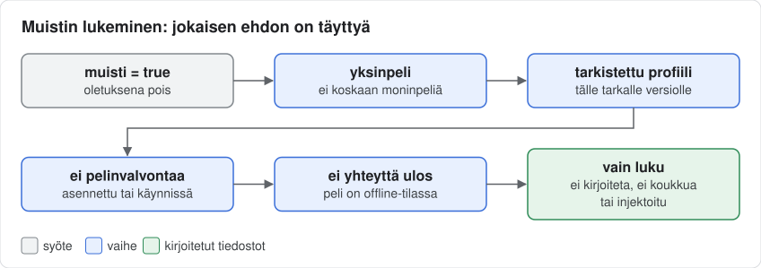

# Muistin lukeminen {#reading-memory}

Jotkin yksinpelit eivät kerro mitään muille ohjelmille. Niille watcher voi - jos kytket sen päälle ja kirjoitat itse
profiilin - etsiä, missä olet pelin muistissa, vain luku -tilassa.

Yksinpeleille, jotka eivät julkaise mitään, watcher voi lukea sijainteja ja arvoja pelin muistista **profiilin** kautta,
jonka kirjoitat oman pelisi versiolle. Kaikista lähteistä tämä on ainoa, jota peli ei antanut ulos, joten se on suojattu
enemmän kuin muut:

- se on **oletuksena pois päältä** (`python -m heat3d_watch config --set memory=true` kytkee sen päälle);
- se lukee, eikä sillä ole mitään tapaa kirjoittaa;
- **profiileja ei toimiteta työkalujen mukana.**

Profiileja ei toimiteta, koska offsetti on oikein vain sille versiolle, jolla se löydettiin. Päivityksen jälkeen profiili,
joka oli ennen oikein, lukee roskaa, ja roska näyttää aivan numeroilta. Profiili on tarkistettava pelaajan omassa
versiossa, pelaajan itse.

## Tarkistukset järjestyksessä {#the-checks-in-order}



Jokaisen alla olevan tarkistuksen on mentävä läpi. Neljä ensimmäistä tehdään **ennen** kuin peliä avataan, koska suojatun pelin
avaaminen lukua varten on sinällään se, minkä huijaamisen vastainen järjestelmä huomaa, ja kieltäytyminen jälkikäteen olisi
liian myöhäistä.

1. **Asetus**: `memory` on tosi. Muuten muistisovittimia ei koskaan käynnistetä.
2. **Profiili pelille**, jonka `exe` nimeää käynnissä olevan prosessin. Profiili kertoo, voiko peliä pelata verkossa ollenkaan
   (`"online"`); profiili, joka jättää tämän pois, hylätään.
3. **Ei huijauksenestoa missään lähellä**:
   - ei huijauksenestotiedostoa pelin kansiossa eikä enintään kolme kansiota sen yläpuolella (pysähtyen Steam-kirjaston
     `common`-kansioon tai kansioon, jossa on `steamapps`, koska muut pelit ovat sen yläpuolella): `EasyAntiCheat`,
     `EasyAntiCheat_EOS_Setup.exe`, `start_protected_game.exe`, `BattlEye`, `BEClient_x64.dll`, `BEService_x64.exe`,
     `EAAntiCheat.GameServiceLauncher.exe`, `AntiCheatExpert`, `SGuard64.exe`, `GameGuard`, `GameMon.des`, `XIGNCODE`,
     `xhunter1.sys`, `Vanguard`, `FACEIT` (verrataan pienillä kirjaimilla, myös nimen alkuun). Jos pelin kansio ei ole tiedossa,
     peli hylätään;
   - ei huijauksenestoajuria tai -palvelua, joka pyörii koneella ollenkaan, kuten `sc query type= driver state= active` ja
     `sc query type= service state= active` listaavat: EasyAntiCheat, EasyAntiCheat_EOS, BEService, BEDaisy, vgk, vgc, ACE-BASE,
     ACE-GAME, xhunter1, FACEIT, FACEITService, EAAntiCheatService, Denuvo Anti-Cheat, npggsvc, Ricochet. Muuhun peliin
     asennettu kernel-tason huijauksenesto valvoo yhä jokaista prosessia. Jos palveluita ei voida listata, peli hylätään.
4. **Ei verkossa**: peliä, jonka profiili sanoo `"online": true`, luetaan vain silloin, kun sillä ei ole yhteyttä mihinkään muuhun
   kuin tähän koneeseen (mikään etäosoite muu kuin `127.x`, `::1`). Jos sen yhteyksiä ei voida lukea, se hylätään.
5. Sitten, kun sovitin käynnistyy:
   - **tarkka versio**: suoritettavan tiedoston koon tai SHA-256:n on täsmättävä jonkin profiilin listaaman version kanssa. Tuntematonta
     versiota ei lueta;
   - **moduulit vielä kerran**: pelin ladatut moduulit listataan (Toolhelp-kuvaus, joka ei pyydä omia käyttöoikeuksia) ja tarkistetaan
     huijauksenestoasiakkaan varalta (`BEClient_x64.dll`, `BEClient.dll`, `EasyAntiCheat_x64.dll`, `EasyAntiCheat.dll`,
     `EOSAntiCheat...`). Suojattu prosessi kieltäytyy kuvauksesta, ja sekin on hylkäys;
   - vasta sitten prosessi avataan, käyttöoikeuksilla `PROCESS_VM_READ | PROCESS_QUERY_LIMITED_INFORMATION` ja ilman muita.

Tarkistukset 1-4 toistetaan jokaisella skannauksella (joka 2 s), kun peli on käynnissä. Jos jokin alkaa epäonnistua (peli yhdistää
palvelimeen, huijauksenestopalvelu käynnistyy), sovitin pysäytetään seuraavalla skannauksella. Hylkäys kirjataan lokiin:
`mem-<id>: not reading memory: <reason>`. Käynnistyksen epäonnistuminen (tuntematon versio, huijauksenestomoduuli, mallia ei löydy)
kirjataan `mem-<id>: could not start`, eikä sovitinta yritetä uudelleen, ennen kuin peli käynnistetään uudelleen.

Ei kirjoitusta, ei varausta toisessa prosessissa, ei säiettä siinä, ei kirjastoa ladattuna siihen, ei debug-oikeutta eikä
korotusta. Testi (`test_memory_reading_cannot_write` tiedostossa `tests/test_core.py`) epäonnistuu, jos paketissa esiintyy yksikin
kutsu, joka kirjoittaa toiseen prosessiin, varaa siinä muistia tai ajaa koodia siinä - `WriteProcessMemory`, `VirtualAllocEx`,
`CreateRemoteThread`, `PROCESS_VM_WRITE`, `SeDebugPrivilege`, `LoadLibrary`, ...

Ei koskaan lueta, mitä profiili sanookaan: verkossa pelattavat pelit ja pelit, joiden yksinpelitila toimii huijauksenestojärjestelmän
alla, kuten GTA V tai Elden Ring käynnistettynä sen käynnistysohjelmasta. Yllä olevat tarkistukset hylkäävät ne joka tapauksessa.

## Profiilin muoto {#the-profile-format}

Profiili on JSON-tiedosto kansiossa `<data>\profiles\` (`<data>` on datakansio, katso
[Asennus ja käynnistys](installing-and-running.md#where-everything-is)), yksi per peli, mikä tahansa tiedostonimi, joka päättyy
`.json`:iin. Keksitty esimerkki:

```json
{
  "schema": "heat3d.memprofile/1",
  "id": "mygame",
  "game": "My Game",
  "exe": "MyGame.exe",
  "online": false,
  "versions": [ { "label": "1.06", "size": 123456789 } ],
  "anchors": {
    "World": { "aob": "48 8B 05 ?? ?? ?? ?? 48 85 C0", "rip": [3, 7] }
  },
  "values": {
    "pos": { "type": "vec3f", "base": "World", "chain": ["0x10", "0x68", "0x70"] },
    "hp":  { "type": "i32",   "base": "World", "chain": ["0x10", "0x138"] },
    "map": { "type": "u32",   "base": "World", "chain": ["0x10", "0x1C0"] }
  },
  "events": [
    { "event": "death", "value": "hp",  "when": "to_zero" },
    { "event": "zone",  "value": "map", "when": "change" }
  ],
  "axes": { "up": "y", "units": "metres" },
  "rate": 10,
  "provenance": [ { "source": "https://example.com/my-notes", "verified_on": "1.06" } ]
}
```

| Avain | Pakollinen | Mitä se on |
|---|---|---|
| `schema` | kyllä | täsmälleen `heat3d.memprofile/1` |
| `id` | kyllä | lyhyt ja pysyvä; sovitin on nimeltään `mem-<id>` |
| `game` | kyllä | pelin nimi, jonka mukaan sessiokansio nimetään |
| `exe` | kyllä | suoritettavan tiedoston nimi, joka kertoo myös, että peli on käynnissä |
| `online` | kyllä | `true`, jos peliä voi pelata verkossa ollenkaan; silloin sitä luetaan vain offline-tilassa |
| `versions` | kyllä | versiot, joilla profiili tarkistettiin: kukin `label`-kentän kanssa, ja `size` (suoritettavan tiedoston koko tavuina) ja/tai `sha256`. Kun molemmat on annettu, molempien on täsmättävä. Merkintä, jossa kumpaakaan ei ole, ei täsmää mihinkään. |
| `anchors` | kyllä | nimetyt osoitteet pääModulissa. `aob`: tavumalli, heksatavut välilyönneillä erotettuina, `?` tai `??` mille tahansa tavulle; sen on esiintyttävä **täsmälleen kerran** moduulin kuvassa (useita osumia on virhe, kuten ei yhtään). `rip: [d, n]`: malli osoittaa käskyyn, jossa on 32-bittinen RIP-suhteellinen siirtymä tavussa `d` ja pituudessa `n`; ankkuri on osoite, johon se käsky viittaa. `offset`: lisätään sen jälkeen (heksa- tai desimaalitekstinä). `aob`:n sijaan `module_offset` antaa kiinteän offsetin moduulin alusta. |
| `values` | kyllä | mitä luetaan joka kyselyllä: `type` (`i32`, `u32`, `i64`, `u64`, `u8`, `f32`, `f64`, `vec3f`, `vec3d`), `base` (ankkurin nimi), `chain` (offsetit heksa- tai desimaalitekstinä) |
| `events` | ei | säännöt, jotka muuttavat muutokset tapahtumiksi: `when` `change` (arvo eroaa edellisestä kyselystä) tai `to_zero` (luku putoaa yli 0:n arvoon 0 tai alle) |
| `axes` | ei | `up` (oletus `y`), `units` (oletus `game units`), `scale` (katselimen yksikkömittakaava, joka kertoo jokaisen sijainnin; oletus 1, pelin omat yksiköt) |
| `rate` | ei | kyselyt sekunnissa, 1-60 (oletus 10) |
| `provenance` | ei | mistä offsetit tulevat ja millä versiolla tarkistit ne; se kopioidaan jokaisen session tiedostoon `meta.json` |

**Miten arvo luetaan.** Ankkurin osoite on alku. Jos `chain` on tyhjä, arvo luetaan siinä kohdassa. Muuten ensin luetaan osoitin,
joka on tallennettu ankkuriin. Sitten jokaisen offsetin kohdalta, paitsi viimeisen, luetaan osoitin kohdassa `osoite + offset`.
Viimeinen offset lisätään, jolloin saadaan arvon osoite. Nollaosoitin matkalla (peli on tasojen välissä tai valikossa) jättää arvon
tyhjäksi yhden kyselyn ajaksi.

**Mitä tallennetaan.** Arvo nimeltä `pos` (`vec3f` tai `vec3d`) tulee riviksi `position` pelaajalle `me` jokaisella kyselyllä. Jokainen
tapahtumasääntö kirjoittaa oman `event`-rivinsä uudella arvolla ja, kun `pos` tunnetaan, sijainnilla, ja lisää yhden tilastoon samalla
nimellä. Moduulin kuva luetaan kerran käynnistyksessä ankkureiden löytämiseksi, 64 KiB:n lohkoissa; lohkot, joita ei voi lukea, lasketaan
nolliksi. Session tiedosto `meta.json` nimeää profiilin, versiomerkin ja alkuperän.

Profiili, jota ei voi käyttää (virheellinen JSON, väärä `schema`, pakollinen avain puuttuu), ohitetaan ja kirjataan lokiin muodossa
`profile <file> not used: <reason>`. Profiilit ladataan, kun watcher käynnistyy, joten käynnistä `run` uudelleen profiilin lisäämisen tai
muuttamisen jälkeen.

## Profiilin kirjoittaminen ja tarkistaminen {#writing-and-verifying-a-profile}

1. **Vain yksinpelille ilman huijauksenestoa.** Jos pelissä on huijauksenesto tai pelaat sitä verkossa, lopeta tähän: watcher kieltäytyy
   siitä, ja sen kuuluukin.
2. **Etsi arvot omasta versiostasi.** Työskentele offline-tilassa. Käytä omia vianetsintätyökalujasi tai julkaistuja muistiinpanoja pelistä
   löytääksesi pelaajan sijainnin ja arvot, joista välität, sekä osoitinpolun kuhunkin niistä suoritettavan tiedoston staattisesta kohdasta.
   Suosi tavumallia (`aob`) kiinteän `module_offset`:n sijaan: malli löytää paikkansa, vaikka koodi siirtyisi hieman.
3. **Tee mallista yksikäsitteinen.** Sen on esiintyttävä täsmälleen kerran moduulissa. Korvaa muuttuvat tavut jokerimerkeillä (osoitteet,
   siirtymät) ja pidä ympärillä tarpeeksi kiinteitä tavuja.
4. **Lukitse versio.** Kirjoita suoritettavan tiedoston tarkka koko kohtaan `versions`; PowerShell
   `(Get-Item .\MyGame.exe).Length` antaa sen, ja `Get-FileHash .\MyGame.exe -Algorithm SHA256` antaa tiivisteen. Päivityksen jälkeen profiilia
   ei yksinkertaisesti käytetä, ennen kuin tarkistat sen uudelleen ja lisäät uuden version.
5. **Kerro, menevätkö pelit verkkoon** (`online`), rehellisesti.
6. **Kokeile**: kytke luku päälle (`config --set memory=true`), laita tiedosto kansioon `<data>\profiles\`, ja tarkista, että
   `python -m heat3d_watch games` listaa `mem-<id>`. Käynnistä peli ja aja `python -m heat3d_watch run -v`. Etsi tiedostosta `watcher.log`
   rivi `mem-<id>: starting`, tai syy, miksi peli hylättiin tai ei voinut käynnistyä.
7. **Tarkista luvut pelistä.** Mene tunnettuun paikkaan ja katso session tiedoston `events.jsonl` `position`-rivejä. Liikkuvatko ne, kun sinä
   liikut, oikealla määrällä, oikeilla akseleilla? Avaa `heat.parquet` katselimessa ja tarkista, että reitti vastaa paikkaa, johon menit.
   Laukaise jokainen tapahtuma (menetä kaikki elämät, vaihda aluetta) ja tarkista, että se ilmestyy kerran. Roska näyttää numeroilta, ja vain
   tämä vertailu erottaa ne toisistaan.
8. **Kirjaa, mitä tarkistit**, kohtaan `provenance`: offsettien lähde ja versio, jolla tarkistit ne.

Muistisovittimen `verified`-teksti, sellaisena kuin `games` sen tulostaa, on aina "by the profile's author, for the builds it lists". Watcher
ei voi tietää enempää kuin sen.
