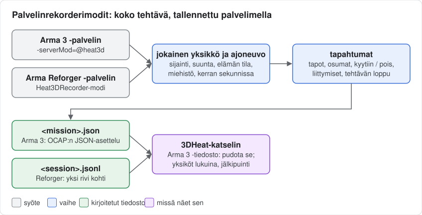

# Palvelimen tallennusmodit (Arma 3, Arma Reforger) {#server-recorder-mods-arma-3-arma-reforger}

Useimpia pelejä vahti tallentaa pelaajan omalla koneella. Arma on erilainen: palvelin voi tallentaa koko tehtävän — jokaisen yksikön ja ajoneuvon, ei vain omaasi — modilla, joka toimii palvelimella. Pelaajat eivät aseta mitään: Arma 3 -modi on pelkästään palvelimella, ja Reforger lataa palvelimen modit pelaajille itse, kun he liittyvät (modi ei tee mitään heidän koneillaan). Repositoriossa on kaksi tällaista modia kohdissa [`mods/arma3`](https://github.com/Holdi601/3DHeat-Watcher/tree/main/mods/arma3) ja [`mods/reforger`](https://github.com/Holdi601/3DHeat-Watcher/tree/main/mods/reforger). Niiden READMEt ovat täydellinen dokumentaatio; tämä sivu on yleiskatsaus.

**Tila: molemmat ovat testaamatta pelissä.** Arma 3 -laajennus on rakennettu ja sitä on ajettu samalla tavalla kuin Arma kutsuu laajennuksia, ja 3DHeat on lukenut sen tulosteen; sen SQF-skriptit eivät ole vielä ajaneet Arma 3:ssa. Reforger-modi on kirjoitettu Bohemian julkaistun skriptirajapinnan mukaan, eikä sitä ole koskaan käännetty. Älä laita kumpaakaan julkiselle palvelimelle, ennen kuin niiden READMEn testivaiheet on käyty läpi.

## Arma 3 {#arma-3}

1. Rakenna laajennus kerran per alusta (`mods/arma3/extension`). Tähän tarvitaan C-kääntäjä: Visual Studio Build Tools Windowsissa, gcc Linuxissa. Jos et ole koskaan kääntänyt mitään, kysy palvelimesi ylläpitäjältä.
   - Windows, "x64 Native Tools Command Prompt for VS" -komentokehotteessa: `cl /nologo /O2 /LD heat3d.c /Fe:heat3d_x64.dll`
   - Linux: `gcc -O2 -shared -fPIC -o heat3d_x64.so heat3d.c -ldl`
2. Rakenna modi: `python mods/arma3/build.py` kirjoittaa kansion `mods/arma3/@heat3d/` (Arma 3 Tools -ohjelmaa ei tarvita).
3. Kopioi `@heat3d` palvelimen kansioon ja käynnistä palvelin komennolla `-serverMod=@heat3d`.
4. Palvelimen `.rpt`-loki kertoo: `Heat3D recorder 0.1.0: recording <file> every 1 s`.

| Asetus | Oletus | Mitä se tekee |
|---|---|---|
| `captureDelay` | 1 | sekuntia kuvien välillä |
| `recordHits` | 1 | 0 kytkee osumatapahtumat pois |
| `recordShots` | 1 | 0 kytkee laukausten laskennan pois |
| `minPlayers` | 0 | tallenna vasta, kun näin monta pelaajaa on paikalla |

Tehtävä voi ohittaa yhden asetuksen omassa `init.sqf`-tiedostossaan (`heat3d_captureDelay = 0.5;`). Tallenteet menevät kansioon `recordings/` `@heat3d`:n sisällä tai kansioon, joka on asetettu muuttujaan `HEAT3D_DIR`.

**Tuloste:** yksi tiedosto per tehtävä OCAP-JSON-asettelussa (OCAP2-tallentimen muoto), nimettynä `<date>__<time>_<mission>.json`. Tehtävän aikana se on pöytäkirja (`.heat3d.part`), joka tallennetaan levylle joka kirjoituksella. Kaatuneen tehtävän pöytäkirja viimeistellään, kun seuraava tehtävä alkaa.

## Arma Reforger {#arma-reforger}

Modi (`Heat3DRecorder.gproj`) avataan ja rakennetaan Bohemian Workbench-ohjelmassa (Arma Reforger Tools), testataan paikallisella omistetulla palvelimella, julkaistaan Workbenchistä (listaamattomana testauksen ajan) ja lisätään palvelimen `config.json`-tiedoston `mods`-luetteloon. Askeleet on kuvattu sen READMEssä. Joka sekunti modi kirjoittaa jokaisen hahmon sijainnin, suunnan, elämäntilan, ajoneuvon ja pelaajan tunnuksen sekä jokaisen ajoneuvon sijainnin, suunnan, tilan ja miehistön. Lisäksi se kirjaa tappot (tappaja, ase, etäisyys), osumat, kyytiin nousut ja kyydistä poistumiset, pelaajien liittymiset ja poistumiset sekä tehtävän lopun.

**Tuloste:** yksi JSON-objekti per rivi, tiedosto `$profile:heat3d/<UTC date>_<UTC time>_<world>.jsonl`: ensin `header`-rivi (muoto `heat3d-reforger`, akselit x itä, y ylös, z pohjoinen), sitten `entity`-, `frame`- ja `event`-rivit tapahtumien mukaan, ja lopuksi `end`-rivi. Yksikkörivit ovat muotoa `[id, x, y, z, dir, alive, vehicleId, playerId]`, ajoneuvorivit muotoa `[id, x, y, z, dir, alive, [crew ids]]`. Tapahtumat seuraavat OCAP2:n tapahtuma-asettelua.

## 3DHeat-katselimessa {#in-the-viewer}

Pudota Arma 3 -tallenne [3DHeat-katselimeen](https://holdi601.github.io/3DHeat/): yksi tehtävä on yksi sessio, yksiköt muuttuvat sotilaiksi ja ajoneuvot tyyppinsä mukaisiksi, ja tappot sekä osumat menevät debrief-listaan. OCAP2:n web-soitin toistaa tallenteen myös. Reforger-tiedosto on modin oma rivimuotoinen tiedosto OCAP2:n tapahtuma-asettelulla.
