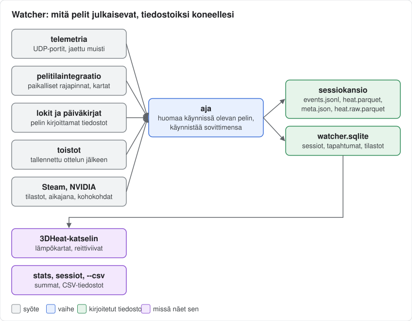

# Lähteet ja säännöt {#sources-and-rules}

Watcher tallentaa vain sen, minkä pelit ja alustat luovuttavat pelaajalle. Tämä sivu kertoo, mitä lähteitä se kattaa, mitä watcher saa niiden kanssa tehdä ja mitkä pelit tai pelien osat se jättää tarkoituksella pois.

## Lähteiden kuusi tyyppiä {#the-six-kinds-of-source}

Jokaisella adapterilla on `kind`, ja se päättää, mitä adapteri saa tehdä:

| Tyyppi | Mitä se on | Moninpelit |
|---|---|---|
| `telemetry` | UDP-portti tai jaettu muisti, jonka peli julkaisee kojelautoja, liikkuvia alustoja ja ohjauspyöriä varten (Forza Data Out, F1 UDP, Kunosin ja iRacingin jaettu muisti, SimConnect, X-Planen UDP-rajapinta, SCS SDK -liitännäinen) | kyllä - se on pelin oma tuloste |
| `gsi` | game-state integration tai paikallinen web-rajapinta, jonka peli tarjoaa pelaajan omalle koneelle (Valven GSI, Leaguen Live Client Data API, Rocket Leaguen Stats API, War Thunderin web-kartta) | kyllä, sen mukaan mitä rajapinta näyttää pelaajalle |
| `log` | tiedostot, jotka peli kirjoittaa ajon aikana: päiväkirjat, lokit, tilastot, tallennukset (Elite Dangerous, Minecraft, Path of Exile, Hearthstone, Star Citizen, EVE Online) | kyllä |
| `replay` | demot ja toistot, jotka peli tallentaa pelaajilleen ja jotka muunnetaan ottelun jälkeen (CS2, Dota 2, War Thunder, World of Tanks, World of Warships, Squad, League of Legends, VALORANT, IL-2 Tacview) | kyllä, ellei salattu, ja vain avoimet osat |
| `platform` | Steamin ja näytönohjaimen ajurin tallentama tieto: tilastot, saavutukset, aikajanat, klipit ja kohokohdat | kyllä |
| `memory` | pelin muisti, vain luku, sen mukaan kuin kirjoitit profiilin | **ei koskaan** - vain yksinpeli |

Vain `memory` avaa toisen prosessin, ja vain lukemista varten. Muut viisi tyyppiä lukevat sen, minkä peli, Steam tai NVIDIA App on jo kirjoittanut ulos tai lähettää.

## Miten lähteitä luetaan {#how-the-sources-are-read}

- **Mitään ei injektoida, koukuteta eikä muuteta pelissä.** Peliin ei ladata koodia, mitään ikkunaa tai syötettä ei koukuteta, eikä pelitiedostoja paikata. Watcher kirjoittaa datakansionsa ulkopuolelle vain ne tiedostot, jotka [`setup --apply`](commands.md#setup) kirjoittaa, kun pyydät sen: pelin oman asetustiedoston (alkuperäinen säilytetään tiedostona `<file>.heat3d-backup`), game-state-cfg-tiedoston, DCS-koukkuskriptin ja BeamNG-protokollamodin.
- **Jaettu muisti avataan vain luku -tilassa, eikä sitä koskaan luoda.** Tavallinen Python-tapa avata nimetty muistialue luo sen, jos sitä ei ole vielä olemassa. Peli, joka käynnistyy sen jälkeen, löytäisi watcherin tyhjän, vain luettavan muistialueen sijaan ja tekisi omansa, jolloin sen telemetria olisi kuollut. Watcher avaa alueet vain `OpenFileMappingW`-funktiolla (joka löytää vain olemassa olevan), kartoittaa ne `FILE_MAP_READ`-oikeuksin ja yrittää uudelleen myöhemmin, jos peli ei ole vielä tehnyt niitä.
- **Portteja lainataan, ei oteta haltuun.** UDP-telemetriaportti, jota toinen ohjelma jo kuuntelee (FH Companion, SimHub, kojelautasovellus), jää sille ohjelmalle. Jos toinen ohjelma alkaa kuunnella porttia, jonka watcher pitää, watcher luopuu siitä muutamassa sekunnissa. Forza-adapterit odottavat 15 s pelin käynnistymisen jälkeen ennen kuin ne ottavat portin 5300, ja välittävät jokaisen paketin muuttumattomana osoitteeseen 127.0.0.1:5301, joten toinen Data Out -sovellus voi edelleen tallentaa.
- **Vain paikallinen.** Pelien tilapalvelimet (CS2, Dota 2), jotka watcher ajaa, kuuntelevat vain osoitetta 127.0.0.1. Kun pelin cfg-tiedostossa on token (sen, jonka `setup` kirjoittaa), jokaisen lähetyksen on kannettava se. Lähetykset ilman sitä lasketaan tilastoon `bad_auth` ja pudotetaan. Ilman tokenia olevaa cfg-tiedostoa mikä tahansa paikallinen lähetys hyväksytään, ja loki kertoo sen. Paikalliset rajapinnat, joita watcher kysyy (League portissa 2999, War Thunder portissa 8111, Rocket League portissa 49123, X-Plane portissa 49000), ovat kaikki osoitteessa 127.0.0.1.
- **Lokitiedostot jaetaan, niitä ei lukita.** Jokainen luku avaa tiedoston kaikilla Windowsin jakoliputuksilla ja sulkee sen heti, joten peli voi jatkaa kirjoittamista, nimetä lokinsa uudelleen tai korvata sen.
- **Kaksi ulkoista palvelua, ja vain näissä tapauksissa.** Julkaisutarkistus kysyy GitHubilta (`api.github.com`) enintään kuuden tunnin välein, ja sen voi kytkeä pois (katso [Päivitykset](updates.md)). League-toistojen adapteri kysyy Riotin Match-V5 API:lta vain, kun olet antanut oman `riot_api_key`-avaimesi. Mitään muuta ei lähetetä minnekään.
- **Lähteen kytkeminen päälle on sinun päätöksesi.** `setup` ilman `--apply`-lippua vain kertoo, mitä se muuttaisi.

## Moninpelisäännöt {#multiplayer-rules}

- Verkossa pelattua peliä tallennetaan vain sen kautta, minkä peli julkaisee: telemetria, game-state-rajapinnat, lokit, toistot, alustatiedostot. Näiden sisällä watcher tallentaa sen, minkä peli näyttää pelaajalle, eikä mitään sen päälle laskettua:
  - **CS2:n game-state integration** lähettää katseltavan pelaajan (sinut, kun olet elossa, joukkuetoverin kuoleman jälkeen). Muiden pelaajien sijainteja (`allplayers_*`) lähetetään vain katsojille ja GOTV:lle, joten watcher ei pyydä niitä.
  - **League of Legendsin Live Client Data API** ei sisällä sijainteja. Riotin käytännön mukaan työkalut saavat näyttää sen, minkä pelaaja voi tietää pelistä itsestään, ei mitään sen päälle laskettua (ei vihollisten ajastimia). Watcher tallentaa tappo-syötteen ja tulostaulun, jotka pelaaja näkee, sekä pelaajan omat luvut.
  - **Rocket Leaguen Stats API** ei sisällä auton sijainteja (auton tila lähetetään vain katsojille). Sijainnin saa pallo: missä se osuttiin, tehtiin maali tai osuttiin poikkipuuhun.
  - **War Thunderin web-kartta** näyttää sen, mitä minikartta näyttää, ilman nimiä tai tunnuksia.
  - **F1 23/24/25** lähettävät jokaisen auton sijainnin Motion-paketissaan, myös verkossa. Peli luovuttaa ne itse, ja pidättää vain niiden pelaajien tiedot, joilla "Your Telemetry" on rajoitettu.
  - **DCS World**: moninpeliserveri voi kieltää oman koneen tietojen viennin. Silloin sessiossa on tapahtumia mutta ei sijainteja, ja sessio kertoo sen.
- **Muistia ei lueta koskaan moninpelissä.** Muistisovitin, joka on merkitty verkkopeliksi, hylätään, ja profiilin on kerrottava, voiko sen peli ylipäätään pelata verkossa. Yksinpelitila, jolla on myös verkkotila, luetaan vain silloin, kun sillä ei ole yhteyttä muuhun kuin tähän koneeseen. Pelien yksinpelitilat, jotka toimivat anti-cheatin alla, eivät myöskään ole luettavissa. Katso [Muistin lukeminen](memory-reading.md).
- `multiplayer`-lippu sovittimessa (`games --markdown` näyttää sen nimellä "Online play") päättää vain muistin lukemisen. Se ei estä muita tyyppejä tallentamasta verkkopelejä.

## Mistä on luovuttu ja miksi {#what-is-declined-and-why}

Joitakin pelejä, ja joitakin pelien osia, ei tallenneta, koska ainoa tapa saada ne rikkoisi suojauksen tai pelin käyttöehdot:

| Peli | Mitä jätetään pois | Miksi |
|---|---|---|
| VALORANT | sijainnit, nimet, pistemäärät toistoissa; asiakkaan lockfile-päätepisteet | Toiston pelivirta on hämärretty arvoilla, jotka on otettu kunkin version suoritettavasta tiedostosta. Ne palauttaminen vaatisi pelin purkamista käänteisesti, minkä Riotin käyttöehdot kieltävät (kohdat 3.1 ja 7.1), ja peli toimii Vanguardin alla. Riotin asiakkaan lockfile-päätepisteet eivät ole julkaistu API. **Luetaan:** se, minkä toisto kantaa avoimena: kartta, ottelun tunnus, agentit, palvelimen tappo- ja kierrosaikajana. |
| League of Legends | `.rofl`-toistojen liikkeet hetki hetkeltä; asiakkaan lockfile-päätepisteet | Hämärretty huijaamisen estämiseksi, ja se muuttuu joka päivityksellä. Sen purkaminen vaatisi pelin purkamista, mitä Riotin ehdot kieltävät. **Luetaan:** pelin lopun tulostaulu, jonka jokainen toisto kantaa selkeänä JSON-muodossa, Live Client Data API ottelun aikana, ja oman kehittäjäavaimesi kanssa virallinen Match-V5-aikajana (sijainnit kerran minuutissa, tappot siellä, missä ne tapahtuivat). |
| Fortnite | toistot | Salattu, ja Epicin ehdot kieltävät niiden purkamisen käänteisesti. |
| World of Tanks, World of Warships | toistot, watcherissä | Salattu avaimella, jonka peli kantaa ja jonka yhteisön työkalut ovat julkaisseet vuosia. Watcher ei lue niitä; erilliset muuntimet ulkopuolella lukevat (`exporters/ext/wot-replay`, `exporters/ext/wows-replay`), jotta Wargamingin ehtojen ongelma - lisenssi kieltää käänteisen suunnittelun (5.3 b) ja luvattoman ohjelmiston, joka on vuorovaikutuksessa sen tuotteiden kanssa (12.1 k) - koskee vain niitä. **Luetaan, kun muunnin on asennettu:** jokaisen ajoneuvon tai laivan sijainti niin kauan kuin tallennusasiakas tiesi siitä, ja tappot. |
| Gran Turismo 7 | telemetria | Vain konsolissa, ja sen telemetria on salattu avaimella, joka on palautettu pelistä. |
| Apex Legends | kaikki | Sen LiveAPI lähettää täydet tapahtumat vain yksityisissä ja mukautetuissa aulissa. Muuten mitään ei ole saatavilla paikallisesti. |
| Overwatch 2, Call of Duty, Battlefield 6, Hunt: Showdown 1896 | live-data | Ei paikallista toistoa, lokia tai pelitilan tulostetta luettavaksi. Niiden tilastot tulevat sieltä, missä Steam ne pitää ([Steam-tilastot](game-steam-stats.md), [Steam Timeline](game-steam-timeline.md)), ja niiden klipit [NVIDIA-kohokohtina](nvidia-highlights.md). |
| Star Citizen | kaikki `Game.log`-tiedoston lisäksi | Käyttää Easy Anti-Cheatia; watcher lukee vain pelin kirjoittaman lokitiedoston eikä koskaan mene lähelle pelin prosessia. |
| osu! | toistot | Ei kuulu tähän: 2D-peli, jolla ei ole mitään sijoitettavaa kartalle. |
| Mikä tahansa moninpeli | muisti | Ei koskaan. Yksinpelipelit, joiden yksinpelitila toimii anti-cheatin alla (GTA V, Elden Ring käynnistimen kautta), eivät myöskään ole luettavissa. |

Salattuja toistoja ei avata: VALORANT-lukija tarkistaa toiston salauslipun ja hylkää salatun tiedoston ("this replay is encrypted; it is not read").

Pelejä, jotka on tutkittu mutta joita ei ole vielä rakennettu (Deadlock-toistot, Rocket League `.replay`-tiedostot, StarCraft II, Team Fortress 2, Rainbow Six Siege, Beat Saber, Trackmania ja useat autopelit), on lueteltu lähteineen kohdassa [Kaikki pelit yhdessä taulussa](watcher.md#researched-not-yet-built). Jokainen niistä tarvitsee näytetiedostoja, joita vasten se tarkistetaan ennen julkaisua.
