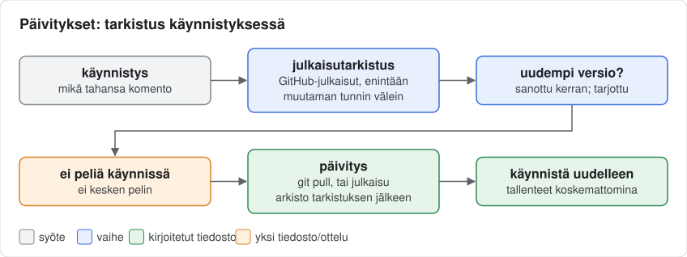

# Päivitykset {#updates}

Vahti pitää itsensä ajan tasalla [Holdi601/3DHeat-Watcher](https://github.com/Holdi601/3DHeat-Watcher/releases)-julkaisuista. Päivittäjä on `heat3d_update`-paketti, joka on repositoriossa `heat3d_watch`in vieressä.

## Tarkistus {#the-check}

- **Milloin**: jokainen komento paitsi `update` tarkistaa käynnistyessään. `run` tarkistaa myös ajon aikana, enintään kerran tunnissa ja vain silloin, kun yhtäkään peliä ei ole käynnissä.
- **Miten**: yksi HTTPS-pyyntö osoitteeseen `https://api.github.com/repos/Holdi601/3DHeat-Watcher/releases/latest`, aikaraja 5 sekuntia. Vastaus on välimuistissa kuusi tuntia tiedostossa `%LOCALAPPDATA%\3DHeat\update-check-3DHeat-Watcher.json`, joten useimmat käynnistykset eivät kysy mitään. "Ei vielä julkaisua" (HTTP 404) talletetaan välimuistiin samoin kuin muu vastaus. Offline-tilassa, rajoitetun pääsyn tai välityspalvelimen takana tarkistus epäonnistuu hiljaa, ja komento jatkuu sillä versiolla, joka vahdilla on.
- **Versiot**: asennettu versio on repositoriokansion `VERSION`-tiedosto. Julkaisun tunniste (`v1.2.0` tai `1.2.0`) verrataan numeroina, osa kerrallaan. Kaikki `-`- tai `+`-merkin jälkeinen jätetään huomiotta.
- **Pois**: `HEAT3D_NO_UPDATE=1` (mikä tahansa arvo paitsi tyhjä, `0`, `false` tai `no`) kytkee pois sekä tarkistuksen että automaattisen päivityksen. Jokaisella 3DHeat-työkalulla on oma välimuistitiedostonsa, joten yhden työkalun vastaus ei korvaa toisen.

## Kun uudempi julkaisu on ulkona {#what-happens-when-a-newer-release-is-out}

- **`run`** tulostaa käynnistyessään ilmoituksen ja jatkaa ajoa: `[heat3d_watch] 3DHeat Watcher 1.2.0 is out (this is 1.0.2). <release page>`. Kun `auto_update` on päällä (oletus) eikä peliä ole käynnissä, se päivittää itsensä ajon aikana: lokirivi `3DHeat Watcher 1.2.0 is out (this is 1.0.2); updating`, Windows-ilmoitus "Updating to 1.2.0", päivitys, jokainen sovitin pysäytetään ja sen sessiot suljetaan, ja sama komento käynnistetään uudelleen uudella koodilla. Vahti ei koskaan päivitä kesken pelin. Jos päivitystä ei voi tehdä, ilmoitus kertoo sen ("1.2.0 is out; not updated: ..."), ja vahti jatkaa vanhalla versiolla. Kun `auto_update` on pois päältä, on pelkkä ilmoitus.
- **Muut komennot** kysyvät `Update now? [Y/n]`, kun ne ajetaan terminaalissa. Enter, `y`, `yes`, `j` tai `ja` päivittää ja ajaa saman komennon uudelleen uudella versiolla. Ilman terminaalia (ajastettu ajo, putki) ne kertovat, miten päivitetään, ja jatkavat.
- **Pyynnöstä**: `python -m heat3d_watch update` (tai `python -m heat3d_update`) kysyy GitHubilta ilman välimuistia ja päivittää. `--check` kertoo vain, onko uudempi julkaisu ulkona. Tämä toimii, vaikka `HEAT3D_NO_UPDATE` on asetettu.

## Miten päivitys tehdään {#how-an-update-is-applied}

Se riippuu siitä, miten kopio asennettiin:

- **Git-kloonaus** (kansiossa on `.git` ja `git` on PATH:lla): `git pull --ff-only`. Tämä evätään, jos kloonauksessa on muutoksia seuratuissa tiedostoissa (`git status --porcelain --untracked-files=no` ei ole tyhjä). Ne muutokset ovat jonkun työtä, eikä päivitys päätä, mitä niille tapahtuu. Tee commit tai stash, ja vedä sitten.
- **Ladattu kopio**: julkaisun lähdearkisto ladataan ja puretaan väliaikaiskansioon. Arkiston ulkopuolelle osoittavat merkinnät ohitetaan. Arkiston `VERSION`-tiedoston on oltava se versio, jonka julkaisu väittää, muuten mitään ei kopioida. Sen jälkeen sen tiedostot kopioidaan repositoriokansion päälle. Tiedostoja, jotka eivät kuulu julkaisuun (tallenteet, asetukset, virtuaaliympäristöt, viennit ja kaikki, minkä teit itse), ei kosketa. Python-moduuli, jonka vanhemmassa julkaisussa oli mutta uudessa ei, poistetaan julkaisun omista paketeista (`heat3d_watch`, `heat3d_update`), joten vanhaa sovitinmoduulia ei ladata päivityksen jälkeen. Paketeista ulkopuolelta ei poisteta mitään.

Tallenteet ja asetukset ovat joka tapauksessa yleensä repositoriokansion ulkopuolella (`%LOCALAPPDATA%\3DHeat\Watcher`), joten päivitys ei koske niihin.

Päivityksen jälkeen sama komento käynnistetään uudelleen. Windowsissa vahti käynnistää uuden prosessin, odottaa sitä ja välittää sen poistumiskoodin eteenpäin, joten konsoli toimii kuin ensimmäinen prosessi olisi tehnyt työn itse.
