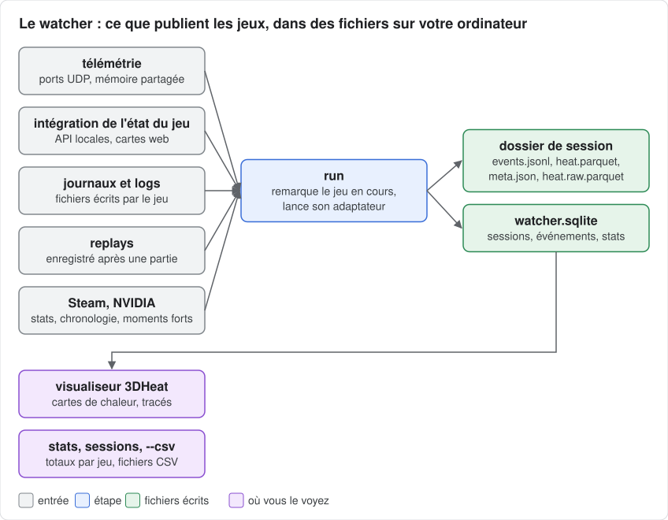
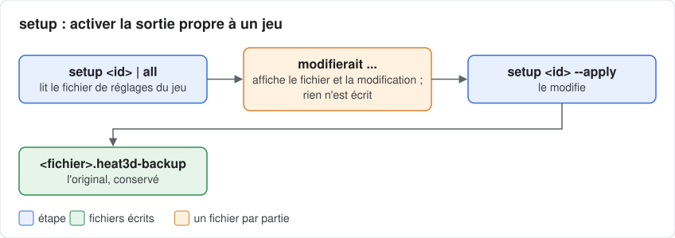
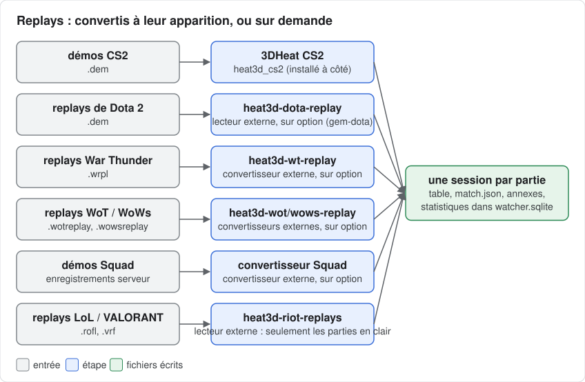
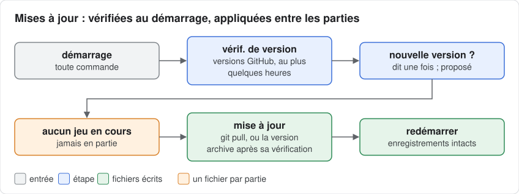

# Commandes {#commands}

Vous ne connaissez pas la ligne de commande ? Lisez d'abord [Avant de commencer](before-you-start.md). Chaque commande se tape
dans un terminal ouvert dans le dossier que vous avez décompressé ou cloné (dans l'Explorateur de fichiers, tapez `powershell` dans la
barre d'adresse), comme ceci :

```bash
python -m heat3d_watch <command> [options]
```


| Commande | Ce qu'elle fait |
|---|---|
| [`run`](#run) | surveille en arrière-plan et enregistre chaque jeu lancé |
| [`games`](#games) | ce que donne chaque jeu et d'où |
| [`setup`](#setup) | active la sortie de données propre à un jeu |
| [`status`](#status) | quels jeux tournent maintenant, et quels adaptateurs démarreraient |
| [`sessions`](#sessions) | les enregistrements jusqu'ici |
| [`stats`](#stats) | totaux par jeu, ou les tableaux en CSV |
| [`table`](#table) | reconstruit le `heat.parquet` d'une session à partir de son `events.jsonl` |
| [`replays`](#replays) | convertit les replays déjà sur le disque |
| [`dota-replay`](#dota-replay) | télécharge le replay d'un match public de Dota 2 à partir de son identifiant |
| [`dota-map`](#dota-map) | la carte de Dota 2 de votre installation en niveau 3D, par l'outil 3DHeat Dota séparé |
| [`update`](#update) | met à jour vers la dernière version |
| [`config`](#config) | affiche ou modifie les réglages |

Options pour toutes les commandes : `-h` / `--help` affiche l'aide, et `python -m heat3d_watch --version`
affiche la version (le fichier `VERSION`).

Les images de cette page montrent des exécutions sur des sessions d'exemple fictives (`Example Racer`, `Example Arena`),
et non de vrais enregistrements.

Toutes les commandes sauf `update` cherchent d'abord une version plus récente (au plus une fois toutes les six heures ; ignoré avec
`HEAT3D_NO_UPDATE=1`, voir [Mises à jour](updates.md)). `run` affiche seulement un avis. Les autres commandes demandent
`Update now? [Y/n]` quand elles tournent dans un terminal, et affichent comment mettre à jour quand elles ne le peuvent pas. La sortie est
en UTF-8, donc les noms de jeux dans n'importe quel alphabet s'affichent dans n'importe quelle console.

## run {#run}

```bash
python -m heat3d_watch run [--once] [-v]
```



Surveille jusqu'à l'arrêt (Ctrl+C) : toutes les `scan_seconds` secondes, il lit la liste des processus et lance un adaptateur pour
chaque jeu trouvé, ainsi que les adaptateurs toujours actifs. Avant le premier contrôle, il termine les sessions
restées ouvertes lors d'un lancement précédent. Quand aucun jeu ne tourne, il peut se mettre à jour lui-même (si `auto_update` est activé).
Les détails sont dans [Installation et lancement](installing-and-running.md#running).

| Option | Effet |
|---|---|
| `--once` | un seul contrôle des jeux en cours, puis fin. Les adaptateurs des jeux en cours (et ceux toujours actifs) sont démarrés, chacun interroge une fois (on attend au plus 10 secondes pour cela), puis tous sont arrêtés comme lorsqu'un jeu se termine : leurs sessions sont fermées, écrites et comptées. Pour vérifier la détection, pas pour enregistrer. |
| `-v`, `--verbose` | lignes de débogage dans `watcher.log` et sur la console |

`run` écrit `<data>\watcher.lock` et refuse de démarrer une seconde fois pour le même dossier de données (code de sortie 1) ;
voir [Le fichier de verrouillage](installing-and-running.md#the-lock-file).

## games {#games}

```bash
python -m heat3d_watch games [--markdown]
```


Liste chaque adaptateur, trié par jeu : son nom, son identifiant et son type, d'où il lit, ce qu'il enregistre, et
comment l'activer. Un adaptateur qui ne peut pas tourner sur cette machine est marqué
`[unavailable: <why>]` - SimConnect.dll introuvable, aucun dossier Minecraft, 3DHeat CS2 non installé,
Steam ou l'application NVIDIA introuvable. Un module d'adaptateur qui n'a pas pu être importé est signalé à la fin avec
l'erreur.

```text
EA SPORTS F1 25  (f1-25, telemetry)
    from: UDP telemetry 127.0.0.1:20777 (Documents\My Games\F1 25\hardwaresettings\hardware_settings_config.xml)
    - every car's position (world XYZ, m) at 10 Hz, by driver name, team, own car marked, ...
    switch on: In the game: Settings > Telemetry Settings > UDP Telemetry On, IP 127.0.0.1, port 20777 - ...
```

`--markdown` affiche la même chose sous forme d'un seul tableau Markdown (jeu, ce qui est enregistré, d'où, comment
l'activer, jeu en ligne, vérifié). Le tableau de [Tous les jeux dans un seul tableau](watcher.md) est cette sortie. Les cellules
sont échappées pour Markdown : le texte entre accents graves reste un bloc de code, et hors de ces accents, `<`, `>`, `&`, `*`, `|`
et une barre oblique inverse devant une ponctuation sont écrits pour s'afficher comme tapés (`<CS2>` disparaîtrait sinon comme
balise HTML dans kramdown). Le seul élément HTML est le `<br>` entre les éléments de « Ce qui est enregistré ».

## setup {#setup}

```bash
python -m heat3d_watch setup <adapter id | all> [--apply]
```




Active la sortie de données propre à un jeu, quand ce jeu a besoin qu'un fichier soit modifié pour cela. Sans `--apply`,
rien n'est modifié : chaque ligne dit ce qui changerait, et s'il y a quelque chose à changer, la dernière
ligne affiche `Nothing was changed. Run again with --apply to make these changes.` Quand il n'y a rien à
changer, il affiche `<id>: nothing to change` (`Nothing to change.` pour `all`). Avec `--apply`, les changements sont
faits, et avant qu'un fichier soit modifié pour la première fois, son original est sauvegardé sous
`<file>.heat3d-backup`. Une sauvegarde déjà existante n'est jamais écrasée, donc elle contient toujours le
fichier tel qu'il était avant la première intervention du watcher.

```text
f1-25: would change: hardware_settings_config.xml <udp>: enabled="false" -> "true"
Nothing was changed. Run again with --apply to make these changes.
```

`all` lance la configuration de chaque adaptateur qui en a une. Un adaptateur sans configuration, nommé seul,
affiche `<id>: nothing for setup to change; ` suivi de la façon dont le jeu s'active (son texte `enable`, ou
qu'il n'a besoin de rien). Un identifiant inconnu affiche `no adapter '<id>'; games lists them` et quitte avec le code 2.
Les adaptateurs qui ont quelque chose à configurer :

| Adaptateur | Ce que `--apply` modifie |
|---|---|
| `beamng` | installe le mod de protocole `heat3d` dans le dossier `mods` de l'utilisateur de BeamNG (seulement s'il n'y est pas) ; puis activez Options > Other > Protocols > « others » dans le jeu |
| `cs2-gsi` | écrit `<CS2>\game\csgo\cfg\gamestate_integration_heat3d.cfg` : envoie l'état du jeu à `http://127.0.0.1:3311/` avec un jeton aléatoire que le watcher exige ensuite (un jeton déjà présent dans le fichier est conservé) ; CS2 le lit au démarrage |
| `dota2-gsi` | la même chose pour Dota 2 : `<Dota>\game\dota\cfg\gamestate_integration\gamestate_integration_heat3d.cfg`, port 3312 |
| `dcs` | ajoute `Scripts\Hooks\heat3d-watch.lua` dans chaque dossier `%USERPROFILE%\Saved Games\DCS*`. Sa copie plus ancienne est mise à jour ; un fichier de ce nom que le watcher n'a pas écrit est laissé tranquille. Redémarrez DCS. |
| `dirt-rally-2` | `hardware_settings_config.xml` : `<udp enabled="true" extradata="3" ip="127.0.0.1" port="20777">` ; lancez d'abord le jeu une fois pour que le fichier existe |
| `ea-wrc` | `Documents\My Games\WRC\telemetry\config.json` : le paquet `session_update` de la structure `wrc` activé, vers cette machine |
| `f1-23`, `f1-24`, `f1-25` | `hardware_settings_config.xml` : `<udp enabled="true" ip="127.0.0.1" port="20777">` ; le jeu doit être fermé |
| `hearthstone` | ajoute une section `[Power]` (`LogLevel=1`, `FilePrinting=true`) dans `%LOCALAPPDATA%\Blizzard\Hearthstone\log.config` ; redémarrez le jeu |
| `il2` | `<game>\data\startup.cfg`, `[KEY = telemetrydevice]` : une cible de plus `addrN = "127.0.0.1:41995"` et `enable = true` (la section est ajoutée, à 10 Hz, quand il n'y en a pas) ; redémarrez IL-2 |
| `il2-tacview` | `<game>\data\startup.cfg`, `[KEY = track_record]` : `tacviewrecord = 1` |
| `rocketleague-stats` | `TAStatsAPI.ini` (ou `DefaultStatsAPI.ini` s'il n'existe pas) dans `<RL>\TAGame\Config` : `PacketSendRate=30` quand l'API est désactivée, et `Port` quand aucun n'est défini ; lu au démarrage de Rocket League |

`richard-burns-rally` n'a pas de configuration : sa télémétrie vient du plugin RSF/NGP, qu'on active à la main dans
`RichardBurnsRally.ini` (voir [sa page](game-richard-burns-rally.md)) ; `setup richard-burns-rally` le dit.
Tous les autres jeux n'ont besoin de rien ou s'activent dans le jeu ; la page de chaque jeu explique comment.

## status {#status}

```bash
python -m heat3d_watch status
```

```text
3DHeat Watcher 1.0.2; data in C:\Users\...\AppData\Local\3DHeat\Watcher
Games running: EA SPORTS F1 25 (f1-25)
Always on: il2-tacview, steam-stats, steam-timeline, nvidia-highlights, cs2-demos, lol-replays, valorant-replays
```

Indique quels adaptateurs un `run` démarrerait maintenant, selon les mêmes règles : le processus du jeu tourne, l'adaptateur
n'est pas dans `disabled`, rien de ce dont il a besoin ne manque, les adaptateurs de replays seulement si `replays` est activé, les
adaptateurs de mémoire seulement si `memory` est activé et que chaque contrôle de mémoire a réussi. Il ne démarre rien.

## sessions {#sessions}

```bash
python -m heat3d_watch sessions [--game NAME] [--limit N]
```


Les sessions les plus récentes de `watcher.sqlite`, une ligne chacune : début (heure locale), jeu, minutes, événements,
positions, dossier.

| Option | Effet |
|---|---|
| `--game NAME` | seulement ce jeu, par son nom exact tel qu'il figure dans la liste (`"EA SPORTS F1 25"`) |
| `--limit N` | au plus N sessions (par défaut 40) |

## stats {#stats}

```bash
python -m heat3d_watch stats [--game NAME] [--csv DIR]
```


Sans option : un tableau de chaque jeu (sessions, heures, événements, positions, dernière partie), du plus joué au
moins joué, puis pour chaque jeu ses 25 événements les plus fréquents et chaque statistique numérique avec le nombre de
sessions qui l'ont, le total, la meilleure valeur (`best`) et la moyenne. `best` sait dans quel sens c'est mieux : la valeur
la plus basse pour les temps conservés comme meilleurs (`best_lap`, `best_stage` et toute autre clé qui
commence par `best_`) et pour les places (`race_position`, `grid_position`, toute clé qui se termine par `_position`),
la plus haute pour tout le reste (éliminations, distance, vitesse maximale, les compteurs propres à un jeu).

| Option | Effet |
|---|---|
| `--game NAME` | seulement les événements et statistiques de ce jeu, sans la vue d'ensemble |
| `--csv DIR` | écrit `sessions.csv`, `events.csv` et `stats.csv` (chaque ligne des trois tableaux) dans `DIR` à la place ; `--game` ne le restreint pas |

## table {#table}

```bash
python -m heat3d_watch table <session folder>
```


Reconstruit `heat.parquet` dans un dossier de session à partir de son `events.jsonl`, avec les axes de son
`meta.json`. Affiche le chemin du tableau, ou `no positions in this session`. Utilisez-la pour une session enregistrée
pendant que `pyarrow` manquait, ou après avoir modifié `events.jsonl` à la main.

## replays {#replays}

```bash
python -m heat3d_watch replays <adapter id> [folder] [-v]
```



Convertit les replays déjà sur le disque, maintenant, l'un après l'autre, chacun en une session comme le ferait la surveillance du
dossier. La première fois que le watcher voit un dossier de replays, il note seulement ce qu'il contient (voir
[Installation et lancement](installing-and-running.md#replays-already-on-disk)) ; c'est ainsi qu'on les convertit à la demande. Sans `folder`, les
dossiers de l'adaptateur sont lus (celui du jeu, plus `replay_folders`) ; avec lui, les replays de ce dossier. Chaque replay
converti est noté comme vu, pour que le watcher en cours d'exécution ne le reconvertisse pas. Un replay qui échoue à la conversion est
journalisé et ignoré.

| Adaptateur | Replays |
|---|---|
| `cs2-demos` | démos de Counter-Strike 2 (`*.dem`), via 3DHeat CS2 |
| `lol-replays` | replays de League of Legends (`*.rofl`), via le lecteur externe `heat3d-riot-replays` (3DHeat-Ext-Riot) |
| `valorant-replays` | replays de VALORANT (`*.vrf`), via le lecteur externe `heat3d-riot-replays` (3DHeat-Ext-Riot) |
| `warthunder-replays` | replays de War Thunder (`*.wrpl`), via le convertisseur externe `heat3d-wt-replay` (exporters/ext/warthunder-replay) |
| `wot-replays` | replays de World of Tanks (`*.wotreplay`), via le convertisseur externe `heat3d-wot-replay` (exporters/ext/wot-replay) |
| `wows-replays` | replays de World of Warships (`*.wowsreplay`), via le convertisseur externe `heat3d-wows-replay` (exporters/ext/wows-replay) |
| `dota-replays` | replays de Dota 2 (`*.dem`), via le lecteur externe `heat3d-dota-replay` (3DHeat-Ext-DotaReplay) |

```text
lol-replays: converted 12 replay(s); `sessions --game` lists them
```

Un identifiant qui n'est pas dans cette liste affiche `no replay adapter '<id>'` avec la liste et quitte avec le code 2 ;
c'est aussi le cas d'un `folder` qui n'existe pas. Un adaptateur qui ne peut pas tourner ici (3DHeat CS2 ou le lecteur du jeu
non installé) affiche la raison - où le trouver et comment l'installer - et quitte avec le code 1. Les pistes Tacview d'IL-2 ne figurent pas dans la liste : cet adaptateur convertit
seul chaque piste terminée qu'il trouve.

## dota-replay {#dota-replay}

```bash
python -m heat3d_watch dota-replay <match id> [<match id> ...] [-o FOLDER] [--convert] [-v]
```

Télécharge le replay d'un match public de Dota 2 depuis les serveurs de replays de Valve. Il faut une connexion Internet. L'identifiant du match
est le numéro sur la page du match dans le client Dota (les détails du match) ou sur le site d'OpenDota ; Valve
conserve un replay pendant quelques semaines, après quoi le téléchargement échoue. Le serveur et le sel du replay viennent de la
fiche du match chez OpenDota (`api.opendota.com/api/matches/<id>`, sans clé), le fichier vient de
`replay<cluster>.valve.net/570/<id>_<salt>.dem.bz2` ; il est décompressé à mesure qu'il arrive (Valve
sert à la fois bzip2 et Zstandard sous ce nom) et enregistré sous `<match id>.dem`. Sans `-o`, il va dans le
dossier de replays de Dota 2 quand Dota 2 est installé - où un watcher en cours d'exécution le convertit - et sinon dans
`<data>/replays/dota`. Un fichier déjà présent est conservé. `--convert` convertit tout de suite les
replays téléchargés, comme le ferait `replays dota-replays`, et les note comme vus ; il a besoin du lecteur de replays de Dota 2
([3DHeat-Ext-DotaReplay](https://github.com/Holdi601/3DHeat-Ext-DotaReplay), `heat3d-dota-replay`)
et, sans lui, indique où le trouver et quitte avec le code 1 avant de rien télécharger. Le téléchargement
lui-même n'a besoin que du watcher.

```text
match 9000000000: C:\Program Files (x86)\Steam\steamapps\common\dota 2 beta\game\dota\replays\9000000000.dem
```

Valve conserve les replays pendant quelques semaines ; un match plus ancien affiche `Valve no longer has the replay of match
<id>` et quitte avec le code 1. Un match qu'OpenDota n'a pas encore vu n'a pas de sel : le message demande de
le demander à OpenDota (`curl -X POST https://api.opendota.com/api/request/<id>`) et de réessayer quelques
minutes plus tard. Les salons privés et les matchs avec un profil masqué ne sont pas du tout sur les serveurs de replays.

## dota-map {#dota-map}

```bash
python -m heat3d_watch dota-map [<map>] -o <file.glb> [--game FOLDER] [--source2viewer EXE] [--detail UNITS]
```

Écrit la carte de Dota 2 - le sol, les falaises, l'eau, les arbres et les bâtiments - sous forme de niveau `.glb`, dans le repère
dans lequel sont dessinées les tables des replays de Dota, à partir de votre propre installation de Dota 2. Le watcher ne lit pas lui-même les
fichiers du jeu : il lance l'outil séparé **3DHeat Dota** (`heat3d-dota-maps level`,
[3DHeat-Ext-Dota](https://github.com/Holdi601/3DHeat-Ext-Dota)) avec ces options, et transmet sa sortie et son code de sortie.
`<map>` vaut `dota` par défaut ; `--game` est le dossier de Dota 2 quand il n'est pas dans une bibliothèque Steam ;
`--source2viewer` le chemin de l'interface en ligne de commande de Source2Viewer, dont cet outil a besoin ; `--detail` la taille
des cellules de regroupement des sommets des bâtiments, en unités du jeu (8 par défaut, 0 garde chaque triangle). Quand l'outil n'est pas
installé, la commande affiche `dota-map: the Dota 2 map converter is not installed: ...` avec où le trouver
et quitte avec le code 2. Détails : [Carte de Dota 2](dota-map.md).

## update {#update}

```bash
python -m heat3d_watch update [--check]
```



Demande à GitHub la dernière version, en ignorant la réponse mise en cache, et met à jour cette copie si elle est plus récente
(voir [Mises à jour](updates.md)). `--check` dit seulement si une version plus récente est sortie. Cette commande fonctionne
même avec `HEAT3D_NO_UPDATE` défini : la demander, c'est la décision. `python -m heat3d_update [--check]` fait la
même chose.

## config {#config}

```bash
python -m heat3d_watch config [--set KEY=VALUE ...]
```


Affiche chaque réglage sous la forme `key = value`. Avec `--set`, modifie d'abord les réglages donnés et enregistre
`settings.json` (`saved <path>`). Les valeurs sont lues selon le type du réglage :

- réglages vrai/faux : `1`, `true`, `yes`, `on` ou `ja` valent vrai ; `0`, `false`, `no`, `off`, `nein` ou
  rien valent faux ;
- nombres : un nombre décimal (`scan_seconds=5`) ;
- listes : séparées par des virgules ou une liste JSON (`disabled=steam-stats,steam-timeline` ; une valeur vide vide la liste) ;
- dictionnaires (`replay_folders`, `player_names`) : le dictionnaire entier en JSON, ou une entrée sous la forme
  `KEY.ID=VALUE` - `replay_folders.cs2-demos=D:\Demos,E:\More Demos` définit les dossiers de cet adaptateur
  (séparés par des virgules), `player_names.warthunder-webmap=Name` le nom de cet adaptateur ; une valeur vide supprime
  l'entrée ;
- texte : tel quel (`data=D:\Heat`, `riot_id=Name#TAG`).

```bash
python -m heat3d_watch config --set memory=true scan_seconds=5
python -m heat3d_watch config --set riot_id=Name#TAG riot_platform=EUW1
python -m heat3d_watch config --set replay_folders.cs2-demos=D:\Demos player_names.rocketleague-stats=Name
```

Une clé inconnue affiche `no setting '<key>'`, et une valeur qui n'est pas du type du réglage (`memory=perhaps`,
`scan_seconds=often`, un dictionnaire qui n'est pas du JSON) affiche `not saved: ...` ; les deux quittent avec le code 2
sans rien enregistrer. Un `settings.json` modifié à la main est lu de la même façon : une valeur donnée en texte
là où le réglage est un nombre, un vrai/faux ou un dictionnaire est lue telle qu'écrite, et une valeur qui ne peut pas être
lue reste à sa valeur par défaut. Chaque réglage est décrit dans
[Installation et lancement](installing-and-running.md#settings).
