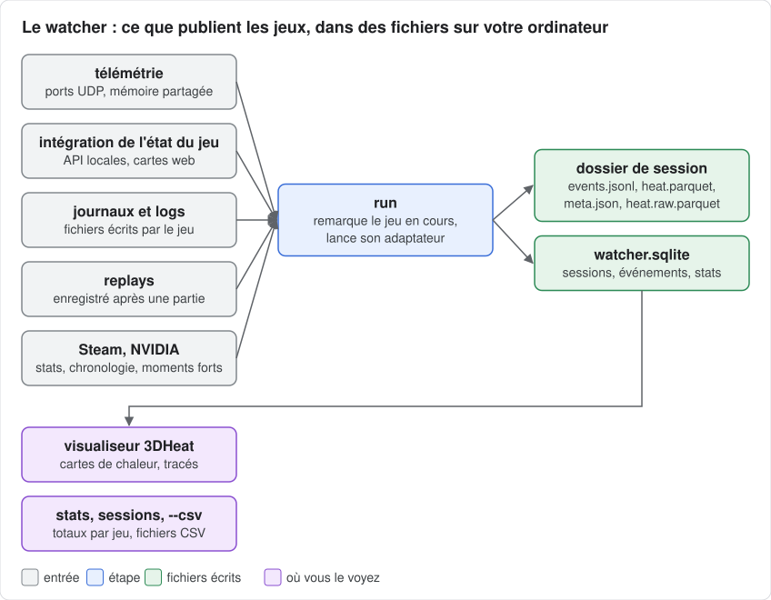

# 3DHeat Watcher {#dheat-watcher}

**Qu'est-ce que c'est ?** Vous jouez à un jeu. Ce programme note discrètement où vous êtes allé et ce qui s'est passé.
Plus tard, vous pouvez le consulter comme une carte colorée dans la visionneuse 3DHeat.

**À quoi ça sert ?** À garder votre propre historique de chaque session - où vous avez roulé, volé ou combattu,
vos totaux par jeu - sans aucun site web et sans modifier le jeu.

**Exemple :** vous roulez un tour dans un jeu de course pendant que le watcher tourne ; ensuite, un fichier dans
`sessions\<jeu>\` contient la trajectoire que vous avez suivie, et la visionneuse la dessine.

En détail : 3DHeat Watcher est un programme de fond qui enregistre ce que les jeux publient sur votre jeu - où vous
êtes allé, ce qui s'est passé à chaque endroit, et les chiffres qui en découlent - dans des fichiers sur votre propre
ordinateur. Les fichiers servent à vos statistiques personnelles, et aux cartes de chaleur et tracés de route de la
visionneuse 3DHeat.

Il tourne discrètement, remarque quel jeu vous lancez, et lit les sorties propres à ce jeu : un port de
télémétrie ou une mémoire partagée que le jeu publie pour ses tableaux de bord, une intégration de l'état de jeu, le
journal ou le fichier de log que le jeu écrit, le replay enregistré après une partie, les statistiques que
Steam conserve, les clips enregistrés par NVIDIA App. Les enregistrements restent sur votre ordinateur. Le programme ne contacte que deux
services extérieurs, et seulement dans ces cas : GitHub, pour chercher une version plus récente (voir [Mises à jour](updates.md)),
et l'API Match-V5 de Riot, et seulement si vous saisissez votre propre clé d'API Riot (voir [Replays de League of Legends](game-lol-replays.md)).



## Ce qu'il enregistre {#what-it-records}

- **Positions** : la voiture, l'avion, le héros ou le joueur, plusieurs fois par seconde là où le jeu les publie,
  avec la vitesse, le cap et tout ce que le jeu envoie en même temps.
- **Événements** : apparitions, morts, éliminations, tours, étapes, manches, buts, missions, décollages et atterrissages, changements
  de zone, succès, moments forts. Chaque événement est stocké avec son heure, et avec son lieu quand le
  jeu le fournit.
- **Statistiques par session** : éliminations, morts, tours, meilleur tour, distance, vitesse maximale, temps de jeu, et les
  statistiques propres au jeu là où il les conserve.

Ce que donne chaque jeu, et d'où, figure sur sa propre page dans [Jeux](games.md). Une seule source ne peut pas
tout enregistrer : les jeux multijoueurs ne sont enregistrés qu'à travers ce qu'ils publient, et le watcher
ne lit jamais leur mémoire (voir [Sources et règles](sources-and-rules.md)).

## Installation {#install}

Vous débutez avec la ligne de commande ? Lisez d'abord [Avant de commencer](before-you-start.md).

Le watcher est un programme Python pour Windows (Python 3.10 ou plus récent). Beaucoup de ses sources n'existent que sous Windows : mémoire
partagée, registre, notifications Windows.

```bash
git clone https://github.com/Holdi601/3DHeat-Watcher.git
cd 3DHeat-Watcher
pip install -r requirements.txt
```

Une archive de version téléchargée fonctionne de la même façon : décompressez-la, puis lancez `pip install -r requirements.txt`
dans le dossier. Les détails, et les extras dont certains jeux ont besoin, sont dans
[Installation et lancement](installing-and-running.md).

## Démarrage rapide {#quick-start}

```bash
python -m heat3d_watch games            # ce que donne chaque jeu, et d'où
python -m heat3d_watch setup all        # ce qu'il faudrait activer (rien n'est modifié)
python -m heat3d_watch setup f1-25 --apply   # activer la sortie d'un jeu (le fichier d'origine est sauvegardé)
python -m heat3d_watch run              # surveiller ; laissez-le tourner pendant que vous jouez
python -m heat3d_watch stats            # totaux par jeu
python -m heat3d_watch stats --csv out  # sessions, événements et statistiques en fichiers CSV
```

Vous devez voir : après `games`, un tableau avec une ligne par jeu ; `run` continue jusqu'à ce que vous appuyiez sur
Ctrl+C ou fermiez la fenêtre.

Tout est écrit dans `%LOCALAPPDATA%\3DHeat\Watcher`. Pour utiliser un autre dossier, définissez la
variable d'environnement `HEAT3D_WATCH_HOME` ou lancez `python -m heat3d_watch config --set data=D:\ailleurs`.

- `sessions\<jeu>\<date>_<adaptateur>\` - un dossier par session, contenant `events.jsonl` (chaque événement
  au moment où il se produit), `heat.parquet` (les lignes avec une position, prêtes pour la visionneuse 3DHeat) et
  `meta.json` (jeu, source, axes, comptes, statistiques)
- `watcher.sqlite` - les statistiques de chaque session, dans trois tables simples
- `watcher.log` - ce que le watcher a fait

La visionneuse ouvre directement le `heat.parquet` d'une session, sans rien à régler (ses axes et ses unités sont dans
le fichier). Les replays convertis sont écrits sous forme de tables et de documents de partie à côté ; le format
d'un fichier par partie de la visionneuse est décrit sur sa page [conteneur `.3dheat`](https://holdi601.github.io/3DHeat/container.html),
et les colonnes de chaque table dans [Les données](the-data.md).

## La documentation {#the-documentation}

| Page | Ce qu'elle couvre |
|---|---|
| [Avant de commencer](before-you-start.md) | Python, un terminal, les espaces réservés, à quoi ressemblent la réussite et les erreurs courantes |
| [Installation et lancement](installing-and-running.md) | prérequis, exécution en arrière-plan, démarrage avec Windows, le fichier de verrouillage, le journal, chaque réglage et variable d'environnement |
| [Jeux](games.md) | une page par jeu : ce qui est enregistré, d'où, comment l'activer, fonctionnement, axes, statistiques, ce qui a été vérifié |
| [Les données](the-data.md) | dossiers de session, `events.jsonl`, `heat.parquet` et son pied, `meta.json`, `watcher.sqlite`, reprise après un plantage, export CSV, ouverture d'une session dans la visionneuse 3DHeat |
| [Commandes](commands.md) | chaque commande et chaque option de `python -m heat3d_watch` |
| [Sources et règles](sources-and-rules.md) | les six sortes de sources, les règles du multijoueur, les jeux laissés de côté et pourquoi |
| [Moments forts NVIDIA](nvidia-highlights.md) | ce que les Moments forts NVIDIA peuvent et ne peuvent pas fournir, et comment un moment fort obtient une position |
| [Mods d'enregistrement serveur](server-mods.md) | les mods serveur d'Arma 3 et d'Arma Reforger qui enregistrent des missions entières pour la visionneuse |
| [Lecture de la mémoire](memory-reading.md) | profils de mémoire pour le solo : le format, les contrôles, comment en écrire et en vérifier un |
| [Mises à jour](updates.md) | comment le watcher cherche de nouvelles versions et se met à jour lui-même |
| [Développement](development.md) | écrire un adaptateur : l'API, les tests, un `verified` honnête, régénérer les pages des jeux |
| [Tous les jeux dans un tableau](watcher.md) | chaque jeu dans un seul tableau, tel que l'affiche `games --markdown`, plus les jeux étudiés mais pas encore réalisés |
| [Référence des commandes](../cli-reference.md) | le `--help` de chaque commande, généré depuis le code |
| [Maintenir ces documents](maintaining.md) | la liste de contrôle des versions pour ces pages |

## Partie de 3DHeat {#part-of-3dheat}

3DHeat Watcher est l'un des outils gratuits qui entourent la visionneuse 3DHeat (le watcher utilise 3DHeat CS2
pour convertir les démos CS2). Chacun est un projet à part, avec ses propres versions et sa licence :

| Outil | Ce qu'il fait | Documentation |
|---|---|---|
| [3DHeat](https://github.com/Holdi601/3DHeat) | la visionneuse : cartes de chaleur, analyse de course et revue de partie en 3D | [site](https://holdi601.github.io/3DHeat/) |
| [GameFiles](https://github.com/Holdi601/3DHeat-GameFiles) | circuits et niveaux tirés des fichiers livrés par les jeux, en modèles 3D | [site](https://holdi601.github.io/3DHeat-GameFiles/) |
| [GameCapture](https://github.com/Holdi601/3DHeat-GameCapture) | télémétrie de tour des jeux de course ; niveaux reconstruits à partir de vidéos de jeu | [site](https://holdi601.github.io/3DHeat-GameCapture/) |
| [Unreal Exporter](https://github.com/Holdi601/3DHeat-UnrealExporter) | un plugin de l'éditeur Unreal qui exporte un niveau en un modèle 3D | [site](https://holdi601.github.io/3DHeat-UnrealExporter/) |
| [CS2](https://github.com/Holdi601/3DHeat-CS2) | démos de Counter-Strike 2 en tables et documents de partie ; cartes en modèles 3D | [site](https://holdi601.github.io/3DHeat-CS2/) |
| [Watcher](https://github.com/Holdi601/3DHeat-Watcher) | enregistre en arrière-plan ce que les jeux publient sur votre jeu | [site](https://holdi601.github.io/3DHeat-Watcher/) |
| [Ext-WarThunder](https://github.com/Holdi601/3DHeat-Ext-WarThunder) | replays de War Thunder en tables et documents de partie | [site](https://holdi601.github.io/3DHeat-Ext-WarThunder/) |
| [Ext-WoT](https://github.com/Holdi601/3DHeat-Ext-WoT) | replays de World of Tanks en tables et documents de partie | [site](https://holdi601.github.io/3DHeat-Ext-WoT/) |
| [Ext-WoWs](https://github.com/Holdi601/3DHeat-Ext-WoWs) | replays de World of Warships en tables et documents de partie | [site](https://holdi601.github.io/3DHeat-Ext-WoWs/) |
| [Ext-Squad](https://github.com/Holdi601/3DHeat-Ext-Squad) | démos de serveurs Squad en tables et documents de partie | [site](https://holdi601.github.io/3DHeat-Ext-Squad/) |
| [Ext-DCS](https://github.com/Holdi601/3DHeat-Ext-DCS) | cartes de DCS World en modèles 3D | [site](https://holdi601.github.io/3DHeat-Ext-DCS/) |
| [Ext-IL2](https://github.com/Holdi601/3DHeat-Ext-IL2) | cartes d'IL-2 Sturmovik en modèles 3D | [site](https://holdi601.github.io/3DHeat-Ext-IL2/) |

Licence : MIT ([LICENSE](https://github.com/Holdi601/3DHeat-Watcher/blob/main/LICENSE)). Les licences
des paquets tiers qu'il utilise, et ce qu'imposent les jeux qu'il lit, sont listées dans
[LICENSES.md](https://github.com/Holdi601/3DHeat-Watcher/blob/main/LICENSES.md).
