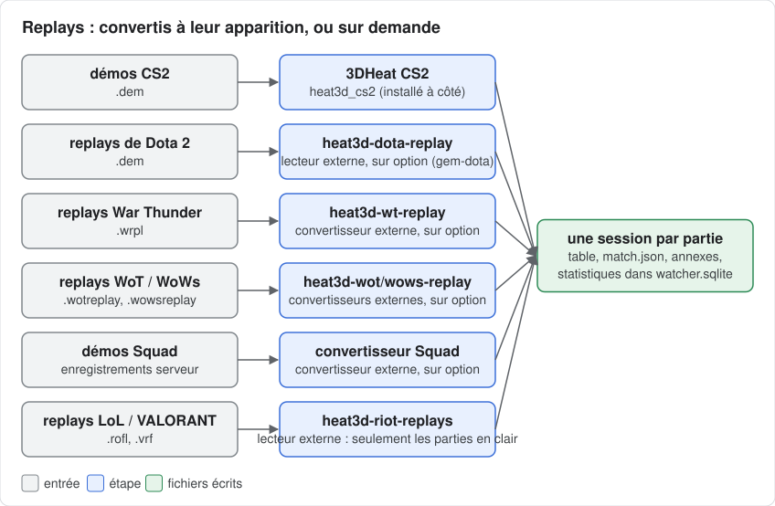

# Installation et lancement {#installing-and-running}

## Prérequis {#requirements}

- **Windows.** Le watcher est écrit pour Windows, et la plupart de ses sources n'existent que là : la
  mémoire partagée que créent les jeux (les mappages `Local\...`), le registre (où se trouve Steam), les
  notifications Windows, la liste des processus avec les chemins des exécutables. Sur un autre système, le programme démarre, mais
  ces sources ne trouvent rien, les notifications sont seulement journalisées, et la lecture de la mémoire refuse (« only
  implemented on Windows »).
- **Python 3.10 ou plus récent**, depuis <https://www.python.org/downloads/> : cochez **Add python.exe to PATH**
  dans l'installateur, puis vérifiez avec `python --version` dans un nouveau terminal. Vous débutez ? Lisez
  d'abord [Avant de commencer](before-you-start.md).
- **Paquets** (`requirements.txt`) : `psutil>=6.0` (quels jeux tournent, quel programme tient un
  port, les connexions d'un jeu ; une version plus ancienne de psutil fonctionne encore, par son ancien nom pour les
  connexions d'un processus), `pyarrow>=15` (écriture de `heat.parquet`), `numpy>=1.24`, et
  `pytest>=8.0` pour les tests. `requirements-optional.txt` ne liste actuellement aucun paquet.

Sans `pyarrow`, les sessions sont tout de même enregistrées : `events.jsonl` est l'enregistrement, et le tableau peut être
construit plus tard avec [`table`](commands.md#table).

### Compléments dont certains jeux ont besoin {#extras-some-games-need}

| Jeu | Ce qu'il faut |
|---|---|
| Démos de Counter-Strike 2 | [3DHeat CS2](https://github.com/Holdi601/3DHeat-CS2) et ses prérequis (`demoparser2`). Le watcher le cherche dans `HEAT3D_CS2`, puis dans un dossier `3DHeat-CS2` ou `cs2` à côté du propre dossier du watcher, puis partout où Python peut importer `heat3d_cs2`. Sans lui, `games` affiche l'adaptateur comme indisponible. |
| Microsoft Flight Simulator 2020 / 2024 | `SimConnect.dll` - non fourni. MSFS 2020 en a un dans son dossier d'installation ; pour MSFS 2024, installez le SDK de MSFS 2024. `MSFS_SDK` / `MSFS2024_SDK` pointent vers le dossier du SDK. |
| Euro Truck Simulator 2, American Truck Simulator | le plugin RenCloud `scs-telemetry.dll` (révision 12) dans `<game>\bin\win_x64\plugins` |
| BeamNG.drive | le mod de protocole `heat3d`, installé par `python -m heat3d_watch setup beamng --apply` |
| League of Legends (en direct) | facultatif : le certificat racine de Riot sous `<data>\riotgames.pem`, pour que la connexion locale soit vérifiée |
| Minecraft | un dossier `%APPDATA%\.minecraft` (édition Java) |

La page de chaque jeu, sous [Jeux](games.md), indique ce qu'il faut activer dans le jeu lui-même.
`python -m heat3d_watch games` marque un adaptateur `[unavailable: ...]` quand un élément dont il a besoin manque
sur cette machine.

## Installation {#installing}

Vous débutez avec la ligne de commande ? Lisez d'abord [Avant de commencer](before-you-start.md). Si `pip` est introuvable,
utilisez plutôt `python -m pip install -r requirements.txt`.

Depuis un clone :

```bash
git clone https://github.com/Holdi601/3DHeat-Watcher.git
cd 3DHeat-Watcher
pip install -r requirements.txt
```

Depuis une version publiée : téléchargez l'archive depuis les versions du dépôt, décompressez-la, puis lancez
`pip install -r requirements.txt` dans le dossier. Les deux types de copie se mettent à jour seuls
(voir [Mises à jour](updates.md)).

Lancez chaque commande depuis le dossier du dépôt : `python -m heat3d_watch` importe le paquet à partir de là,
et le programme de mise à jour (`heat3d_update`) se trouve juste à côté.

## Lancement {#running}

```bash
python -m heat3d_watch run        # watch until stopped
python -m heat3d_watch run -v     # the same, with debug lines in the log
python -m heat3d_watch run --once # one look at the games running now, then stop and exit
```

Au démarrage, `run` :

1. écrit le [fichier de verrouillage](#the-lock-file) ;
2. termine les sessions qu'une exécution précédente a laissées ouvertes, par exemple après un plantage
   (voir [Récupération](the-data.md#recovery-after-a-crash)) ;
3. toutes les `scan_seconds` (2 s), lit la liste des processus (noms et chemins seulement, aucun processus n'est ouvert)
   et démarre un adaptateur, dans son propre thread, pour chaque jeu trouvé. Quand le processus d'un jeu disparaît,
   son adaptateur est arrêté et les sessions qu'il avait ouvertes sont fermées, ce qui écrit leur tableau et
   leur ligne dans les statistiques. Les adaptateurs qui n'attendent pas un jeu (statistiques Steam, Steam
   Timeline, NVIDIA highlights, les dossiers de replays) tournent en permanence ;
4. tant qu'aucun jeu ne tourne, cherche une version plus récente au plus une fois par heure (la réponse elle-même est mise en cache pendant six heures) et, avec `auto_update`
   activé, l'installe et se relance (voir [Mises à jour](updates.md)).

Un adaptateur qui échoue est journalisé et n'arrête pas les autres. Si l'interrogation d'un adaptateur échoue 20 fois de suite,
ou si son démarrage échoue, l'adaptateur est arrêté et ne redémarre pas tant que le jeu n'est pas relancé (un nouvel
identifiant de processus).

Arrêtez le watcher avec Ctrl+C. Les adaptateurs ferment leurs sessions avant de quitter. Si le watcher est
tué à la place (Gestionnaire des tâches, plantage, coupure de courant), rien de ce qui était déjà écrit n'est perdu : le
prochain `run` termine ces sessions.

`--once` fait un seul contrôle : il démarre les adaptateurs des jeux qui tournent à ce moment (et ceux qui sont toujours actifs),
laisse chacun interroger une fois - en attendant au plus 10 secondes pour cela - puis les arrête comme le ferait la fin d'un jeu,
si bien que les sessions qu'ils ont ouvertes sont fermées, leurs tableaux écrits et leurs lignes
comptées dans les statistiques avant de quitter. Utilisez-le pour vérifier qu'un jeu est détecté, pas pour enregistrer.

### Replays déjà présents sur le disque {#replays-already-on-disk}



La première fois qu'un adaptateur de replays voit l'un de ses dossiers, il ne fait que noter les replays déjà présents :
un joueur qui a des années de démos verrait sinon le watcher occupé à convertir pendant une journée. Ensuite,
chaque nouveau replay est converti une fois que le jeu a fini de l'écrire. Les anciens sont convertis à la demande avec
[`replays`](commands.md#replays) :

```bash
python -m heat3d_watch replays cs2-demos              # every demo in CS2's folders and replay_folders
python -m heat3d_watch replays lol-replays D:\Old     # the replays in one folder
```

### Lancer en arrière-plan {#running-in-the-background}

Le watcher n'a pas de fenêtre à lui ; c'est un programme console qui tourne jusqu'à son arrêt. Il
écrit tout dans `watcher.log`, donc il n'a pas besoin d'une console visible. Moyens de le garder à l'écart :

- démarrez-le dans une console et réduisez la console : `start "" /min python -m heat3d_watch run` depuis
  `cmd`, dans le dossier du dépôt ;
- démarrez-le sans console : `pythonw -m heat3d_watch run`. La sortie console est perdue, mais `watcher.log`
  est toujours écrit. Pour l'arrêter, terminez le processus `pythonw.exe` ; le démarrage suivant termine alors les
  sessions restées ouvertes. Le projet n'a pas testé cette façon de le lancer.

### Démarrer avec Windows (une idée) {#starting-with-windows-an-idea}

Le watcher ne s'installe pas lui-même au démarrage de Windows. Pour le lancer automatiquement :

- **Planificateur de tâches** : créez une tâche avec le déclencheur *À l'ouverture de session* et l'action *Démarrer un programme*,
  programme `pythonw.exe` (ou `python.exe`), arguments `-m heat3d_watch run`, *Démarrer dans* réglé sur le
  dossier du dépôt ;
- **Dossier Démarrage** : placez un raccourci dans `shell:startup` avec le même programme, les mêmes arguments et le même dossier
  *Démarrer dans*.

Ni l'une ni l'autre ne fait partie du watcher, et il ne les teste pas. Le [fichier de verrouillage](#the-lock-file) fait en sorte
qu'une deuxième copie lancée par erreur quitte aussitôt.

## Le fichier de verrouillage {#the-lock-file}

`<data>\watcher.lock` contient l'identifiant de processus du watcher en cours. Quand `run` démarre et que le fichier de verrouillage
nomme un processus qui existe encore et dont le nom contient `python`, il affiche

```text
A watcher is already running (process 12345) for C:\Users\...\3DHeat\Watcher.
```

et quitte avec le code 1. Deux watchers sur un même dossier de données enregistreraient chaque jeu deux fois, et le
second traiterait les sessions ouvertes du premier comme des restes d'un plantage. Un fichier de verrouillage dont le processus
a disparu, ou appartient à un autre programme, est écrasé. Quand `run` se termine, il supprime le fichier de verrouillage si le
fichier nomme encore son propre processus.

## Le journal {#the-log}

`<data>\watcher.log` est écrit par `run` seulement ; les autres commandes affichent dans la console. Chaque ligne contient
l'heure, le niveau et un message :

```text
2026-05-01 20:15:01,123 INFO watching; data in C:\Users\...\AppData\Local\3DHeat\Watcher
2026-05-01 20:15:03,456 INFO f1-25: starting (EA SPORTS F1 25)
2026-05-01 21:02:11,789 INFO f1-25: stopping
```

Les adaptateurs journalisent ce qu'ils ne peuvent pas faire et pourquoi : « UDP 20777 is in use by ...; not taking it from that program »,
« not reading memory: the game is played online », « could not start », « poll failed (3) » avec la trace d'erreur.
`run -v` ajoute des lignes de débogage. Le fichier est complété à la fin et n'est jamais tourné ni vidé par le
watcher ; supprimez-le quand vous voulez. Les mêmes lignes vont aussi dans la console.

## Où se trouve tout {#where-everything-is}

Le dossier personnel est `%LOCALAPPDATA%\3DHeat\Watcher`, ou `HEAT3D_WATCH_HOME` quand il est défini (sans
`LOCALAPPDATA`, par exemple sur un autre système, `~/.local/share/3DHeat/Watcher`). `settings.json` est
toujours dans le dossier personnel. Tout le reste va dans le dossier de données, qui est le dossier personnel sauf si le
réglage `data` en nomme un autre :

| Chemin | Ce que c'est |
|---|---|
| `<home>\settings.json` | les réglages |
| `<data>\sessions\` | les enregistrements, un dossier par séance ([Les données](the-data.md)) |
| `<data>\watcher.sqlite` | la base de données des statistiques |
| `<data>\watcher.log` | le journal de `run` |
| `<data>\watcher.lock` | le fichier de verrouillage, pendant que `run` tourne |
| `<data>\state\` | ce que les adaptateurs toujours actifs et de replays ont déjà vu (`steam-stats.json`, `replays-cs2-demos.json`, ...), pour qu'un redémarrage n'enregistre rien deux fois |
| `<data>\profiles\*.json` | les profils mémoire que vous avez écrits ([Lecture de la mémoire](memory-reading.md)) |
| `<data>\riotgames.pem` | facultatif, certificat racine de Riot pour l'adaptateur en direct de League of Legends |
| `%LOCALAPPDATA%\3DHeat\update-check-3DHeat-Watcher.json` | la réponse mise en cache de la dernière vérification de version |

Le watcher ne supprime rien dans ces dossiers, sauf un dossier de session où rien n'a été enregistré
(un jeu resté dans ses menus).

## Réglages {#settings}


`python -m heat3d_watch config` affiche les réglages ; `config --set key=value ...` les modifie et enregistre
`settings.json` (voir [config](commands.md#config)). Le fichier est du JSON brut et peut aussi être
modifié à la main pendant que le watcher ne tourne pas. Les clés inconnues y sont ignorées. Les réglages sont lus au démarrage
d'une commande, donc relancez `run` après les avoir modifiés.

| Réglage | Par défaut | Ce qu'il fait |
|---|---|---|
| `data` | `""` | Le dossier de données. Vide : le dossier personnel. |
| `disabled` | `[]` | Identifiants d'adaptateurs qui ne tournent jamais, par exemple `config --set disabled=steam-stats,nvidia-highlights`. Tous les autres adaptateurs tournent quand ils trouvent leur jeu. |
| `auto_update` | `true` | Tant qu'aucun jeu ne tourne, installe une version plus récente et redémarre (voir [Mises à jour](updates.md)). `false` : seulement un avis dans le journal. |
| `scan_seconds` | `2.0` | Secondes entre deux regards sur la liste des processus. |
| `memory` | `false` | Autorise les adaptateurs de mémoire (jeux solo avec un profil que vous avez écrit) à tourner. Désactivé par défaut ; voir [Lecture de la mémoire](memory-reading.md). |
| `replays` | `true` | Fait tourner les adaptateurs `replay` : tous (voir `python -m heat3d_watch replays` et [Jeux](games.md)) - démos CS2, Dota 2, War Thunder, World of Tanks, World of Warships, Squad, replays de League of Legends et de VALORANT, enregistrements Tacview d'IL-2. |
| `replay_folders` | `{}` | Dossiers supplémentaires par identifiant d'adaptateur, par exemple `{"cs2-demos": ["D:\\Demos"]}`. Les adaptateurs de replays les surveillent en plus des propres dossiers du jeu ; `il2-tacview` accepte aussi des dossiers d'installation (il cherche alors dans leur `data\Tracks`) ; pour `elite`, le premier dossier remplace le dossier du journal. Réglez les dossiers d'un adaptateur avec `config --set replay_folders.cs2-demos=D:\Demos,E:\More`, ou le dictionnaire entier en JSON. |
| `riot_id` | `""` | Votre Riot ID (`Name#TAG`), pour que votre propre ligne dans un replay de League of Legends devienne vos statistiques. Vide : la ligne de chaque joueur est gardée, aucune n'est marquée comme la vôtre. |
| `riot_api_key` | `""` | Votre propre clé d'API développeur Riot, pour récupérer la chronologie officielle de chaque match de League rejoué (positions chaque minute, éliminations à l'endroit où elles ont eu lieu). Vide : rien n'est récupéré. |
| `riot_platform` | `"EUW1"` | L'identifiant de plateforme de votre serveur League (`EUW1`, `EUN1`, `NA1`, `KR`, ...), utilisé pour trouver l'hôte régional Match-V5. |
| `player_names` | `{}` | Votre nom dans les jeux dont l'interface nomme chaque joueur mais ne dit pas lequel vous êtes, par identifiant d'adaptateur : `warthunder-webmap` (les lignes du fil des frags qui vous concernent deviennent vos frags et vos morts) et `rocketleague-stats` (vos lignes deviennent `me` ; sans lui, le joueur que suit la caméra du jeu). Réglez-le avec `config --set player_names.warthunder-webmap=Name`. |

Un `settings.json` avec toutes les valeurs par défaut :

```json
{
  "data": "",
  "disabled": [],
  "auto_update": true,
  "scan_seconds": 2.0,
  "memory": false,
  "replays": true,
  "replay_folders": {},
  "riot_id": "",
  "riot_api_key": "",
  "riot_platform": "EUW1",
  "player_names": {}
}
```

## Variables d'environnement {#environment-variables}

| Variable | Effet |
|---|---|
| `HEAT3D_WATCH_HOME` | le dossier personnel (réglages, et les données sauf si `data` dit autre chose) |
| `HEAT3D_NO_UPDATE` | toute valeur non vide, autre que `0`, `false` ou `no`, désactive la vérification de version et la mise à jour automatique |
| `HEAT3D_NO_TOAST` | toute valeur non vide : pas de notifications Windows, seulement des lignes de journal |
| `HEAT3D_CS2` | le dossier de 3DHeat CS2, pour les démos CS2 |
| `HEAT3D_CS2_GSI_PORT` | le port d'état de jeu de CS2 (3311 par défaut) ; le fichier cfg que `setup` écrit l'utilise |
| `HEAT3D_DOTA_GSI_PORT` | le port d'état de jeu de Dota 2 (3312 par défaut) |
| `MSFS_SDK`, `MSFS2024_SDK` | les dossiers du SDK MSFS, où l'on cherche `SimConnect SDK\lib\SimConnect.dll` |

Les notifications Windows ne servent qu'aux mises à jour : « Updating to 1.2.0 », ou « 1.2.0 is out; not updated:
... » quand la mise à jour n'a pas pu être appliquée. Elles passent par l'API de notification propre à PowerShell,
donc rien n'a besoin d'être installé. Le titre et le texte sont transmis à PowerShell comme variables d'environnement,
jamais comme partie du script.
