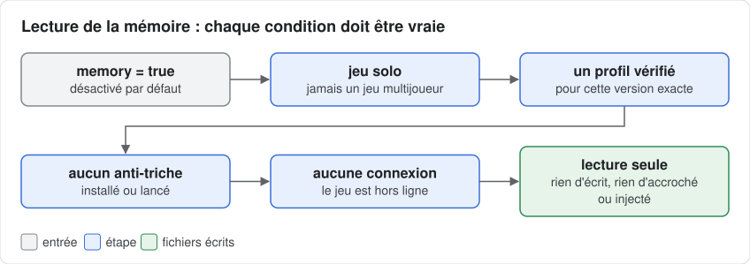

# Lecture de la mémoire {#reading-memory}

Certains jeux solo ne disent rien aux autres programmes. Pour ceux-là, le watcher peut - si vous l'activez et
écrivez vous-même un profil - chercher où vous vous trouvez dans la mémoire du jeu, en lecture seule.

Pour les jeux solo qui ne publient rien, le watcher peut lire des positions et des valeurs dans la
mémoire du jeu, grâce à un **profil** que vous écrivez pour votre propre version du jeu. De toutes les sources, c'est la
seule que le jeu n'a pas donnée ; elle est donc plus encadrée que les autres :

- elle est **désactivée par défaut** (`python -m heat3d_watch config --set memory=true` l'active) ;
- elle lit, et n'a aucun moyen d'écrire ;
- **aucun profil n'est livré avec les outils.**

Les profils ne sont pas livrés parce qu'un décalage n'est juste que pour la version sur laquelle il a été trouvé. Après un
correctif, un profil qui était juste avant lit des données erronées, et des données erronées ressemblent
exactement à des nombres. Un profil doit être vérifié sur la version qu'un joueur possède, par ce joueur.

## Les contrôles, dans l'ordre {#the-checks-in-order}



Chaque contrôle ci-dessous doit réussir. Les quatre premiers sont faits **avant** l'ouverture du jeu, car ouvrir un
jeu protégé en lecture est déjà ce que remarque un anti-triche, et refuser après serait trop tard.

1. **Le réglage** : `memory` vaut vrai. Sinon, les adaptateurs de mémoire ne démarrent jamais.
2. **Un profil pour le jeu**, dont `exe` nomme le processus en cours. Un profil indique si le
   jeu peut être joué en ligne (`"online"`) ; un profil qui omet cette clé est rejeté.
3. **Aucun anti-triche à proximité** :
   - aucun fichier anti-triche dans le dossier du jeu ni jusqu'à trois dossiers au-dessus (en s'arrêtant au dossier
     `common` d'une bibliothèque Steam, ou à un dossier contenant `steamapps`, car d'autres jeux se trouvent au-dessus) :
     `EasyAntiCheat`, `EasyAntiCheat_EOS_Setup.exe`, `start_protected_game.exe`, `BattlEye`,
     `BEClient_x64.dll`, `BEService_x64.exe`, `EAAntiCheat.GameServiceLauncher.exe`, `AntiCheatExpert`,
     `SGuard64.exe`, `GameGuard`, `GameMon.des`, `XIGNCODE`, `xhunter1.sys`, `Vanguard`, `FACEIT`
     (comparés en minuscules, aussi comme début de nom). Si le dossier du jeu est inconnu, le jeu est
     refusé ;
   - aucun pilote ni service anti-triche en cours d'exécution sur la machine, tel que listé par
     `sc query type= driver state= active` et `sc query type= service state= active` : EasyAntiCheat,
     EasyAntiCheat_EOS, BEService, BEDaisy, vgk, vgc, ACE-BASE, ACE-GAME, xhunter1, FACEIT,
     FACEITService, EAAntiCheatService, Denuvo Anti-Cheat, npggsvc, Ricochet. Un anti-triche en mode noyau
     installé pour un autre jeu surveille quand même chaque processus. Si les services ne peuvent pas être listés, le
     jeu est refusé ;
4. **Pas en ligne** : un jeu dont le profil indique `"online": true` n'est lu que tant qu'il n'a de connexion vers rien d'autre
   que cette machine (toute adresse distante autre que `127.x`, `::1`). Si ses connexions ne peuvent pas être lues, il est refusé.
5. Ensuite, au démarrage de l'adaptateur :
   - **la version exacte** : la taille du fichier de l'exécutable, ou son SHA-256, doit correspondre à une version listée par le
     profil. Une version inconnue n'est pas lue ;
   - **les modules une fois de plus** : les modules chargés du jeu sont listés (un instantané Toolhelp, qui ne demande
     aucun droit d'accès propre) et contrôlés pour un client anti-triche (`BEClient_x64.dll`,
     `BEClient.dll`, `EasyAntiCheat_x64.dll`, `EasyAntiCheat.dll`, `EOSAntiCheat...`). Un processus protégé refuse
     l'instantané, ce qui est aussi un refus ;
   - ce n'est qu'alors que le processus est ouvert, avec `PROCESS_VM_READ | PROCESS_QUERY_LIMITED_INFORMATION` et
     rien d'autre.

Les contrôles 1 à 4 sont répétés à chaque analyse (toutes les 2 s) pendant que le jeu tourne. Si l'un commence à échouer (le
jeu se connecte à un serveur, un service anti-triche démarre), l'adaptateur est arrêté à l'analyse suivante. Un
refus est journalisé : `mem-<id>: not reading memory: <reason>`. Un échec au démarrage (version inconnue,
un module anti-triche, un motif introuvable) est journalisé comme `mem-<id>: could not start`, et l'adaptateur
n'est pas réessayé tant que le jeu n'est pas relancé.

Il n'y a aucune écriture, aucune allocation dans l'autre processus, aucun thread lancé dedans, aucune bibliothèque chargée,
aucun privilège de débogage et aucune élévation. Un test (`test_memory_reading_cannot_write` dans
`tests/test_core.py`) échoue si un appel qui écrit dans un autre processus, y alloue de la mémoire ou y exécute du code -
`WriteProcessMemory`, `VirtualAllocEx`, `CreateRemoteThread`, `PROCESS_VM_WRITE`, `SeDebugPrivilege`,
`LoadLibrary`, ... - apparaît n'importe où dans le paquet.

Ne jamais lire, quoi que dise un profil : les jeux joués en ligne, et les jeux dont le mode solo tourne
sous un anti-triche, comme GTA V, ou Elden Ring lancé par son lanceur. Les contrôles ci-dessus les refusent de toute façon.

## Le format du profil {#the-profile-format}

Un profil est un fichier JSON dans `<data>\profiles\` (`<data>` est le dossier de données, voir
[Installation et lancement](installing-and-running.md#where-everything-is)), un par jeu, avec n'importe quel nom de fichier
se terminant par `.json`. Un exemple fictif :

```json
{
  "schema": "heat3d.memprofile/1",
  "id": "mygame",
  "game": "My Game",
  "exe": "MyGame.exe",
  "online": false,
  "versions": [ { "label": "1.06", "size": 123456789 } ],
  "anchors": {
    "World": { "aob": "48 8B 05 ?? ?? ?? ?? 48 85 C0", "rip": [3, 7] }
  },
  "values": {
    "pos": { "type": "vec3f", "base": "World", "chain": ["0x10", "0x68", "0x70"] },
    "hp":  { "type": "i32",   "base": "World", "chain": ["0x10", "0x138"] },
    "map": { "type": "u32",   "base": "World", "chain": ["0x10", "0x1C0"] }
  },
  "events": [
    { "event": "death", "value": "hp",  "when": "to_zero" },
    { "event": "zone",  "value": "map", "when": "change" }
  ],
  "axes": { "up": "y", "units": "metres" },
  "rate": 10,
  "provenance": [ { "source": "https://example.com/my-notes", "verified_on": "1.06" } ]
}
```

| Clé | Obligatoire | Ce que c'est |
|---|---|---|
| `schema` | oui | exactement `heat3d.memprofile/1` |
| `id` | oui | court et stable ; l'adaptateur s'appelle `mem-<id>` |
| `game` | oui | le nom du jeu, dont le dossier de session prend le nom |
| `exe` | oui | le nom de fichier de l'exécutable, qui indique aussi que le jeu tourne |
| `online` | oui | `true` si le jeu peut être joué en ligne du tout ; il n'est alors lu que hors ligne |
| `versions` | oui | les versions sur lesquelles le profil a été vérifié : chacune avec un `label`, et une `size` (la taille de l'exécutable en octets) et/ou un `sha256`. Quand les deux sont donnés, les deux doivent correspondre. Une entrée avec aucun des deux ne correspond à rien. |
| `anchors` | oui | adresses nommées dans le module principal. `aob` : un motif d'octets, des octets hexadécimaux séparés par des espaces, `?` ou `??` pour n'importe quel octet ; il doit apparaître **exactement une fois** dans l'image du module (plusieurs correspondances comptent comme un échec, comme aucune). `rip: [d, n]` : le motif pointe vers une instruction avec un déplacement RIP relatif de 32 bits à l'octet `d` et de longueur `n` ; l'ancre devient l'adresse à laquelle cette instruction se réfère. `offset` : ajouté ensuite (texte hexadécimal ou décimal). Au lieu de `aob`, `module_offset` donne un décalage fixe depuis la base du module. |
| `values` | oui | ce qui est lu à chaque interrogation : `type` (`i32`, `u32`, `i64`, `u64`, `u8`, `f32`, `f64`, `vec3f`, `vec3d`), `base` (le nom d'une ancre), `chain` (décalages en texte hexadécimal ou décimal) |
| `events` | non | règles qui transforment les changements en événements : `when` `change` (la valeur diffère de la dernière interrogation) ou `to_zero` (un nombre passe de au-dessus de 0 à 0 ou en dessous) |
| `axes` | non | `up` (par défaut `y`), `units` (par défaut `game units`), `scale` (l'échelle d'unité du visualiseur, qui multiplie chaque position ; par défaut 1, les unités propres au jeu) |
| `rate` | non | interrogations par seconde, de 1 à 60 (par défaut 10) |
| `provenance` | non | d'où viennent les décalages et sur quelle version vous les avez vérifiés ; c'est recopié dans le `meta.json` de chaque session |

**Comment une valeur est lue.** L'adresse de l'ancre est le point de départ. Si `chain` est vide, la valeur est lue
à cet endroit même. Sinon, le pointeur stocké à l'ancre est d'abord lu. Puis, pour chaque décalage sauf le
dernier, le pointeur à `address + offset` est lu. Le dernier décalage est ajouté pour donner l'adresse de la
valeur. Un pointeur nul en chemin (le jeu est entre deux niveaux ou dans un menu) laisse la valeur vide pour cette
interrogation.

**Ce qui est enregistré.** Une valeur nommée `pos` (un `vec3f` ou `vec3d`) devient une ligne `position` du joueur
`me` à chaque interrogation. Chaque règle d'événement écrit sa ligne `event`, avec la nouvelle valeur et, quand `pos`
est connu, la position, et ajoute 1 à une statistique du même nom. L'image du module est lue une fois au
démarrage pour trouver les ancres, par blocs de 64 KiB ; les blocs qui ne peuvent pas être lus comptent comme des zéros. Le
`meta.json` de la session nomme le profil, le libellé de la version et la provenance.

Un profil inutilisable (JSON incorrect, mauvais `schema`, clé obligatoire absente) est ignoré et
journalisé comme `profile <file> not used: <reason>`. Les profils sont chargés au démarrage du watcher, donc relancez
`run` après en avoir ajouté ou modifié un.

## Écrire et vérifier un profil {#writing-and-verifying-a-profile}

1. **Seulement pour un jeu solo sans anti-triche.** Si le jeu a un anti-triche, ou si vous le jouez en ligne, arrêtez-vous
   ici : le watcher le refusera, et il doit le faire.
2. **Trouvez les valeurs sur votre propre version.** Travaillez hors ligne. Utilisez vos propres outils de débogage, ou des
   notes publiées sur le jeu, pour trouver la position du joueur et les valeurs qui vous intéressent, ainsi qu'un chemin
   de pointeurs vers chacune depuis un endroit fixe de l'exécutable. Préférez un motif d'octets (`aob`) à un
   `module_offset` fixe : un motif retrouve toujours sa place quand le code se déplace un peu.
3. **Rendez le motif unique.** Il doit correspondre exactement une fois dans le module. Remplacez par des jokers les octets qui
   changent (adresses, déplacements) et gardez assez d'octets fixes autour.
4. **Figez la version.** Mettez la taille exacte de l'exécutable dans `versions` ; PowerShell
   `(Get-Item .\MyGame.exe).Length` la donne, et `Get-FileHash .\MyGame.exe -Algorithm SHA256` donne
   le hachage. Après un correctif, le profil cesse simplement d'être utilisé jusqu'à ce que vous le vérifiiez à nouveau et ajoutiez la
   nouvelle version.
5. **Indiquez si le jeu se joue en ligne** (`online`), honnêtement.
6. **Essayez-le** : activez la lecture (`config --set memory=true`), placez le fichier dans `<data>\profiles\`, et
   vérifiez que `python -m heat3d_watch games` liste `mem-<id>`. Lancez le jeu et exécutez
   `python -m heat3d_watch run -v`. Dans `watcher.log`, cherchez `mem-<id>: starting`, ou la raison
   pour laquelle il a été refusé ou n'a pas pu démarrer.
7. **Vérifiez les nombres contre le jeu.** Marchez jusqu'à un endroit connu et regardez les lignes `position` dans
   `events.jsonl` de la session. Bougent-elles quand vous bougez, de la bonne quantité, selon les bons axes ? Ouvrez
   `heat.parquet` dans le visualiseur et vérifiez que le trajet correspond à l'endroit où vous êtes allé. Déclenchez chaque événement
   (perdre toute sa vie, changer de zone) et vérifiez qu'il n'apparaît qu'une fois. Des données erronées ressemblent à des
   nombres, et seule cette comparaison permet de les distinguer.
8. **Notez ce que vous avez vérifié** dans `provenance` : la source des décalages et la version sur laquelle vous les avez
   contrôlés.

Le texte `verified` d'un adaptateur de mémoire, tel que `games` l'affiche, est toujours « by the profile's author, for the
builds it lists ». Le watcher ne peut pas en savoir davantage.
