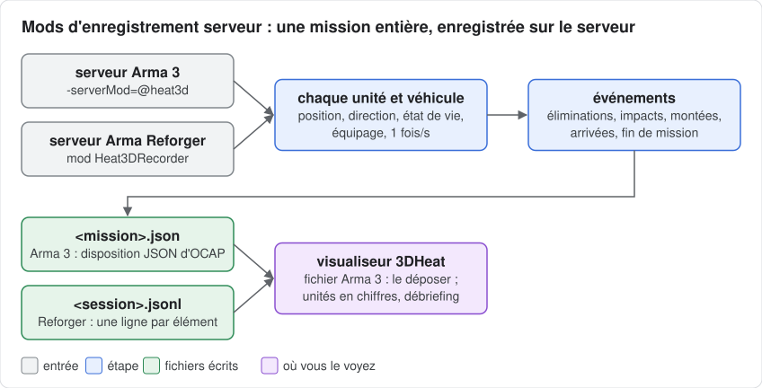

# Mods d'enregistrement serveur (Arma 3, Arma Reforger) {#server-recorder-mods-arma-3-arma-reforger}

La plupart des jeux sont enregistrés par le watcher sur la machine du joueur. Arma est différent : un
serveur peut enregistrer une mission entière — chaque unité et chaque véhicule, pas seulement le vôtre —
avec un mod qui tourne sur le serveur. Les joueurs ne configurent rien : le mod d'Arma 3 ne concerne que le
serveur, et Reforger télécharge tout seul les mods d'un serveur chez les joueurs quand ils le rejoignent
(le mod ne fait rien sur leurs machines). Le dépôt contient deux de ces mods, dans
[`mods/arma3`](https://github.com/Holdi601/3DHeat-Watcher/tree/main/mods/arma3)
et [`mods/reforger`](https://github.com/Holdi601/3DHeat-Watcher/tree/main/mods/reforger).
Leurs README sont la documentation complète ; cette page en est le survol.

**Statut : les deux ne sont pas encore testés dans le jeu.** L'extension d'Arma 3 a été compilée et
pilotée de la façon dont Arma appelle les extensions, et sa sortie a été lue par 3DHeat ; ses scripts SQF
n'ont pas encore tourné dans Arma 3. Le mod Reforger a été écrit d'après l'API de script publiée par
Bohemia et n'a jamais été compilé. Ne les mettez pas sur un serveur public avant que les étapes de test de
leur README soient passées.

## Arma 3 {#arma-3}

1. Compilez l'extension une fois par plateforme (`mods/arma3/extension`). Cela demande un compilateur C :
   Visual Studio Build Tools sous Windows, gcc sous Linux ; si vous n'avez jamais compilé, demandez à
   l'hébergeur de votre serveur.
   - Windows, dans un « x64 Native Tools Command Prompt for VS » :
     `cl /nologo /O2 /LD heat3d.c /Fe:heat3d_x64.dll`
   - Linux : `gcc -O2 -shared -fPIC -o heat3d_x64.so heat3d.c -ldl`
2. Construisez le mod : `python mods/arma3/build.py` écrit `mods/arma3/@heat3d/`
   (pas besoin d'Arma 3 Tools).
3. Copiez `@heat3d` dans le dossier du serveur et lancez le serveur avec
   `-serverMod=@heat3d`.
4. Le journal `.rpt` du serveur indique `Heat3D recorder 0.1.0: recording <file> every 1 s`.

| Réglage | Défaut | Ce qu'il fait |
|---|---|---|
| `captureDelay` | 1 | secondes entre deux images |
| `recordHits` | 1 | 0 désactive les événements d'impact |
| `recordShots` | 1 | 0 désactive le comptage des tirs |
| `minPlayers` | 0 | n'enregistre qu'à partir de ce nombre de joueurs connectés |

Une mission le remplace dans son `init.sqf` (`heat3d_captureDelay = 0.5;`).
Les enregistrements vont dans `recordings/` à l'intérieur de `@heat3d`, ou dans `HEAT3D_DIR`.

**Sortie :** un fichier par mission, dans la disposition JSON d'OCAP (le format de l'enregistreur OCAP2),
nommé `<date>__<time>_<mission>.json`. Pendant la mission, c'est un journal (`.heat3d.part`), vidé à
chaque écriture ; le journal d'une mission plantée est terminé la prochaine fois qu'une mission démarre.

## Arma Reforger {#arma-reforger}

Le mod (`Heat3DRecorder.gproj`) s'ouvre et se construit dans Workbench de Bohemia (Arma Reforger Tools),
se teste sur un serveur dédié local, se publie depuis Workbench (non listé pendant les tests) et s'ajoute à
la liste `mods` du `config.json` du serveur — étape par étape dans son README. Chaque seconde, il écrit la
position, la direction, l'état de vie, le véhicule et l'identifiant de joueur de chaque personnage, et la
position, la direction, l'état et l'équipage de chaque véhicule ; ainsi que les kills (tueur, arme, distance),
les impacts, les montées et descentes de véhicule, les arrivées et départs de joueurs, et la fin de la
mission.

**Sortie :** un objet JSON par ligne, `$profile:heat3d/<date UTC>_<heure UTC>_<monde>.jsonl` : une ligne
`header` (format `heat3d-reforger`, axes x est, y vertical, z nord), puis des lignes `entity`, `frame` et
`event` au fil des événements, et une ligne `end`. Les lignes d'unités sont
`[id, x, y, z, dir, alive, vehicleId, playerId]`, les lignes de véhicules
`[id, x, y, z, dir, alive, [crew ids]]` ; les événements suivent la disposition d'événements d'OCAP2.

## Dans la visionneuse {#in-the-viewer}

Déposez un enregistrement d'Arma 3 sur la [visionneuse 3DHeat](https://holdi601.github.io/3DHeat/) :
une mission devient une session, les unités deviennent des soldats, les véhicules prennent leur type, et les
kills et impacts vont dans la liste du débriefing. Le lecteur web d'OCAP2 le joue aussi. Le fichier Reforger
est le format de lignes propre au mod, avec la disposition d'événements d'OCAP2.
