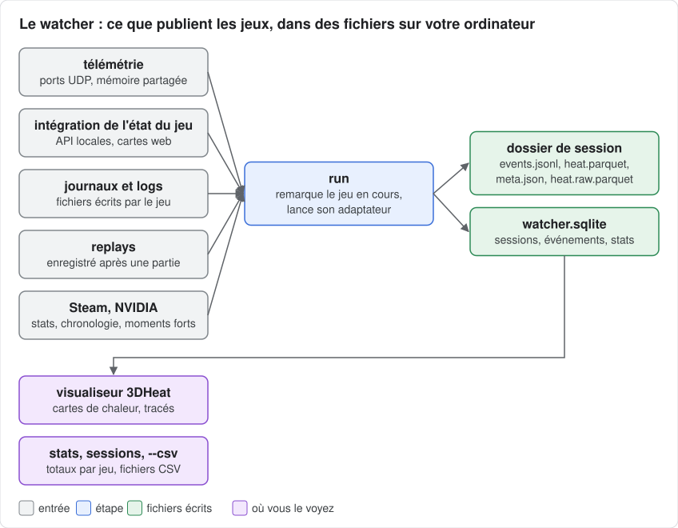

# Sources et règles {#sources-and-rules}

Le watcher n'enregistre que ce que les jeux et les plateformes remettent au joueur. Cette page explique quelles sources cela couvre, ce que le watcher peut faire avec chacune, et quels jeux ou parties de jeux il laisse de côté à dessein.

## Les six types de source {#the-six-kinds-of-source}

Chaque adaptateur a un `kind`, et ce type décide de ce que l'adaptateur peut faire :

| Type | Ce que c'est | Jeux multijoueurs |
|---|---|---|
| `telemetry` | un port UDP ou une mémoire partagée que le jeu publie pour les tableaux de bord, les simulateurs de mouvement et les volants (Forza Data Out, UDP de F1, mémoire partagée de Kunos et iRacing, SimConnect, l'interface UDP de X-Plane, le plugin SCS SDK) | oui - c'est la sortie du jeu elle-même |
| `gsi` | une intégration d'état de jeu ou une API web locale que le jeu sert au propre ordinateur du joueur (Valve GSI, l'API Live Client Data de League, l'API de statistiques de Rocket League, la carte web de War Thunder) | oui, dans ce que l'API montre au joueur |
| `log` | des fichiers que le jeu écrit pendant qu'il tourne : journaux de bord, journaux, statistiques, sauvegardes (Elite Dangerous, Minecraft, Path of Exile, Hearthstone, Star Citizen, EVE Online) | oui |
| `replay` | des démos et replays que le jeu sauvegarde pour ses joueurs, convertis après le match (CS2, Dota 2, War Thunder, World of Tanks, World of Warships, Squad, League of Legends, VALORANT, IL-2 Tacview) | oui, sauf s'ils sont chiffrés, et seulement les parties en clair |
| `platform` | ce que Steam et le pilote graphique conservent : statistiques, succès, chronologies, clips et moments forts | oui |
| `memory` | la mémoire du jeu, en lecture seule, par un profil que vous avez écrit | **jamais** - solo uniquement |

Seul `memory` ouvre un autre processus, et seulement en lecture. Les cinq autres types lisent ce que le jeu, Steam ou l'application NVIDIA a déjà écrit ou envoie.

## Comment les sources sont lues {#how-the-sources-are-read}

- **Rien n'est injecté, accroché ni modifié dans un jeu.** Aucun code n'est chargé dans un jeu, aucune fenêtre ni aucune entrée n'est interceptée, aucun fichier de jeu n'est modifié. Les seuls fichiers que le watcher écrit hors de son dossier de données sont ceux que [`setup --apply`](commands.md#setup) écrit quand vous le demandez : le fichier de réglages propre à un jeu (avec l'original gardé sous `<file>.heat3d-backup`), un fichier cfg d'état de jeu, le script de hook DCS, le mod de protocole BeamNG.
- **La mémoire partagée est ouverte en lecture seule, et jamais créée.** La façon habituelle en Python d'ouvrir un espace mémoire nommé en crée un quand il n'existe pas encore. Un jeu lancé après cela trouverait la mémoire vide et en lecture seule du watcher au lieu de créer la sienne, et sa télémétrie serait morte. Le watcher n'ouvre les espaces qu'avec `OpenFileMappingW` (qui ne trouve qu'un espace existant), les mappe avec `FILE_MAP_READ`, et réessaie plus tard si le jeu ne les a pas encore créés.
- **Les ports sont empruntés, jamais pris.** Un port UDP de télémétrie qu'un autre programme écoute déjà (FH Companion, SimHub, une application de tableau de bord) est laissé à ce programme. Si un autre programme se met à écouter un port que le watcher tient, le watcher le lâche dans les quelques secondes. Les adaptateurs Forza attendent 15 s après le lancement du jeu avant de prendre le port 5300, et transmettent chaque paquet sans modification vers 127.0.0.1:5301, pour qu'une seconde application Data Out puisse encore enregistrer.
- **Local uniquement.** Les serveurs d'état de jeu que le watcher fait tourner (CS2, Dota 2) écoutent sur 127.0.0.1 et nulle part ailleurs. Quand le fichier cfg du jeu contient un jeton (celui qu'écrit `setup`), chaque envoi doit le porter ; les envois sans lui sont comptés comme `bad_auth` et jetés. Sans fichier cfg avec un jeton, tout envoi local est accepté, et le journal le signale. Les API locales que le watcher interroge (League sur le port 2999, War Thunder sur 8111, Rocket League sur 49123, X-Plane sur 49000) sont sur 127.0.0.1.
- **Les fichiers journaux sont partagés, jamais verrouillés.** Chaque lecture ouvre le fichier avec tous les indicateurs de partage que Windows connaît, puis le referme, pour que le jeu puisse continuer à écrire, renommer ou remplacer son journal.
- **Deux services extérieurs, et seulement dans ces cas.** La vérification de version interroge GitHub (`api.github.com`) au plus toutes les six heures, et peut être désactivée (voir [Mises à jour](updates.md)). L'adaptateur de replays League interroge l'API Match-V5 de Riot seulement si vous avez saisi votre propre `riot_api_key`. Rien d'autre n'est envoyé nulle part.
- **Activer une source est votre décision.** `setup` sans `--apply` dit seulement ce qu'il modifierait.

## Règles du multijoueur {#multiplayer-rules}

- Un jeu joué en ligne n'est enregistré qu'à travers ce qu'il publie : télémétrie, API d'état de jeu, journaux, replays, fichiers de plateforme. Dans ces limites, le watcher enregistre ce que le jeu montre au joueur, et rien de calculé au-delà :
  - **L'intégration d'état de jeu de CS2** envoie le joueur regardé (vous-même quand vous êtes en vie, un coéquipier après votre mort). Les positions des autres joueurs (`allplayers_*`) ne sont envoyées qu'aux spectateurs et au GOTV, donc le watcher ne les demande pas.
  - **L'API Live Client Data de League of Legends** n'a pas de positions. La politique de Riot autorise les outils à montrer ce que le joueur peut savoir du jeu lui-même, et rien de calculé au-delà (pas de minuteurs ennemis). Le watcher enregistre le fil des frags et le tableau des scores que voit le joueur, et les propres chiffres du joueur.
  - **L'API de statistiques de Rocket League** n'a pas de positions de voitures (l'état des voitures n'est envoyé qu'aux spectateurs). Ce qui a un lieu, c'est la balle : là où elle a été frappée, marquée ou a touché la barre transversale.
  - **La carte web de War Thunder** montre ce que montre la minicarte, sans noms ni identifiants.
  - **F1 23/24/25** mettent la position de chaque voiture dans leur paquet Motion, en ligne aussi. Le jeu la transmet lui-même, et ne retient que les données des joueurs dont le réglage « Your Telemetry » est restreint.
  - **DCS World** : un serveur multijoueur peut interdire l'export des données de son propre avion ; la session n'a alors que des événements, pas de positions, et le dit.
- **La mémoire n'est jamais lue dans un jeu multijoueur.** Un adaptateur mémoire pour un jeu marqué comme joué en ligne est refusé, et un profil doit indiquer si son jeu peut être joué en ligne. Un jeu solo qui a aussi un mode en ligne n'est lu que tant qu'il n'a de connexion avec rien d'autre que cette machine. Les jeux dont le mode solo tourne sous un anti-triche ne sont jamais lus non plus. Voir [Lecture de la mémoire](memory-reading.md).
- L'indicateur `multiplayer` d'un adaptateur (affiché comme « Online play » par `games --markdown`) ne décide que de la lecture de la mémoire. Il n'empêche pas les autres types d'enregistrer le jeu en ligne.

## Ce qui est refusé, et pourquoi {#what-is-declined-and-why}

Certains jeux, et certaines parties de jeux, ne sont pas enregistrés : leurs données sont protégées, non publiées, ou absentes de la machine du joueur :

| Jeu | Ce qui est laissé de côté | Pourquoi |
|---|---|---|
| VALORANT | positions, noms, scores dans les replays ; les points d'accès du fichier lockfile du client | Le flux de jeu du replay est obscurci avec des valeurs tirées de l'exécutable de chaque version. Le jeu tourne sous Vanguard. Les points d'accès du fichier lockfile du client Riot ne sont pas une API publiée. **Lu :** ce que le replay contient en clair - la carte, l'identifiant du match, les agents, la chronologie des frags et des manches du serveur. |
| League of Legends | la partie moment par moment des replays `.rofl` ; les points d'accès du fichier lockfile du client | Obscurci contre la triche, différemment à chaque patch, et non décodé. **Lu :** la fiche de fin de partie que chaque replay contient en JSON clair, l'API Live Client Data pendant un match, et - avec votre propre clé développeur - la chronologie officielle Match-V5 (positions une fois par minute, frags là où ils ont eu lieu). |
| Fortnite | replays | Chiffrés. |
| World of Tanks, World of Warships | replays, dans le watcher | Chiffrés. Le watcher ne les lit pas ; des convertisseurs séparés, hors du watcher, le font (`exporters/ext/wot-replay`, `exporters/ext/wows-replay`), chacun un projet à part entière. **Lu, avec un convertisseur installé :** la position de chaque véhicule ou navire tant que le client d'enregistrement le connaissait, et les frags. |
| Gran Turismo 7 | télémétrie | Console uniquement, et sa télémétrie est chiffrée avec une clé retrouvée à partir du jeu. |
| Apex Legends | tout | Son LiveAPI n'envoie les événements complets que dans les salons privés et personnalisés ; rien n'est disponible localement sinon. |
| Overwatch 2, Call of Duty, Battlefield 6, Hunt: Showdown 1896 | données en direct | Aucune sortie locale de replay, de journal ou d'état de jeu à lire. Leurs statistiques arrivent là où Steam les garde ([Statistiques Steam](game-steam-stats.md), [Steam Timeline](game-steam-timeline.md)), et leurs clips sous forme de [moments forts NVIDIA](nvidia-highlights.md). |
| Star Citizen | tout ce qui dépasse `Game.log` | Utilise Easy Anti-Cheat ; le watcher ne lit que le fichier journal que le jeu écrit et ne s'approche jamais du processus du jeu. |
| osu! | replays | Hors sujet : un jeu en 2D, sans rien à placer sur une carte. |
| Tout jeu multijoueur | mémoire | Jamais. Les jeux solo dont le mode tourne sous un anti-triche (GTA V, Elden Ring via son lanceur) ne sont pas lus non plus. |

Les replays chiffrés ne sont pas ouverts : le lecteur de replays VALORANT vérifie l'indicateur de chiffrement du replay et refuse un fichier chiffré (« this replay is encrypted; it is not read »).

Jeux étudiés mais pas encore construits (replays de Deadlock, fichiers `.replay` de Rocket League, StarCraft II, Team Fortress 2, Rainbow Six Siege, Beat Saber, Trackmania, plusieurs simulateurs de course) sont listés avec leurs sources dans [Tous les jeux dans un tableau](watcher.md#researched-not-yet-built). Chacun a besoin de fichiers d'exemple pour être vérifié avant d'être livré.
