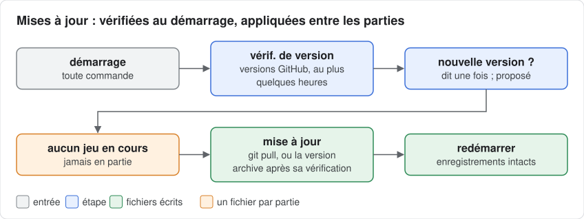

# Mises à jour {#updates}

Le watcher se tient à jour à partir des versions publiées sur
[Holdi601/3DHeat-Watcher](https://github.com/Holdi601/3DHeat-Watcher/releases). Le programme de mise à jour
est le paquet `heat3d_update`, à côté de `heat3d_watch` dans le dépôt.

## La vérification {#the-check}

- **Quand** : chaque commande sauf `update` vérifie au démarrage. `run` vérifie aussi pendant qu'il tourne,
  au plus une fois par heure et seulement quand aucun jeu ne tourne.
- **Comment** : une seule requête HTTPS vers `https://api.github.com/repos/Holdi601/3DHeat-Watcher/releases/latest`,
  avec un délai de 5 secondes. La réponse est gardée en cache six heures dans
  `%LOCALAPPDATA%\3DHeat\update-check-3DHeat-Watcher.json`, donc la plupart des démarrages ne demandent rien.
  « Pas encore de version » (HTTP 404) est mis en cache comme une réponse. Hors ligne, limité en débit ou
  derrière un proxy, la vérification échoue discrètement et la commande continue avec la version qu'elle a.
- **Versions** : la version installée est le fichier `VERSION` du dossier du dépôt. Le tag d'une version
  (`v1.2.0` ou `1.2.0`) est comparé en nombres, partie par partie ; tout ce qui suit un `-` ou un `+` est ignoré.
- **Désactiver** : `HEAT3D_NO_UPDATE=1` (toute valeur sauf vide, `0`, `false` ou `no`) désactive la vérification
  et la mise à jour automatique. Chaque outil 3DHeat garde son propre fichier de cache, donc la réponse d'un
  outil ne tient jamais lieu de celle d'un autre.

## Ce qui se passe quand une version plus récente est sortie {#what-happens-when-a-newer-release-is-out}

- **`run`** affiche un avis au démarrage, et continue de tourner :
  `[heat3d_watch] 3DHeat Watcher 1.2.0 is out (this is 1.0.2). <release page>`. Pendant qu'il tourne, avec
  `auto_update` activé (par défaut) et aucun jeu en cours, il se met alors à jour lui-même : la ligne de journal
  `3DHeat Watcher 1.2.0 is out (this is 1.0.2); updating`, une notification Windows « Updating to 1.2.0 », la
  mise à jour, l'arrêt de chaque adaptateur et la fermeture de ses sessions, puis la même commande relancée sur
  le nouveau code. Le watcher ne se met jamais à jour au milieu d'une partie. Si la mise à jour ne peut pas
  être appliquée, la notification le dit (« 1.2.0 is out; not updated: ... ») et le watcher continue avec
  l'ancienne version. Avec `auto_update` désactivé, il n'y a que l'avis.
- **Les autres commandes** demandent `Update now? [Y/n]` quand elles tournent dans un terminal. Entrée, `y`,
  `yes`, `j` ou `ja` met à jour, puis relance la même commande sur la nouvelle version. Sans terminal (une
  exécution planifiée, un tube), elles indiquent comment mettre à jour et continuent.
- **Sur demande** : `python -m heat3d_watch update` (ou `python -m heat3d_update`) interroge GitHub sans le cache
  et met à jour. `--check` dit seulement si une version plus récente est sortie. Cela fonctionne même avec
  `HEAT3D_NO_UPDATE` défini.

## Comment une mise à jour est appliquée {#how-an-update-is-applied}

Cela dépend de la façon dont la copie a été installée :

- **Un clone git** (le dossier contient `.git` et `git` est dans le PATH) : `git pull --ff-only`. C'est refusé
  tant que le clone a des modifications de fichiers suivis (`git status --porcelain --untracked-files=no` n'est
  pas vide) : ces modifications sont le travail de quelqu'un, et une mise à jour ne décide pas de leur sort.
  Validez-les ou mettez-les de côté (commit ou stash), puis faites le pull.
- **Une copie téléchargée** : l'archive source de la version est téléchargée et décompressée dans un dossier
  temporaire. Les entrées qui sortiraient de ce dossier sont ignorées. Le `VERSION` de l'archive doit être la
  version que la publication annonce, sinon rien n'est copié. Ses fichiers sont ensuite copiés par-dessus le
  dossier du dépôt. Les fichiers qui ne font pas partie d'une version — enregistrements, paramètres,
  environnements virtuels, exports, tout ce que vous avez créé — ne sont pas touchés. Un module Python qu'une
  ancienne version avait et que la nouvelle a abandonné est supprimé des paquets de la version
  (`heat3d_watch`, `heat3d_update`), pour qu'aucun module d'adaptateur périmé ne soit chargé après la mise à
  jour ; rien en dehors de ces paquets n'est supprimé.

Les enregistrements et les paramètres se trouvent de toute façon en général hors du dossier du dépôt
(`%LOCALAPPDATA%\3DHeat\Watcher`), donc une mise à jour ne les touche jamais.

Après une mise à jour, la même commande est relancée. Sous Windows, le watcher démarre le nouveau processus,
attend qu'il finisse et transmet son code de sortie, pour que la console se comporte comme si le premier
processus avait fait le travail.
