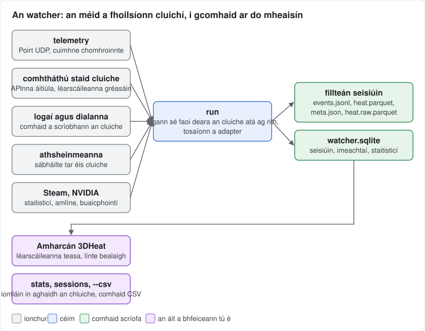

# 3DHeat Watcher {#dheat-watcher}

**Cad é?** Imríonn tú cluiche. Scríobhann an clár seo síos go ciúin cá ndeachaigh tú agus cad a tharla.
Ina dhiaidh sin is féidir leat féachaint air mar léarscáil daite san amharcán 3DHeat.

**Cén fáth a n-úsáidfinn é?** Chun do thaifead féin a choinneáil de gach suí - an áit ar thiomáin tú, ar eitil tú nó ar throid tú,
do iomláin in aghaidh an chluiche - gan aon suíomh gréasáin agus gan an cluiche a athrú.

**Sampla:** tiomáineann tú cuairt i gcluiche rásaíochta agus an watcher ag rith; ina dhiaidh sin coinníonn comhad i
`sessions\<game>\` an líne a ghlac tú, agus tarraingíonn an t-amharcán í.

Níos mine: is clár cúlra é 3DHeat Watcher a thaifeadann an méid a fhoilsíonn cluichí faoi d'imirt - an áit
ar chuaigh tú, cad a tharla cén áit, agus na huimhreacha taobh thiar de - i gcomhaid ar do mheaisín féin. Tá na comhaid
le haghaidh do staitisticí féin agus do léarscáileanna teasa agus línte bealaigh an amharcáin 3DHeat.

Ritheann sé go ciúin, tugann sé faoi deara cén cluiche a thosaigh tú, agus léann sé aschuir an chluiche sin féin: port telemetry
nó cuimhne chomhroinnte a fhoilsíonn an cluiche do dashboards, comhtháthú staid cluiche, an dialann nó an log a
scríobhann an cluiche, an t-athsheinm a shábhálann sé tar éis cluiche, na staitisticí a choinníonn Steam, na clipeanna a shábhálann
an NVIDIA App. Fanann taifid ar do mheaisín. Ní dhéanann an clár teagmháil ach le dhá sheirbhís sheachtracha, agus sna cásanna
seo amháin: GitHub, chun eisiúint níos nuaí a lorg (féach [Nuashonruithe](../updates.md)), agus API Match-V5 de chuid Riot,
agus ach amháin má iontrálann tú d'eochair API Riot féin (féach [Athsheinmeanna League of Legends](../game-lol-replays.md)).



## Cad a thaifeadann sé {#what-it-records}

- **Suíomhanna**: an carr, an t-aerárthach, an laoch nó an t-imreoir, go minic sa soicind nuair a fhoilsíonn an cluiche
  iad, le luas, treo agus cibé rud eile a sheolann an cluiche leo.
- **Imeachtaí**: spawns, básanna, maruithe, cuairteanna, céimeanna, babhtaí, cúil, jabanna, éirí den talamh agus tuirlingtí, athruithe
  crios, éachtaí, buaicphointí. Stóráiltear gach imeacht lena am, agus lena áit nuair a
  thugann an cluiche ceann.
- **Staitisticí in aghaidh an tseisiúin**: maruithe, básanna, cuairteanna, an chuairt is fearr, achar, uasluas, am súgartha, agus
  staitisticí an chluiche féin nuair a choinníonn sé iad.

Tá an méid a thugann gach cluiche, agus ón áit, ar a leathanach féin faoi [Cluichí](../games.md). Ní féidir le foinse amháin
gach rud a thaifeadadh: ní thaifeadtar cluichí ilimreora ach tríd an méid a fhoilsíonn siad, agus ní léann an watcher
a gcuimhne riamh (féach [Foinsí agus rialacha](../sources-and-rules.md)).

## Suiteáil {#install}

An bhfuil tú nua leis an líne ordaithe? Léigh [Sula dtosaíonn tú](before-you-start.md) ar dtús.

Is clár Python do Windows é an watcher (Python 3.10 nó níos nuaí). Níl ach Windows ag go leor dá fhoinsí: cuimhne
chomhroinnte, an chlárlann, fógraí Windows.

```bash
git clone https://github.com/Holdi601/3DHeat-Watcher.git
cd 3DHeat-Watcher
pip install -r requirements.txt
```

Oibríonn cartlann eisiúna íoslódáilte ar an mbealach céanna: dízipeáil í, ansin rith `pip install -r requirements.txt`
laistigh den fhillteán. Tá na sonraí, agus na breiseanna a theastaíonn ó roinnt cluichí, in
[Suiteáil agus rith](../installing-and-running.md).

## Tús tapa {#quick-start}

```bash
python -m heat3d_watch games            # what each game gives, and from where
python -m heat3d_watch setup all        # what would have to be switched on (nothing is changed)
python -m heat3d_watch setup f1-25 --apply   # switch one game's output on (the original file is backed up)
python -m heat3d_watch run              # watch; leave it running while you play
python -m heat3d_watch stats            # totals per game
python -m heat3d_watch stats --csv out  # sessions, events and stats as CSV files
```

Ba chóir duit a fheiceáil: tar éis `games`, tábla le líne amháin in aghaidh an chluiche; leanann `run` ar aghaidh go dtí go mbrúnn tú
Ctrl+C nó go ndúnann tú an fhuinneog.

Scríobhtar gach rud chuig `%LOCALAPPDATA%\3DHeat\Watcher`. Chun fillteán eile a úsáid, socraigh an athróg
timpeallachta `HEAT3D_WATCH_HOME` nó rith `python -m heat3d_watch config --set data=D:\somewhere`.

- `sessions\<game>\<date>_<adapter>\` - fillteán amháin in aghaidh gach suí, ina bhfuil `events.jsonl` (gach imeacht
  de réir mar a tharlaíonn sé), `heat.parquet` (na sraitheanna le suíomh, réidh don amharcán 3DHeat) agus
  `meta.json` (cluiche, foinse, aiseanna, comhaireamh, staitisticí)
- `watcher.sqlite` - staitisticí gach seisiúin, i dtrí tábla simplí
- `watcher.log` - cad a rinne an watcher

Osclaíonn an t-amharcán `heat.parquet` seisiúin go díreach, gan aon rud le socrú (tá a aiseanna agus a aonaid sa
chomhad). Scríobhtar athsheinmeanna tiontaithe mar tháblaí agus cáipéisí cluiche lena thaobh; tá formáid comhad-amháin-in-aghaidh-an-chluiche
an amharcáin curtha síos ar a leathanach [coimeádán `.3dheat`](https://holdi601.github.io/3DHeat/container.html),
agus colúin gach tábla in [Na sonraí](../the-data.md).

## Na doiciméid {#the-documentation}

| Leathanach | Cad a chlúdaíonn sé |
|---|---|
| [Sula dtosaíonn tú](before-you-start.md) | Python, teirminéal, ionadchoinneálaithe, cuma an rath agus na n-earráidí coitianta |
| [Suiteáil agus rith](../installing-and-running.md) | riachtanais, rith sa chúlra, tosú le Windows, an comhad glasála, an log, gach socrú agus athróg timpeallachta |
| [Cluichí](../games.md) | leathanach amháin in aghaidh an chluiche: cad a thaifeadtar, ón áit, conas é a chasadh air, conas a oibríonn sé, aiseanna, staitisticí, cad a fíoraíodh |
| [Na sonraí](../the-data.md) | fillteáin seisiún, `events.jsonl`, `heat.parquet` agus a footer, `meta.json`, `watcher.sqlite`, aisghabháil tar éis tuairte, easpórtáil CSV, seisiún a oscailt san amharcán 3DHeat |
| [Orduithe](../commands.md) | gach ordú agus rogha de `python -m heat3d_watch` |
| [Foinsí agus rialacha](../sources-and-rules.md) | na sé chineál foinse, na rialacha ilimreora, cé na cluichí atá fágtha ar lár agus cén fáth |
| [NVIDIA Highlights](../nvidia-highlights.md) | cad is féidir agus nach féidir le NVIDIA Highlights a sheachadadh, agus conas a fhaigheann buaicphointe suíomh |
| [Modanna taifeadáin freastalaí](../server-mods.md) | modanna freastalaí Arma 3 agus Arma Reforger a thaifeadann misin iomlána don amharcán |
| [Cuimhne a léamh](../memory-reading.md) | próifílí cuimhne cluiche aon-imreora: an fhormáid, na seiceálacha, conas ceann a scríobh agus a fhíorú |
| [Nuashonruithe](../updates.md) | conas a lorgaíonn an watcher eisiúintí nua agus a nuashonraíonn sé é féin |
| [Forbairt](../development.md) | adapter a scríobh: an API, tástálacha, `verified` macánta, leathanaigh cluichí a athghiniúint |
| [Gach cluiche in aon tábla](../watcher.md) | gach cluiche in aon tábla, mar a phriontálann `games --markdown` é, móide na cluichí a ndearnadh taighde orthu ach nár tógadh go fóill |
| [Tagairt orduithe](../cli-reference.md) | `--help` gach ordaithe, ginte ón gcód |
| [Cothabháil](../maintaining.md) | seicliosta eisiúna na leathanach seo |

## Cuid de 3DHeat {#part-of-3dheat}

Tá 3DHeat Watcher ar cheann de na huirlisí saora timpeall ar amharcán 3DHeat (úsáideann an watcher 3DHeat CS2
chun demos CS2 a thiontú). Is tionscadal ar leith é gach ceann, lena eisiúintí agus a cheadúnas féin:

| Uirlis | Cad a dhéanann sí | Doiciméid |
|---|---|---|
| [3DHeat](https://github.com/Holdi601/3DHeat) | an amharcán: léarscáileanna teasa, anailís rása agus athbhreithniú cluiche i 3D | [suíomh](https://holdi601.github.io/3DHeat/) |
| [GameFiles](https://github.com/Holdi601/3DHeat-GameFiles) | cúrsaí agus leibhéil as na comhaid a sheolann cluichí, mar shamhlacha 3D | [suíomh](https://holdi601.github.io/3DHeat-GameFiles/) |
| [GameCapture](https://github.com/Holdi601/3DHeat-GameCapture) | telemetry cuarta ó chluichí rásaíochta; leibhéil atógtha ó fhíseán cluiche | [suíomh](https://holdi601.github.io/3DHeat-GameCapture/) |
| [Unreal Exporter](https://github.com/Holdi601/3DHeat-UnrealExporter) | breiseán d'Unreal Editor a onnmhairíonn leibhéal mar shamhail 3D amháin | [suíomh](https://holdi601.github.io/3DHeat-UnrealExporter/) |
| [CS2](https://github.com/Holdi601/3DHeat-CS2) | demos Counter-Strike 2 ina dtáblaí agus ina gcáipéisí cluiche; léarscáileanna ina samhlacha 3D | [suíomh](https://holdi601.github.io/3DHeat-CS2/) |
| [Watcher](https://github.com/Holdi601/3DHeat-Watcher) | taifeadann sé an méid a fhoilsíonn cluichí faoi d'imirt, sa chúlra | [suíomh](https://holdi601.github.io/3DHeat-Watcher/) |
| [Ext-WarThunder](https://github.com/Holdi601/3DHeat-Ext-WarThunder) | athsheinmeanna War Thunder ina dtáblaí agus ina gcáipéisí cluiche | [suíomh](https://holdi601.github.io/3DHeat-Ext-WarThunder/) |
| [Ext-WoT](https://github.com/Holdi601/3DHeat-Ext-WoT) | athsheinmeanna World of Tanks ina dtáblaí agus ina gcáipéisí cluiche | [suíomh](https://holdi601.github.io/3DHeat-Ext-WoT/) |
| [Ext-WoWs](https://github.com/Holdi601/3DHeat-Ext-WoWs) | athsheinmeanna World of Warships ina dtáblaí agus ina gcáipéisí cluiche | [suíomh](https://holdi601.github.io/3DHeat-Ext-WoWs/) |
| [Ext-Squad](https://github.com/Holdi601/3DHeat-Ext-Squad) | demos freastalaí Squad ina dtáblaí agus ina gcáipéisí cluiche | [suíomh](https://holdi601.github.io/3DHeat-Ext-Squad/) |
| [Ext-DCS](https://github.com/Holdi601/3DHeat-Ext-DCS) | léarscáileanna DCS World ina samhlacha 3D | [suíomh](https://holdi601.github.io/3DHeat-Ext-DCS/) |
| [Ext-IL2](https://github.com/Holdi601/3DHeat-Ext-IL2) | léarscáileanna IL-2 Sturmovik ina samhlacha 3D | [suíomh](https://holdi601.github.io/3DHeat-Ext-IL2/) |

Ceadúnas: MIT ([LICENSE](https://github.com/Holdi601/3DHeat-Watcher/blob/main/LICENSE)). Tá ceadúnais
na bpacáistí tríú páirtí a úsáideann sé, agus an méid a éilíonn na cluichí a léann sé, liostaithe in
[LICENSES.md](https://github.com/Holdi601/3DHeat-Watcher/blob/main/LICENSES.md).
