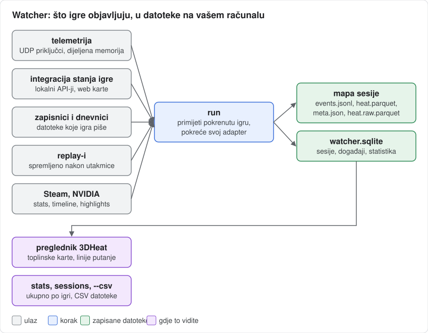
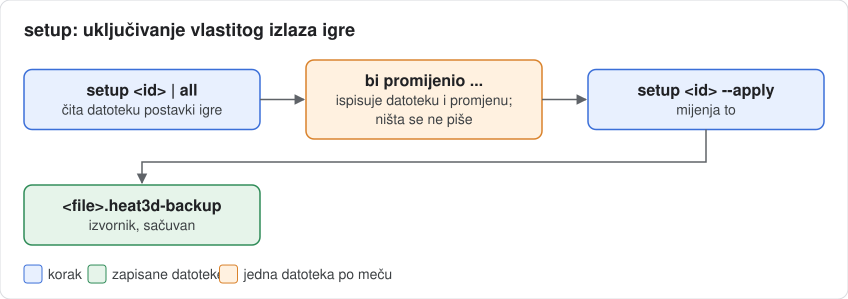
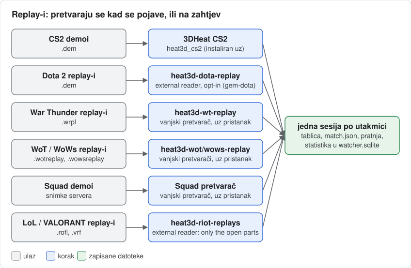
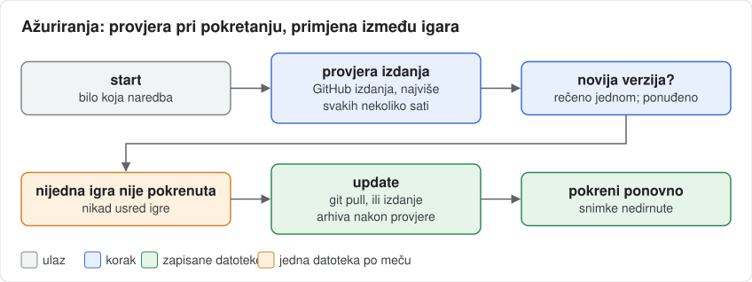

# Naredbe {#commands}

Ako ne znate što je naredbeni redak, prvo pročitajte [Prije nego što počnete](before-you-start.md). Svaka naredba se upisuje u terminal otvoren u mapi u koju ste raspakirali ili klonirali program (u File Explorer-u upišite `powershell` u adresnu traku), ovako:

```bash
python -m heat3d_watch <command> [options]
```


| Naredba | Što radi |
|---|---|
| [`run`](#run) | prati u pozadini i bilježi svaku igru koja se pokrene |
| [`games`](#games) | što daje svaka igra i odakle |
| [`setup`](#setup) | uključuje vlastiti izlaz igre |
| [`status`](#status) | koje igre rade sada i koji bi se adapteri pokrenuli |
| [`sessions`](#sessions) | dosadašnje snimke |
| [`stats`](#stats) | zbroji po igri ili tablice kao CSV |
| [`table`](#table) | ponovno izradi `heat.parquet` sesije iz njezinog `events.jsonl` |
| [`replays`](#replays) | pretvori replayeve koji su već na disku |
| [`dota-replay`](#dota-replay) | preuzmi replay javnog Dota 2 meča po njegovom ID-u |
| [`dota-map`](#dota-map) | karta Dota 2 iz vaše instalacije kao 3D razina za preglednik |
| [`update`](#update) | ažuriraj na najnovije izdanje |
| [`config`](#config) | prikaži ili promijeni postavke |

Opcije za svaku naredbu: `-h` / `--help` ispisuje pomoć, a `python -m heat3d_watch --version` ispisuje verziju (datoteka `VERSION`).

Slike na ovoj stranici su snimke pokretanja na sintetičkim primjerima sesija (`Example Racer`, `Example Arena`), a ne na stvarnim snimkama.

Svaka naredba osim `update` najprije provjerava ima li novije izdanje (najviše jednom u šest sati; preskače se s `HEAT3D_NO_UPDATE=1`, vidi [Ažuriranja](updates.md)). `run` samo ispiše obavijest. Ostale naredbe pitaju `Update now? [Y/n]` kad rade u terminalu, a kad ne rade, ispišu kako se ažurira. Izlaz je UTF-8, pa se nazivi igara na bilo kojem jeziku ispravno prikazuju u svakoj konzoli.

## run {#run}

```bash
python -m heat3d_watch run [--once] [-v]
```



Prati dok se ne zaustavi (Ctrl+C): svakih `scan_seconds` čita popis procesa i za svaku igru koju nađe pokreće adapter, uz adaptere koji su uvijek uključeni. Prije prvog pregleda dovršava sesije koje je ostavilo prethodno pokretanje. Dok nijedna igra ne radi, može se sam ažurirati (ako je `auto_update` uključen). Pojedinosti su u [Instalacija i pokretanje](installing-and-running.md#running).

| Opcija | Učinak |
|---|---|
| `--once` | jedan pregled igara koje sada rade, pa izlaz. Pokreću se adapteri za igre koje rade sada (i oni koji su uvijek uključeni), svaki jednom provjeri (čeka se najviše 10 sekundi za to), a zatim se svi zaustave onako kako se zaustavljaju kad igra završi: njihove sesije se zatvaraju, zapisuju i broje. Za provjeru prepoznavanja, a ne za snimanje. |
| `-v`, `--verbose` | retci za otklanjanje grešaka u `watcher.log` i na konzoli |

`run` zapisuje `<data>\watcher.lock` i odbija se pokrenuti drugi put za istu mapu podataka (izlazni kod 1); vidi [Datoteka zaključavanja](installing-and-running.md#the-lock-file).

## games {#games}

```bash
python -m heat3d_watch games [--markdown]
```


Ispisuje svaki adapter razvrstan po igri: naziv, ID i vrstu, odakle čita, što bilježi i kako ga uključiti. Adapter koji se ne može pokrenuti na ovom računalu označen je s `[unavailable: <why>]` - nije pronađen SimConnect.dll, nema mape Minecrafta, 3DHeat CS2 nije instaliran, Steam ili NVIDIA App nisu pronađeni. Modul adaptera koji se nije uspio učitati navodi se na kraju s greškom.

```text
EA SPORTS F1 25  (f1-25, telemetry)
    from: UDP telemetry 127.0.0.1:20777 (Documents\My Games\F1 25\hardwaresettings\hardware_settings_config.xml)
    - every car's position (world XYZ, m) at 10 Hz, by driver name, team, own car marked, ...
    switch on: In the game: Settings > Telemetry Settings > UDP Telemetry On, IP 127.0.0.1, port 20777 - ...
```

`--markdown` ispisuje isto kao jednu Markdown tablicu (igra, što se bilježi, odakle, kako se uključuje, igranje na mreži, provjereno). Tablica u [Sve igre u jednoj tablici](watcher.md) je taj ispis. Ćelije su zaštićene za Markdown: tekst u oznakama ostaje kod, a izvan njih `<`, `>`, `&`, `*`, `|` i obrnuta kosa crta ispred interpunkcije zapisani su tako da se prikazuju kako su upisani (`<CS2>` bi inače nestao kao HTML oznaka u kramdownu). Jedina HTML oznaka je `<br>` između stavki u stupcu "Što se bilježi".

## setup {#setup}

```bash
python -m heat3d_watch setup <adapter id | all> [--apply]
```




Uključuje vlastiti izlaz igre tamo gdje igra treba promijenjenu datoteku. Bez `--apply` ništa se ne mijenja: svaki redak kaže što bi se promijenilo, a kad ima što promijeniti, zadnji redak kaže `Nothing was changed. Run again with --apply to make these changes.` Kad nema što mijenjati, ispiše `<id>: nothing to change` (`Nothing to change.` za `all`). S `--apply` promjene se izvrše, a prije prve promjene datoteke njezin original se sprema kao `<file>.heat3d-backup`. Postojeća sigurnosna kopija se nikad ne prepisuje, pa uvijek sadrži datoteku kakva je bila prije nego ju je watcher prvi put dirao.

```text
f1-25: would change: hardware_settings_config.xml <udp>: enabled="false" -> "true"
Nothing was changed. Run again with --apply to make these changes.
```

`all` pokreće postavljanje svakog adaptera koji ga ima. Adapter bez njega, imenovan sam, ispiše `<id>: nothing for setup to change; ` nakon čega slijedi kako se igra uključuje (njegov tekst `enable`, ili da ne treba ništa). Nepoznat ID ispiše `no adapter '<id>'; games lists them` i izlazi s kodom 2. Adapteri koji imaju što postaviti:

| Adapter | Što `--apply` mijenja |
|---|---|
| `beamng` | instalira protokol-mod `heat3d` u BeamNG-ovu korisničku mapu `mods` (samo ako ga tamo nema); zatim u igri uključite Options > Other > Protocols > "others" |
| `cs2-gsi` | piše `<CS2>\game\csgo\cfg\gamestate_integration_heat3d.cfg`: šalje stanje igre na `http://127.0.0.1:3311/` sa slučajnim tokenom koji watcher zatim traži (token koji je već u datoteci se zadržava); CS2 ga čita pri pokretanju |
| `dota2-gsi` | isto za Dota 2: `<Dota>\game\dota\cfg\gamestate_integration\gamestate_integration_heat3d.cfg`, port 3312 |
| `dcs` | dodaje `Scripts\Hooks\heat3d-watch.lua` u svaku mapu `%USERPROFILE%\Saved Games\DCS*`. Njegova starija kopija se ažurira; datoteku tog imena koju watcher nije napisao ostavlja na miru. Ponovno pokrenite DCS. |
| `dirt-rally-2` | `hardware_settings_config.xml`: `<udp enabled="true" extradata="3" ip="127.0.0.1" port="20777">`; prvo jednom pokrenite igru da datoteka postoji |
| `ea-wrc` | `Documents\My Games\WRC\telemetry\config.json`: uključuje paket `session_update` strukture `wrc`, za ovaj računalo |
| `f1-23`, `f1-24`, `f1-25` | `hardware_settings_config.xml`: `<udp enabled="true" ip="127.0.0.1" port="20777">`; igra mora biti zatvorena |
| `hearthstone` | dodaje odjeljak `[Power]` (`LogLevel=1`, `FilePrinting=true`) u `%LOCALAPPDATA%\Blizzard\Hearthstone\log.config`; ponovno pokrenite igru |
| `il2` | `<game>\data\startup.cfg`, `[KEY = telemetrydevice]`: još jedno odredište `addrN = "127.0.0.1:41995"` i `enable = true` (odjeljak se dodaje, na 10 Hz, ako ga nema); ponovno pokrenite IL-2 |
| `il2-tacview` | `<game>\data\startup.cfg`, `[KEY = track_record]`: `tacviewrecord = 1` |
| `rocketleague-stats` | `TAStatsAPI.ini` (ili `DefaultStatsAPI.ini` kad ovaj ne postoji) u `<RL>\TAGame\Config`: `PacketSendRate=30` kad je API isključen, i `Port` kad nijedan nije postavljen; čita se pri pokretanju Rocket Leaguea |

`richard-burns-rally` nema postavljanje: njegova telemetrija je dodatak RSF/NGP, uključuje se ručno u `RichardBurnsRally.ini` (vidi [njegovu stranicu](game-richard-burns-rally.md)); `setup richard-burns-rally` to samo kaže. Svaka druga igra ili ne treba ništa ili se uključuje u samoj igri; stranica svake igre kaže kako.

## status {#status}

```bash
python -m heat3d_watch status
```

```text
3DHeat Watcher 1.0.2; data in C:\Users\...\AppData\Local\3DHeat\Watcher
Games running: EA SPORTS F1 25 (f1-25)
Always on: il2-tacview, steam-stats, steam-timeline, nvidia-highlights, cs2-demos, osu-replays, lol-replays, valorant-replays
```

Kaže koji bi se adapteri pokrenuli `run`-om sada, prema istim pravilima: proces igre radi, adapter nije u `disabled`, ništa što mu treba ne nedostaje, adapteri za replayeve rade samo uz uključen `replays`, adapteri za memoriju samo uz uključen `memory` i kad su sve provjere memorije prošle. Ništa ne pokreće.

## sessions {#sessions}

```bash
python -m heat3d_watch sessions [--game NAME] [--limit N]
```


Najnovije sesije iz `watcher.sqlite`, jedna linija po sesiji: početak (lokalno vrijeme), igra, minute, događaji, pozicije, mapa.

| Opcija | Učinak |
|---|---|
| `--game NAME` | samo ova igra, po njezinom točnom nazivu kao na popisu (`"EA SPORTS F1 25"`) |
| `--limit N` | najviše N sesija (zadano 40) |

## stats {#stats}

```bash
python -m heat3d_watch stats [--game NAME] [--csv DIR]
```


Bez opcija: tablica svih igara (sesije, sati, događaji, pozicije, zadnja igra), od najigranije, pa za svaku igru njezinih 25 najčešćih događaja i svaka brojčana statistika s brojem sesija koje je imaju, zbrojem, najboljom vrijednošću (`best`) i prosjekom. `best` zna koji smjer je bolji: najniža vrijednost za vremena koja se čuvaju kao najbolja (`best_lap`, `best_stage` i svaki ostali ključ koji počinje s `best_`) i za mjesta (`race_position`, `grid_position`, svaki ključ koji završava s `_position`), a najviša za sve ostalo (ubojstva, udaljenost, najveća brzina, brojači same igre).

| Opcija | Učinak |
|---|---|
| `--game NAME` | samo događaji i statistika ove igre, bez pregleda |
| `--csv DIR` | umjesto toga piše `sessions.csv`, `events.csv` i `stats.csv` (svaki redak sve tri tablice) u `DIR`; `--game` ga ne sužava |

## table {#table}

```bash
python -m heat3d_watch table <session folder>
```


Ponovno izrađuje `heat.parquet` u mapi sesije iz njezinog `events.jsonl`, s osima iz njezinog `meta.json`. Ispisuje put do tablice ili `no positions in this session`. Koristite je za sesiju snimljenu dok nije bio instaliran `pyarrow`, ili nakon što ste ručno uredili `events.jsonl`.

## replays {#replays}

```bash
python -m heat3d_watch replays <adapter id> [folder] [-v]
```



Pretvara replayeve koji su već na disku, odmah, jedan za drugim, svaki u sesiju kao što bi ga napravilo praćenje mape. Kad watcher prvi put vidi mapu replayeva, samo zabilježi što je u njoj (vidi [Instalacija i pokretanje](installing-and-running.md#replays-already-on-disk)); ovako se oni pretvaraju na zahtjev. Bez `folder` čitaju se mape samog adaptera (igrine, plus `replay_folders`); s njim, replayi u toj mapi. Svaki pretvoreni replay se bilježi kao viđen, pa ga pokrenuti watcher ne pretvara ponovno. Replay koji se ne može pretvoriti zapisuje se u dnevnik i preskače se.

| Adapter | Replayi |
|---|---|
| `cs2-demos` | demo-snimke Counter-Strike 2 (`*.dem`), preko 3DHeat CS2 |
| `lol-replays` | replayi League of Legends (`*.rofl`) |
| `osu-replays` | replayi osu! (`*.osr`) |
| `valorant-replays` | replayi VALORANT-a (`*.vrf`) |
| `warthunder-replays` | replayi War Thunder (`*.wrpl`), preko vanjskog pretvarača `heat3d-wt-replay` (exporters/ext/warthunder-replay) |
| `wot-replays` | replayi World of Tanks (`*.wotreplay`), preko vanjskog pretvarača `heat3d-wot-replay` (exporters/ext/wot-replay) |
| `wows-replays` | replayi World of Warships (`*.wowsreplay`), preko vanjskog pretvarača `heat3d-wows-replay` (exporters/ext/wows-replay) |
| `dota-replays` | replayi Dota 2 (`*.dem`), preko gem-a (`pip install gem-dota`) |

```text
osu-replays: converted 12 replay(s); `sessions --game` lists them
```

ID koji nije među ovima ispiše `no replay adapter '<id>'` s popisom i izađe s kodom 2; tako i `folder` koji ne postoji. Adapter koji ovdje ne može raditi (3DHeat CS2 nije instaliran) ispiše zašto i izađe s kodom 1. Tacview zapisi IL-2 nisu na popisu: taj adapter sam pretvara svaki završeni zapis koji nađe.

## dota-replay {#dota-replay}

```bash
python -m heat3d_watch dota-replay <match id> [<match id> ...] [-o FOLDER] [--convert] [-v]
```

Preuzima replay javnog Dota 2 meča s Valveovih poslužitelja replayeva. Treba internet. ID meča je broj na stranici meča u Dota klijentu (detalji meča) ili na OpenDota-inoj web stranici; Valve čuva replay nekoliko tjedana, nakon čega preuzimanje ne uspijeva. Poslužitelj i salt replaya uzimaju se iz OpenDota-ina zapisa meča (`api.opendota.com/api/matches/<id>`, ključ nije potreban), a datoteka iz `replay<cluster>.valve.net/570/<id>_<salt>.dem.bz2`; raspakira se dok stiže (Valve pod tim imenom šalje i bzip2 i Zstandard) i sprema kao `<match id>.dem`. Bez `-o` ide u Dotinu mapu replayeva kad je Dota 2 instalirana, gdje ju pokrenuti watcher pretvara, a inače u `<data>/replays/dota`. Datoteka koja je već tamo ostaje. `--convert` odmah pretvara preuzete replayeve, kao što bi to učinio `replays dota-replays`, i bilježi ih kao viđene.

```text
match 9000000000: C:\Program Files (x86)\Steam\steamapps\common\dota 2 beta\game\dota\replays\9000000000.dem
```

Valve čuva replayeve nekoliko tjedana; stariji meč ispiše `Valve no longer has the replay of match <id>` i izađe s kodom 1. Meč koji OpenDota još nije vidjela nema salt: poruka kaže da od OpenDote zatražite (`curl -X POST https://api.opendota.com/api/request/<id>`) i pokušate nakon nekoliko minuta. Privatne sobe i mečevi sa skrivenim profilom uopće nisu na poslužiteljima replayeva.

## dota-map {#dota-map}

```bash
python -m heat3d_watch dota-map [<map>] -o <file.glb> [--game FOLDER] [--source2viewer EXE] [--detail UNITS]
```

Zapisuje kartu Dota 2 - tlo, litice, vodu, drveće i zgrade - kao `.glb` razinu u koordinatnom sustavu u kojem se crtaju Dota replay tablice, iz vaše instalacije Dota 2, čitajući je sučeljem naredbenog retka programa Source2Viewer. Ništa se ne preuzima. `<map>` je zadano `dota`; `--game` je mapa Dota 2 kad nije u Steam biblioteci; `--source2viewer` putanja do CLI-ja kad nije ni u `HEAT3D_SOURCE2VIEWER` ni na `PATH`-u; `--detail` je ćelija grupiranja vrhova za zgrade u jedinicama igre (zadano 8, 0 zadržava svaki trokut). Izlazi s kodom 1 i `dota-map: <why>` kad se ne nađe Dota 2, karta ili Source2Viewer. Svaki korak, dijelovi datoteke i kako je provjerena: [Karta Dota 2](dota-map.md).

## update {#update}

```bash
python -m heat3d_watch update [--check]
```



Pita GitHub za najnovije izdanje, zaobilazeći spremljeni odgovor, i ažurira ovu kopiju ako je novija (vidi [Ažuriranja](updates.md)). `--check` samo kaže ima li novijeg izdanja. Ova naredba radi i kad je `HEAT3D_NO_UPDATE` postavljen: ako ju tražite, to je vaša odluka. `python -m heat3d_update [--check]` radi isto.

## config {#config}

```bash
python -m heat3d_watch config [--set KEY=VALUE ...]
```


Ispisuje svaku postavku kao `key = value`. Uz `--set`, prvo mijenja navedene i sprema `settings.json` (`saved <path>`). Vrijednosti se čitaju prema vrsti postavke:

- postavke da/ne: `1`, `true`, `yes`, `on` ili `ja` znači da; `0`, `false`, `no`, `off`, `nein` ili prazna vrijednost znači ne;
- brojevi: decimalni broj (`scan_seconds=5`);
- popisi: odvojeni zarezom ili JSON popis (`disabled=steam-stats,steam-timeline`; prazna vrijednost briše popis);
- rječnici (`replay_folders`, `player_names`): cijeli rječnik kao JSON, ili jedan unos kao `KEY.ID=VALUE` - `replay_folders.cs2-demos=D:\Demos,E:\More Demos` postavlja mape tog adaptera (odvojene zarezom), `player_names.warthunder-webmap=Name` ime tog adaptera; prazna vrijednost uklanja unos;
- tekst: kako je zadan (`data=D:\Heat`, `riot_id=Name#TAG`).

```bash
python -m heat3d_watch config --set memory=true scan_seconds=5
python -m heat3d_watch config --set riot_id=Name#TAG riot_platform=EUW1
python -m heat3d_watch config --set replay_folders.cs2-demos=D:\Demos player_names.rocketleague-stats=Name
```

Nepoznat ključ ispiše `no setting '<key>'`, a vrijednost koja nije vrste te postavke (`memory=perhaps`, `scan_seconds=often`, rječnik koji nije JSON) ispiše `not saved: ...`; oba izlaze s kodom 2 bez ičega spremljenog. `settings.json` uređen ručno čita se isto: vrijednost zadana kao tekst tamo gdje je postavka broj, da/ne ili rječnik čita se kako je upisana, a onu koju nije moguće pročitati ostavlja na zadanoj vrijednosti. Svaka postavka opisana je u [Instalacija i pokretanje](installing-and-running.md#settings).
