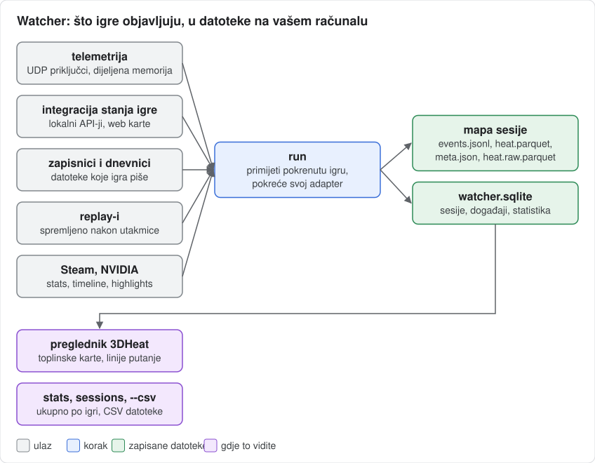

# 3DHeat Watcher {#dheat-watcher}

**Što je to?** Vi igrate igru. Ovaj program tiho bilježi gdje ste išli i što se događalo.
Kasnije to možete pogledati kao obojenu kartu u pregledniku 3DHeat.

**Zašto bih ga koristio?** Da vodite vlastitu evidenciju svakog sjedenja - gdje ste vozili, letjeli ili se borili,
vaše ukupne rezultate po igri - bez ikakve web-stranice i bez mijenjanja igre.

**Primjer:** vozite krug u igri utrka dok je watcher pokrenut; poslije datoteka u
`sessions\<game>\` sadrži liniju kojom ste išli, a preglednik je crta.

Detaljnije: 3DHeat Watcher je program koji radi u pozadini i bilježi što igre objavljuju o vašem igranju - gdje ste
išli, što se događalo gdje i brojke iza toga - u datoteke na vašem vlastitom računalu. Datoteke su
za vašu vlastitu statistiku te za toplinske karte i linije putanja preglednika 3DHeat.

Radi tiho, primijeti koju ste igru pokrenuli i čita izlaze te igre: priključak za telemetriju
ili dijeljenu memoriju koju igra objavljuje za nadzorne ploče, integraciju stanja igre, dnevnik ili zapisnik koji
igra piše, replay koji sprema nakon utakmice, statistiku koju čuva Steam, i isječke koje sprema
NVIDIA App. Snimke ostaju na vašem računalu. Program se javlja samo dvjema vanjskim
službama, i to samo u ovim slučajevima: GitHubu, da potraži noviju verziju (vidi [Ažuriranja](updates.md)), i
Riotovu Match-V5 API-ju, i to samo ako unesete vlastiti Riot API ključ (vidi [Replay-i League of Legends](game-lol-replays.md)).



## Što bilježi {#what-it-records}

- **Položaji**: automobil, zrakoplov, heroj ili igrač, nekoliko puta u sekundi gdje ih igra objavljuje,
  s brzinom, smjerom i svime što igra šalje uz to.
- **Događaji**: pojave, smrti, ubojstva, krugovi, etape, runde, golovi, poslovi, polijetanja i slijetanja, promjene
  zone, postignuća, istaknuti trenuci. Svaki događaj se sprema s vremenom i, kad ga igra
  dade, mjestom.
- **Statistika po sesiji**: ubojstva, smrti, krugovi, najbolji krug, udaljenost, najveća brzina, vrijeme igranja, i
  vlastita statistika igre tamo gdje je vodi.

Što svaka igra daje i odakle, nalazi se na vlastitoj stranici pod [Igre](games.md). Jedan izvor ne može
zabilježiti sve: višekorisničke igre bilježe se samo kroz ono što objavljuju, a watcher
nikad ne čita njihovu memoriju (vidi [Izvori i pravila](sources-and-rules.md)).

## Instalacija {#install}

Ne znate ništa o naredbenom retku? Prvo pročitajte [Prije nego što počnete](before-you-start.md).

Watcher je Python program za Windows (Python 3.10 ili noviji). Mnogi njegovi izvori postoje samo na Windowsu: dijeljena
memorija, registar, obavijesti Windowsa.

```bash
git clone https://github.com/Holdi601/3DHeat-Watcher.git
cd 3DHeat-Watcher
pip install -r requirements.txt
```

Preuzeti arhiv izdanja radi jednako: raspakirajte ga, zatim u mapi pokrenite `pip install -r requirements.txt`.
Detalji i dodaci koje neke igre trebaju nalaze se u
[Instalacija i pokretanje](installing-and-running.md).

## Brzi početak {#quick-start}

```bash
python -m heat3d_watch games            # što svaka igra daje i odakle
python -m heat3d_watch setup all        # što bi se moralo uključiti (ništa se ne mijenja)
python -m heat3d_watch setup f1-25 --apply   # uključi izlaz jedne igre (izvorna datoteka se sprema kao sigurnosna kopija)
python -m heat3d_watch run              # bilježi; ostavite pokrenuto dok igrate
python -m heat3d_watch stats            # ukupno po igri
python -m heat3d_watch stats --csv out  # sesije, događaji i statistika kao CSV datoteke
```

Trebali biste vidjeti: nakon `games`, tablicu s jednim retkom po igri; `run` nastavlja dok ne pritisnete
Ctrl+C ili zatvorite prozor.

Sve se piše u `%LOCALAPPDATA%\3DHeat\Watcher`. Za drugu mapu postavite
varijablu okruženja `HEAT3D_WATCH_HOME` ili pokrenite `python -m heat3d_watch config --set data=D:\somewhere`.

- `sessions\<game>\<date>_<adapter>\` - jedna mapa po sjedenju, koja sadrži `events.jsonl` (svaki događaj
  kako se dogodi), `heat.parquet` (retke s položajem, spremne za preglednik 3DHeat) i
  `meta.json` (igra, izvor, osi, brojevi, statistika)
- `watcher.sqlite` - statistika svake sesije, u tri jednostavne tablice
- `watcher.log` - što je watcher radio

Preglednik izravno otvara `heat.parquet` sesije, bez ikakvog podešavanja (njegove osi i jedinice su u
datoteci). Pretvoreni replay-i zapisuju se kao tablice i dokumenti meča uz nju; vlastiti format preglednika
s jednom datotekom po meču opisan je na njegovoj stranici
[`.3dheat` spremnik](https://holdi601.github.io/3DHeat/container.html), a stupci svake tablice na
[Podaci](the-data.md).

## Dokumentacija {#the-documentation}

| Stranica | Što obuhvaća |
|---|---|
| [Prije nego što počnete](before-you-start.md) | Python, terminal, mjesta za upis, kako izgledaju uspjeh i česte greške |
| [Instalacija i pokretanje](installing-and-running.md) | zahtjevi, pokretanje u pozadini, pokretanje sa sustavom Windows, datoteka zaključavanja, zapisnik, svaka postavka i varijabla okruženja |
| [Igre](games.md) | jedna stranica po igri: što se bilježi, odakle, kako se uključuje, kako radi, osi, statistika, što je provjereno |
| [Podaci](the-data.md) | mape sesija, `events.jsonl`, `heat.parquet` i njegovo podnožje, `meta.json`, `watcher.sqlite`, oporavak nakon ruševine, izvoz CSV-a, otvaranje sesije u pregledniku 3DHeat |
| [Naredbe](commands.md) | svaka naredba i opcija `python -m heat3d_watch` |
| [Izvori i pravila](sources-and-rules.md) | šest vrsta izvora, pravila za višekorisničke igre, koje su igre izostavljene i zašto |
| [NVIDIA Highlights](nvidia-highlights.md) | što NVIDIA Highlights može i ne može isporučiti, i kako isječak dobiva položaj |
| [Serverski snimački modovi](server-mods.md) | modovi Arma 3 i Arma Reforger servera koji snimaju cijele misije za preglednik |
| [Čitanje memorije](memory-reading.md) | profili memorije za jednoigračke igre: format, provjere, kako napisati i provjeriti jedan |
| [Ažuriranja](updates.md) | kako watcher traži nova izdanja i sam se ažurira |
| [Razvoj](development.md) | pisanje adaptera: API, testovi, iskreno `verified`, ponovno generiranje stranica o igrama |
| [Sve igre u jednoj tablici](watcher.md) | svaka igra u jednoj tablici, kako je ispisuje `games --markdown`, plus igre istražene ali još nisu izrađene |
| [Referenca naredbi](../cli-reference.md) | `--help` svake naredbe, generirano iz koda |
| [Održavanje](maintaining.md) | popis za izdavanje ovih stranica |

## Dio 3DHeata {#part-of-3dheat}

3DHeat Watcher je jedan od besplatnih alata oko preglednika 3DHeat (watcher koristi 3DHeat CS2
za pretvaranje CS2 demoa). Svaki je zaseban projekt, sa svojim izdanjima i licencom:

| Alat | Što radi | Dokumentacija |
|---|---|---|
| [3DHeat](https://github.com/Holdi601/3DHeat) | preglednik: toplinske karte, analiza utrka i pregled meča u 3D | [stranica](https://holdi601.github.io/3DHeat/) |
| [GameFiles](https://github.com/Holdi601/3DHeat-GameFiles) | staze i razine iz datoteka koje igre isporučuju, kao 3D modeli | [stranica](https://holdi601.github.io/3DHeat-GameFiles/) |
| [GameCapture](https://github.com/Holdi601/3DHeat-GameCapture) | telemetrija krugova iz igara utrka; razine rekonstruirane iz videa igranja | [stranica](https://holdi601.github.io/3DHeat-GameCapture/) |
| [Unreal Exporter](https://github.com/Holdi601/3DHeat-UnrealExporter) | dodatak za Unreal Editor koji izvozi razinu kao jedan 3D model | [stranica](https://holdi601.github.io/3DHeat-UnrealExporter/) |
| [CS2](https://github.com/Holdi601/3DHeat-CS2) | demoi Counter-Strike 2 u tablice i dokumente meča; karte u 3D modele | [stranica](https://holdi601.github.io/3DHeat-CS2/) |
| [Watcher](https://github.com/Holdi601/3DHeat-Watcher) | bilježi što igre objavljuju o vašem igranju, u pozadini | [stranica](https://holdi601.github.io/3DHeat-Watcher/) |
| [Ext-WarThunder](https://github.com/Holdi601/3DHeat-Ext-WarThunder) | War Thunder replay-i u tablice i dokumente meča | [stranica](https://holdi601.github.io/3DHeat-Ext-WarThunder/) |
| [Ext-WoT](https://github.com/Holdi601/3DHeat-Ext-WoT) | World of Tanks replay-i u tablice i dokumente meča | [stranica](https://holdi601.github.io/3DHeat-Ext-WoT/) |
| [Ext-WoWs](https://github.com/Holdi601/3DHeat-Ext-WoWs) | World of Warships replay-i u tablice i dokumente meča | [stranica](https://holdi601.github.io/3DHeat-Ext-WoWs/) |
| [Ext-Squad](https://github.com/Holdi601/3DHeat-Ext-Squad) | demoi Squad servera u tablice i dokumente meča | [stranica](https://holdi601.github.io/3DHeat-Ext-Squad/) |
| [Ext-DCS](https://github.com/Holdi601/3DHeat-Ext-DCS) | karte DCS Worlda u 3D modele | [stranica](https://holdi601.github.io/3DHeat-Ext-DCS/) |
| [Ext-IL2](https://github.com/Holdi601/3DHeat-Ext-IL2) | karte IL-2 Sturmovik u 3D modele | [stranica](https://holdi601.github.io/3DHeat-Ext-IL2/) |

Svaki čitač igre zaseban je mali projekt s vlastitom datotekom licence, izdanjima i praćenjem
problema, pa se može instalirati, ažurirati, održavati - ili povući na zahtjev nositelja prava -
zasebno, bez utjecaja na preglednik i ostale alate.

Licenca: MIT ([LICENSE](https://github.com/Holdi601/3DHeat-Watcher/blob/main/LICENSE)). Licence
paketa trećih strana koje koristi, i što zahtijevaju igre koje čita, navedene su u
[LICENSES.md](https://github.com/Holdi601/3DHeat-Watcher/blob/main/LICENSES.md).
