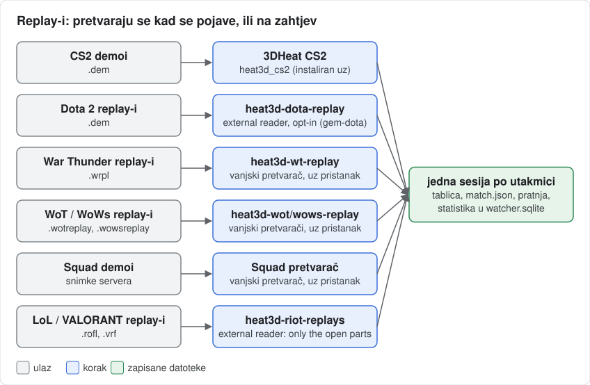

# Instalacija i pokretanje {#installing-and-running}

## Zahtjevi {#requirements}

- **Windows.** Watcher je napisan za Windows, a većina njegovih izvora postoji samo tamo: dijeljena memorija koju igre stvaraju (mapiranja `Local\...`), registar (gdje je Steam), Windows obavijesti, popis procesa s putanjama izvršnih datoteka. Na drugom sustavu program se pokrene, ali ti izvori ništa ne nađu, obavijesti se samo bilježe, a čitanje memorije odbija ("only implemented on Windows").
- **Python 3.10 ili noviji**, s <https://www.python.org/downloads/>: u instalaciji označite **Add python.exe to PATH**, pa provjerite s `python --version` u novom terminalu. Ako ste novi u ovome, prvo pročitajte [Prije nego što počnete](before-you-start.md).
- **Paketi** (`requirements.txt`): `psutil>=6.0` (koje igre rade, koji program drži port, veze igre; stariji psutil i dalje radi, preko svog starijeg naziva za veze procesa), `pyarrow>=15` (pisanje `heat.parquet`), `numpy>=1.24`, i `pytest>=8.0` za testove. `requirements-optional.txt` trenutno ne navodi nijedan paket.

Bez `pyarrow`, sesije se i dalje snimaju: `events.jsonl` je zapis, a tablica se može izraditi kasnije naredbom [`table`](commands.md#table).

### Dodaci koje neke igre trebaju {#extras-some-games-need}

| Igra | Što treba |
|---|---|
| Counter-Strike 2 demo-snimke | [3DHeat CS2](https://github.com/Holdi601/3DHeat-CS2) i njegovi zahtjevi (`demoparser2`). Watcher ga traži u `HEAT3D_CS2`, zatim u mapi `3DHeat-CS2` ili `cs2` pored watcherove mape, zatim bilo gdje gdje Python može uvesti `heat3d_cs2`. Bez njega, `games` navodi adapter kao nedostupan. |
| Microsoft Flight Simulator 2020 / 2024 | `SimConnect.dll` - nije isporučen. MSFS 2020 ga ima u svojoj mapi instalacije; za MSFS 2024 instalirajte MSFS 2024 SDK. `MSFS_SDK` / `MSFS2024_SDK` pokazuju na mapu SDK-a. |
| Euro Truck Simulator 2, American Truck Simulator | dodatak RenCloud `scs-telemetry.dll` (revizija 12) u `<game>\bin\win_x64\plugins` |
| BeamNG.drive | protokol-mod `heat3d`, instalira ga `python -m heat3d_watch setup beamng --apply` |
| League of Legends (uživo) | neobavezno: Riotov korijenski certifikat kao `<data>\riotgames.pem`, da se lokalna veza provjeri |
| Minecraft | mapa `%APPDATA%\.minecraft` (Java Edition) |

Stranica svake igre pod [Igre](games.md) kaže što se mora uključiti u samoj igri.
`python -m heat3d_watch games` označi adapter s `[unavailable: ...]` kad mu nešto potrebno nedostaje na ovom računalu.

## Instalacija {#installing}

Novi ste u naredbenom retku? Prvo pročitajte [Prije nego što počnete](before-you-start.md). Ako `pip` nije pronađen, umjesto toga koristite `python -m pip install -r requirements.txt`.

Iz kloniranog repozitorija:

```bash
git clone https://github.com/Holdi601/3DHeat-Watcher.git
cd 3DHeat-Watcher
pip install -r requirements.txt
```

Iz izdanja: preuzmite arhivu s izdanja repozitorija, raspakirajte je, zatim u mapi pokrenite `pip install -r requirements.txt`. Obje vrste kopije se same ažuriraju (vidi [Ažuriranja](updates.md)).

Pokrećite svaku naredbu iz mape repozitorija: `python -m heat3d_watch` uvozi paket odatle, a ažuriranje (`heat3d_update`) je pored njega.

## Pokretanje {#running}

```bash
python -m heat3d_watch run        # watch until stopped
python -m heat3d_watch run -v     # the same, with debug lines in the log
python -m heat3d_watch run --once # one look at the games running now, then stop and exit
```

Pri pokretanju, `run`:

1. zapisuje [datoteku zaključavanja](#the-lock-file);
2. dovršava sve sesije koje je ostavilo prethodno pokretanje, na primjer nakon pada (vidi [Oporavak](the-data.md#recovery-after-a-crash));
3. svakih `scan_seconds` (2 s) čita popis procesa (samo nazive i putanje, nijedan proces se ne otvara) i za svaku igru koju nađe pokreće adapter u vlastitoj niti. Kad proces igre nestane, njegov adapter se zaustavlja, a sesije koje je imao otvorene se zatvaraju, što zapisuje njihovu tablicu i njihov redak u statistici. Adapteri koji ne čekaju igru (statistika Steama, Steam Timeline, NVIDIA highlights, mape replayeva) rade cijelo vrijeme;
4. dok nijedna igra ne radi, traži novije izdanje najviše jednom na sat (sam odgovor se sprema šest sati) i, uz uključen `auto_update`, instalira ga i ponovno se pokreće (vidi [Ažuriranja](updates.md)).

Adapter koji ne uspije zapisuje se u dnevnik, a ostali se ne zaustavljaju. Ako provjera adaptera ne uspije 20 puta zaredom, ili mu pokretanje ne uspije, adapter se zaustavlja i ne pokreće se ponovno dok se igra ne pokrene iznova (novi ID procesa).

Watcher zaustavite s Ctrl+C. Adapteri zatvore svoje sesije prije izlaska. Ako se watcher ubije umjesto toga (Upravitelj zadataka, pad, nestanak struje), ništa što je već zapisano se ne gubi: sljedeći `run` dovršava te sesije.

`--once` uzima jedan pregled: pokreće adaptere za igre koje rade u tom trenutku (i one koje su uvijek uključene), pusti svakog da jednom provjeri - čekajući najviše 10 sekundi za to - i zatim ih zaustavi onako kako bi se zaustavili kad igra završi, pa se sesije koje su otvorili zatvore, njihove tablice zapišu, a retci prebroje u statistici prije izlaska. Koristite ga da provjerite je li igra prepoznata, a ne za snimanje.

### Replayi koji su već na disku {#replays-already-on-disk}



Kad adapter za replayeve prvi put vidi jednu od svojih mapa, samo zabilježi replayeve koji su već u njoj: igrač s godinama demo-snimki inače bi ostavio watcher zauzetim pretvaranjem cijeli dan. Od tada se svaki novi replay pretvara jednom, čim ga igra završi pisati. Stari se pretvaraju na zahtjev naredbom [`replays`](commands.md#replays):

```bash
python -m heat3d_watch replays cs2-demos              # every demo in CS2's folders and replay_folders
python -m heat3d_watch replays osu-replays D:\Old     # the replays in one folder
```

### Pokretanje u pozadini {#running-in-the-background}

Watcher nema vlastiti prozor; to je konzolni program koji radi dok se ne zaustavi. Sve zapisuje u `watcher.log`, pa mu nije potrebna vidljiva konzola. Načini da ga se ne vidi:

- pokrenite ga u konzoli i minimizirajte konzolu: `start "" /min python -m heat3d_watch run` iz `cmd`, u mapi repozitorija;
- pokrenite ga bez konzole: `pythonw -m heat3d_watch run`. Izlaz konzole se gubi, ali se `watcher.log` i dalje piše. Za zaustavljanje, završite proces `pythonw.exe`; sljedeće pokretanje tada dovršava sesije koje je ostavio otvorene. Projekt nije testirao ovaj način rada.

### Pokretanje sa sustavom Windows (ideja) {#starting-with-windows-an-idea}

Watcher se sam ne instalira da se pokreće sa sustavom Windows. Da se pokrene automatski:

- **Planer zadataka**: napravite zadatak s okidačem *At log on* i radnjom *Start a program*, program `pythonw.exe` (ili `python.exe`), argumenti `-m heat3d_watch run`, *Start in* postavljen na mapu repozitorija;
- **Mapa Startup**: stavite prečac u `shell:startup` s istim programom, argumentima i mapom *Start in*.

Nijedno nije dio watchera niti ga watcher testira. [Datoteka zaključavanja](#the-lock-file) osigurava da se druga kopija, pokrenuta greškom, odmah zatvori.

## Datoteka zaključavanja {#the-lock-file}

`<data>\watcher.lock` sadrži ID procesa pokrenutog watchera. Kad `run` počne, a datoteka zaključavanja navodi proces koji još postoji i čije ime sadrži `python`, ispiše

```text
A watcher is already running (process 12345) for C:\Users\...\3DHeat\Watcher.
```

i izađe s kodom 1. Dva watchera na jednoj mapi podataka snimila bi svaku igru dvaput, a drugi bi tretirao otvorene sesije prvoga kao ostatke pada. Datoteka zaključavanja čiji proces više ne postoji, ili pripada drugom programu, se prepisuje. Kad `run` završi, uklanja datoteku zaključavanja ako datoteka još navodi njegov vlastiti proces.

## Dnevnik {#the-log}

`<data>\watcher.log` piše samo `run`; ostale naredbe ispisuju na konzolu. Svaki redak ima vrijeme, razinu i poruku:

```text
2026-05-01 20:15:01,123 INFO watching; data in C:\Users\...\AppData\Local\3DHeat\Watcher
2026-05-01 20:15:03,456 INFO f1-25: starting (EA SPORTS F1 25)
2026-05-01 21:02:11,789 INFO f1-25: stopping
```

Adapteri bilježe što ne mogu učiniti i zašto: "UDP 20777 is in use by ...; not taking it from that program", "not reading memory: the game is played online", "could not start", "poll failed (3)" s tragom greške. `run -v` dodaje retke za otklanjanje grešaka. Datoteka se nastavlja pisati i watcher je nikad ne rotira niti prazni; obrišite je kad god želite. Isti retci idu i na konzolu.

## Gdje je sve {#where-everything-is}

Početna mapa je `%LOCALAPPDATA%\3DHeat\Watcher`, ili `HEAT3D_WATCH_HOME` kad je postavljen (bez `LOCALAPPDATA`, na primjer na drugom sustavu, `~/.local/share/3DHeat/Watcher`). `settings.json` je uvijek u početnoj mapi. Sve ostalo ide u mapu podataka, koja je početna mapa osim ako postavka `data` ne navodi drugu:

| Putanja | Što je |
|---|---|
| `<home>\settings.json` | postavke |
| `<data>\sessions\` | snimke, jedna mapa po sjedenju ([Podaci](the-data.md)) |
| `<data>\watcher.sqlite` | baza statistike |
| `<data>\watcher.log` | dnevnik naredbe `run` |
| `<data>\watcher.lock` | datoteka zaključavanja, dok `run` radi |
| `<data>\state\` | ono što su adapteri koji su uvijek uključeni i adapteri za replayeve već vidjeli (`steam-stats.json`, `replays-cs2-demos.json`, ...), pa ponovno pokretanje ne bilježi ništa dvaput |
| `<data>\profiles\*.json` | profili memorije koje ste napisali ([Čitanje memorije](memory-reading.md)) |
| `<data>\riotgames.pem` | neobavezno, Riotov korijenski certifikat za uživo adapter za League of Legends |
| `%LOCALAPPDATA%\3DHeat\update-check-3DHeat-Watcher.json` | spremljeni odgovor zadnje provjere izdanja |

Watcher ništa ne briše u tim mapama, osim mape sesije u kojoj ništa nije zabilježeno (igra koja je ostala u svojim izbornicima).

## Postavke {#settings}


`python -m heat3d_watch config` prikazuje postavke; `config --set key=value ...` ih mijenja i sprema `settings.json` (vidi [config](commands.md#config)). Datoteka je običan JSON i može se urediti ručno dok watcher ne radi. Nepoznati ključevi u njoj se ignoriraju. Postavke se čitaju kad naredba počne, pa nakon promjene ponovno pokrenite `run`.

| Postavka | Zadano | Što radi |
|---|---|---|
| `data` | `""` | Mapa podataka. Prazno: početna mapa. |
| `disabled` | `[]` | ID-evi adaptera koji se nikad ne pokreću, na primjer `config --set disabled=steam-stats,nvidia-highlights`. Svaki drugi adapter se pokreće kad nađe svoju igru. |
| `auto_update` | `true` | Dok nijedna igra ne radi, instalira novije izdanje i ponovno se pokreće (vidi [Ažuriranja](updates.md)). `false`: samo obavijest u dnevniku. |
| `scan_seconds` | `2.0` | Sekunde između pregleda popisa procesa. |
| `memory` | `false` | Dopušta da adapteri za memoriju (igre za jednog igrača s profilom koji ste napisali) rade. Isključeno prema zadanom; vidi [Čitanje memorije](memory-reading.md). |
| `replays` | `true` | Pokreće adaptere `replay`: sve njih (vidi `python -m heat3d_watch replays` i [Igre](games.md)) - CS2 demo-snimke, Dota 2, osu!, War Thunder, World of Tanks, World of Warships, Squad i replayeve League of Legends i VALORANT, IL-2 Tacview snimke. |
| `replay_folders` | `{}` | Dodatne mape po ID-u adaptera, na primjer `{"cs2-demos": ["D:\\Demos"]}`. Adapteri za replayeve prate ih uz igrine vlastite mape; `il2-tacview` prihvaća i mape instalacija (tada gleda u njihov `data\Tracks`); za `elite`, prva mapa zamjenjuje mapu dnevnika. Mape jednog adaptera postavite s `config --set replay_folders.cs2-demos=D:\Demos,E:\More`, ili cijeli rječnik kao JSON. |
| `riot_id` | `""` | Vaš Riot ID (`Name#TAG`), da vaš vlastiti redak u replayu League of Legends postane vaša statistika. Prazno: čuva se redak svakog igrača, a nijedan se ne označava kao vaš. |
| `riot_api_key` | `""` | Vaš vlastiti Riotov programerski API ključ, za dohvat službene vremenske crte svakog replaya League meča (pozicije svake minute, ubojstva gdje su se dogodila). Prazno: ništa se ne dohvaća. |
| `riot_platform` | `"EUW1"` | ID platforme vašeg poslužitelja League-a (`EUW1`, `EUN1`, `NA1`, `KR`, ...), za pronalaženje regionalnog domaćina Match-V5. |
| `player_names` | `{}` | Vaše ime u igrama čije sučelje imenuje svakog igrača, ali ne kaže koji ste vi, po ID-u adaptera: `warthunder-webmap` (redci feeda ubojstava o vama postaju vaša ubojstva i smrti) i `rocketleague-stats` (vaši redci postaju `me`; bez toga, igrač kojeg prati kamera igre). Postavlja se s `config --set player_names.warthunder-webmap=Name`. |

`settings.json` sa svim zadanim vrijednostima:

```json
{
  "data": "",
  "disabled": [],
  "auto_update": true,
  "scan_seconds": 2.0,
  "memory": false,
  "replays": true,
  "replay_folders": {},
  "riot_id": "",
  "riot_api_key": "",
  "riot_platform": "EUW1",
  "player_names": {}
}
```

## Varijable okoline {#environment-variables}

| Varijabla | Učinak |
|---|---|
| `HEAT3D_WATCH_HOME` | početna mapa (postavke, i podaci osim ako ih `data` ne navodi drugačije) |
| `HEAT3D_NO_UPDATE` | bilo koja vrijednost osim prazne, `0`, `false` ili `no` isključuje provjeru izdanja i automatsko ažuriranje |
| `HEAT3D_NO_TOAST` | bilo koja neprazna vrijednost: bez Windows obavijesti, samo retci dnevnika |
| `HEAT3D_CS2` | mapa 3DHeat CS2, za CS2 demo-snimke |
| `HEAT3D_CS2_GSI_PORT` | port stanja igre CS2 (zadano 3311); datoteka cfg koju piše `setup` ga koristi |
| `HEAT3D_DOTA_GSI_PORT` | port stanja igre Dota 2 (zadano 3312) |
| `MSFS_SDK`, `MSFS2024_SDK` | mape MSFS SDK-a, gdje se traži `SimConnect SDK\lib\SimConnect.dll` |

Windows obavijesti se koriste samo za ažuriranja: "Updating to 1.2.0", ili "1.2.0 is out; not updated: ..." kad se ažuriranje nije moglo primijeniti. Prikazuju se preko vlastitog API-ja obavijesti PowerShella, pa se ništa ne mora instalirati. Naslov i tekst PowerShellu se predaju kao varijable okruženja, nikad kao dio skripte.
