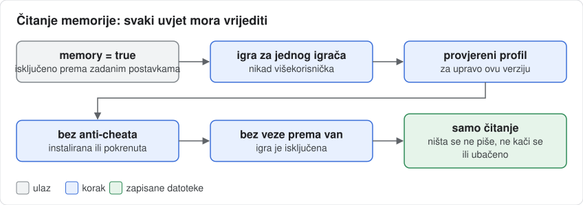

# Čitanje memorije {#reading-memory}

Neke igre za jednog igrača ne govore ništa drugim programima. Za njih watcher može - ako ga uključite i ako sami napišete profil - potražiti gdje ste u memoriji igre, samo za čitanje.

Za igre za jednog igrača koje ništa ne objavljuju, watcher može čitati pozicije i vrijednosti iz memorije igre, kroz **profil** koji sami napišete za svoju verziju igre. Od svih izvora ovo je jedini koji igra nije sama ponudila, pa je ograđen više od ostalih:

- isključeno je **prema zadanom** (`python -m heat3d_watch config --set memory=true` ga uključuje);
- čita, a nema načina da piše;
- **nijedan profil se ne isporučuje uz alate.**

Profili se ne isporučuju jer je pomak dobar samo za verziju na kojoj je pronađen. Nakon zakrpe, profil koji je prije bio ispravan čita smeće, a smeće izgleda točno kao brojevi. Profil mora provjeriti na verziji koju igrač ima, sam igrač.

## Provjere, redom {#the-checks-in-order}



Svaka provjera u nastavku mora proći. Prve četiri obavljaju se **prije** nego što se igra otvori, jer je otvaranje zaštićene igre za čitanje samo po sebi ono što anti-cheat sustav primijeti, a odbijanje nakon toga bilo bi prekasno.

1. **Postavka**: `memory` je istina. Inače adapteri za memoriju se nikad ne pokreću.
2. **Profil za igru**, čiji `exe` imenuje pokrenuti proces. Profil mora reći može li se igra uopće igrati na mreži (`"online"`); onaj koji to izostavi se odbija.
3. **Nema anti-cheat sustava u blizini**:
   - nema datoteke anti-cheat sustava u mapi igre ili do tri mape iznad nje (stajući na mapi `common` Steam biblioteke, ili na mapi s `steamapps` u sebi, jer su iznad nje druge igre): `EasyAntiCheat`, `EasyAntiCheat_EOS_Setup.exe`, `start_protected_game.exe`, `BattlEye`, `BEClient_x64.dll`, `BEService_x64.exe`, `EAAntiCheat.GameServiceLauncher.exe`, `AntiCheatExpert`, `SGuard64.exe`, `GameGuard`, `GameMon.des`, `XIGNCODE`, `xhunter1.sys`, `Vanguard`, `FACEIT` (uspoređeno malim slovima, također kao početak naziva). Ako mapa igre nije poznata, igra se odbija;
   - nema upravljačkog programa ili usluge anti-cheat sustava koja radi na računalu uopće, kako je navedeno pod `sc query type= driver state= active` i `sc query type= service state= active`: EasyAntiCheat, EasyAntiCheat_EOS, BEService, BEDaisy, vgk, vgc, ACE-BASE, ACE-GAME, xhunter1, FACEIT, FACEITService, EAAntiCheatService, Denuvo Anti-Cheat, npggsvc, Ricochet. Anti-cheat sustav na razini jezgre instalirana za drugu igru i dalje nadzire svaki proces. Ako se usluge ne mogu popisati, igra se odbija.
4. **Nije na mreži**: igra čiji profil kaže `"online": true` čita se samo dok nema vezu ni s čim osim s ovim računalom (bilo koja udaljena adresa osim `127.x`, `::1`). Ako se njezine veze ne mogu pročitati, odbija se.
5. Zatim, kako se adapter pokreće:
   - **točna verzija**: veličina datoteke izvršnog programa ili njegov SHA-256 moraju odgovarati verziji koju profil navodi. Nepoznata verzija se ne čita;
   - **moduli još jednom**: popis učitanih modula igre (Toolhelp snimka, koja ne traži vlastita prava pristupa) provjerava se za klijentom anti-cheat sustava (`BEClient_x64.dll`, `BEClient.dll`, `EasyAntiCheat_x64.dll`, `EasyAntiCheat.dll`, `EOSAntiCheat...`). Zaštićeni proces odbija snimku, što je također odbijanje;
   - tek onda se proces otvara, s `PROCESS_VM_READ | PROCESS_QUERY_LIMITED_INFORMATION` i ničim drugim.

Provjere 1 do 4 ponavljaju se pri svakom pregledu (svake 2 s) dok igra radi. Ako jedna počne ne uspijevati (igra se spoji na poslužitelj, pokrene se usluga anti-cheat sustava), adapter se zaustavlja pri sljedećem pregledu. Odbijanje se zapisuje: `mem-<id>: not reading memory: <reason>`. Neuspjeh pri pokretanju (nepoznata verzija, modul anti-cheat sustava, uzorak nije pronađen) zapisuje se kao `mem-<id>: could not start`, i adapter se ne pokušava ponovno dok se igra ne pokrene iznova.

Nema pisanja, nema alokacije u drugom procesu, nema niti pokrenute u njemu, nema učitane biblioteke u njemu, nema prava za otklanjanje grešaka i nema podizanja privilegija. Test (`test_memory_reading_cannot_write` u `tests/test_core.py`) pada ako se bilo koji poziv koji piše u drugi proces, alocira u njemu ili u njemu pokreće kod - `WriteProcessMemory`, `VirtualAllocEx`, `CreateRemoteThread`, `PROCESS_VM_WRITE`, `SeDebugPrivilege`, `LoadLibrary`, ... - pojavi bilo gdje u paketu.

Nikad se ne čita, što god profil kaže: igre igrane na mreži i igre čiji režim za jednog igrača radi pod anti-cheat sustavom, kao GTA V, ili Elden Ring pokrenut kroz svoj pokretač. Gore navedene provjere ih ionako odbijaju.

## Format profila {#the-profile-format}

Profil je JSON datoteka u `<data>\profiles\` (`<data>` je mapa podataka, vidi [Instalacija i pokretanje](installing-and-running.md#where-everything-is)), jedan po igri, s bilo kojim nazivom datoteke koji završava na `.json`. Izmišljen primjer:

```json
{
  "schema": "heat3d.memprofile/1",
  "id": "mygame",
  "game": "My Game",
  "exe": "MyGame.exe",
  "online": false,
  "versions": [ { "label": "1.06", "size": 123456789 } ],
  "anchors": {
    "World": { "aob": "48 8B 05 ?? ?? ?? ?? 48 85 C0", "rip": [3, 7] }
  },
  "values": {
    "pos": { "type": "vec3f", "base": "World", "chain": ["0x10", "0x68", "0x70"] },
    "hp":  { "type": "i32",   "base": "World", "chain": ["0x10", "0x138"] },
    "map": { "type": "u32",   "base": "World", "chain": ["0x10", "0x1C0"] }
  },
  "events": [
    { "event": "death", "value": "hp",  "when": "to_zero" },
    { "event": "zone",  "value": "map", "when": "change" }
  ],
  "axes": { "up": "y", "units": "metres" },
  "rate": 10,
  "provenance": [ { "source": "https://example.com/my-notes", "verified_on": "1.06" } ]
}
```

| Ključ | Obavezan | Što je |
|---|---|---|
| `schema` | da | točno `heat3d.memprofile/1` |
| `id` | da | kratko i stalno; adapter se zove `mem-<id>` |
| `game` | da | naziv igre, po kojem se imenuje mapa sesije |
| `exe` | da | naziv datoteke izvršnog programa, koji također kaže da igra radi |
| `online` | da | `true` ako se igra uopće može igrati na mreži; tada se čita samo dok je izvan mreže |
| `versions` | da | verzije na kojima je profil provjeren: svaka s `label`-om, i `size` (veličina izvršnog programa u bajtovima) i/ili `sha256`. Kad su dani oba, moraju se oba podudarati. Unos bez ijednog ne odgovara ničemu. |
| `anchors` | da | imenovane adrese u glavnom modulu. `aob`: uzorak bajtova, heksadecimalni bajtovi odvojeni razmacima, `?` ili `??` za bilo koji bajt; mora se pojaviti **točno jednom** u slici modula (više podudaranja se računa kao neuspjeh, kao i nijedno). `rip: [d, n]`: uzorak pokazuje na instrukciju s 32-bitnim RIP-relativnim pomakom na bajtu `d` i duljine `n`; sidro postaje adresa na koju ta instrukcija upućuje. `offset`: dodaje se nakon toga (tekst heksadecimalno ili decimalno). Umjesto `aob`, `module_offset` daje fiksni pomak od baze modula. |
| `values` | da | što se čita pri svakoj provjeri: `type` (`i32`, `u32`, `i64`, `u64`, `u8`, `f32`, `f64`, `vec3f`, `vec3d`), `base` (ime sidra), `chain` (pomaci kao heksadecimalni ili decimalni tekst) |
| `events` | ne | pravila koja promjene pretvaraju u događaje: `when` `change` (vrijednost se razlikuje od zadnje provjere) ili `to_zero` (broj padne s iznad 0 na 0 ili ispod) |
| `axes` | ne | `up` (zadano `y`), `units` (zadano `game units`), `scale` (mjerilo jedinica preglednika, koje množi svaku poziciju; zadano 1, jedinice same igre) |
| `rate` | ne | provjere u sekundi, 1 do 60 (zadano 10) |
| `provenance` | ne | odakle dolaze pomaci i na kojoj ste verziji provjerili; kopira se u `meta.json` svake sesije |

**Kako se vrijednost čita.** Adresa sidra je početak. Ako je `chain` prazan, vrijednost se čita odmah tu. Inače se prvo čita pokazivač spremljen na sidru. Zatim se, za svaki pomak osim zadnjeg, čita pokazivač na `address + offset`. Zadnji pomak se dodaje da se dobije adresa vrijednosti. Nulti pokazivač na putu (igra je između razina ili u izborniku) ostavlja vrijednost praznom za tu provjeru.

**Što se bilježi.** Vrijednost imenovana `pos` (`vec3f` ili `vec3d`) postaje redak `position` igrača `me` pri svakoj provjeri. Svako pravilo događaja zapisuje svoj redak `event`, s novom vrijednosti i, gdje je `pos` poznat, pozicijom, i dodaje 1 statistici istog imena. Slika modula se čita jednom pri pokretanju da se nađu sidra, u blokovima od 64 KiB; blokovi koji se ne mogu pročitati broje se kao nule. `meta.json` sesije navodi profil, oznaku verzije i podrijetlo.

Profil koji se ne može koristiti (neispravan JSON, krivi `schema`, nedostaje obavezan ključ) preskače se i zapisuje kao `profile <file> not used: <reason>`. Profili se učitavaju kad se watcher pokrene, pa nakon dodavanja ili promjene jednoga ponovno pokrenite `run`.

## Pisanje i provjera profila {#writing-and-verifying-a-profile}

1. **Samo za igru za jednog igrača bez anti-cheat sustava.** Ako igra ima anti-cheat sustav, ili je igrate na mreži, stanite ovdje: watcher će je odbiti, i tako treba.
2. **Pronađite vrijednosti na svojoj verziji.** Radite izvan mreže. Koristite vlastite alate za otklanjanje grešaka, ili objavljene bilješke o igri, da nađete igračevu poziciju i vrijednosti koje vas zanimaju, i put pokazivača do svake od statičnog mjesta u izvršnom programu. Radije uzmite uzorak bajtova (`aob`) nego fiksni `module_offset`: uzorak i dalje nađe svoje mjesto kad se kod malo pomakne.
3. **Učinite uzorak jedinstvenim.** Mora se podudarati točno jednom u modulu. Zamijenite zamjenskim znakom bajtove koji se mijenjaju (adrese, pomake) i zadržite dovoljno nepromijenjenih bajtova oko njih.
4. **Učvrstite verziju.** Stavite točnu veličinu izvršnog programa u `versions`; PowerShell `(Get-Item .\MyGame.exe).Length` je daje, a `Get-FileHash .\MyGame.exe -Algorithm SHA256` daje hash. Nakon zakrpe, profil jednostavno prestaje da se koristi dok ga ne provjerite ponovno i ne dodate nove verzije.
5. **Recite ide li igra na mrežu** (`online`), iskreno.
6. **Isprobajte**: uključite čitanje (`config --set memory=true`), stavite datoteku u `<data>\profiles\`, i provjerite da `python -m heat3d_watch games` navodi `mem-<id>`. Pokrenite igru i `python -m heat3d_watch run -v`. U `watcher.log` potražite `mem-<id>: starting`, ili razlog zašto je odbijena ili se nije mogla pokrenuti.
7. **Provjerite brojeve prema igri.** Idite na poznato mjesto i pogledajte retke `position` u `events.jsonl` sesije. Pomiču li se kad se vi pomičete, za pravu udaljenost, duž pravih osi? Otvorite `heat.parquet` u pregledniku i provjerite odgovara li ruta mjestima gdje ste bili. Izazovite svaki događaj (izgubite sve zdravlje, promijenite zonu) i provjerite da se pojavi jednom. Smeće izgleda kao brojevi, i samo ova usporedba razlikuje to dvoje.
8. **Zapišite što ste provjerili** u `provenance`: izvor pomaka i verziju na kojoj ste ih provjerili.

Tekst `verified` adaptera za memoriju, kako ga ispisuje `games`, uvijek glasi "by the profile's author, for the builds it lists". Watcher ne može znati više od toga.
