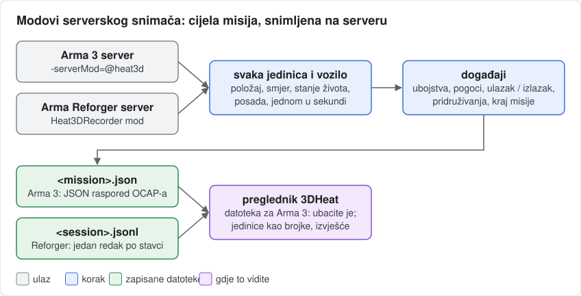

# Serverski snimači (modovi) (Arma 3, Arma Reforger) {#server-recorder-mods-arma-3-arma-reforger}

Većinu igara watcher snima na računalu samog igrača. Arma je drugačija: server može snimiti cijelu misiju - svaku jedinicu i vozilo, ne samo vaše - pomoću moda koji radi na serveru. Igrači ništa ne postavljaju: Arma 3 mod je samo za server, a Reforger sam preuzima serverove modove igračima kad se pridruže (mod na njihovim računalima ne radi ništa). Repozitorij nosi dva takva moda, u [`mods/arma3`](https://github.com/Holdi601/3DHeat-Watcher/tree/main/mods/arma3) i [`mods/reforger`](https://github.com/Holdi601/3DHeat-Watcher/tree/main/mods/reforger). Njihovi README-i su potpuna dokumentacija; ova stranica je pregled.

**Status: oba još nisu testirana u igri.** Proširenje za Arma 3 izgrađeno je i pokretano onako kako Arma poziva proširenja, a njegov izlaz je čitao 3DHeat; njegove SQF skripte još nisu radile u Arma 3. Reforger mod napisan je prema Bohemijinom objavljenom API-ju skripti i nikad nije preveden. Nemojte nijedan staviti na javni server prije nego što prođu koraci testiranja u njegovom README-u.

## Arma 3 {#arma-3}

1. Izgradite proširenje jednom po platformi (`mods/arma3/extension`). Treba vam C prevoditelj: Visual Studio Build Tools na Windowsu, gcc na Linuxu; ako nikad niste ništa prevodili, pitajte domaćina servera.
   - Windows, u "x64 Native Tools Command Prompt for VS":
     `cl /nologo /O2 /LD heat3d.c /Fe:heat3d_x64.dll`
   - Linux: `gcc -O2 -shared -fPIC -o heat3d_x64.so heat3d.c -ldl`
2. Izgradite mod: `python mods/arma3/build.py` zapisuje `mods/arma3/@heat3d/` (nije potreban Arma 3 Tools).
3. Kopirajte `@heat3d` u mapu servera i pokrenite server s `-serverMod=@heat3d`.
4. Dnevnik `.rpt` servera kaže `Heat3D recorder 0.1.0: recording <file> every 1 s`.

| Postavka | Zadano | Što radi |
|---|---|---|
| `captureDelay` | 1 | sekunde između okvira |
| `recordHits` | 1 | 0 isključuje događaje pogodaka |
| `recordShots` | 1 | 0 isključuje brojanje pucanja |
| `minPlayers` | 0 | snima tek kad je toliko igrača prijavljeno |

Misija to nadjača u svojoj `init.sqf` datoteci (`heat3d_captureDelay = 0.5;`). Snimke idu u `recordings/` unutar `@heat3d`, ili u `HEAT3D_DIR`.

**Izlaz:** jedna datoteka po misiji u OCAP-ovom JSON rasporedu (format OCAP2 snimača), nazvana `<date>__<time>_<mission>.json`. Tijekom misije to je dnevnik (`.heat3d.part`) koji se ispisuje na disk pri svakom pisanju; dnevnik srušene misije dovrši se sljedeći put kad počne neka misija.

## Arma Reforger {#arma-reforger}

Mod (`Heat3DRecorder.gproj`) otvara se i gradi u Bohemijinom Workbenchu (Arma Reforger Tools), testiran je na lokalnom namjenskom serveru, objavljen iz Workbencha (nije na popisu dok se testira) i dodan na popis `mods` u serverovom `config.json` - korak po korak u njegovom README-u. Svake sekunde zapisuje položaj, smjer, stanje života, vozilo i id igrača svakog lika, te položaj, smjer, stanje i posadu svakog vozila; i ubojstva (ubojica, oružje, udaljenost), pogotke, ulazak i izlazak iz vozila, pridruživanje i odlazak igrača te kraj misije.

**Izlaz:** jedan JSON objekt po retku, `$profile:heat3d/<UTC date>_<UTC time>_<world>.jsonl`: redak `header` (format `heat3d-reforger`, osi x istok, y gore, z sjever), zatim redci `entity`, `frame` i `event` kako se događaju, i redak `end`. Reci jedinica su `[id, x, y, z, dir, alive, vehicleId, playerId]`, retci vozila `[id, x, y, z, dir, alive, [crew ids]]`; događaji slijede OCAP2 raspored.

## U pregledniku {#in-the-viewer}

Ubacite snimku Arma 3 na [3DHeat preglednik](https://holdi601.github.io/3DHeat/): jedna misija je jedna sesija, jedinice postaju vojnici, vozila dobivaju svoj tip, a ubojstva i pogoci idu na popis Sažetka nakon misije. OCAP2-ov web player također je reproducira. Reforger datoteka je linijski format samog moda, s OCAP2-ovim rasporedom događaja.
