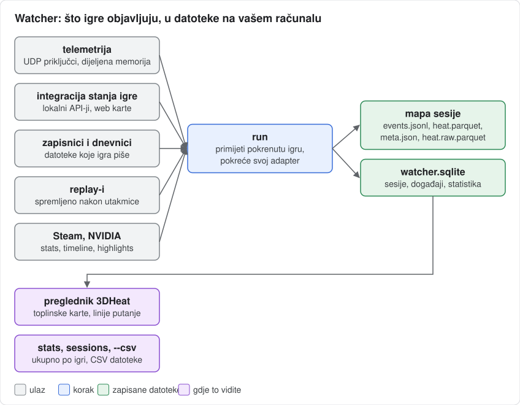

# Izvori i pravila {#sources-and-rules}

Watcher bilježi samo ono što igre i platforme daju igraču. Ova stranica objašnjava koje izvore to pokriva, što watcher smije učiniti s svakim od njih, i koje igre ili dijelove igara namjerno izostavlja.

## Šest vrsta izvora {#the-six-kinds-of-source}

Svaki adapter ima `kind`, a vrsta određuje što adapter smije raditi:

| Vrsta | Što je | Igre za više igrača |
|---|---|---|
| `telemetry` | UDP port ili dijeljena memorija koju igra objavljuje za nadzorne ploče, pokretne platforme i volane (Forza Data Out, F1 UDP, Kunosova i iRacing dijeljena memorija, SimConnect, UDP sučelje X-Planea, SCS SDK dodatak) | da - to je vlastiti izlaz igre |
| `gsi` | game-state integracija ili lokalni web API koji igra poslužuje igraču na njegovu računalu (Valve GSI, Live Client Data API League-a, Stats API Rocket League-a, web karta War Thundera) | da, unutar onoga što API prikazuje igraču |
| `log` | datoteke koje igra piše dok radi: dnevnici, zapisnici, statistika, spremanja (Elite Dangerous, Minecraft, Path of Exile, Hearthstone, Star Citizen, EVE Online) | da |
| `replay` | demo snimke i replayi koje igra sprema za svoje igrače, pretvoreni nakon utakmice (CS2, Dota 2, osu!, War Thunder, World of Tanks, World of Warships, Squad, League of Legends, VALORANT, IL-2 Tacview) | da, osim ako je šifrirano, i samo dijelovi koji su otvoreni |
| `platform` | ono što čuvaju Steam i upravljački program grafike: statistika, postignuća, vremenske crte, isječci i istaknuti trenuci | da |
| `memory` | memorija igre, samo za čitanje, profilom koji ste napisali | **nikad** - samo za igru za jednog igrača |

Samo `memory` otvara drugi proces, i to samo za čitanje. Ostalih pet vrsta čita ono što je igra, Steam ili NVIDIA aplikacija već zapisala ili šalje.

## Kako se izvori čitaju {#how-the-sources-are-read}

- **Ništa se ne ubacuje, ne kači i ne mijenja u igri.** U igru se ne učitava kod, ne kači se nijedan prozor ni unos, ne krpa se nijedna datoteka igre. Jedine datoteke koje watcher piše izvan svoje mape podataka jesu one koje [`setup --apply`](commands.md#setup) piše kad to zatražite: datoteka postavki igre (s originalom sačuvanim kao `<file>.heat3d-backup`), cfg datoteka game-state integracije, DCS hook skripta, BeamNG protokol mod.
- **Dijeljena memorija se otvara samo za čitanje i nikad se ne stvara.** Uobičajen način u Pythonu za otvaranje imenovane mape stvara je ako ne postoji. Igra pokrenuta poslije našla bi prazno, samo-čitajuće mapiranje watchera umjesto da napravi svoje, pa bi njezina telemetrija bila mrtva. Watcher otvara mapiranja samo s `OpenFileMappingW` (koji nalazi samo postojeće), mapira ih s `FILE_MAP_READ`, i pokuša ponovno kasnije ako ih igra još nije napravila.
- **Portovi se posuđuju, nikad ne preuzimaju.** UDP telemetrijski port na kojem već sluša drugi program (FH Companion, SimHub, aplikacija nadzorne ploče) prepušta se tom programu. Ako drugi program počne slušati port koji watcher drži, watcher ga pusti u roku od nekoliko sekundi. Forza adapteri čekaju 15 s nakon pokretanja igre prije nego zauzmu port 5300, i svaki paket prosljeđuju nepromijenjen na 127.0.0.1:5301, pa druga Data Out aplikacija i dalje može snimati.
- **Samo lokalno.** Poslužitelji game-state integracije koje watcher pokreće (CS2, Dota 2) slušaju na 127.0.0.1 i nigdje drugdje. Kad cfg datoteka igre sadrži token (onaj koji `setup` piše), svaki POST mora ga nositi; POST-ovi bez njega broje se kao `bad_auth` i odbacuju. Bez cfg datoteke s tokenom, prihvaća se svaki lokalni POST, i zapisnik to kaže. Lokalni API-ji koje traži (League na portu 2999, War Thunder na 8111, Rocket League na 49123, X-Plane na 49000) također su na 127.0.0.1.
- **Datoteke zapisnika se dijele, nikad ne zaključavaju.** Svako čitanje otvara datoteku sa svim zastavicama dijeljenja koje Windows ima i odmah je zatvara, pa igra može nastaviti pisati, preimenovati ili zamijeniti svoj zapisnik.
- **Dvije vanjske usluge, i samo u ovim slučajevima.** Provjera izdanja pita GitHub (`api.github.com`) najviše svakih šest sati i može se isključiti (vidi [Ažuriranja](updates.md)). Adapter replaya League-a pita Riotov Match-V5 API samo kad ste upisali vlastiti `riot_api_key`. Ništa drugo se nigdje ne šalje.
- **Uključivanje izvora odluka je vaša.** `setup` bez `--apply` samo kaže što bi promijenio.

## Pravila za više igrača {#multiplayer-rules}

- Igra koja se igra na mreži bilježi se samo kroz ono što objavljuje: telemetriju, game-state API-je, zapisnike, replaye, datoteke platforme. Unutar toga watcher bilježi ono što igra prikazuje igraču, i ništa izračunato dalje od toga:
  - **CS2 game-state integracija** šalje igrača koji se gleda (vi dok ste živi, suigrač nakon smrti). Pozicije ostalih igrača (`allplayers_*`) šalju se samo promatračima i GOTV-u, pa ih watcher ne traži.
  - **Live Client Data API League of Legendsa** nema pozicija. Riotova pravila dopuštaju alatima da prikazuju ono što igrač može znati iz same igre, i ništa izračunato dalje od toga (bez neprijateljskih tajmera). Watcher bilježi feed ubojstava i ljestvicu koju igrač vidi, te vlastite brojke igrača.
  - **Stats API Rocket League** nema pozicija automobila (stanje automobila šalje se samo promatračima). Ono što ima mjesto je lopta: gdje je udarena, postigla gol ili pogodila prečku.
  - **Web karta War Thundera** prikazuje ono što prikazuje mini karta, bez imena i ID-ova.
  - **F1 23/24/25** stavljaju poziciju svakog automobila u svoj Motion paket, i na mreži. Igra ih sama daje, i zadržava samo podatke igrača čija je "Your Telemetry" ograničena.
  - **DCS World**: poslužitelj za više igrača može zabraniti izvoz podataka vlastitog zrakoplova; sesija tada ima događaje, ali nema pozicija, i to kaže.
- **Memorija se nikad ne čita u igri za više igrača.** Adapter memorije za igru označenu kao igra na mreži se odbija, a profil mora navesti može li se njegova igra uopće igrati na mreži. Igra za jednog igrača koja ima i mrežni način čita se samo dok nema veze ni s čim osim s ovim računalom. Igre čiji način za jednog igrača radi pod anti-cheat sustavom se također nikad ne čitaju. Vidi [Čitanje memorije](memory-reading.md).
- Oznaka `multiplayer` na adapteru (u `games --markdown` prikazana kao "Online play") odlučuje samo o čitanju memorije. Ne zaustavlja ostale vrste da bilježe igru na mreži.

## Što je odbijeno i zašto {#what-is-declined-and-why}

Neke igre, i neki dijelovi igara, se ne bilježe: njihovi su podaci zaštićeni, nisu objavljeni ili ih uopće nema na računalu igrača:

| Igra | Što je izostavljeno | Zašto |
|---|---|---|
| VALORANT | pozicije, imena, rezultati u replayima; krajnje točke lockfile-a klijenta | Tok igre u replayu je zamagljen vrijednostima uzetim iz izvršne datoteke svake verzije. Igra radi pod Vanguardom. Krajnje točke lockfile-a Riot klijenta nisu objavljeni API. **Čita se:** što replay nosi u otvorenom obliku - mapa, ID utakmice, agenti, vremenska crta ubojstava i rundi koju bilježi poslužitelj. |
| League of Legends | trenutačni dio `.rofl` replayeva; krajnje točke lockfile-a klijenta | Zamagljeno protiv varanja, drugačije svaki patch, i ne dekodira se. **Čita se:** završni zbirni prikaz utakmice koji svaki replay nosi kao običan JSON, Live Client Data API tijekom utakmice i - uz vlastiti ključ za razvojne programere - službena Match-V5 vremenska crta (pozicije jednom u minuti, ubojstva tamo gdje su se dogodila). |
| Fortnite | replayi | Šifrirani su. |
| World of Tanks, World of Warships | replayi, u watcheru | Šifrirani. Watcher ih ne čita; to rade zasebni pretvarači izvan njega (`exporters/ext/wot-replay`, `exporters/ext/wows-replay`), svaki zaseban projekt. **Čita se, uz instaliran pretvarač:** pozicija svakog vozila ili broda dok ju je snimajući klijent znao, i ubojstva. |
| Gran Turismo 7 | telemetrija | Samo na konzoli, a telemetrija joj je šifrirana ključem izvučenim iz igre. |
| Apex Legends | sve | Njegov LiveAPI šalje potpune događaje samo u privatnim i prilagođenim lobijima; inače ništa nije dostupno lokalno. |
| Overwatch 2, Call of Duty, Battlefield 6, Hunt: Showdown 1896 | živi podaci | Nema lokalnog replaya, zapisnika ni izlaza game-state integracije za čitanje. Njihova statistika dolazi tamo gdje je Steam čuva ([Steam statistika](game-steam-stats.md), [Steam Timeline](game-steam-timeline.md)), a njihovi isječci kao [NVIDIA highlights](nvidia-highlights.md). |
| Star Citizen | sve izvan `Game.log` | Pokreće Easy Anti-Cheat; watcher čita samo datoteku zapisnika koju igra piše i nikad ne dira proces igre. |
| osu!lazer | replayi | Čuvaju se u vlastitoj pohrani igre; čitaju se samo `.osr` datoteke osu! (stabilna verzija). |
| Svaka igra za više igrača | memorija | Nikad. Igre za jednog igrača čiji način rada radi pod anti-cheat sustavom (GTA V, Elden Ring kroz svoj launcher) također se ne čitaju. |

Šifrirani replayi se ne otvaraju: čitač VALORANTA provjerava zastavicu šifriranja replaya i odbija šifriranu datoteku ("this replay is encrypted; it is not read").

Igre koje su istražene ali još nisu izrađene (Deadlock replayi, Rocket League `.replay` datoteke, StarCraft II, Team Fortress 2, Rainbow Six Siege, Beat Saber, Trackmania, nekoliko vozačkih simulatora) navedene su sa svojim izvorima u [Sve igre u jednoj tablici](watcher.md#researched-not-yet-built). Svaka treba uzorke datoteka prema kojima se provjerava prije nego se isporuči.
