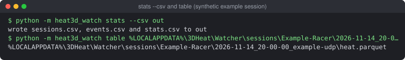

# Podaci {#the-data}

Sve snimke su obične datoteke u mapi podataka (`%LOCALAPPDATA%\3DHeat\Watcher`, osim ako se ne promijeni, vidi [Instalacija i pokretanje](installing-and-running.md#where-everything-is)). Možete ih čitati, kopirati ili brisati bez watchera. Datoteka `.jsonl` je običan tekst, jedan događaj po retku (otvara je Notepad); datoteka `.parquet` je tablica koju otvara preglednik 3DHeat (Excel ne - `stats --csv` piše CSV datoteke za tablične proračune).

## Mape sesija {#session-folders}


**Sesija** je jedno sjedenje s jednim izvorom: od trenutka kad igra prvi put nešto kaže, do trenutka kad se zaustavi (igra se zatvori, meč završi, vožnja ili let se resetiraju - stranica svakog adaptera kaže što pokreće i završava njegove sesije). Svaka sesija dobiva mapu:

```text
<data>\sessions\<game>\<YYYY-MM-DD_HH-MM-SS>_<adapter id>\
    events.jsonl
    heat.parquet
    meta.json
```

- `<game>` je naziv igre u kojem su svi znakovi osim slova, brojki, `.`, `_` i `-` zamijenjeni s `-` (najviše 60 znakova): `EA-SPORTS-F1-25`, `Counter-Strike-2`. Adapteri koji pokrivaju mnogo igara (statistika Steama, Steam Timeline, NVIDIA highlights) spremaju svaku sesiju pod igrom kojoj pripada.
- Vrijeme je početak sesije u lokalnom vremenu. Sesije koje opisuju prošlost (replay pretvoren nakon meča, datoteka statistike Steama) koriste vrijeme koje daje igra ili datoteka. Dvije sesije koje počnu u istoj sekundi dobivaju nastavak `_2`, `_3`, ...
- ID sesije u bazi statistike je `<game folder>/<session folder>`.

Sesija u kojoj ništa nije zabilježeno (igra je stajala u svojim izbornicima, ili se srušila pri pokretanju) briše se kad se zatvori, pa svako pokretanje ne ostavlja praznu mapu.

Neke sesije sadrže još datoteka. Sesija demo-snimke Counter-Strike 2 sadrži vlastitu tablicu i sažetak pretvarača (`<map>/<match>.parquet`, `<match>.match.json`). Sesija iRacinga navodi `.ibt` datoteke koje je simulator zapisao tijekom sjedenja kao događaje `telemetry_file`.

## events.jsonl {#eventsjsonl}

`events.jsonl` ima jedan JSON objekt po retku, jedan redak po događaju, zapisan u trenutku kad se događaj dogodi. Datoteka se piše po retcima, pa pad, nestanak struje ili ubijen proces ne gube ništa što je već zapisano; redak prekinut padom se preskače pri čitanju datoteke, a svaki redak prije njega ostaje.

Svaki redak ima iste osnovne stupce:

| Stupac | Vrsta | Što je |
|---|---|---|
| `time` | broj | sekunde od početka sesije (4 decimale), ili vlastiti sat igre gdje ga adapter prosljeđuje |
| `ms` | cijeli broj | vrijeme sa zidnog sata, Unix milisekunde |
| `event` | tekst | što se dogodilo: `position`, `spawn`, `death`, `kill`, `lap`, `teleport`, `session_start`, ... |
| `x`, `y`, `z` | broj | gdje, u jedinicama i osima same igre (vidi `axes` u `meta.json`); prisutno samo kad su sva tri poznata i konačna |
| `player` | tekst | tko: ime, ID, ili `me` za osobu koja igra (vidi [Vlastiti retci igrača](#the-players-own-rows)) |
| `team` | tekst | njihova strana, kad to igra kaže |
| `session` | tekst | meč, runda, etapa, život ili let kojem redak pripada, kad to igra kaže |

Svako drugo polje koje igra prijavi slijedi pod svojim imenom (`speed_kmh`, `gear`, `lap_time`, `weapon`, `victim`, `hero`, ...). Polja bez vrijednosti se izostavljaju, a tako i brojevi koji nisu konačni.
Dva izmišljena retka:

```json
{"time":12.3456,"ms":1777660501123,"event":"position","x":-412.5,"y":12.1,"z":233.0,"player":"me","session":"1","speed_kmh":187.4,"gear":5}
{"time":15.0,"ms":1777660503667,"event":"lap","x":-380.2,"y":12.0,"z":250.9,"player":"me","session":"1","lap_time":92.418,"lap":3}
```

Retci bez pozicije (redak feeda ubojstava, podizanje razine, promjena statistike) ostaju u `events.jsonl` i broje se u statistici. U tablicu idu samo retci s pozicijom.

### Vlastiti retci igrača {#the-players-own-rows}

Koji su retci osobe koja igra kaže izvor, nikad se ne pogađa. Redak je igračev vlastiti kad

- je njegov `player` `me`: većina adaptera, čiji je izvor igračeva vlastita igra (telemetrija vlastitog automobila ili zrakoplova, integracija stanja igre, dnevnik);
- nosi `own_car` 1: utrkaške igre koje bilježe svaki automobil pod imenom vozača (EA SPORTS F1 po igračevom indeksu automobila u igri, RaceRoom po vlastitom mjestu, Automobilista 2 i Project CARS 2 po gledanom sudioniku) označavaju igračev automobil ovako i zadržavaju vozačevo ime u `player`;
- je njegov `player` jednak `player` iz `meta.json` sesije: ime koje izvor daje igraču - zapovjednik Elite Dangerous (dnevnik je uvijek igračev), ili redak League of Legends replaya s Riot ID-om iz postavki.

War Thunder i Rocket League imenuju svakog igrača i ne kažu koji ste vi; s vašim imenom u postavci `player_names` (vidi [Postavke](installing-and-running.md#settings)) vaši retci postaju `me`. [NVIDIA highlights](nvidia-highlights.md) traže trenutak upravo u tim retcima.

## heat.parquet {#heatparquet}

Kad se sesija zatvori, retci iz `events.jsonl` koji imaju `x`, `y` i `z` zapisuju se u `heat.parquet`. To je tablica koju otvara preglednik 3DHeat. Ako sesija nema pozicija, tablica se ne piše.

- Stupci su `time`, `ms`, `event`, `x`, `y`, `z`, `player`, `team`, `session`, a za njima svako ostalo polje redom kojim se prvi put pojavilo.
- `x`, `y`, `z` i `time` su 64-bitni brojevi s pomičnom točkom, a `ms` je 64-bitni cijeli broj. Svaki drugi stupac čije su vrijednosti sve brojevi je 64-bitni broj s pomičnom točkom; svaki ostali stupac je tekst kodiran rječnikom (nedostajuće vrijednosti su prazan tekst, a popisi ili objekti se zapisuju kao JSON tekst).
- Metapodaci datoteke imaju ključ `heat3d` s uputama za čitanje, pa preglednik sam preslikava stupce i osi (primjer, sa skraćenim popisom `extra`):

```json
{
  "version": 1,
  "kind": "heat3d-watch",
  "game": "EA SPORTS F1 25",
  "axes": {"up": "y", "flipX": false, "flipY": false, "flipZ": false, "scale": 1.0},
  "columns": {
    "x": "x", "y": "y", "z": "z",
    "time": "time", "timeUnit": "seconds",
    "personId": "player", "teamId": "team", "sessionId": "session",
    "extra": ["event", "speed_kmh", "gear", "lap_time", "lap"]
  }
}
```

`up` je glavna os igre, `flipX`/`flipY`/`flipZ` zrcale os da se lijevi svijet ne crta zrcaljen, a `scale` je mjerilo jedinica preglednika: preglednik množi svaku poziciju s njim kad učita tablicu (0,01 bi centimetre pretvorio u metre). Svaki adapter piše 1 i zadržava jedinice same igre - metre za većinu, jedinice Source (inči) za Counter-Strike 2, Unreal jedinice (centimetri) za Rocket League - jer je razina izvezena iz igre u tim istim jedinicama, pa se retci poklapaju s njom; tablice pretvarača CS2 kažu isto. `units` u `meta.json` kaže što je jedna jedinica. Stranica svake igre navodi svoje vrijednosti pod "Positions and axes".

Simulatori letenja (DCS World, Microsoft Flight Simulator, X-Plane, Tacview snimke IL-2) stavljaju svoje retke na Zemlju, a njihovo podnožje kaže gdje, pa preglednik može položiti pravi svijet ispod njih:

```json
"geo": {"lat0": 42.0, "lon0": 42.0, "projection": "tangent-plane", "east": "x", "north": "z", "up": "y"}
```

`lat0`/`lon0` (stupnjevi) su ishodište ravne karte u kojoj su retci; `east`, `north` i `up` imenuju stupce koji drže metre istočno i sjeverno od njega te visinu iznad morske razine. Ishodište je prvo očitanje za X-Plane i MSFS, referentna točka snimke za IL-2, a fiksno ishodište bojišta za DCS (prvo očitanje zaokruženo na cijele stupnjeve na bojištu koje watcher ne poznaje). Tablica bez mjesta na Zemlji nema ključ `geo`, a sve ostalo u podnožju je isto u oba slučaja.

`heat.parquet` se uvijek može ponovno izraditi iz `events.jsonl` naredbom `python -m heat3d_watch table <session folder>` (vidi [Naredbe](commands.md#table)). To je korisno kad je `pyarrow` nedostajao dok je sesija snimana.

## meta.json {#metajson}

`meta.json` sažima sesiju. Piše se kad se sesija otvori, najviše svakih 30 sekundi dok pristižu događaji ili statistika, i kad se sesija zatvori. Statistika se između tih pisanja drži samo u memoriji, pa pad može izgubiti najviše zadnjih pola minute.

```json
{
  "format": "heat3d-watch-session",
  "version": 1,
  "watcher": "1.0.2",
  "game": "EA SPORTS F1 25",
  "adapter": "f1-25",
  "source": "UDP telemetry 127.0.0.1:20777 (...)",
  "multiplayer": true,
  "started": "2026-05-01T20:15:03",
  "ended": "2026-05-01T21:02:11",
  "seconds": 2828.0,
  "axes": {"up": "y", "flip_x": false, "flip_y": false, "flip_z": false, "scale": 1.0, "units": "metres"},
  "events": {"position": 52110, "lap": 412, "teleport": 3},
  "positions": 52530,
  "stats": {"laps": 20, "best_lap": 91.874, "distance_km": 106.3, "race_position": 4},
  "track": "..."
}
```

Sesija čiji izvor imenuje igrača (vidi [Vlastiti retci igrača](#the-players-own-rows)) ima i `"player"`: ime koje nose igračevi vlastiti retci. Sesija na Zemlji (simulatori letenja) ima i `"geo": {"lat0": .., "lon0": ..}`, ishodište koje ponavlja `geo` njezinog podnožja.

- `started` / `ended`: lokalno vrijeme do sekunde; `ended` je `null` dok sesija traje.
- `events`: koliko se puta svaki događaj dogodio, od najčešćeg. `positions` je broj redaka s pozicijom.
- `stats`: brojevi sesije. Adapter svaki postavlja, dodaje mu, ili zadržava najveću ili najmanju vrijednost.
- Sve drugo što adapter zna o sjedenju slijedi na vrhu: staza, karta, misija, ID meča, ID Steam aplikacije, replay datoteka, profil memorije i verzija. Sesija koju je završio oporavak ima `"recovered": true`.

## watcher.sqlite {#watchersqlite}

`watcher.sqlite` je baza statistike. Redak se dodaje za svaku sesiju kad se zatvori. Tri tablice su obične, pa ih može čitati svaki SQL alat, bilježnica ili tablični proračun bez watchera:

```sql
CREATE TABLE sessions (
  id TEXT PRIMARY KEY,          -- <game folder>/<session folder>
  game TEXT NOT NULL,
  adapter TEXT NOT NULL,
  started REAL NOT NULL,        -- Unix seconds
  ended REAL,                   -- Unix seconds
  seconds REAL,
  folder TEXT NOT NULL,         -- the session folder's full path
  events INTEGER NOT NULL DEFAULT 0,
  positions INTEGER NOT NULL DEFAULT 0,
  multiplayer INTEGER NOT NULL DEFAULT 0,
  source TEXT
);
CREATE TABLE events (           -- per session, how many times each event happened
  session TEXT NOT NULL REFERENCES sessions(id) ON DELETE CASCADE,
  event TEXT NOT NULL,
  count INTEGER NOT NULL,
  PRIMARY KEY (session, event)
);
CREATE TABLE stats (            -- per session, every number the game reported or the watcher counted
  session TEXT NOT NULL REFERENCES sessions(id) ON DELETE CASCADE,
  key TEXT NOT NULL,
  value REAL,                   -- numbers
  text TEXT,                    -- everything else (a map name, a result, a hero)
  PRIMARY KEY (session, key)
);
```

Ponovno snimanje sesije (oporavak, ponovno pretvoren replay) zamjenjuje njezine retke. `multiplayer` je zastavica adaptera (neki adapteri je postavljaju po sesiji, na primjer DCS iz misije), a ne provjera jeste li bili na mreži. Istina/laž vrijednost u `stats` se sprema kao tekst.

Primjer upita, najbolji krug po igri nad svim sesijama (niža vrijednost je bolja):

```sql
SELECT s.game, MIN(t.value) AS best_lap
FROM stats t JOIN sessions s ON s.id = t.session
WHERE t.key = 'best_lap'
GROUP BY s.game;
```

`python -m heat3d_watch stats` ispisuje zbrojeve iz ovih tablica (vidi [Naredbe](commands.md#stats)); njegov stupac `best` je najniža vrijednost za vremena koja se čuvaju kao najbolja i za mjesta, a najviša za ostalo.

## Oporavak nakon pada {#recovery-after-a-crash}

Kad se `run` pokrene, traži sesije koje je prethodni watcher ostavio otvorene: `meta.json` bez `ended`, i `events.jsonl` s barem jednim retkom. Dovršava svaku:

- broj događaja i broj pozicija ponovno se broje iz `events.jsonl`, preskačući redak prekinut padom;
- kraj je zidno vrijeme zadnjeg retka (`ms`);
- statistika je ona iz zadnjeg pisanja `meta.json` (najviše 30 sekundi stara);
- dodaje se `"recovered": true`, piše se `heat.parquet`, a sesija ide u `watcher.sqlite`.

Dnevnik kaže "finished N session(s) left open by an earlier run". Datoteka zaključavanja sprečava da drugi watcher "oporavlja" sesije onog koji još radi.

## CSV izvoz {#csv-export}



```bash
python -m heat3d_watch stats --csv out
```

piše `out\sessions.csv`, `out\events.csv` i `out\stats.csv`. Svaka datoteka je jedna tablica iz `watcher.sqlite`, potpuna, s redkom zaglavlja, kao UTF-8. Vremena su Unix sekunde kao u bazi. `--game` ne sužava izvoz; zapisuje se svaka sesija.

## Otvaranje sesije u pregledniku 3DHeat {#opening-a-session-in-the-3dheat-viewer}

Preglednik: [github.com/Holdi601/3DHeat](https://github.com/Holdi601/3DHeat), dokumentacija [holdi601.github.io/3DHeat](https://holdi601.github.io/3DHeat/) - njegova stranica [`.3dheat` spremnik](https://holdi601.github.io/3DHeat/container.html) opisuje format jedna-datoteka-po-meču koji pretvarači replayeva mogu pisati.

Otvorite `heat.parquet` sesije u pregledniku 3DHeat. Podnožje govori pregledniku koji je stupac pozicija, vrijeme, igrač, strana i sesija te kamo je gore, pa se ništa ne mora ručno preslikavati. Pozicije su u svjetskim koordinatama same igre. Nacrtane preko razine izvezene drugim alatima 3DHeat-a (na primjer iz [3DHeat GameFiles](https://github.com/Holdi601/3DHeat-GameFiles)), padaju tamo gdje su se dogodile.

- **Toplinske karte** koriste svaki redak s pozicijom, filtriran po `event`, `player`, `team` ili `session` kao i svaki ostali stupac.
- **Crte** (Line heat) crtaju liniju od svakog retka igrača do njegovog sljedećeg, a u reprodukciji je svaki igrač točka koja se kreće rutom s repom iza sebe. Panel preglednika Rute odabire, iz stupca `event`, koji događaji **započinju** rutu, a koji je **završavaju**. Watcher piše omeđujuće događaje kao retke s pozicijom, pa se mogu odabrati tamo:
  - početci: `spawn`, `respawn`, `session_start`. Početak zatvara rutu koja je bila otvorena, bez crtanja linije do novog mjesta.
  - završeci: `death`, `finish`, `session_end` i `teleport`. Linija ide do samog retka završetka, odnosno mjesta gdje je igrač poginuo, stao ili bio odveden.

  Skok - mjesto stignuto bez putovanja do njega - su dva retka: `teleport` na mjestu **napuštenom**, i početak na mjestu **do kojeg se stiglo**, odmah nakon njega. Adapteri za utrke pišu ga kad se automobil pomakne dalje nego što je mogao voziti (vraćanje unatrag ili flashback, resetiranje na cestu, povratak u boks, brzo putovanje), s `spawn` na dolasku (`respawn` za BeamNG-ov reset); redak `teleport` nosi dolazak kao `to_x`, `to_y`, `to_z` i udaljenost kao `metres`, a redak početka `after: "teleport"`. Adapteri za kamione rade isto za trajekt, vlak ili učitani spremljeni, a adapteri za letjelice za skok kojim nijedan zrakoplov ne bi mogao letjeti. Tako, uz `teleport` među završecima i `spawn` među početcima - što preglednik sam predlaže - ruta završava gdje ju je skok ostavio, a sljedeća počinje gdje je stigla, i nijedna linija ne prelazi kartu. Ruta nikad ne prelazi preko promjene stupca `session`. Redak pozicije se piše nekoliko puta u sekundi (10 Hz za većinu telemetrije), što daje glatku liniju.
- Stupac `session` dijeli sjedenje na runde, etape, živote ili tijela (Elite Dangerous na taj način drži retke galaksije i retke površine svakog planeta odvojeno). Odaberite jedan u pregledniku da pogledate samo taj dio.

Što preglednik radi s retcima - filtri, boje, reprodukcija - opisano je u dokumentaciji samog preglednika. Sesije demo-snimki Counter-Strike 2 otvaraju se kroz `<map>/<match>.parquet` i `<match>.match.json` pretvarača, u karticama Toplinska karta i Meč preglednika. Pozicije iRacinga dolaze iz `.ibt` datoteka navedenih u sesiji, koje preglednik sam čita.
