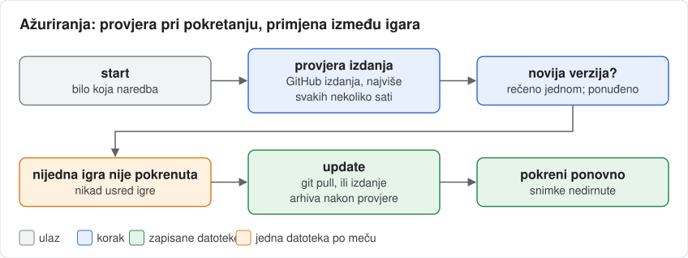

# Ažuriranja {#updates}

Watcher se ažurira sam iz izdanja [Holdi601/3DHeat-Watcher](https://github.com/Holdi601/3DHeat-Watcher/releases). Ažurirač je paket `heat3d_update` pored `heat3d_watch` u repozitoriju.

## Provjera {#the-check}

- **Kada**: svaka naredba osim `update` provjerava pri pokretanju. `run` provjerava i dok radi, najviše jednom na sat i samo dok nijedna igra nije pokrenuta.
- **Kako**: jedan HTTPS zahtjev na `https://api.github.com/repos/Holdi601/3DHeat-Watcher/releases/latest`, s rokom od 5 sekundi. Odgovor se čuva šest sati u `%LOCALAPPDATA%\3DHeat\update-check-3DHeat-Watcher.json`, pa većina pokretanja ništa ne pita. "Još nema izdanja" (HTTP 404) čuva se kao i svaki ostali odgovor. Bez mreže, s ograničenjem brzine ili iza proxyja, provjera tiho ne uspije i naredba nastavlja s verzijom koju ima.
- **Verzije**: instalirana verzija je datoteka `VERSION` u mapi repozitorija. Oznaka izdanja (`v1.2.0` ili `1.2.0`) uspoređuje se kao brojevi, dio po dio; sve nakon `-` ili `+` se ignorira.
- **Isključeno**: `HEAT3D_NO_UPDATE=1` (bilo koja vrijednost osim prazne, `0`, `false` ili `no`) isključuje i provjeru i automatsko ažuriranje. Svaki 3DHeat alat ima vlastitu datoteku predmemorije, pa odgovor jednog alata nikad ne vrijedi za drugi.

## Što se događa kad izađe novije izdanje {#what-happens-when-a-newer-release-is-out}

- **`run`** ispiše obavijest kad se pokrene i nastavi raditi: `[heat3d_watch] 3DHeat Watcher 1.2.0 is out (this is 1.0.2). <release page>`. Dok radi, uz uključen `auto_update` (zadano) i dok nijedna igra nije pokrenuta, zatim se sam ažurira: redak u dnevniku `3DHeat Watcher 1.2.0 is out (this is 1.0.2); updating`, Windows obavijest "Updating to 1.2.0", ažuriranje, svaki adapter zaustavljen i njegove sesije zatvorene, te ista naredba ponovno pokrenuta na novom kodu. Watcher se nikad ne ažurira usred igre. Ako se ažuriranje ne može primijeniti, obavijest to kaže ("1.2.0 is out; not updated: ...") i watcher nastavlja raditi staru verziju. S isključenim `auto_update` ostaje samo obavijest.
- **Ostale naredbe** pitaju `Update now? [Y/n]` kad rade u terminalu. Enter, `y`, `yes`, `j` ili `ja` ažurira, pa ponovno pokrene istu naredbu na novoj verziji. Bez terminala (zakazano pokretanje, cijev) ispišu kako se ažurira i nastave.
- **Na zahtjev**: `python -m heat3d_watch update` (ili `python -m heat3d_update`) pita GitHub bez predmemorije i ažurira. `--check` samo kaže je li izašlo novije izdanje. Ovo radi i kad je postavljen `HEAT3D_NO_UPDATE`.

## Kako se ažuriranje primjenjuje {#how-an-update-is-applied}

Ovisi o tome kako je kopija instalirana:

- **Git klon** (mapa ima `.git` i `git` je na PATH-u): `git pull --ff-only`. Ovo se odbija dok klon ima promjene u praćenim datotekama (`git status --porcelain --untracked-files=no` nije prazan): te promjene su nečiji rad, a ažuriranje ne odlučuje što će se s njima dogoditi. Spremite ih commitom ili stashom, pa povucite.
- **Preuzeta kopija**: arhiva izvornog koda izdanja preuzme se i raspakira u privremenu mapu. Unosi koji bi završili izvan nje se preskaču. `VERSION` u arhivi mora biti verzija koju izdanje tvrdi, inače se ništa ne kopira. Zatim se njezine datoteke kopiraju preko mape repozitorija. Datoteke koje nisu dio izdanja - snimke, postavke, virtualna okruženja, izvoz, sve što ste sami napravili - ne diraju se. Python modul koji je stariji izdanje imalo, a novo ga je izbacilo, uklanja se iz paketa izdanja (`heat3d_watch`, `heat3d_update`), pa se nakon ažuriranja ne učitava zastarjeli modul adaptera; izvan tih paketa ništa se ne uklanja.

Snimke i postavke obično ionako žive izvan mape repozitorija (`%LOCALAPPDATA%\3DHeat\Watcher`), pa im se ažuriranje nikad ne približi.

Nakon ažuriranja ista naredba se pokreće ponovno. Na Windowsu watcher pokrene novi proces, čeka ga i prosljeđuje njegov izlazni kod, pa se konzola ponaša kao da je prvi proces obavio posao.
