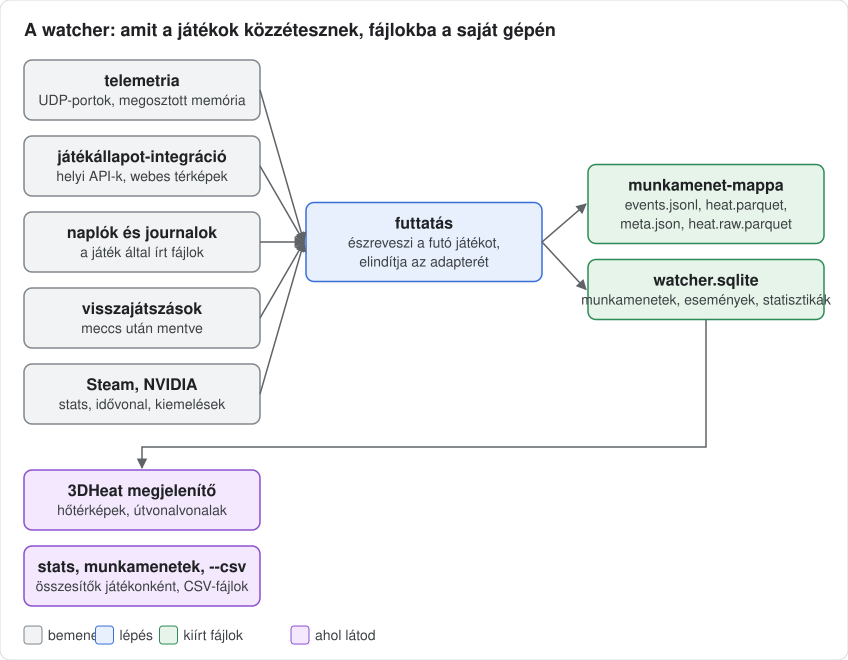
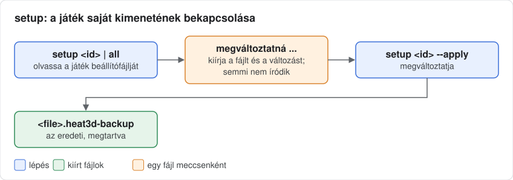
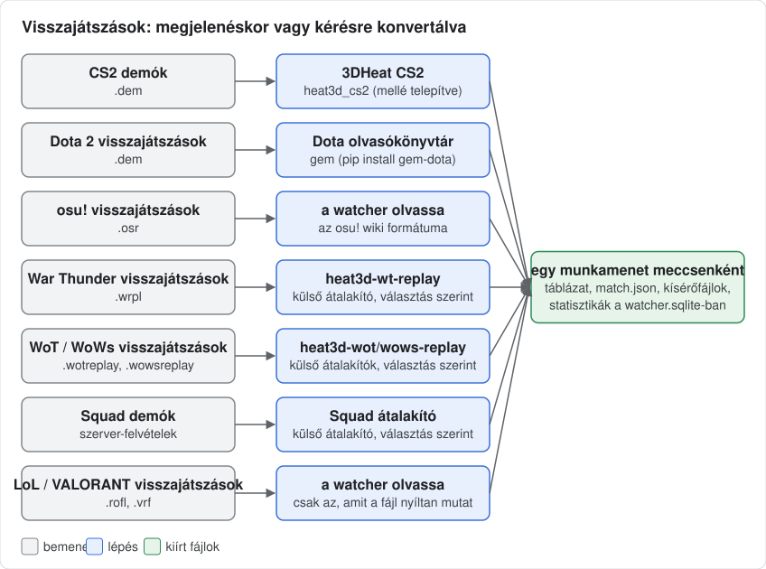
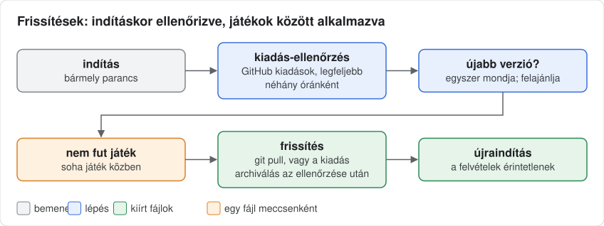

# Parancsok {#commands}

Még nem használtad a parancssort? Először olvasd el a [Mielőtt elkezdenéd](before-you-start.md) oldalt. Minden parancsot
abban a terminálban írsz be, amelyet abban a mappában nyitsz meg, ahová kicsomagoltad vagy klónoztad a programot (a Fájlkezelőben
írd be a `powershell` szót a címsorba), így:

```bash
python -m heat3d_watch <command> [options]
```


| Parancs | Mit csinál |
|---|---|
| [`run`](#run) | a háttérben figyel, és rögzít minden futó játékot |
| [`games`](#games) | minden játék mit ad, és honnan |
| [`setup`](#setup) | a játék saját kimenetének bekapcsolása |
| [`status`](#status) | mely játékok futnak most, és mely adapterek indulnának el |
| [`sessions`](#sessions) | az eddigi felvételek |
| [`stats`](#stats) | összesítés játékonként, vagy a táblák CSV-ben |
| [`table`](#table) | egy munkamenet `heat.parquet` fájljának újraépítése az `events.jsonl` alapján |
| [`replays`](#replays) | a lemezen már meglévő visszajátszások konvertálása |
| [`dota-replay`](#dota-replay) | egy nyilvános Dota 2 mérkőzés visszajátszásának letöltése az azonosítója alapján |
| [`dota-map`](#dota-map) | a Dota 2 pálya a telepítésedből, 3D szintként a nézegetőhöz |
| [`update`](#update) | frissítés a legújabb kiadásra |
| [`config`](#config) | a beállítások megjelenítése vagy módosítása |

Minden parancsnál használható kapcsolók: a `-h` / `--help` kiírja a súgót, a `python -m heat3d_watch --version`
pedig a verziót (a `VERSION` fájlt).

Ezen az oldalon a képek szintetikus, kitalált példa-munkameneteken (`Example Racer`, `Example Arena`) készült futtatásokat
mutatnak, nem valódi felvételeket.

Az `update` parancs kivételével minden parancs először megnézi, van-e újabb kiadás (legfeljebb hatóránként; a `HEAT3D_NO_UPDATE=1`
beállítással kihagyható, lásd [Frissítések](updates.md)). A `run` csak egy értesítést ír ki. A többi parancs terminálban
megkérdezi: `Update now? [Y/n]`, nem terminálban pedig kiírja, hogyan frissíthetsz. A kimenet UTF-8, ezért a játéknevek
bármilyen nyelven helyesen jelennek meg bármelyik konzolon.

## run {#run}

```bash
python -m heat3d_watch run [--once] [-v]
```



Addig figyel, amíg le nem állítod (Ctrl+C): a `scan_seconds` időközönként megnézi a folyamatlistát, és minden
megtalált játékhoz elindítja az adaptert, a mindig futó adapterek mellett. Az első ellenőrzés előtt lezárja azokat a
munkameneteket, amelyeket egy korábbi futás nyitva hagyott. Amíg nem fut játék, frissülhet is magától (ha az `auto_update`
be van kapcsolva). A részletek a [Telepítés és futtatás](installing-and-running.md#running) oldalon vannak.

| Kapcsoló | Hatás |
|---|---|
| `--once` | egyszeri ellenőrzés a most futó játékokra, majd kilépés. A most futó játékok adapterei (és a mindig futók) elindulnak, mindegyik egyszer lekérdez (legfeljebb 10 másodpercet vár rá), majd mind leáll úgy, ahogy egy játék végekor állnak le: a munkameneteik lezáródnak, kiíródnak és számolódnak. A felismerés ellenőrzésére szolgál, nem felvételre. |
| `-v`, `--verbose` | hibakereső sorok a `watcher.log` fájlban és a konzolon |

A `run` létrehozza a `<data>\watcher.lock` fájlt, és nem indul el másodszor ugyanahhoz az adatmappához (kilépési kód: 1);
lásd [A zárfájl](installing-and-running.md#the-lock-file).

## games {#games}

```bash
python -m heat3d_watch games [--markdown]
```


Minden adaptert felsorol játékonként rendezve: a nevét, azonosítóját és típusát, honnan olvas, mit rögzít, és
hogyan kell bekapcsolni. Az az adapter, amely ezen a gépen nem futhat, `[unavailable: <why>]` jelölést kap - nem található a
SimConnect.dll, nincs Minecraft-mappa, nincs telepítve a 3DHeat CS2, nem található a Steam vagy az NVIDIA App. Ha egy
adaptermodul nem importálható, a lista végén nevesítve van, a hibával együtt.

```text
EA SPORTS F1 25  (f1-25, telemetry)
    from: UDP telemetry 127.0.0.1:20777 (Documents\My Games\F1 25\hardwaresettings\hardware_settings_config.xml)
    - every car's position (world XYZ, m) at 10 Hz, by driver name, team, own car marked, ...
    switch on: In the game: Settings > Telemetry Settings > UDP Telemetry On, IP 127.0.0.1, port 20777 - ...
```

A `--markdown` ugyanezt egyetlen Markdown-táblázatként írja ki (játék, mit rögzít, honnan, hogyan kapcsolható be,
online játék, ellenőrizve). Az [Összes játék egy táblázatban](watcher.md) című rész táblázata ennek a kimenete. A cellák
Markdown-kompatibilisek: a backtickek közötti szöveg kódrészlet marad, azon kívül a `<`, `>`, `&`, `*`, `|` és az
írásjel előtti visszaper úgy van írva, hogy pontosan úgy jelenjen meg, ahogy be van gépelve (a `<CS2>` különben HTML-
címkeként eltűnne a kramdownban). Az egyetlen HTML-elem a „Mit rögzít” elemei közötti `<br>`.

## setup {#setup}

```bash
python -m heat3d_watch setup <adapter id | all> [--apply]
```




A játék saját kimenetét kapcsolja be, ha a játéknak egy fájl megváltoztatása kell hozzá. A `--apply` nélkül
semmi sem változik: minden sor leírja, mit változtatna, és ha van változtatnivaló, az utolsó sor ezt írja:
`Nothing was changed. Run again with --apply to make these changes.` Ha nincs mit változtatni, ezt írja ki:
`<id>: nothing to change` (`Nothing to change.` az `all` esetén). A `--apply` kapcsolóval a változtatások megtörténnek, és
egy fájl első módosítása előtt az eredetijét `<file>.heat3d-backup` néven elmenti. A már meglévő biztonsági másolatot soha
nem írja felül, így mindig az a fájl van benne, ahogy a watcher először hozzányúlt.

```text
f1-25: would change: hardware_settings_config.xml <udp>: enabled="false" -> "true"
Nothing was changed. Run again with --apply to make these changes.
```

Az `all` lefuttatja minden olyan adapter beállítását, amelynek van ilyen. Az adapter, amelynek nincs, külön megnevezve
ezt írja ki: `<id>: nothing for setup to change; ` és utána, hogyan kapcsolódik be a játékban (az `enable` szövege, vagy
hogy semmi sem kell hozzá). Ismeretlen azonosító esetén `no adapter '<id>'; games lists them` íródik ki, és a kilépési kód 2.
Azok az adapterek, amelyeknek van mit beállítani:

| Adapter | Mit változtat a `--apply` |
|---|---|
| `beamng` | telepíti a `heat3d` protokoll-modot a BeamNG felhasználói `mods` mappájába (csak ha ott még nincs); utána a játékban kapcsold be: Options > Other > Protocols > "others" |
| `cs2-gsi` | írja a `<CS2>\game\csgo\cfg\gamestate_integration_heat3d.cfg` fájlt: a játékállapotot a `http://127.0.0.1:3311/` címre küldi egy véletlenszerű tokennel, amelyet a watcher ezután megkövetel (a fájlban már meglévő tokent megtartja); a CS2 indításkor olvassa be |
| `dota2-gsi` | ugyanez a Dota 2-höz: `<Dota>\game\dota\cfg\gamestate_integration\gamestate_integration_heat3d.cfg`, 3312-es porton |
| `dcs` | a `Scripts\Hooks\heat3d-watch.lua` fájlt minden `%USERPROFILE%\Saved Games\DCS*` mappába bemásolja. A saját, régebbi példányát frissíti; az ilyen nevű fájlt, amelyet a watcher nem írt, érintetlenül hagyja. Indítsd újra a DCS-t. |
| `dirt-rally-2` | `hardware_settings_config.xml`: `<udp enabled="true" extradata="3" ip="127.0.0.1" port="20777">`; előbb egyszer indítsd el a játékot, hogy a fájl létezzen |
| `ea-wrc` | `Documents\My Games\WRC\telemetry\config.json`: a `wrc` struktúra `session_update` csomagja bekapcsolva, erre a gépre |
| `f1-23`, `f1-24`, `f1-25` | `hardware_settings_config.xml`: `<udp enabled="true" ip="127.0.0.1" port="20777">`; a játéknak zárva kell lennie |
| `hearthstone` | egy `[Power]` szakaszt ad (`LogLevel=1`, `FilePrinting=true`) a `%LOCALAPPDATA%\Blizzard\Hearthstone\log.config` fájlhoz; indítsd újra a játékot |
| `il2` | `<game>\data\startup.cfg`, `[KEY = telemetrydevice]`: egy újabb cél, `addrN = "127.0.0.1:41995"`, és `enable = true` (a szakaszt 10 Hz-en hozzáadja, ha nincs); indítsd újra az IL-2-t |
| `il2-tacview` | `<game>\data\startup.cfg`, `[KEY = track_record]`: `tacviewrecord = 1` |
| `rocketleague-stats` | `TAStatsAPI.ini` (vagy ha az nincs, a `DefaultStatsAPI.ini`) a `<RL>\TAGame\Config` mappában: `PacketSendRate=30`, ha az API ki van kapcsolva, és `Port`, ha nincs beállítva; a Rocket League indulásakor olvassa be |

A `richard-burns-rally`-nak nincs beállítása: a telemetriáját az RSF/NGP bővítmény adja, amelyet kézzel kell bekapcsolni a
`RichardBurnsRally.ini` fájlban (lásd [a saját oldalát](game-richard-burns-rally.md)); a `setup richard-burns-rally` ezt
mondja ki. Minden más játéknak nincs szüksége semmire, vagy magában a játékban kapcsolódik be; minden játék oldala
leírja, hogyan.

## status {#status}

```bash
python -m heat3d_watch status
```

```text
3DHeat Watcher 1.0.2; data in C:\Users\...\AppData\Local\3DHeat\Watcher
Games running: EA SPORTS F1 25 (f1-25)
Always on: il2-tacview, steam-stats, steam-timeline, nvidia-highlights, cs2-demos, osu-replays, lol-replays, valorant-replays
```

Megmondja, mely adapterek indulnának most el egy `run` esetén, ugyanazon szabályok szerint: a játék folyamata fut, az
adapter nincs a `disabled` listán, nincs hiányzó, amire szüksége van; a visszajátszás-adapterek csak akkor, ha a `replays`
be van kapcsolva; a memóriaadapterek csak akkor, ha a `memory` be van kapcsolva, és minden memória-ellenőrzés sikeres volt.
Semmit sem indít el.

## sessions {#sessions}

```bash
python -m heat3d_watch sessions [--game NAME] [--limit N]
```


A legújabb munkamenetek a `watcher.sqlite` fájlból, soronként egy: kezdés (helyi idő), játék, perc, események,
pozíciók, mappa.

| Kapcsoló | Hatás |
|---|---|
| `--game NAME` | csak ez a játék, a listában szereplő pontos nevével (`"EA SPORTS F1 25"`) |
| `--limit N` | legfeljebb N munkamenet (alapértelmezés: 40) |

## stats {#stats}

```bash
python -m heat3d_watch stats [--game NAME] [--csv DIR]
```


Kapcsolók nélkül: táblázat minden játékról (munkamenetek, órák, események, pozíciók, utoljára játszva), a legtöbbet
játszott először, majd játékonként a 25 leggyakoribb esemény, és minden számszerű statisztika a rendelkező munkamenetek
számával, az összeggel, a legjobb értékkel (`best`) és az átlaggal. A `best` tudja, melyik irány a jobb: a legkisebb értéket
a legjobb időknél (`best_lap`, `best_stage` és minden más, `best_` kezdetű kulcs), és a helyezéseknél (`race_position`,
`grid_position`, minden `_position` végű kulcs); minden másnál a legnagyobbat (kill, távolság, végsebesség, a játék saját
számlálói).

| Kapcsoló | Hatás |
|---|---|
| `--game NAME` | csak ennek a játéknak az eseményei és statisztikái, az áttekintés nélkül |
| `--csv DIR` | a `sessions.csv`, `events.csv` és `stats.csv` fájlokat írja a `DIR` mappába (a három tábla minden sorát); a `--game` nem szűkíti |

## table {#table}

```bash
python -m heat3d_watch table <session folder>
```


Újraépíti a `heat.parquet` fájlt egy munkamenet mappájában, az `events.jsonl` alapján, a tengelyeket a `meta.json`
fájlból véve. Kiírja a tábla elérési útját, vagy azt, hogy `no positions in this session`. Akkor használd, ha a munkamenet
rögzítésekor hiányzott a `pyarrow`, vagy ha kézzel szerkesztetted az `events.jsonl` fájlt.

## replays {#replays}

```bash
python -m heat3d_watch replays <adapter id> [folder] [-v]
```



A lemezen már meglévő visszajátszásokat konvertálja, most, egymás után, mindegyiket olyan munkamenetté, mint ahogy a
watch tenné a mappából. Amikor a watcher először lát egy visszajátszás-mappát, csak feljegyzi, mi van benne (lásd
[Telepítés és futtatás](installing-and-running.md#replays-already-on-disk)); ezeket így lehet kérésre konvertálni. A
`folder` nélkül az adapter saját mappái olvasódnak (a játéké, plusz a `replay_folders`); a megadásával az abban a mappában
lévő visszajátszások. Minden konvertált visszajátszás láthatónak van jelölve, hogy a futó watcher ne konvertálja újra. A
sikertelenül konvertált visszajátszást a napló rögzíti, és kihagyja.

| Adapter | Visszajátszások |
|---|---|
| `cs2-demos` | Counter-Strike 2 demók (`*.dem`), a 3DHeat CS2-n keresztül |
| `lol-replays` | League of Legends visszajátszások (`*.rofl`) |
| `osu-replays` | osu! visszajátszások (`*.osr`) |
| `valorant-replays` | VALORANT visszajátszások (`*.vrf`) |
| `warthunder-replays` | War Thunder visszajátszások (`*.wrpl`), a külső `heat3d-wt-replay` konverteren keresztül (exporters/ext/warthunder-replay) |
| `wot-replays` | World of Tanks visszajátszások (`*.wotreplay`), a külső `heat3d-wot-replay` konverteren keresztül (exporters/ext/wot-replay) |
| `wows-replays` | World of Warships visszajátszások (`*.wowsreplay`), a külső `heat3d-wows-replay` konverteren keresztül (exporters/ext/wows-replay) |
| `dota-replays` | Dota 2 visszajátszások (`*.dem`), a gem-en keresztül (`pip install gem-dota`) |

```text
osu-replays: converted 12 replay(s); `sessions --game` lists them
```

Ha az azonosító nem ezek egyike, `no replay adapter '<id>'` íródik ki a listával, és a kilépési kód 2; ugyanez
történik, ha a `folder` nem létezik. Ha az adapter itt nem futhat (a 3DHeat CS2 nincs telepítve), kiírja az okát, és a
kilépési kód 1. Az IL-2 Tacview-nyomvonalai nincsenek a listában: ez az adapter minden befejezett nyomvonalat magától
konvertál.

## dota-replay {#dota-replay}

```bash
python -m heat3d_watch dota-replay <match id> [<match id> ...] [-o FOLDER] [--convert] [-v]
```

Egy nyilvános Dota 2 mérkőzés visszajátszását tölti le a Valve visszajátszás-szervereiről. Internetkapcsolat kell hozzá. A
mérkőzés azonosítója a szám a mérkőzés oldalán a Dota-kliensben (a mérkőzés részletei), vagy az OpenDota weboldalán; a Valve
néhány hétig tartja meg a visszajátszást, utána a letöltés hibázik. A szervert és a visszajátszás sóját az OpenDota
mérkőzés-nyilvántartásából kapja (`api.opendota.com/api/matches/<id>`, kulcs nem kell), a fájlt pedig a
`replay<cluster>.valve.net/570/<id>_<salt>.dem.bz2` címről; érkezés közben kicsomagolja (a Valve ezen a néven bzip2-t és
Zstandard-ot is kiszolgál), és `<match id>.dem` néven menti. A `-o` nélkül a Dota saját visszajátszás-mappájába megy, ha a
Dota 2 telepítve van - ahol a futó watcher konvertálja -, egyébként a `<data>/replays/dota` mappába. A már ott lévő fájlt
megtartja. A `--convert` a letöltött visszajátszásokat azonnal konvertálja, ahogy a `replays dota-replays` tenné, és láthatónak
jelöli őket.

```text
match 9000000000: C:\Program Files (x86)\Steam\steamapps\common\dota 2 beta\game\dota\replays\9000000000.dem
```

A Valve csak néhány hétig tartja meg a visszajátszásokat; egy régebbi mérkőzés `Valve no longer has the replay of match
<id>` üzenettel jelez, és a kilépési kód 1. Egy olyan mérkőzés, amelyet az OpenDota még nem látott, nem rendelkezik sóval: az
üzenet megmondja, hogy kérd az OpenDota-tól (`curl -X POST https://api.opendota.com/api/request/<id>`), és pár perc múlva
próbáld újra. A privát lobbik és a rejtett profilú mérkőzések egyáltalán nincsenek a visszajátszás-szervereken.

## dota-map {#dota-map}

```bash
python -m heat3d_watch dota-map [<map>] -o <file.glb> [--game FOLDER] [--source2viewer EXE] [--detail UNITS]
```

Kiírja a Dota 2 pályát - talaj, szikla, víz, fák és épületek - `.glb` szintként abban a koordinátarendszerben, amelyben a
Dota-visszajátszás táblái rajzolódnak, a saját Dota 2 telepítésedből, a Source2Viewer parancssorán keresztül olvasva. Semmit
sem tölt le. A `<map>` alapértelmezés szerint `dota`; a `--game` a Dota 2 mappa, ha nem a Steam-könyvtárban van; a
`--source2viewer` a CLI elérési útja, ha az sem a `HEAT3D_SOURCE2VIEWER`-ben, sem a `PATH`-on nincs; a `--detail` az épületek
csomósítási cellája játékegységben (alapértelmezés 8, 0 minden háromszöget megtart). Ha a Dota 2, a pálya vagy a Source2Viewer
nem található, kilépési kód 1 és `dota-map: <why>` a kimenet. Minden lépés, a fájl részei és ellenőrzésük: [Dota 2 pálya](dota-map.md).

## update {#update}

```bash
python -m heat3d_watch update [--check]
```



Lekérdezi a GitHubtól a legújabb kiadást, figyelmen kívül hagyva a gyorsítótárazott választ, és frissíti ezt a példányt,
ha az újabb (lásd [Frissítések](updates.md)). A `--check` csak azt mondja meg, van-e újabb kiadás. Ez a parancs akkor is fut,
ha a `HEAT3D_NO_UPDATE` be van állítva: a kérés maga a döntés. A `python -m heat3d_update [--check]` ugyanezt teszi.

## config {#config}

```bash
python -m heat3d_watch config [--set KEY=VALUE ...]
```


Kiírja minden beállítást `key = value` alakban. A `--set` kapcsolóval előbb módosítja a megadottakat, és elmenti a
`settings.json` fájlt (`saved <path>`). Az értékeket a beállítás típusa szerint olvassa:

- igaz/hamis beállítások: az `1`, `true`, `yes`, `on` vagy `ja` igaz; a `0`, `false`, `no`, `off`, `nein` vagy semmi hamis;
- számok: tizedes szám (`scan_seconds=5`);
- listák: vesszővel elválasztva vagy JSON-listaként (`disabled=steam-stats,steam-timeline`; üres értékkel a lista kiürül);
- szótárak (`replay_folders`, `player_names`): az egész szótár JSON-ként, vagy egy bejegyzés `KEY.ID=VALUE` alakban -
  `replay_folders.cs2-demos=D:\Demos,E:\More Demos` beállítja az adapter mappáit (vesszővel elválasztva),
  `player_names.warthunder-webmap=Name` az adapter nevét; üres értékkel a bejegyzés törlődik;
- szöveg: úgy, ahogy megadod (`data=D:\Heat`, `riot_id=Name#TAG`).

```bash
python -m heat3d_watch config --set memory=true scan_seconds=5
python -m heat3d_watch config --set riot_id=Name#TAG riot_platform=EUW1
python -m heat3d_watch config --set replay_folders.cs2-demos=D:\Demos player_names.rocketleague-stats=Name
```

Ismeretlen kulcsnál `no setting '<key>'` íródik ki, és ha egy érték nem a beállítás típusának felel meg (`memory=perhaps`,
`scan_seconds=often`, egy szótár, ami nem JSON), `not saved: ...` íródik ki; mindkettő kilépési kóddal (2) zárul, és semmit
sem ment el. A kézzel szerkesztett `settings.json` ugyanígy olvasódik: a szövegként megadott érték ott, ahol a beállítás
szám, igaz/hamis vagy szótár, úgy olvasódik, ahogy írva van, és amelyet nem lehet beolvasni, az alapértelmezésen marad.
Minden beállítást leír a [Telepítés és futtatás](installing-and-running.md#settings) oldal.
