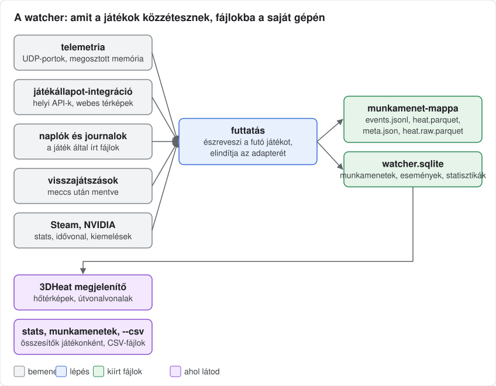

# 3DHeat Watcher {#dheat-watcher}

**Mi ez?** Játszol egy játékot. Ez a program csendben feljegyzi, hol járt, és mi történt.
Később a 3DHeat megjelenítőben színes térképként nézheted meg.

**Mire jó?** Hogy saját nyilvántartásod legyen minden játékülésről – hol vezetett, repült vagy harcolt, és a
játékonkénti összesítői –, weboldal nélkül, és a játék megváltoztatása nélkül.

**Példa:** egy versenyjátékban megteszel egy kört, miközben a watcher fut; utána a `sessions\<game>\` mappában
egy fájl tartja azt a vonalat, amelyen haladt, és a megjelenítő megrajzolja.

Részletesebben: a 3DHeat Watcher egy háttérprogram, amely azt rögzíti, amit a játékok a játékmenetéről közzétesznek –
hol járt, mi történt hol, és az ezek mögötti számokat – a saját gépén lévő fájlokba. A fájlok a saját
statisztikáihoz, valamint a 3DHeat megjelenítő hőtérképeihez és útvonalvonalaihoz valók.

Csendben fut, észreveszi, melyik játékot indította el, és az adott játék saját kimeneteit olvassa: a játék által
a műszerfalaknak közzétett telemetriai portot vagy megosztott memóriát, egy játékállapot-integrációt, a játék által
írt naplót vagy journalt, a meccs után mentett visszajátszást, a Steam által vezetett statisztikákat, az NVIDIA
App által mentett klipeket. A felvételek a saját gépén maradnak. A program csak két külső szolgáltatással
kommunikál, és csak ezekben az esetekben: a GitHubbal, újabb kiadás keresésére (lásd: [Frissítések](updates.md)),
és a Riot Match-V5 API-jával, de csak akkor, ha megadod a saját Riot API-kulcsodat (lásd:
[League of Legends visszajátszások](game-lol-replays.md)).



## Mit rögzít {#what-it-records}

- **Pozíciók**: az autó, a repülőgép, a hős vagy a játékos, többször másodpercenként, ahol a játék közzéteszi,
  a sebességgel, iránnyal és mindazzal, amit a játék ezzel együtt küld.
- **Események**: megjelenések, halálok, ölések, körök, szakaszok, fordulók, gólok, munkák, felszállások és
  leszállások, zónaváltások, eredmények, kiemelések. Minden eseményt az idejével tárol, és azzal a helyével,
  ahol a játék megadja.
- **Statisztikák munkamenetenként**: ölések, halálok, körök, legjobb kör, távolság, csúcssebesség, játékidő, és
  a játék saját statisztikái, ahol vezeti őket.

Hogy melyik játék mit ad, és honnan, az a [Játékok](games.md) oldalán található játékonként. Egy forrás nem mindent
képes rögzíteni: a többjátékos játékokat csak azon keresztül rögzítjük, amit közzétesznek, a watcher pedig soha nem
olvassa a memóriájukat (lásd: [Források és szabályok](sources-and-rules.md)).

## Telepítés {#install}

Még nem használt parancssort? Előbb olvasd el a [Mielőtt elkezded](before-you-start.md) oldalt.

A watcher egy Windowsra készült Python-program (Python 3.10 vagy újabb). Sok forrása csak Windowson létezik: a
megosztott memória, a rendszerleíró adatbázis, a Windows-értesítések.

```bash
git clone https://github.com/Holdi601/3DHeat-Watcher.git
cd 3DHeat-Watcher
pip install -r requirements.txt
```

Egy letöltött kiadási archívum ugyanígy működik: csomagold ki, majd futtasd a `pip install -r requirements.txt`
parancsot a mappában. A részletek és néhány játékhoz szükséges extrák a
[Telepítés és futtatás](installing-and-running.md) oldalon vannak.

## Gyors kezdés {#quick-start}

```bash
python -m heat3d_watch games            # mit ad minden játék, és honnan
python -m heat3d_watch setup all        # mit kellene bekapcsolni (semmi nem változik)
python -m heat3d_watch setup f1-25 --apply   # egy játék kimenetének bekapcsolása (az eredeti fájl biztonsági mentést kap)
python -m heat3d_watch run              # figyelés; hagyd futni, amíg játszik
python -m heat3d_watch stats            # összesítők játékonként
python -m heat3d_watch stats --csv out  # munkamenetek, események és statisztikák CSV-fájlokban
```

Ezt kell látnod: a `games` után egy táblázatot, játékonként egy sorral; a `run` addig fut, amíg meg nem nyomod a
Ctrl+C-t, vagy be nem zárod az ablakot.

Minden `%LOCALAPPDATA%\3DHeat\Watcher` mappába íródik. Másik mappa használatához állítsd be a
`HEAT3D_WATCH_HOME` környezeti változót, vagy futtasd a `python -m heat3d_watch config --set data=D:\somewhere`
parancsot.

- `sessions\<game>\<date>_<adapter>\` – egy mappa ülésenként, benne `events.jsonl` (minden esemény, ahogy
  történik), `heat.parquet` (a pozícióval rendelkező sorok, a 3DHeat megjelenítőhöz készen) és `meta.json`
  (játék, forrás, tengelyek, számlálók, statisztikák)
- `watcher.sqlite` – minden munkamenet statisztikái, három egyszerű táblában
- `watcher.log` – amit a watcher csinált

A megjelenítő egy munkamenet `heat.parquet` fájlját közvetlenül megnyitja, semmit nem kell beállítani (a tengelyek és
mértékegységek a fájlban vannak). A konvertált visszajátszások mellette táblázatként és meccsdokumentumként íródnak;
a megjelenítő saját egy-fájl-egy-meccs formátumát a [`.3dheat` tároló](https://holdi601.github.io/3DHeat/container.html)
oldal írja le, minden táblázat oszlopait pedig az [Adatok](the-data.md) oldalon.

## A dokumentáció {#the-documentation}

| Oldal | Mit tartalmaz |
|---|---|
| [Mielőtt elkezded](before-you-start.md) | Python, egy terminál, helyőrzők, mit jelent a siker és a gyakori hibák |
| [Telepítés és futtatás](installing-and-running.md) | követelmények, futtatás a háttérben, indítás a Windows-szal, a zárfájl, a napló, minden beállítás és környezeti változó |
| [Játékok](games.md) | játékonként egy oldal: mit rögzít, honnan, hogyan kapcsold be, hogyan működik, tengelyek, statisztikák, mit ellenőriztünk |
| [Az adatok](the-data.md) | munkamenet-mappák, `events.jsonl`, `heat.parquet` és lábléce, `meta.json`, `watcher.sqlite`, helyreállítás összeomlás után, CSV-export, munkamenet megnyitása a 3DHeat megjelenítőben |
| [Parancsok](commands.md) | a `python -m heat3d_watch` minden parancsa és kapcsolója |
| [Források és szabályok](sources-and-rules.md) | a hatféle forrás, a többjátékos szabályok, mely játékok maradnak ki, és miért |
| [NVIDIA Highlights](nvidia-highlights.md) | mit tud és mit nem tud az NVIDIA Highlights, és hogyan kap egy kiemelés pozíciót |
| [Szerver-rögzítő modok](server-mods.md) | az Arma 3 és Arma Reforger szerver-modok, amelyek egész küldetéseket rögzítenek a megjelenítőnek |
| [Memória olvasása](memory-reading.md) | egyjátékos memóriaprofilok: a formátum, az ellenőrzések, hogyan írj és ellenőrizz egyet |
| [Frissítések](updates.md) | hogyan keresi a watcher az új kiadásokat, és hogyan frissíti magát |
| [Fejlesztés](development.md) | adapter írása: az API, tesztek, egy becsületes `verified`, a játékoldalak újragenerálása |
| [Minden játék egy táblázatban](watcher.md) | minden játék egy táblázatban, ahogy a `games --markdown` kiírja, plusz a kutatott, de még el nem készült játékok |
| [Parancsleírás](../cli-reference.md) | minden parancs `--help` kimenete, a kódból generálva |
| [Karbantartás](maintaining.md) | ezekhez az oldalakhoz tartozó kiadási ellenőrzőlista |

## A 3DHeat része {#part-of-3dheat}

A 3DHeat Watcher a 3DHeat megjelenítő körüli ingyenes eszközök egyike (a watcher a 3DHeat CS2-t használja a CS2-demók
konvertálására). Mindegyik külön projekt, saját kiadásokkal és licenccel:

| Eszköz | Mit csinál | Dokumentáció |
|---|---|---|
| [3DHeat](https://github.com/Holdi601/3DHeat) | a megjelenítő: hőtérképek, versenyelemzés és meccsáttekintés 3D-ben | [oldal](https://holdi601.github.io/3DHeat/) |
| [GameFiles](https://github.com/Holdi601/3DHeat-GameFiles) | pályák és pályaszintek a játékok fájljaiból, 3D-modellként | [oldal](https://holdi601.github.io/3DHeat-GameFiles/) |
| [GameCapture](https://github.com/Holdi601/3DHeat-GameCapture) | körtelemetria versenyjátékokból; pályák rekonstruálva játékvideóból | [oldal](https://holdi601.github.io/3DHeat-GameCapture/) |
| [Unreal Exporter](https://github.com/Holdi601/3DHeat-UnrealExporter) | Unreal Editor bővítmény, amely egy pályát egyetlen 3D-modellként exportál | [oldal](https://holdi601.github.io/3DHeat-UnrealExporter/) |
| [CS2](https://github.com/Holdi601/3DHeat-CS2) | Counter-Strike 2 demók táblázatokba és meccsdokumentumokba; térképek 3D-modellekbe | [oldal](https://holdi601.github.io/3DHeat-CS2/) |
| [Watcher](https://github.com/Holdi601/3DHeat-Watcher) | a játékmenetéről rögzíti, amit a játékok közzétesznek, a háttérben | [oldal](https://holdi601.github.io/3DHeat-Watcher/) |
| [Ext-WarThunder](https://github.com/Holdi601/3DHeat-Ext-WarThunder) | War Thunder visszajátszások táblázatokba és meccsdokumentumokba | [oldal](https://holdi601.github.io/3DHeat-Ext-WarThunder/) |
| [Ext-WoT](https://github.com/Holdi601/3DHeat-Ext-WoT) | World of Tanks visszajátszások táblázatokba és meccsdokumentumokba | [oldal](https://holdi601.github.io/3DHeat-Ext-WoT/) |
| [Ext-WoWs](https://github.com/Holdi601/3DHeat-Ext-WoWs) | World of Warships visszajátszások táblázatokba és meccsdokumentumokba | [oldal](https://holdi601.github.io/3DHeat-Ext-WoWs/) |
| [Ext-Squad](https://github.com/Holdi601/3DHeat-Ext-Squad) | Squad-szerverdemók táblázatokba és meccsdokumentumokba | [oldal](https://holdi601.github.io/3DHeat-Ext-Squad/) |
| [Ext-DCS](https://github.com/Holdi601/3DHeat-Ext-DCS) | DCS World térképek 3D-modellként | [oldal](https://holdi601.github.io/3DHeat-Ext-DCS/) |
| [Ext-IL2](https://github.com/Holdi601/3DHeat-Ext-IL2) | IL-2 Sturmovik térképek 3D-modellként | [oldal](https://holdi601.github.io/3DHeat-Ext-IL2/) |

Minden játékolvasó egy kis önálló projekt saját licencfájllal, kiadásokkal és hibakövetővel, így külön telepíthető,
frissíthető, karbantartható - vagy egy jogtulajdonos kérésére visszavonható -, anélkül hogy a megjelenítőt vagy a
többi eszközt érintené.

Licenc: MIT ([LICENSE](https://github.com/Holdi601/3DHeat-Watcher/blob/main/LICENSE)). A harmadik féltől származó
csomagok licencei, és az, amit az általa olvasott játékok előírnak, a
[LICENSES.md](https://github.com/Holdi601/3DHeat-Watcher/blob/main/LICENSES.md) fájlban vannak felsorolva.
