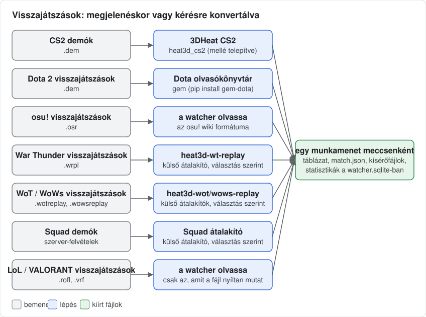

# Telepítés és futtatás {#installing-and-running}

## Követelmények {#requirements}

- **Windows.** A figyelő Windowsra készült, és a forrásainak többsége csak ott létezik: a játékok által létrehozott
  megosztott memória (`Local\...` leképezések), a beállításjegyzék (ahol a Steam van), a Windows-értesítések, a
  folyamatlista futtatható elérési utakkal. Más rendszeren a program elindul, de ezek a források nem találnak semmit,
  az értesítéseket csak naplózza, a memóriaolvasás pedig megtagadja a működést („only implemented on Windows”).
- **Python 3.10 vagy újabb**, innen: <https://www.python.org/downloads/>: a telepítőben pipáld be az **Add python.exe to PATH**
  opciót, majd egy új terminálban ellenőrizd a `python --version` paranccsal. Ez új neked? Először olvasd el a
  [Mielőtt elkezdenéd](before-you-start.md) oldalt.
- **Csomagok** (`requirements.txt`): `psutil>=6.0` (mely játékok futnak, melyik program foglal egy portot, egy játék
  kapcsolatai; a régebbi psutil is működik, a folyamatok kapcsolatainak régebbi nevén keresztül), `pyarrow>=15` (a
  `heat.parquet` írása), `numpy>=1.24`, és `pytest>=8.0` a tesztekhez. A `requirements-optional.txt` jelenleg nem sorol fel
  csomagot.

A `pyarrow` nélkül a munkamenetek továbbra is rögzítődnek: az `events.jsonl` a felvétel, a táblát később a
[`table`](commands.md#table) paranccsal lehet elkészíteni.

### Kiegészítők, amelyekre egyes játékoknak szükségük van {#extras-some-games-need}

| Játék | Mire van szüksége |
|---|---|
| Counter-Strike 2 demók | [3DHeat CS2](https://github.com/Holdi601/3DHeat-CS2) és a követelményei (`demoparser2`). A figyelő a `HEAT3D_CS2` változóban keresi, majd a figyelő saját mappája melletti `3DHeat-CS2` vagy `cs2` mappában, majd bárhol, ahonnan a Python importálni tudja a `heat3d_cs2`-t. Nélküle a `games` az adaptert nem elérhetőként listázza. |
| Microsoft Flight Simulator 2020 / 2024 | `SimConnect.dll` - nincs mellékelve. Az MSFS 2020 telepítési mappájában van egy; az MSFS 2024-hez telepítsd az MSFS 2024 SDK-t. Az `MSFS_SDK` / `MSFS2024_SDK` az SDK mappájára mutat. |
| Euro Truck Simulator 2, American Truck Simulator | a RenCloud `scs-telemetry.dll` bővítmény (12-es verzió) a `<game>\bin\win_x64\plugins` mappában |
| BeamNG.drive | a `heat3d` protokoll-mod, amelyet a `python -m heat3d_watch setup beamng --apply` telepít |
| League of Legends (élő) | opcionális: a Riot gyökértanúsítványa `<data>\riotgames.pem` néven, hogy a helyi kapcsolat ellenőrzött legyen |
| Minecraft | egy `%APPDATA%\.minecraft` mappa (Java Edition) |

A [Játékok](games.md) alatti minden játékoldal leírja, mit kell bekapcsolni magában a játékban.
A `python -m heat3d_watch games` `[unavailable: ...]` jelölést ad egy adapterhez, ha ezen a gépen hiányzik valami, amire
szüksége van.

## Telepítés {#installing}

Ez új neked? Először olvasd el a [Mielőtt elkezdenéd](before-you-start.md) oldalt. Ha a `pip` nem található, használd
helyette a `python -m pip install -r requirements.txt` parancsot.

Klónozott példányból:

```bash
git clone https://github.com/Holdi601/3DHeat-Watcher.git
cd 3DHeat-Watcher
pip install -r requirements.txt
```

Kiadásból: töltsd le a tároló kiadásai közül az archívumot, csomagold ki, majd a mappán belül futtasd a
`pip install -r requirements.txt` parancsot. Mindkét fajta példány magától frissül (lásd [Frissítések](updates.md)).

Minden parancsot a tároló mappájából futtass: a `python -m heat3d_watch` onnan importálja a csomagot, a frissítő
(`heat3d_update`) pedig mellette található.

## Futtatás {#running}

```bash
python -m heat3d_watch run        # watch until stopped
python -m heat3d_watch run -v     # the same, with debug lines in the log
python -m heat3d_watch run --once # one look at the games running now, then stop and exit
```

Indításkor a `run`:

1. létrehozza a [zárfájlt](#the-lock-file);
2. lezár minden munkamenetet, amelyet egy korábbi futás nyitva hagyott, például egy összeomlás után
   (lásd [Helyreállítás összeomlás után](the-data.md#recovery-after-a-crash));
3. minden `scan_seconds` (2 s) másodpercben beolvassa a folyamatlistát (csak a neveket és az elérési utakat, egy folyamatot
   sem nyit meg), és minden megtalált játékhoz külön szálban elindít egy adaptert. Amikor egy játék folyamata eltűnik, az
   adapterét leállítják, és a nyitva tartott munkameneteit lezárják, ami kiírja a táblájukat és a statisztikai sorukat.
   Azok az adapterek, amelyek nem várnak játékra (Steam-statisztika, Steam Timeline, NVIDIA-kiemelések, a visszajátszás-mappák),
   egész idő alatt futnak;
4. amíg nem fut játék, legfeljebb óránként egyszer újabb kiadást keres (maga a válasz hat órára gyorsítótárazott), és ha az
   `auto_update` be van kapcsolva, telepíti, majd újraindítja magát (lásd [Frissítések](updates.md)).

A hibázó adaptert naplózza, és ez nem állítja le a többit. Ha egy adapter lekérdezése 20-szor egymás után hibázik, vagy az
indítása hibázik, az adaptert leállítják, és nem indítják újra, amíg a játékot újra nem indítják (új folyamatazonosító).

A figyelőt Ctrl+C-vel állítsd le. Az adapterek a kilépés előtt lezárják a munkameneteiket. Ha a figyelőt inkább megölik
(Feladatkezelő, összeomlás, áramszünet), a már kiírt adat nem vész el: a következő `run` lezárja azokat a munkameneteket.

A `--once` egyetlen pillanatképet készít: elindítja az adaptereket a pillanatban futó játékokhoz (és a mindig futókhoz),
hagyja, hogy mindegyik egyszer lekérdezzen - legfeljebb 10 másodpercet várva rá -, majd úgy állítja le őket, ahogy egy játék
befejeződése történne, így a kilépés előtt a nyitott munkameneteik lezáródnak, a tábláik kiíródnak, és a statisztikában
megszámlálódnak a soraik. Akkor használd, ha azt akarod ellenőrizni, hogy egy játék felismerhető, nem pedig felvételre.

### A lemezen már meglévő visszajátszások {#replays-already-on-disk}



Amikor egy visszajátszás-adapter először látja egy figyelt mappáját, csak feljegyzi a benne lévő visszajátszásokat: egy
olyan játékos, akinek évekig gyűlt demója van, különben egy napig azzal találná a figyelőt elfoglaltnak, hogy konvertál.
Ezentúl minden új visszajátszást egyszer konvertál, miután a játék befejezte az írását. A régieket kérésre a
[`replays`](commands.md#replays) paranccsal konvertálhatod:

```bash
python -m heat3d_watch replays cs2-demos              # every demo in CS2's folders and replay_folders
python -m heat3d_watch replays osu-replays D:\Old     # the replays in one folder
```

### Futtatás a háttérben {#running-in-the-background}

A figyelőnek nincs saját ablaka; konzolprogram, amely addig fut, amíg le nem állítják. Mindent a `watcher.log` fájlba ír,
ezért nincs szüksége látható konzolra. Módok, hogy ne zavarjon:

- indítsd egy konzolban, és minimalizáld a konzolt: `start "" /min python -m heat3d_watch run` a `cmd`-ből, a tároló
  mappájában;
- indítsd konzol nélkül: `pythonw -m heat3d_watch run`. A konzolkimenet elvész, de a `watcher.log` továbbra is íródik.
  A leállításhoz fejezd be a `pythonw.exe` folyamatot; a következő indítás lezárja a nyitva hagyott munkameneteket. A
  projekt ezt a futtatási módot nem tesztelte.

### Indítás a Windows-szal (egy ötlet) {#starting-with-windows-an-idea}

A figyelő nem telepíti magát a Windows-szal együtt induló programok közé. Az automatikus indításhoz:

- **Feladatütemező**: hozz létre egy feladatot *At log on* (Bejelentkezéskor) indítóval és *Start a program* (Program indítása)
  művelettel, a program `pythonw.exe` (vagy `python.exe`), az argumentumok `-m heat3d_watch run`, a *Start in* (Indítás
  helye) pedig a tároló mappája;
- **Indítómappa**: tegyél egy parancsikont a `shell:startup` mappába ugyanazzal a programmal, argumentumokkal és *Start in*
  mappával.

Egyik sem része a figyelőnek, és ő nem tesztelte. A [zárfájl](#the-lock-file) gondoskodik arról, hogy a tévedésből
másodszor indított példány azonnal kilépjen.

## A zárfájl {#the-lock-file}

A `<data>\watcher.lock` tartalmazza a futó figyelő folyamatazonosítóját. Amikor a `run` elindul, és a zárfájl olyan
folyamatot nevez meg, amely még létezik, és amelynek a neve tartalmazza a `python` szót, ezt írja ki:

```text
A watcher is already running (process 12345) for C:\Users\...\3DHeat\Watcher.
```

és 1-es kilépési kóddal lép ki. Két figyelő egy adatmappán minden játékot kétszer rögzítene, a második pedig az első nyitott
munkameneteit egy összeomlás maradványainak tekintené. Egy olyan zárfájl, amelynek a folyamata már nincs, vagy másik
programhoz tartozik, felülíródik. Amikor a `run` véget ér, eltávolítja a zárfájlt, ha az még a saját folyamatát nevezi meg.

## A napló {#the-log}

A `<data>\watcher.log` csak a `run` által íródik; a többi parancs a konzolra ír. Minden sor tartalmazza az időt, a szintet
és az üzenetet:

```text
2026-05-01 20:15:01,123 INFO watching; data in C:\Users\...\AppData\Local\3DHeat\Watcher
2026-05-01 20:15:03,456 INFO f1-25: starting (EA SPORTS F1 25)
2026-05-01 21:02:11,789 INFO f1-25: stopping
```

Az adapterek naplózzák, mit nem tudnak megtenni, és miért: „UDP 20777 is in use by ...; not taking it from that program”,
„not reading memory: the game is played online”, „could not start”, „poll failed (3)” a visszakövetéssel. A `run -v` hibakereső
sorokat ad hozzá. A fájlhoz csak hozzáfűzés történik, a figyelő soha nem forgatja vagy üríti; bármikor törölheted. Ugyanezek a
sorok a konzolra is kiíródnak.

## Hol van minden {#where-everything-is}

A kezdőmappa `%LOCALAPPDATA%\3DHeat\Watcher`, vagy a `HEAT3D_WATCH_HOME`, ha az be van állítva (a `LOCALAPPDATA` nélkül, például
más rendszeren, `~/.local/share/3DHeat/Watcher`). A `settings.json` mindig a kezdőmappában van. Minden más az adatmappába
kerül, ami a kezdőmappa, hacsak a `data` beállítás másikat nem nevez meg:

| Útvonal | Mit jelent |
|---|---|
| `<home>\settings.json` | a beállítások |
| `<data>\sessions\` | a felvételek, egy mappa ülésenként ([Az adatok](the-data.md)) |
| `<data>\watcher.sqlite` | a statisztikai adatbázis |
| `<data>\watcher.log` | a `run` naplója |
| `<data>\watcher.lock` | a zárfájl, amíg a `run` fut |
| `<data>\state\` | amit a mindig futó és a visszajátszás-adapterek már láttak (`steam-stats.json`, `replays-cs2-demos.json`, ...), így az újraindítás nem rögzít kétszer semmit |
| `<data>\profiles\*.json` | a te írt memória-profilok ([Memória olvasása](memory-reading.md)) |
| `<data>\riotgames.pem` | opcionális, a Riot gyökértanúsítványa a League of Legends élő adapteréhez |
| `%LOCALAPPDATA%\3DHeat\update-check-3DHeat-Watcher.json` | az utolsó kiadás-ellenőrzés gyorsítótárazott válasza |

A figyelő ezekben a mappákban semmit sem töröl, kivéve azt a munkamenet-mappát, amelyben nem rögzítődött semmi (egy játék,
amely a menüiben ragadt).

## Beállítások {#settings}


A `python -m heat3d_watch config` megmutatja a beállításokat; a `config --set key=value ...` megváltoztatja őket, és
elmenti a `settings.json` fájlt (lásd [config](commands.md#config)). A fájl egyszerű JSON, és kézzel is szerkeszthető,
amíg a figyelő nem fut. Az ismeretlen kulcsait figyelmen kívül hagyja. A beállításokat a parancs indulásakor olvassa be,
ezért módosítás után indítsd újra a `run`-t.

| Beállítás | Alapérték | Mit csinál |
|---|---|---|
| `data` | `""` | Az adatmappa. Üres: a kezdőmappa. |
| `disabled` | `[]` | Adapter-azonosítók, amelyek soha nem futnak, például `config --set disabled=steam-stats,nvidia-highlights`. Minden más adapter fut, amikor megtalálja a játékát. |
| `auto_update` | `true` | Amíg nem fut játék, telepíti az újabb kiadást és újraindul (lásd [Frissítések](updates.md)). `false`: csak egy értesítés a naplóban. |
| `scan_seconds` | `2.0` | Másodpercek a folyamatlista-ellenőrzések között. |
| `memory` | `false` | Engedélyezi a memória-adaptereket (egyjátékos játékok a te írt profilodal). Alapból ki van kapcsolva; lásd [Memória olvasása](memory-reading.md). |
| `replays` | `true` | Futtatja a `replay` adaptereket: mindet (lásd `python -m heat3d_watch replays` és a [Játékok](games.md)) - CS2-demók, Dota 2, osu!, War Thunder, World of Tanks, World of Warships, Squad, League of Legends és VALORANT visszajátszások, IL-2 Tacview-felvételek. |
| `replay_folders` | `{}` | További mappák adapter-azonosítónként, például `{"cs2-demos": ["D:\\Demos"]}`. A visszajátszás-adapterek ezeken felül a játék saját mappáit is figyelik; az `il2-tacview` telepítési mappákat is elfogad (ilyenkor a `data\Tracks` mappában néz); az `elite`-nál az első mappa felülírja a napló mappáját. Egy adapter mappáit a `config --set replay_folders.cs2-demos=D:\Demos,E:\More` paranccsal állíthatod be, vagy az egész szótárat JSON-ként. |
| `riot_id` | `""` | A Riot-azonosítód (`Name#TAG`), hogy a League of Legends visszajátszásban a saját sorod a statisztikáddá váljon. Üres: minden játékos sora megmarad, egyik sem lesz jelölve a tiédnek. |
| `riot_api_key` | `""` | A saját Riot-fejlesztői API-kulcsod, hogy minden visszajátszott League-mérkőzés hivatalos idővonalát letöltsd (percenkénti pozíciók, a gyilkosságok a helyükön). Üres: semmi sem töltődik le. |
| `riot_platform` | `"EUW1"` | A League-szervered platformazonosítója (`EUW1`, `EUN1`, `NA1`, `KR`, ...), a regionális Match-V5 kiszolgáló megtalálásához. |
| `player_names` | `{}` | A neved azokban a játékokban, amelyek felülete minden játékost névvel említ, de nem mondja meg, melyik vagy te, adapter-azonosítónként: `warthunder-webmap` (a kill feed rád vonatkozó sorai lesznek a te öléseid és halálaid) és `rocketleague-stats` (a soraid `me` lesznek; enélkül az a játékos, akit a játék kamerája követ). A `config --set player_names.warthunder-webmap=Name` paranccsal állítható. |

Egy `settings.json` minden alapértékkel:

```json
{
  "data": "",
  "disabled": [],
  "auto_update": true,
  "scan_seconds": 2.0,
  "memory": false,
  "replays": true,
  "replay_folders": {},
  "riot_id": "",
  "riot_api_key": "",
  "riot_platform": "EUW1",
  "player_names": {}
}
```

## Környezeti változók {#environment-variables}

| Változó | Hatás |
|---|---|
| `HEAT3D_WATCH_HOME` | a kezdőmappa (a beállítások, és az adatok, hacsak a `data` mást nem mond) |
| `HEAT3D_NO_UPDATE` | bármilyen nem üres érték, kivéve a `0`, `false` vagy `no` szavakat, kikapcsolja a kiadás-ellenőrzést és az automatikus frissítést |
| `HEAT3D_NO_TOAST` | bármilyen nem üres érték: nincsenek Windows-értesítések, csak naplósorok |
| `HEAT3D_CS2` | a 3DHeat CS2 mappája, a CS2-demókhoz |
| `HEAT3D_CS2_GSI_PORT` | a CS2 játékállapot-portja (alapértelmezés 3311); a `setup` által írt cfg-fájl ezt használja |
| `HEAT3D_DOTA_GSI_PORT` | a Dota 2 játékállapot-portja (alapértelmezés 3312) |
| `MSFS_SDK`, `MSFS2024_SDK` | az MSFS SDK mappái, ahol a `SimConnect SDK\lib\SimConnect.dll` fájlt keresi |

A Windows-értesítéseket csak a frissítésekhez használja: „Updating to 1.2.0”, vagy „1.2.0 is out; not updated: ...”, ha a
frissítést nem lehetett alkalmazni. A PowerShell saját értesítési API-ján keresztül jelennek meg, így semmit sem kell
telepíteni. A címet és a szöveget környezeti változóként adja át a PowerShellnek, soha nem a szkript részeként.
