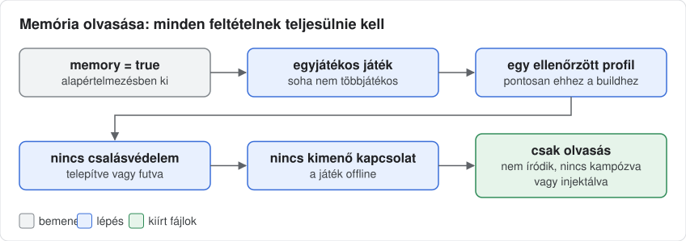

# Memória olvasása {#reading-memory}

Néhány egyjátékos játék semmit nem mond más programoknak. Ezeknél a figyelő - ha bekapcsolod, és te írsz hozzá egy
**profilt** - megnézheti, hol vagy a játék memóriájában, csak olvasva.

Az egyjátékos játékoknál, amelyek semmit sem tesznek közzé, a figyelő a játék memóriájából olvashat pozíciókat és
értékeket egy **profil** segítségével, amelyet a játék saját buildjéhez írsz. Az összes forrás közül ez az egy, amelyet
a játék nem adott ki kézzel, ezért több védelem veszi körül, mint a többit:

- **alapból ki van kapcsolva** (a `python -m heat3d_watch config --set memory=true` bekapcsolja);
- olvas, és nincs módja írni;
- **a eszközökhöz nem jár mellé profil.**

Azért nem járnak mellé profilok, mert egy eltolás csak arra a buildre igaz, amelyen megtalálták. Egy javítás után a
korábban helyes profil szemetet olvas, a szemét pedig pont úgy néz ki, mint a számok. A profilt az a játékos
ellenőrizze, akinél fut, az ő buildjén.

## Az ellenőrzések, sorrendben {#the-checks-in-order}



Az alábbi ellenőrzések mindegyikének sikerülnie kell. Az első négyet a játék **megnyitása előtt** végzik, mert egy védett
játék olvasásra való megnyitása maga az, amit a csalásellenes rendszer észrevesz, és a megtagadás utólag már túl későn
jönne.

1. **A beállítás**: a `memory` igaz. Különben a memória-adapterek soha nem indulnak.
2. **Egy profil a játékhoz**, amelynek az `exe` mezője a futó folyamat nevét adja meg. A profil megmondja, hogy a játék
   egyáltalán játszható-e online (`"online"`); aki ezt kihagyja, azt elutasítják.
3. **Nincs csalásellenes rendszer a közelében**:
   - nincs csalásellenes fájl a játék mappájában, vagy legfeljebb három szinttel feljebb (a Steam-könyvtár `common`
     mappájánál vagy egy `steamapps`-et tartalmazó mappánál megállva, mert a többi játék ezek fölött van): `EasyAntiCheat`,
     `EasyAntiCheat_EOS_Setup.exe`, `start_protected_game.exe`, `BattlEye`, `BEClient_x64.dll`, `BEService_x64.exe`,
     `EAAntiCheat.GameServiceLauncher.exe`, `AntiCheatExpert`, `SGuard64.exe`, `GameGuard`, `GameMon.des`, `XIGNCODE`,
     `xhunter1.sys`, `Vanguard`, `FACEIT` (kisbetűs összehasonlítás, név elejére illeszkedve is). Ha a játék mappája
     ismeretlen, a játékot elutasítják;
   - nincs csalásellenes illesztőprogram vagy szolgáltatás futva a gépen, ahogy a
     `sc query type= driver state= active` és `sc query type= service state= active` listázza: EasyAntiCheat,
     EasyAntiCheat_EOS, BEService, BEDaisy, vgk, vgc, ACE-BASE, ACE-GAME, xhunter1, FACEIT, FACEITService,
     EAAntiCheatService, Denuvo Anti-Cheat, npggsvc, Ricochet. Egy másik játékhoz telepített kernel-szintű csalásellenes
     rendszer minden folyamatot figyel. Ha a szolgáltatásokat nem lehet listázni, a játékot elutasítják;
4. **Nincs online**: az a játék, amelynek a profilja `"online": true`, csak akkor olvasódik, ha nincs kapcsolata a gépen
   kívül másokkal (a `127.x` és `::1` kivételével bármilyen távoli cím). Ha a kapcsolatai nem olvashatók, elutasítják.
5. Ezután, az adapter indulásakor:
   - **a pontos build**: a futtatható fájl mérete vagy SHA-256 értéke egyezzen a profil által felsorolt verzióval. Egy
     ismeretlen build nem olvasódik;
   - **a modulok még egyszer**: a játék betöltött moduljait listázzák (egy Toolhelp-pillanatkép, amely nem kér saját
     hozzáférési jogot), és ellenőrzik, nincs-e köztük csalásellenes kliens (`BEClient_x64.dll`, `BEClient.dll`,
     `EasyAntiCheat_x64.dll`, `EasyAntiCheat.dll`, `EOSAntiCheat...`). A védett folyamat megtagadja a pillanatképet, ez is
     elutasítás;
   - csak ezután nyitják meg a folyamatot, `PROCESS_VM_READ | PROCESS_QUERY_LIMITED_INFORMATION` jogokkal, és semmi mással.

Az 1-4. ellenőrzést minden lekérdezésnél (2 másodpercenként) megismétlik, amíg a játék fut. Ha egy elkezd hibázni (a játék
szerverhez csatlakozik, egy csalásellenes szolgáltatás indul), az adaptert a következő lekérdezésnél leállítják. Az
elutasítást naplózzák: `mem-<id>: not reading memory: <reason>`. Az indítás közbeni hibát (ismeretlen build, csalásellenes
modul, nem található minta) `mem-<id>: could not start` néven naplózzák, és az adaptert nem próbálják újra, amíg a játékot
újra nem indítják.

Nincs írás, nincs memóriafoglalás a másik folyamatban, nem indul benne szál, nincs bele betöltött könyvtár, nincs
hibakeresési jog és nincs jogemelés. Egy teszt (`test_memory_reading_cannot_write` a `tests/test_core.py`-ban) elbukik,
ha a csomagban bárhol megjelenik olyan hívás, amely másik folyamatba ír, abban foglal, vagy abban kódot futtat -
`WriteProcessMemory`, `VirtualAllocEx`, `CreateRemoteThread`, `PROCESS_VM_WRITE`, `SeDebugPrivilege`, `LoadLibrary`, ...

Soha ne olvass, bármit mond is a profil: online játszható játékokat, és olyan játékokat, amelyek egyjátékos módja
csalásellenes rendszer alatt fut, például a GTA V-t vagy az Elden Ringet, ha a kezdőprogramján keresztül indítják. A fenti
ellenőrzések így is elutasítják őket.

## A profil formátuma {#the-profile-format}

A profil egy JSON-fájl a `<data>\profiles\` mappában (a `<data>` az adatmappa, lásd
[Telepítés és futtatás](installing-and-running.md#where-everything-is)), játékonként egy, bármilyen `.json` végű fájlnévvel.
Egy kitalált példa:

```json
{
  "schema": "heat3d.memprofile/1",
  "id": "mygame",
  "game": "My Game",
  "exe": "MyGame.exe",
  "online": false,
  "versions": [ { "label": "1.06", "size": 123456789 } ],
  "anchors": {
    "World": { "aob": "48 8B 05 ?? ?? ?? ?? 48 85 C0", "rip": [3, 7] }
  },
  "values": {
    "pos": { "type": "vec3f", "base": "World", "chain": ["0x10", "0x68", "0x70"] },
    "hp":  { "type": "i32",   "base": "World", "chain": ["0x10", "0x138"] },
    "map": { "type": "u32",   "base": "World", "chain": ["0x10", "0x1C0"] }
  },
  "events": [
    { "event": "death", "value": "hp",  "when": "to_zero" },
    { "event": "zone",  "value": "map", "when": "change" }
  ],
  "axes": { "up": "y", "units": "metres" },
  "rate": 10,
  "provenance": [ { "source": "https://example.com/my-notes", "verified_on": "1.06" } ]
}
```

| Kulcs | Kötelező | Mit jelent |
|---|---|---|
| `schema` | igen | pontosan `heat3d.memprofile/1` |
| `id` | igen | rövid és állandó; az adapter neve `mem-<id>` |
| `game` | igen | a játék neve, amelyről a munkamenet-mappa kapja a nevét |
| `exe` | igen | a futtatható fájl neve, amely azt is jelzi, hogy a játék fut |
| `online` | igen | `true`, ha a játék egyáltalán játszható online; ilyenkor csak offline állapotban olvasódik |
| `versions` | igen | a buildek, amelyeken a profilt ellenőrizték: mindegyiknek `label`-je, és `size` (a futtatható fájl mérete bájtban) és/vagy `sha256`. Ha mindkettő meg van adva, mindkettőnek egyeznie kell. Az olyan bejegyzés, amelyben egyik sincs, semmire sem illeszkedik. |
| `anchors` | igen | elnevezett címek a fő modulban. `aob`: bájtminta, szóközökkel elválasztott hexa bájtok, `?` vagy `??` bármely bájtra; a modulképben **pontosan egyszer** kell előfordulnia (több találat is hibának számít, mint a nulla). `rip: [d, n]`: a minta egy olyan utasításra mutat, amelynek a `d` bájtnál, `n` hosszúságú, 32 bites RIP-relatív eltolása van; a horgony az a cím lesz, amelyre az utasítás hivatkozik. `offset`: utólag hozzáadódik (hexa vagy decimális szöveg). Az `aob` helyett a `module_offset` a modul alapcímétől mért rögzített eltolást ad meg. |
| `values` | igen | amit minden lekérdezésnél olvasnak: `type` (`i32`, `u32`, `i64`, `u64`, `u8`, `f32`, `f64`, `vec3f`, `vec3d`), `base` (egy horgony neve), `chain` (eltolások hexa vagy decimális szövegként) |
| `events` | nem | szabályok, amelyek a változásokat eseményekké alakítják: `when` `change` (az érték eltér az előző lekérdezéstől) vagy `to_zero` (egy szám 0-ról feletti értékről 0-ra vagy az alá esik) |
| `axes` | nem | `up` (alapértelmezés `y`), `units` (alapértelmezés `game units`), `scale` (a nézegető mértékegység-skálája, amely minden pozíciót megszoroz; alapértelmezés 1, a játék saját egységei) |
| `rate` | nem | lekérdezés másodpercenként, 1-60 (alapértelmezés 10) |
| `provenance` | nem | honnan származnak az eltolások, és melyik buildön ellenőrizted őket; minden munkamenet `meta.json`-jába átmásolódik |

**Hogyan olvasódik egy érték.** A horgony címe a kiindulópont. Ha a `chain` üres, az érték ott helyben olvasódik. Egyébként
előbb a horgonynál tárolt mutatót olvassák be. Utána az utolsó kivételével minden eltolásnál beolvassák a mutatót a
`cím + eltolás` helyen. Az utolsó eltolást hozzáadják, így kapják meg az érték címét. Egy útközbeni null mutató (a játék
pályák között vagy menüben van) azt eredményezi, hogy az érték az adott lekérdezésnél üres.

**Mi rögzítődik.** A `pos` nevű érték (`vec3f` vagy `vec3d`) minden lekérdezésnél a `me` játékos egy `position` sorává válik.
Minden eseményszabály megírja a saját `event` sorát az új értékkel, és ha a `pos` ismert, a pozícióval is, és a
megegyező nevű statisztikát eggyel növeli. A modulképet indításkor egyszer olvassák be a horgonyok megtalálásához, 64 KiB-os
blokkokban; az olvashatatlan blokkok nullának számítanak. A munkamenet `meta.json`-ja megnevezi a profilt, a build címkéjét
és a származást.

A nem használható profilt (hibás JSON, rossz `schema`, hiányzó kötelező kulcs) kihagyják, és `profile <file> not used: <reason>`
néven naplózzák. A profilok a figyelő indulásakor töltődnek be, ezért egy profil hozzáadása vagy módosítása után indítsd újra
a `run`-t.

## Profil írása és ellenőrzése {#writing-and-verifying-a-profile}

1. **Csak csalásellenes rendszer nélküli egyjátékos játéknál.** Ha a játéknak van csalásellenes rendszere, vagy online
   játszod, itt álljunk meg: a figyelő elutasítja, és ez így is helyes.
2. **Keresd meg az értékeket a saját buildeden.** Offline dolgozz. Használd a saját hibakereső eszközeidet, vagy a játékról
   közzétett jegyzeteket, hogy megtaláld a játékos pozícióját és a neked fontos értékeket, és mindegyikhez egy mutatóláncot
   a futtatható fájl egy statikus pontjától. Részesítsd előnyben a bájtmintát (`aob`) a rögzített `module_offset`-tel szemben:
   a minta akkor is megtalálja a helyét, ha a kód kicsit elmozdul.
3. **Tedd egyedivé a mintát.** Pontosan egyszer kell illeszkednie a modulban. A változó bájtokat (címeket, eltolásokat) tedd
   helyettesítő karakterré, és hagyj elég rögzített bájtot köréjük.
4. **Rögzítsd a buildet.** A `versions`-be írd be a futtatható fájl pontos méretét; a PowerShell
   `(Get-Item .\MyGame.exe).Length` megadja, a `Get-FileHash .\MyGame.exe -Algorithm SHA256` pedig a hash-t. Egy javítás után
   a profilt egyszerűen nem használják, amíg újra nem ellenőrzöd és hozzá nem adod az új buildet.
5. **Mondd meg, hogy a játék online megy-e** (`online`), őszintén.
6. **Próbáld ki**: kapcsold be az olvasást (`config --set memory=true`), tedd a fájlt a `<data>\profiles\` mappába, és
   ellenőrizd, hogy a `python -m heat3d_watch games` listázza az `mem-<id>`-t. Indítsd el a játékot, és futtasd a
   `python -m heat3d_watch run -v` parancsot. A `watcher.log`-ban keresd a `mem-<id>: starting` sort, vagy azt az okot, amiért
   elutasították, vagy nem tudott elindulni.
7. **Ellenőrizd a számokat a játékkal.** Sétálj el egy ismert helyre, és nézd meg a munkamenet `events.jsonl`-jében a
   `position` sorokat. Mozognak-e, ahogy te mozogsz, a megfelelő mértékben, a megfelelő tengelyeken? Nyisd meg a
   `heat.parquet`-et a nézegetőben, és ellenőrizd, hogy az útvonal megfelel-e annak, amerre jártál. Idézd elő minden
   eseményt (vesztsz minden életerőt, pályát váltasz), és ellenőrizd, hogy egyszer megjelenik-e. A szemét számoknak látszik,
   és csak ez az összevetés tudja megkülönböztetni a kettőt.
8. **Írd le, amit ellenőriztél** a `provenance`-ben: az eltolások forrását és a buildet, amelyen ellenőriztél.

A memória-adapter `verified` szövege, ahogy a `games` kiírja, mindig ez: „by the profile's author, for the builds it lists”
(a profil szerzője, a felsorolt buildekre). A figyelő ennél többet nem tudhat.
