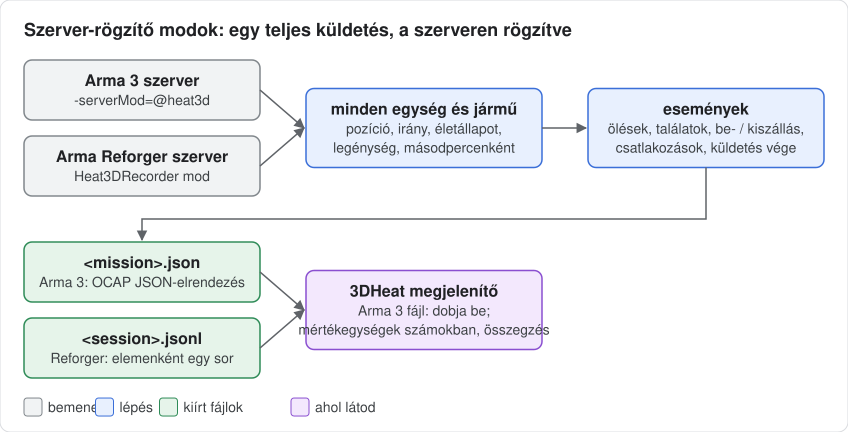

# Szerver-felvevő modok (Arma 3, Arma Reforger) {#server-recorder-mods-arma-3-arma-reforger}

A legtöbb játékot a watcher a játékos saját gépén rögzíti. Az Arma más: egy szerver egy egész küldetést rögzíthet – minden egységet és járművet, nem csak a sajátodat – a szerveren futó modja segítségével. A játékosnak semmit nem kell beállítania: az Arma 3 mod csak szerveren fut, a Reforger pedig csatlakozáskor magától letölti a szerver modjait a játékosoknak (a mod a játékosok gépén nem csinál semmit). A tárolóban két ilyen mod van, a [`mods/arma3`](https://github.com/Holdi601/3DHeat-Watcher/tree/main/mods/arma3) és a [`mods/reforger`](https://github.com/Holdi601/3DHeat-Watcher/tree/main/mods/reforger). A README-jük a teljes dokumentáció; ez az oldal az áttekintés.

**Állapot: mindkettő játékban még nincs tesztelve.** Az Arma 3 bővítményét úgy építettük és futtattuk, ahogy az Arma a bővítményeket hívja, a kimenetét pedig a 3DHeat beolvasta; az SQF-szkriptjei még nem futottak Arma 3-ban. A Reforger modot a Bohemia közzétett script API-jából írtuk, és még soha nem fordítottuk le. Egyiket se tegyd nyilvános szerverre, amíg a README tesztlépéseit le nem futtattad.

## Arma 3 {#arma-3}

1. Építsd meg a bővítményt platformonként egyszer (`mods/arma3/extension`). Ehhez C-fordító kell: Windowson Visual Studio Build Tools, Linuxon gcc; ha még soha nem fordítottál semmit, kérdezd meg a szerver üzemeltetőjét.
   - Windows, az „x64 Native Tools Command Prompt for VS” parancssorban:
     `cl /nologo /O2 /LD heat3d.c /Fe:heat3d_x64.dll`
   - Linux: `gcc -O2 -shared -fPIC -o heat3d_x64.so heat3d.c -ldl`
2. Építsd meg a modot: a `python mods/arma3/build.py` létrehozza az `mods/arma3/@heat3d/` mappát (nincs szükség Arma 3 Toolsra).
3. Másold az `@heat3d` mappát a szerver mappájába, és indítsd a szervert a `-serverMod=@heat3d` kapcsolóval.
4. A szerver `.rpt` naplója ezt írja: `Heat3D recorder 0.1.0: recording <file> every 1 s`.

| Beállítás | Alapérték | Mit csinál |
|---|---|---|
| `captureDelay` | 1 | másodperc két képkocka között |
| `recordHits` | 1 | 0 kikapcsolja a találat-eseményeket |
| `recordShots` | 1 | 0 kikapcsolja a lövésszámlálást |
| `minPlayers` | 0 | csak akkor rögzít, ha ennyi játékos van fent |

Egy küldetés az `init.sqf` fájljában felülírhatja ezeket (`heat3d_captureDelay = 0.5;`).
A felvételek az `@heat3d` mappán belüli `recordings/` mappába kerülnek, vagy a `HEAT3D_DIR` mappába.

**Kimenet:** küldetésenként egy fájl az OCAP JSON-elrendezésében (az OCAP2 felvevő formátuma), a neve `<date>__<time>_<mission>.json`. A küldetés alatt naplófájl (`.heat3d.part`), amelyet minden íráskor kiürítünk; egy összeomlott küldetés naplóját a következő küldetés indulásakor fejezzük be.

## Arma Reforger {#arma-reforger}

A modot (`Heat3DRecorder.gproj`) a Bohemia Workbench-ében (Arma Reforger Tools) nyitjuk meg és építjük, helyi dedikált szerveren teszteljük, a Workbenchből publikáljuk (teszt közben listázatlanul), és a szerver `config.json` fájljának `mods` listájához adjuk – lépésről lépésre a README-ben. Másodpercenként kiírja minden karakter pozícióját, irányát, életállapotát, járművét és játékosazonosítóját, valamint minden jármű pozícióját, irányát, állapotát és legénységét; továbbá az ölések (ölő, fegyver, távolság), találatok, be- és kiszállások, a csatlakozó és kilépő játékosok, valamint a küldetés vége.

**Kimenet:** soronként egy JSON-objektum, `$profile:heat3d/<UTC dátum>_<UTC idő>_<world>.jsonl`: egy `header` sor (formátum `heat3d-reforger`, tengelyek x kelet, y felfelé, z észak), utána az `entity`, `frame` és `event` sorok, ahogy történnek, és egy `end` sor. Az egységsorok `[id, x, y, z, dir, alive, vehicleId, playerId]`, a járműsorok `[id, x, y, z, dir, alive, [crew ids]]` alakúak; az események az OCAP2 eseményelrendezését követik.

## A megtekintőben {#in-the-viewer}

Húzz egy Arma 3-felvételt a [3DHeat megtekintőbe](https://holdi601.github.io/3DHeat/): egy küldetés egy munkamenet, az egységek katonákká, a járművek a saját típusukká válnak, az ölések és találatok pedig az Összegzés fül listájába kerülnek. Az OCAP2 webes lejátszója is lejátssza. A Reforger-fájl a mod saját soronkénti formátuma, az OCAP2 eseményelrendezésével.
