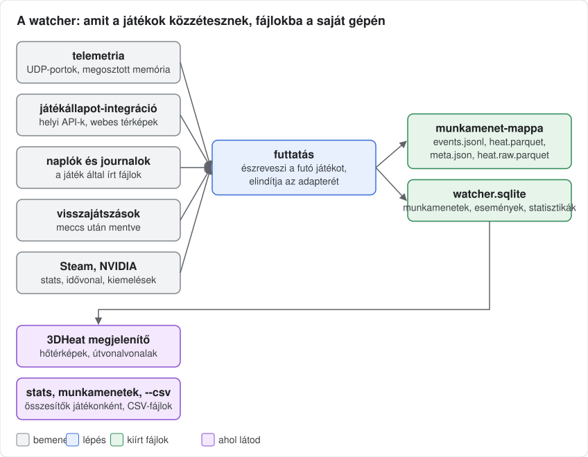

# Források és szabályok {#sources-and-rules}

A watcher csak azt rögzíti, amit a játékok és platformok a játékosnak kiadnak. Ez az oldal leírja, mely forrásokat fedi ez, mit tehet vele a watcher, és mely játékokat vagy játékrészeket hagy ki szándékosan.

## A források hat fajtája {#the-six-kinds-of-source}

Minden adapternek van egy `kind` (típus) jelzője, és ez dönti el, mit tehet az adapter:

| Típus | Mi ez | Többjátékos játékok |
|---|---|---|
| `telemetry` | UDP-port vagy megosztott memória, amelyet a játék dashboardoknak, mozgásplatformoknak és kormányoknak tesz közzé (Forza Data Out, F1 UDP, Kunos és iRacing megosztott memória, SimConnect, az X-Plane UDP-felülete, az SCS SDK bővítmény) | igen – a játék saját kimenete |
| `gsi` | játékállapot-integráció vagy helyi webes API, amelyet a játék a játékos saját gépének szolgáltat (Valve GSI, a League Live Client Data API-ja, a Rocket League Stats API-ja, a War Thunder webes térképe) | igen, azon belül, amit az API a játékosnak mutat |
| `log` | fájlok, amelyeket a játék futás közben ír: naplók, statisztikák, mentések (Elite Dangerous, Minecraft, Path of Exile, Hearthstone, Star Citizen, EVE Online) | igen |
| `replay` | a játék által a játékosainak mentett demók és visszajátszások, meccs után átalakítva (CS2, Dota 2, osu!, War Thunder, World of Tanks, World of Warships, Squad, League of Legends, VALORANT, IL-2 Tacview) | igen, hacsak titkosítva nincs, és csak a nyílt részeket |
| `platform` | amit a Steam és a grafikus illesztőprogram tárol: statisztikák, eredmények, idővonalak, klipek és kiemelések | igen |
| `memory` | a játék memóriája, csak olvasva, egy általad írt profil alapján | **soha** – csak egyjátékos módban |

Csak a `memory` nyit meg egy másik folyamatot, és csak olvasásra. Az öt másik típus azt olvassa, amit a játék, a Steam vagy az NVIDIA App már kiírt vagy elküld.

## Hogyan olvassuk a forrásokat {#how-the-sources-are-read}

- **Semmi nem kerül be egy játékba, nem akasztunk rá, és nem változtatunk rajta.** Nem töltünk be kódot egy játékba, nem hookolunk egy ablakot vagy bemenetet, nem foltozunk játékfájlt. A watcher az adatmappáján kívül csak azokat a fájlokat írja, amelyeket a [`setup --apply`](commands.md#setup) ír, ha kéred: egy játék saját beállítófájlját (az eredetit `<file>.heat3d-backup` néven megtartva), egy játékállapot-cfg fájlt, a DCS hook-szkriptet, a BeamNG protokollmódot.
- **A megosztott memóriát csak olvasásra nyitjuk, és soha nem hozzuk létre.** A szokásos Python-módszer egy elnevezett leképezés megnyitására létrehoz egyet, ha még nincs. Egy később indított játék ekkor a watcher üres, csak olvasható leképezését találná a sajátja helyett, és a telemetriája halott lenne. A watcher csak az `OpenFileMappingW`-vel nyit leképezést (amely csak létezőt talál), `FILE_MAP_READ`-del képezi le, és később újra próbálkozik, ha a játék még nem hozta létre.
- **A portokat kölcsönbe vesszük, nem vesszük át.** Egy UDP-telemetriai portot, amelyen már egy másik program figyel (FH Companion, SimHub, egy dashboard-alkalmazás), az a program kapja meg. Ha egy másik program kezd el figyelni a watcher által tartott porton, a watcher néhány másodpercen belül elengedi. A Forza-adapterek a játék indulása után 15 másodpercet várnak a 5300-as port elfoglalása előtt, és minden csomagot változatlanul továbbítanak a 127.0.0.1:5301 címre, így egy második Data Out-alkalmazás is tud rögzíteni.
- **Csak helyi.** A watcher által futtatott játékállapot-szerverek (CS2, Dota 2) a 127.0.0.1-en figyelnek, máshol nem. Ha a játék cfg-fájlja tartalmaz tokent (amelyet a `setup` ír), minden POST-nak hordoznia kell azt; a token nélküliek `bad_auth`-ként számolódnak és eldobódnak. Token nélküli cfg-fájl esetén bármely helyi POST elfogadott, és a napló ezt jelzi. A helyi API-k, amelyeket kérdezünk (League a 2999-es porton, War Thunder a 8111-en, Rocket League a 49123-on, X-Plane a 49000-en), mind a 127.0.0.1-en vannak.
- **A naplófájlok megoszthatók, nem zárolódnak.** Minden olvasás a Windows összes megosztási jelzőjével nyitja meg a fájlt, majd bezárja, így a játék tovább írhat, átnevezhet vagy lecserélhet naplót.
- **Két külső szolgáltatás, csak ezekben az esetekben.** A kiadás-ellenőrzés legfeljebb hatóránként kérdezi a GitHubot (`api.github.com`), és kikapcsolható (lásd [Frissítések](updates.md)). A League-visszajátszás-adapter csak akkor kérdezi a Riot Match-V5 API-ját, ha megadtad a saját `riot_api_key`-edet. Máshová nem megy semmi.
- **A forrás bekapcsolása a te döntésed.** A `setup` `--apply` nélkül csak megmondja, mit változtatna.

## Többjátékos szabályok {#multiplayer-rules}

- Online játszott játékot csak azon keresztül rögzítünk, amit közzétesz: telemetria, játékállapot-API, naplók, visszajátszások, platformfájlok. Ezeken belül azt rögzítjük, amit a játék a játékosnak mutat, és semmi mást, ami ezen túl számított:
  - **A CS2 játékállapot-integrációja** azt a játékost küldi, akit figyelsz (magadat, amíg élsz, egy csapattársadat a halálod után). Más játékosok pozícióit (`allplayers_*`) csak nézőknek és a GOTV-nak küldik, ezért a watcher nem kéri őket.
  - **A League of Legends Live Client Data API-jában nincsenek pozíciók.** A Riot szabályzata megengedi, hogy az eszközök azt mutassák, amit a játékos maga a játékból tudhat, és semmi számítottat, ami azon túlmegy (nincsenek ellenséges időzítők). A watcher azt a hírfolyamot és eredménytáblát rögzíti, amelyet a játékos lát, és a játékos saját számait.
  - **A Rocket League Stats API-jában nincsenek autópozíciók** (az autók állapotát csak nézőknek küldik). Ami helyet kap, az a labda: hol ütötték, hol gólt rúgtak, hol találta el a lécet.
  - **A War Thunder webes térképe** azt mutatja, amit a kistérkép, nevek és azonosítók nélkül.
  - **F1 23/24/25**: minden autó pozícióját a Motion csomagjukban adják, online is. A játék maga adja ki ezeket, és csak azoknak a játékosoknak az adatait tartja vissza, akiknél a "Your Telemetry" korlátozott.
  - **DCS World**: egy többjátékos szerver megtilthatja a saját repülőgép adatainak exportját; akkor a munkamenetben vannak események, pozíciók nincsenek, és ezt a munkamenet jelzi.
- **Memóriát soha nem olvasunk többjátékos játékban.** Az online játszottként jelölt játékhoz tartozó memória-adaptert elutasítjuk, és a profilnak meg kell adnia, online játszható-e a játéka egyáltalán. Az egyjátékos játék, amelynek van online módja, csak akkor olvasható, ha nincs más kapcsolata, csak ezzel a géppel. Az anti-csalás alatt futó egyjátékos módú játékokat sem olvassuk soha. Lásd [Memória olvasása](memory-reading.md).
- Az adapteren lévő `multiplayer` jelző (a `games --markdown` "Online play"-ként mutatja) csak a memóriaolvasást dönti el. Nem állítja meg a többi típust abban, hogy online játékot rögzítsen.

## Amit kihagyunk, és miért {#what-is-declined-and-why}

Néhány játékot, illetve játékrészt nem rögzítünk: az adataik védettek, nincsenek közzétéve, vagy egyáltalán nincsenek a játékos gépén:

| Játék | Amit kihagyunk | Miért |
|---|---|---|
| VALORANT | pozíciók, nevek, pontszámok a visszajátszásokban; a kliens lockfile-végpontjai | A visszajátszás játékfolyama olyan értékekkel van elrejtve, amelyeket minden build végrehajtható fájljából vesznek. A játék a Vanguard alatt fut. A Riot kliens lockfile-végpontjai nem közzétett API-k. **Olvasható:** ami a visszajátszásban nyíltan van – a pálya, a meccsazonosító, az ügynökök, a szerver ölés- és köridővonala. |
| League of Legends | a `.rofl` visszajátszások pillanatról pillanatra szóló része; a kliens lockfile-végpontjai | Csalás ellen elrejtve, minden javítással másképp, és nincs dekódolva. **Olvasható:** a végső meccsdoboz, amelyet minden visszajátszás nyílt JSON-ként hordoz, a Live Client Data API meccs közben, és – a saját fejlesztői kulcsoddal – a hivatalos Match-V5 idővonal (pozíciók percenként, ölések ott, ahol történtek). |
| Fortnite | visszajátszások | Titkosított. |
| World of Tanks, World of Warships | visszajátszások, a watcherben | Titkosítottak. A watcher nem olvassa őket; külön átalakítók kívül igen (`exporters/ext/wot-replay`, `exporters/ext/wows-replay`), mindegyik önálló projekt. **Olvasható, ha van telepített átalakító:** minden jármű vagy hajó pozíciója, amíg a rögzítő kliens tudott róla, és az ölések. |
| Gran Turismo 7 | telemetria | Csak konzolon, és a telemetriája egy a játékból visszanyert kulccsal titkosított. |
| Apex Legends | minden | A LiveAPI-ja csak privát és egyedi lobbikban küld teljes eseményeket; máshol helyben semmi nem elérhető. |
| Overwatch 2, Call of Duty, Battlefield 6, Hunt: Showdown 1896 | élő adatok | Nincs helyi visszajátszás, napló vagy játékállapot-kimenet, amit olvashatnánk. A statisztikáik ott jelennek meg, ahol a Steam tárolja ([Steam statisztikák](game-steam-stats.md), [Steam Timeline](game-steam-timeline.md)), a klipjeik pedig [NVIDIA highlights](nvidia-highlights.md) néven. |
| Star Citizen | minden a `Game.log`-on túl | Easy Anti-Cheat fut rajta; a watcher csak a játék által írt naplófájlt olvassa, és soha nem nyúl a játék folyamatához. |
| osu!lazer | visszajátszások | A játék saját tárolójában vannak; csak az osu! (régi) `.osr` fájljait olvassuk. |
| Bármely többjátékos játék | memória | Soha. Az egyjátékos módú játékokat, amelyeknek módja anti-csalás alatt fut (GTA V, Elden Ring a launcheren keresztül), szintén nem olvassuk. |

A titkosított visszajátszásokat nem nyitjuk meg: a VALORANT-olvasó ellenőrzi a visszajátszás titkosítási jelzőjét, és visszautasítja a titkosított fájlt ("this replay is encrypted; it is not read").

Olyan játékok, amelyeket kutattak, de még nem építettek meg (Deadlock visszajátszások, Rocket League `.replay` fájlok, StarCraft II, Team Fortress 2, Rainbow Six Siege, Beat Saber, Trackmania, több versenyszimulátor), a forrásaikkal együtt szerepelnek a [Minden játék egy táblázatban](watcher.md#researched-not-yet-built) oldalon. Mindegyikhez kell mintafájl, amellyel ellenőrizni lehet, mielőtt kiadnánk.
