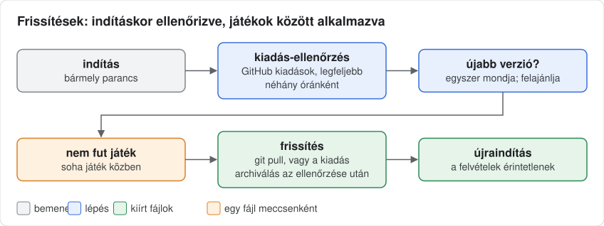

# Frissítések {#updates}

A watchert a [Holdi601/3DHeat-Watcher](https://github.com/Holdi601/3DHeat-Watcher/releases) kiadásai tartják naprakészen. A frissítő a `heat3d_update` csomag, amely a tárolóban a `heat3d_watch` mellett van.

## Az ellenőrzés {#the-check}

- **Mikor**: az `update` parancs kivételével minden parancs indításkor ellenőriz. A `run` futás közben is ellenőriz, legfeljebb óránként egyszer, és csak akkor, ha nem fut játék.
- **Hogyan**: egy HTTPS-kérés a `https://api.github.com/repos/Holdi601/3DHeat-Watcher/releases/latest` címre, 5 másodperces időkorláttal. A választ hat órára gyorsítótárazzuk a `%LOCALAPPDATA%\3DHeat\update-check-3DHeat-Watcher.json` fájlban, így a legtöbb indításkor nem kérdezünk semmit. A „Még nincs kiadás” (HTTP 404) választ is úgy gyorsítótárazzuk, mint bármely más választ. Offline, sebességkorláton vagy proxy mögött az ellenőrzés csendben meghiúsul, a parancs pedig a meglévő verzióval folytatódik.
- **Verziók**: a telepített verzió a tároló mappájában lévő `VERSION` fájl. A kiadás tagjét (`v1.2.0` vagy `1.2.0`) számként hasonlítjuk össze, részenként; a `-` vagy `+` utáni rész figyelmen kívül marad.
- **Kikapcsolás**: a `HEAT3D_NO_UPDATE=1` (bármilyen érték, kivéve az üreset, `0`, `false` és `no`) kikapcsolja az ellenőrzést és az automatikus frissítést is. Minden 3DHeat-eszköznek saját gyorsítótár-fájlja van, így az egyik eszköz válasza sosem helyettesít egy másikét.

## Mi történik, ha újabb kiadás van {#what-happens-when-a-newer-release-is-out}

- **`run`**: indításkor kiír egy értesítést, és fut tovább: `[heat3d_watch] 3DHeat Watcher 1.2.0 is out (this is 1.0.2). <release page>` (a program kiírása angolul marad). Futás közben, ha az `auto_update` be van kapcsolva (ez az alapérték) és nem fut játék, magától frissít: a naplósor `3DHeat Watcher 1.2.0 is out (this is 1.0.2); updating`, egy Windows-értesítés „Updating to 1.2.0” szöveggel, maga a frissítés, minden adapter leáll, és a munkamenetei lezárulnak, majd ugyanaz a parancs újraindul az új kóddal. A watcher soha nem frissít játék közben. Ha a frissítést nem lehet alkalmazni, az értesítés ezt mondja (`1.2.0 is out; not updated: ...`), és a watcher a régi verzióval fut tovább. Ha az `auto_update` ki van kapcsolva, csak az értesítés marad.
- **Más parancsok**: ha terminálban futnak, megkérdezik: `Update now? [Y/n]`. Enter, `y`, `yes`, `j` vagy `ja` frissít, majd ugyanazt a parancsot újra futtatja az új verzión. Terminál nélkül (ütemezett futás, csővezeték) megmondják, hogyan kell frissíteni, és folytatják.
- **Kérésre**: a `python -m heat3d_watch update` (vagy `python -m heat3d_update`) gyorsítótár nélkül kérdezi meg a GitHubot, és frissít. A `--check` csak azt mondja meg, megjelent-e újabb kiadás. Ez a `HEAT3D_NO_UPDATE` beállítással is működik.

## Hogyan történik a frissítés {#how-an-update-is-applied}

Attól függ, hogyan telepítették a példányt:

- **Git-klón** (a mappában van `.git`, és a `git` a PATH-on van): `git pull --ff-only`. Ez visszautasításra kerül, ha a klónban változások vannak a követett fájlokban (`git status --porcelain --untracked-files=no` nem üres): ezek valakinek a munkája, és a frissítés nem dönt a sorsukról. Mentsd el vagy tedd félre őket, majd húzd le.
- **Letöltött példány**: a kiadás forrásarchívumát letöltjük, és egy ideiglenes mappába csomagoljuk ki. A mappán kívülre mutató bejegyzéseket kihagyjuk. Az archívum `VERSION` fájljának meg kell egyeznie a kiadás állításával, különben semmi sem másolódik. Ezután a fájljai átmásolódnak a tároló mappájára. A kiadás részét nem képező fájlak – felvételek, beállítások, virtuális környezetek, exportok, minden, amit te készítettél – érintetlenek maradnak. Ha egy régebbi kiadásnak volt olyan Python-modulja, amelyet az új már nem tartalmaz, azt eltávolítjuk a kiadás saját csomagjaiból (`heat3d_watch`, `heat3d_update`), így a frissítés után nem töltődik be elavult adaptermodul; ezeken a csomagokon kívül semmit nem törlünk.

A felvételek és beállítások úgyis rendszerint a tároló mappáján kívül vannak (`%LOCALAPPDATA%\3DHeat\Watcher`), így a frissítés hozzájuk sem ér.

Frissítés után ugyanaz a parancs újraindul. Windowson a watcher elindítja az új folyamatot, megvárja, és továbbadja annak kilépési kódját, így a konzol úgy viselkedik, mintha az első folyamat végezte volna a munkát.
