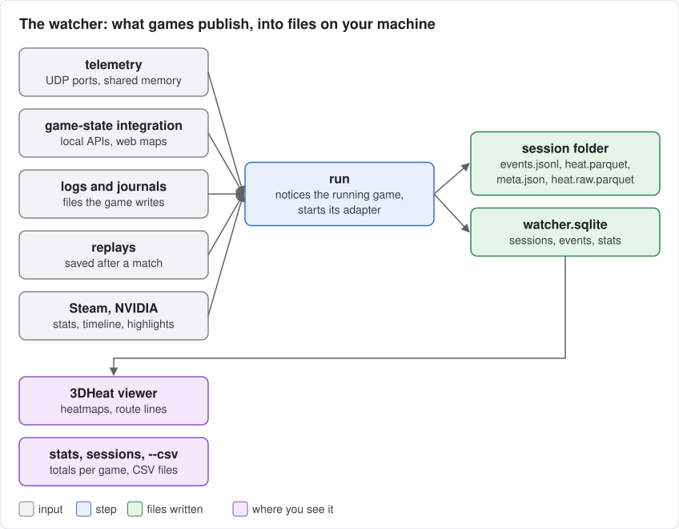

# 3DHeat Watcher

**What is it?** You play a game. This program quietly writes down where you went and what happened.
Later you can look at it as a coloured map in the 3DHeat viewer.

**Why would I use it?** To keep your own record of every sitting - where you drove, flew or fought,
your totals per game - without any website and without changing the game.

**Example:** you drive a lap in a racing game with the watcher running; afterwards a file in
`sessions\<game>\` holds the line you took, and the viewer draws it.

In more detail: 3DHeat Watcher is a background program that records what games publish about your play - where you
went, what happened where, and the numbers behind it - into files on your own machine. The files are
for your own statistics and for the heatmaps and route lines of the 3DHeat viewer.

It runs quietly, notices which game you started, and reads that game's own outputs: a telemetry port
or shared memory the game publishes for dashboards, a game-state integration, the journal or log the
game writes, the replay it saves after a match, the statistics Steam keeps, the clips the NVIDIA App
saves. Recordings stay on your machine. The program contacts only two outside services, and only in
these cases: GitHub, to look for a newer release (see [Updates](updates.md)), and Riot's Match-V5 API,
and only if you enter your own Riot API key (see [League of Legends replays](game-lol-replays.md)).



## What it records

- **Positions**: the car, aircraft, hero or player, several times a second where the game publishes
  them, with speed, heading and whatever else the game sends alongside.
- **Events**: spawns, deaths, kills, laps, stages, rounds, goals, jobs, takeoffs and landings, zone
  changes, achievements, highlights. Each event is stored with its time, and with its place when the
  game gives one.
- **Statistics per session**: kills, deaths, laps, best lap, distance, top speed, playtime, and the
  game's own stats where it keeps them.

What each game gives, and from where, is on its own page under [Games](games.md). One source cannot
record everything: multiplayer games are recorded only through what they publish, and the watcher
never reads their memory (see [Sources and rules](sources-and-rules.md)).

## Install

New to the command line? Read [Before you start](before-you-start.md) first.

The watcher is a Python program for Windows (Python 3.10 or later). Many of its sources exist only on Windows: shared
memory, the registry, Windows notifications.

```bash
git clone https://github.com/Holdi601/3DHeat-Watcher.git
cd 3DHeat-Watcher
pip install -r requirements.txt
```

A downloaded release archive works the same way: unpack it, then run `pip install -r requirements.txt`
inside the folder. The details, and the extras some games need, are in
[Installing and running](installing-and-running.md).

## Quick start

You need Windows, Python 3.10 or later ("Add python.exe to PATH" ticked in its
installer) and the games you play; no Git.

Download the release, <https://github.com/Holdi601/3DHeat-Watcher/archive/refs/tags/v1.0.3.zip>,
unpack it and open PowerShell in the unpacked folder (`3DHeat-Watcher-1.0.3`; in File Explorer,
type `powershell` in the address bar); run every command from there:

```bash
python -m pip install -r requirements.txt
python -m heat3d_watch games            # what each game gives, and from where
python -m heat3d_watch setup all        # what would have to be switched on (nothing is changed)
python -m heat3d_watch setup f1-25 --apply   # switch one game's output on (the original file is backed up)
python -m heat3d_watch run              # watch; leave it running while you play
python -m heat3d_watch stats            # totals per game
python -m heat3d_watch stats --csv out  # sessions, events and stats as CSV files
```

Some games want an extra package or a reader of their own; `games` says which, and
`requirements-optional.txt` lists them ([Installing and running](installing-and-running.md)).

You should see: after `games`, a table with one line per game; `run` keeps going until you press
Ctrl+C or close the window.

Everything is written to `%LOCALAPPDATA%\3DHeat\Watcher`. To use another folder, set the
`HEAT3D_WATCH_HOME` environment variable or run `python -m heat3d_watch config --set data=D:\somewhere`.

- `sessions\<game>\<date>_<adapter>\` - one folder per sitting, holding `events.jsonl` (every event
  as it happens), `heat.parquet` (the rows with a position, ready for the 3DHeat viewer) and
  `meta.json` (game, source, axes, counts, statistics)
- `watcher.sqlite` - the statistics of every session, in three plain tables
- `watcher.log` - what the watcher did

Then open a session in the [3DHeat viewer](https://github.com/Holdi601/3DHeat#quick-start):
download it (**Code -> Download ZIP**, unpack), double-click `start.bat` (it offers to install
Node.js when it is missing and opens `http://127.0.0.1:5273`), then **Source -> Files...** and pick
the session's `heat.parquet` (or drop it on the Source panel); it opens with nothing to set (its axes
and units are in the file). Converted replays are written as tables and match documents beside it:
a `<match>.match.json` goes in the **Match** tab's **Load match files...**. The viewer's own
one-file-a-match format is described in its [`.3dheat` container](https://holdi601.github.io/3DHeat/container.html)
page, and every table's columns in [The data](the-data.md).

When a new release is out, the watcher says so when it starts and offers to update the folder
from the release (`python -m heat3d_watch update` does the same).

## The documentation

| Page | What it covers |
|---|---|
| [Before you start](before-you-start.md) | Python, a terminal, placeholders, what success and the common errors look like |
| [Installing and running](installing-and-running.md) | requirements, running in the background, starting with Windows, the lock file, the log, every setting and environment variable |
| [Games](games.md) | one page per game: what is recorded, where from, how to switch it on, how it works, axes, statistics, what was verified |
| [The data](the-data.md) | session folders, `events.jsonl`, `heat.parquet` and its footer, `meta.json`, `watcher.sqlite`, recovery after a crash, CSV export, opening a session in the 3DHeat viewer |
| [Commands](commands.md) | every command and option of `python -m heat3d_watch` |
| [Sources and rules](sources-and-rules.md) | the six kinds of source, the multiplayer rules, which games are left out and why |
| [NVIDIA Highlights](nvidia-highlights.md) | what NVIDIA Highlights can and cannot deliver, and how a highlight gets a position |
| [Server recorder mods](server-mods.md) | the Arma 3 and Arma Reforger server mods that record whole missions for the viewer |
| [Reading memory](memory-reading.md) | single-player memory profiles: the format, the checks, how to write and verify one |
| [Updates](updates.md) | how the watcher looks for new releases and updates itself |
| [Development](development.md) | writing an adapter: the API, tests, an honest `verified`, regenerating the game pages |
| [All games in one table](watcher.md) | every game in one table, as `games --markdown` prints it, plus the games researched but not yet built |
| [Command reference](cli-reference.md) | every command's `--help`, generated from the code |
| [Maintaining](maintaining.md) | the release checklist for these pages |

## Part of 3DHeat

3DHeat Watcher is one of the free tools around the 3DHeat viewer (the watcher uses 3DHeat CS2
to convert CS2 demos). Each is its own project, with its own releases and licence:

| Tool | What it does | Docs |
|---|---|---|
| [3DHeat](https://github.com/Holdi601/3DHeat) | the viewer: heatmaps, race analysis and match review in 3D | [site](https://holdi601.github.io/3DHeat/) |
| [GameFiles](https://github.com/Holdi601/3DHeat-GameFiles) | courses and levels out of the files games ship, as 3D models | [site](https://holdi601.github.io/3DHeat-GameFiles/) |
| [GameCapture](https://github.com/Holdi601/3DHeat-GameCapture) | lap telemetry from racing games; levels rebuilt from gameplay video | [site](https://holdi601.github.io/3DHeat-GameCapture/) |
| [Unreal Exporter](https://github.com/Holdi601/3DHeat-UnrealExporter) | an Unreal Editor plugin that exports a level as one 3D model | [site](https://holdi601.github.io/3DHeat-UnrealExporter/) |
| [CS2](https://github.com/Holdi601/3DHeat-CS2) | Counter-Strike 2 demos into tables and match documents; maps into 3D models | [site](https://holdi601.github.io/3DHeat-CS2/) |
| [Watcher](https://github.com/Holdi601/3DHeat-Watcher) | records what games publish about your play, in the background | [site](https://holdi601.github.io/3DHeat-Watcher/) |
| [Ext-WarThunder](https://github.com/Holdi601/3DHeat-Ext-WarThunder) | War Thunder replays into tables and match documents | [site](https://holdi601.github.io/3DHeat-Ext-WarThunder/) |
| [Ext-WoT](https://github.com/Holdi601/3DHeat-Ext-WoT) | World of Tanks replays into tables and match documents | [site](https://holdi601.github.io/3DHeat-Ext-WoT/) |
| [Ext-WoWs](https://github.com/Holdi601/3DHeat-Ext-WoWs) | World of Warships replays into tables and match documents | [site](https://holdi601.github.io/3DHeat-Ext-WoWs/) |
| [Ext-Squad](https://github.com/Holdi601/3DHeat-Ext-Squad) | Squad server demos into tables and match documents | [site](https://holdi601.github.io/3DHeat-Ext-Squad/) |
| [Ext-DCS](https://github.com/Holdi601/3DHeat-Ext-DCS) | DCS World maps into 3D models | [site](https://holdi601.github.io/3DHeat-Ext-DCS/) |
| [Ext-IL2](https://github.com/Holdi601/3DHeat-Ext-IL2) | IL-2 Sturmovik maps into 3D models | [site](https://holdi601.github.io/3DHeat-Ext-IL2/) |
| [Ext-Dota](https://github.com/Holdi601/3DHeat-Ext-Dota) | the Dota 2 map from your own install as a 3D level | [site](https://holdi601.github.io/3DHeat-Ext-Dota/) |
| [Ext-DotaReplay](https://github.com/Holdi601/3DHeat-Ext-DotaReplay) | Dota 2 replays | [site](https://holdi601.github.io/3DHeat-Ext-DotaReplay/) |
| [Ext-Riot](https://github.com/Holdi601/3DHeat-Ext-Riot) | League of Legends and VALORANT replays (what they carry unencrypted) | [site](https://holdi601.github.io/3DHeat-Ext-Riot/) |
| [Ext-Forza](https://github.com/Holdi601/3DHeat-Ext-Forza) | Forza courses, races and cars from your own install | [site](https://holdi601.github.io/3DHeat-Ext-Forza/) |
| [Ext-Battlefield](https://github.com/Holdi601/3DHeat-Ext-Battlefield) | Battlefield levels (Frostbite) as 3D levels | [site](https://holdi601.github.io/3DHeat-Ext-Battlefield/) |
| [Ext-BeamNG](https://github.com/Holdi601/3DHeat-Ext-BeamNG) | BeamNG.drive courses | [site](https://holdi601.github.io/3DHeat-Ext-BeamNG/) |
| [Ext-ACRally](https://github.com/Holdi601/3DHeat-Ext-ACRally) | Assetto Corsa Rally stages as courses | [site](https://holdi601.github.io/3DHeat-Ext-ACRally/) |
| [Ext-Reforger](https://github.com/Holdi601/3DHeat-Ext-Reforger) | Arma Reforger worlds (Enfusion) as 3D levels | [site](https://holdi601.github.io/3DHeat-Ext-Reforger/) |
| [Ext-R6](https://github.com/Holdi601/3DHeat-Ext-R6) | Rainbow Six Siege match replays | [site](https://holdi601.github.io/3DHeat-Ext-R6/) |

Each game reader is its own small project with its own licence file, releases and issue tracker, so
it can be installed, updated, maintained - or withdrawn on a rights holder's request - on its own,
without affecting the viewer or the other tools.

Licence: MIT ([LICENSE](https://github.com/Holdi601/3DHeat-Watcher/blob/main/LICENSE)). The licences
of the third-party packages it uses, and the note that nothing from a game ships with it, are listed in
[LICENSES.md](https://github.com/Holdi601/3DHeat-Watcher/blob/main/LICENSES.md).
