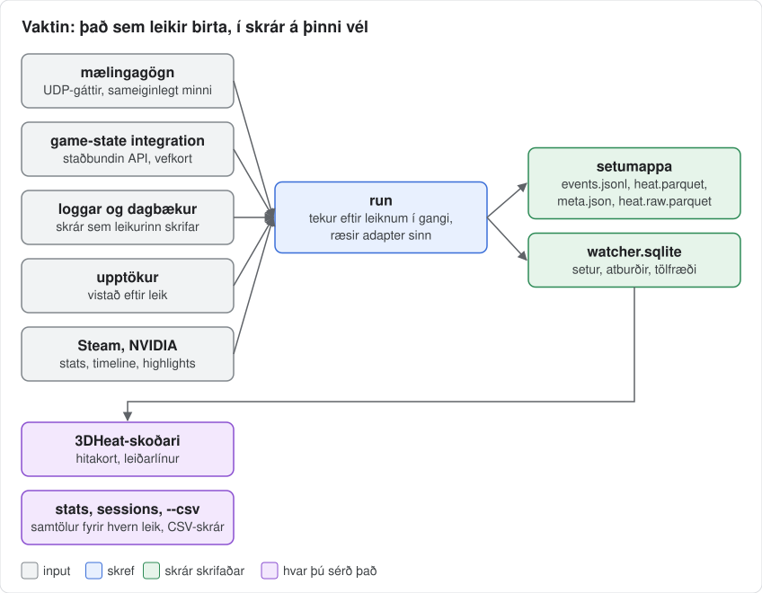
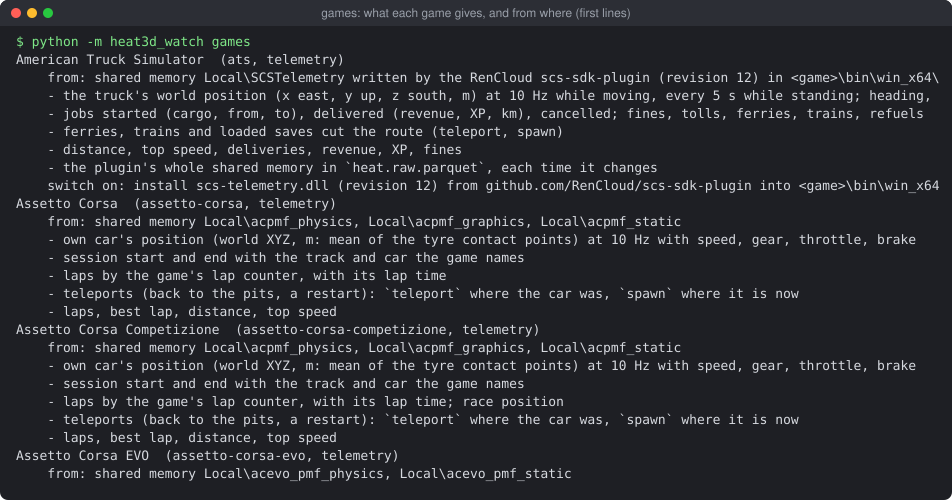
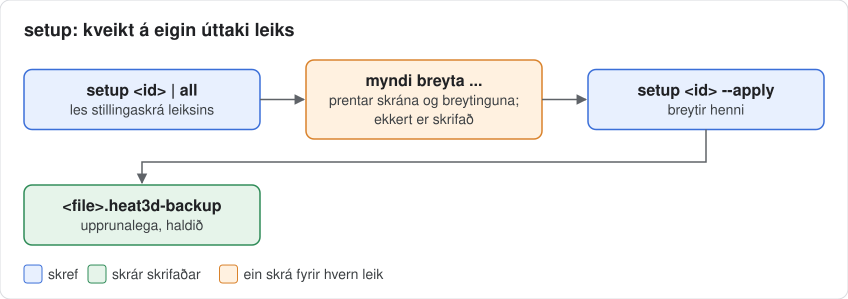
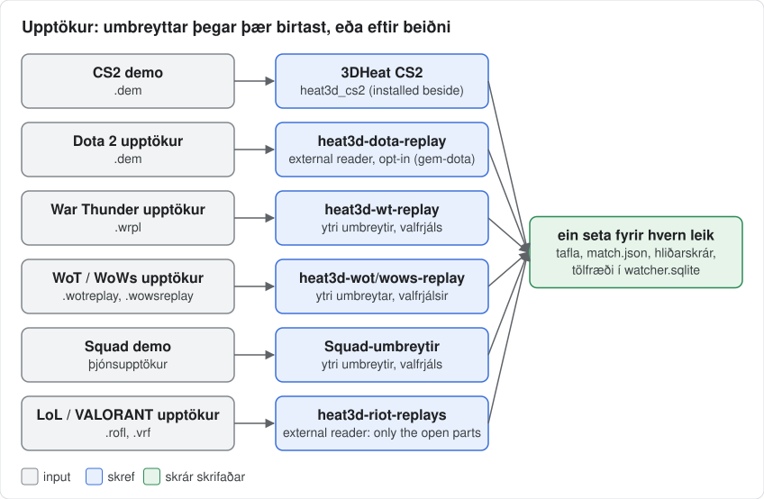
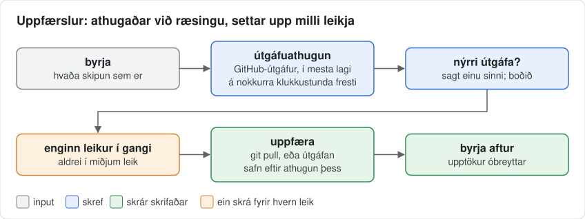

# Skipanir {#commands}

Ertu ný/r í skipanalínunni? Lestu fyrst [Áður en þú byrjar](before-you-start.md). Hver skipun er skrifuð
í skipanalínu (terminal) sem er opin í möppunni sem þú pakkaðir upp eða klónaðir (í File Explorer skaltu skrifa `powershell` í
veffangastikuna), svona:

```bash
python -m heat3d_watch <command> [options]
```


| Skipun | Hvað hún gerir |
|---|---|
| [`run`](#run) | fylgist með í bakgrunni og skráir hvern leik sem keyrir |
| [`games`](#games) | hvað hver leikur gefur og hvaðan |
| [`setup`](#setup) | kveikir á eigin úttaki leiks |
| [`status`](#status) | hvaða leikir eru í gangi núna og hvaða millistykki myndu keyra |
| [`sessions`](#sessions) | upptökurnar hingað til |
| [`stats`](#stats) | samtölur fyrir hvern leik, eða töflurnar sem CSV |
| [`table`](#table) | endurbyggir `heat.parquet` lotu úr `events.jsonl` |
| [`replays`](#replays) | umbreytir endursýningunum sem eru þegar á disknum |
| [`dota-replay`](#dota-replay) | sækir endursýningu opinbers Dota 2 leiks eftir auðkenni hans |
| [`dota-map`](#dota-map) | Dota 2 kortið úr þinni uppsetningu sem þrívíddarborð, með sérstaka verkfærinu 3DHeat Dota |
| [`update`](#update) | uppfærir í nýjustu útgáfu |
| [`config`](#config) | sýnir eða breytir stillingunum |

Valkostir fyrir allar skipanir: `-h` / `--help` prentar hjálpina, og `python -m heat3d_watch --version`
prentar útgáfunúmerið (skráin `VERSION`).

Myndirnar á þessari síðu eru keyrslur á gerviloturnar (`Example Racer`, `Example Arena`),
ekki raunverulegar upptökur.

Hver skipun nema `update` leitar fyrst að nýrri útgáfu (í mesta lagi á sex tíma fresti; sleppt með
`HEAT3D_NO_UPDATE=1`, sjá [Uppfærslur](updates.md)). `run` prentar aðeins tilkynningu. Hinar skipanirnar spyrja
`Update now? [Y/n]` þegar þær keyra í skipanalínu, og prenta hvernig á að uppfæra þegar þær gera það ekki. Úttakið er
UTF-8, svo leikjaheiti á hvaða letri sem er prentast í hvaða glugga sem er.

## run {#run}

```bash
python -m heat3d_watch run [--once] [-v]
```



Fylgist með þar til það er stöðvað (Ctrl+C): á `scan_seconds` fresti les það ferlalistann og keyrir millistykki fyrir
hvern leik sem það finnur, auk millistykkjanna sem eru alltaf í gangi. Áður en það lítur fyrst á listann lýkur það lotunum sem
fyrri keyrsla skildi eftir opnar. Meðan enginn leikur er í gangi getur það uppfært sig sjálft (ef `auto_update` er kveikt). Nánar er
í [Uppsetning og keyrsla](installing-and-running.md#running).

| Valkostur | Áhrif |
|---|---|
| `--once` | eitt augnatillit á leikina sem eru í gangi, svo hættir það. Millistykkin fyrir leikina sem eru í gangi núna (og þau sem eru alltaf í gangi) eru ræst, hvert spyr einu sinni (beðið er í mesta lagi 10 sekúndur eftir því), og svo eru þau öll stöðvuð eins og þegar leikur endar: lotur þeirra eru lokaðar, skrifaðar og taldar. Til að athuga greiningu, ekki til að skrá. |
| `-v`, `--verbose` | villuleitarlínur í `watcher.log` og í glugganum |

`run` skrifar `<data>\watcher.lock` og neitar að ræsast í annað sinn fyrir sömu gagnamöppu (skilakóði
1); sjá [Læsingarskráin](installing-and-running.md#the-lock-file).

## games {#games}

```bash
python -m heat3d_watch games [--markdown]
```



Telur upp hvert millistykki raðað eftir leik: nafn þess, auðkenni og gerð, hvaðan það les, hvað það skráir og
hvernig á að kveikja á því. Millistykki sem getur ekki keyrt á þessari vél er merkt
`[unavailable: <why>]` - SimConnect.dll fannst ekki, engin Minecraft-mappa, 3DHeat CS2 ekki uppsett,
Steam eða NVIDIA App fannst ekki. Millistykkiseining sem tókst ekki að hlaða er nefnd aftast með
villunni.

```text
EA SPORTS F1 25  (f1-25, telemetry)
    from: UDP telemetry 127.0.0.1:20777 (Documents\My Games\F1 25\hardwaresettings\hardware_settings_config.xml)
    - every car's position (world XYZ, m) at 10 Hz, by driver name, team, own car marked, ...
    switch on: In the game: Settings > Telemetry Settings > UDP Telemetry On, IP 127.0.0.1, port 20777 - ...
```

`--markdown` prentar það sama sem eina Markdown-töflu (leikur, hvað er skráð, hvaðan, hvernig á að kveikja
á því, netspilun, athugað). Taflan í [Allir leikir í einni töflu](watcher.md) er það úttak. Reitirnir
eru varðir fyrir Markdown: texti innan í bakfyrningum helst kóðabútur, og utan þeirra eru `<`, `>`, `&`, `*`, `|`
og bakstrik á undan greinarmerki skrifuð þannig að þau birtast eins og þau voru slegin inn (`<CS2>` myndi annars hverfa sem
HTML-merki í kramdown). Eina HTML-ið er `<br>` á milli atriðanna í „Hvað er skráð“.

## setup {#setup}

```bash
python -m heat3d_watch setup <adapter id | all> [--apply]
```




Kveikir á eigin úttaki leiks, þar sem leikurinn þarf að skrá sé breytt til þess. Án `--apply`
er engu breytt: hver lína segir hvað myndi breytast, og þegar eitthvað er til að breyta segir síðasta
línan `Nothing was changed. Run again with --apply to make these changes.` Þegar ekkert er til að
breyta segir hún `<id>: nothing to change` (`Nothing to change.` fyrir `all`). Með `--apply` eru breytingarnar
gerðar, og áður en skrá er breytt í fyrsta sinn er frumútgáfa hennar vistuð sem
`<file>.heat3d-backup`. Afrit sem er þegar til er aldrei skrifað yfir, svo það geymir alltaf
skrána eins og hún var áður en watcher snerti hana fyrst.

```text
f1-25: would change: hardware_settings_config.xml <udp>: enabled="false" -> "true"
Nothing was changed. Run again with --apply to make these changes.
```

`all` keyrir uppsetningu hvers millistykkis sem hefur slíka. Millistykki án uppsetningar, nefnt eitt og sér, prentar
`<id>: nothing for setup to change; ` og svo hvernig kveikt er á leiknum (`enable` textinn, eða
að hann þarf ekkert). Óþekkt auðkenni prentar `no adapter '<id>'; games lists them` og hættir með kóðann
2. Millistykkin sem hafa eitthvað til að setja upp:

| Millistykki | Hverju `--apply` breytir |
|---|---|
| `beamng` | setur `heat3d` samskiptareglumóddið upp í `mods` möppu notanda BeamNG (aðeins þegar það er ekki þar); kveiktu svo á Options > Other > Protocols > "others" í leiknum |
| `cs2-gsi` | skrifar `<CS2>\game\csgo\cfg\gamestate_integration_heat3d.cfg`: sendir leikstöðuna á `http://127.0.0.1:3311/` með handahófskenndu tákni sem watcher krefst svo (tákn sem er þegar í skránni helst); CS2 les hana þegar það ræsist |
| `dota2-gsi` | það sama fyrir Dota 2: `<Dota>\game\dota\cfg\gamestate_integration\gamestate_integration_heat3d.cfg`, gátt 3312 |
| `dcs` | bætir `Scripts\Hooks\heat3d-watch.lua` við hverja `%USERPROFILE%\Saved Games\DCS*` möppu. Eldra eintak þess sjálfs er uppfært; skrá með þessu nafni sem watcher skrifaði ekki er látin í friði. Endurræstu DCS. |
| `dirt-rally-2` | `hardware_settings_config.xml`: `<udp enabled="true" extradata="3" ip="127.0.0.1" port="20777">`; ræstu leikinn einu sinni fyrst svo skráin sé til |
| `ea-wrc` | `Documents\My Games\WRC\telemetry\config.json`: `session_update` pakki `wrc` gerðarinnar kveiktur, til þessarar vélar |
| `f1-23`, `f1-24`, `f1-25` | `hardware_settings_config.xml`: `<udp enabled="true" ip="127.0.0.1" port="20777">`; leikurinn verður að vera lokaður |
| `hearthstone` | bætir `[Power]` hluta (`LogLevel=1`, `FilePrinting=true`) við `%LOCALAPPDATA%\Blizzard\Hearthstone\log.config`; endurræstu leikinn |
| `il2` | `<game>\data\startup.cfg`, `[KEY = telemetrydevice]`: einu skotmarki fleira `addrN = "127.0.0.1:41995"` og `enable = true` (hlutanum er bætt við, á 10 Hz, ef enginn er til); endurræstu IL-2 |
| `il2-tacview` | `<game>\data\startup.cfg`, `[KEY = track_record]`: `tacviewrecord = 1` |
| `rocketleague-stats` | `TAStatsAPI.ini` (eða `DefaultStatsAPI.ini` ef hún er ekki til) í `<RL>\TAGame\Config`: `PacketSendRate=30` þegar API-ið er slökkt, og `Port` þegar enginn er stilltur; lesin þegar Rocket League ræsist |

`richard-burns-rally` hefur enga uppsetningu: fjarmæling þess er frá RSF/NGP viðbótinni, kveikt á henni í höndunum í
`RichardBurnsRally.ini` (sjá [síðu þess](game-richard-burns-rally.md)); `setup richard-burns-rally` segir
frá því. Hver annar leikur þarf annað hvort ekkert eða er kveikt á honum í leiknum; síða hvers leiks segir hvernig.

## status {#status}

```bash
python -m heat3d_watch status
```

```text
3DHeat Watcher 1.0.2; data in C:\Users\...\AppData\Local\3DHeat\Watcher
Games running: EA SPORTS F1 25 (f1-25)
Always on: il2-tacview, steam-stats, steam-timeline, nvidia-highlights, cs2-demos, lol-replays, valorant-replays
```

Segir hvaða millistykki `run` myndi ræsa núna, eftir sömu reglum: ferli leiksins er í gangi, millistykkið er ekki í
`disabled`, ekkert sem það þarf vantar, endursýningarmillistykki aðeins með `replays` kveikt, minnismillistykki
aðeins með `memory` kveikt og allar minnisathuganir staðnar. Það ræsir ekkert.

## sessions {#sessions}

```bash
python -m heat3d_watch sessions [--game NAME] [--limit N]
```


Nýjustu loturnar úr `watcher.sqlite`, ein lína fyrir hverja: upphaf (staðartími), leikur, mínútur, atburðir,
staðsetningar, mappa.

| Valkostur | Áhrif |
|---|---|
| `--game NAME` | aðeins þessi leikur, með nákvæmu nafni eins og í listanum (`"EA SPORTS F1 25"`) |
| `--limit N` | í mesta lagi N lotur (sjálfgefið 40) |

## stats {#stats}

```bash
python -m heat3d_watch stats [--game NAME] [--csv DIR]
```


Án valkosta: tafla yfir hvern leik (lotur, klukkustundir, atburðir, staðsetningar, síðast spilað), mest spilaði
fyrst, svo fyrir hvern leik 25 algengustu atburðirnir og hver töluleg tölfræði með fjölda
lota sem hafa hana, samtölunni, besta gildinu (`best`) og meðaltalinu. `best` veit hvor leiðin er
betri: lægsta gildið fyrir tímana sem eru geymdir sem met (`best_lap`, `best_stage` og hver annar lykill
sem byrjar á `best_`) og fyrir sæti (`race_position`, `grid_position`, hver lykill sem endar á `_position`),
hæsta fyrir allt annað (dráp, vegalengd, hámarkshraði, eigin teljarar leiks).

| Valkostur | Áhrif |
|---|---|
| `--game NAME` | aðeins atburðir og tölfræði þessa leiks, án yfirlitsins |
| `--csv DIR` | skrifar `sessions.csv`, `events.csv` og `stats.csv` (hverja röð þriggja taflnanna) í `DIR` í staðinn; `--game` þrengir það ekki |

## table {#table}

```bash
python -m heat3d_watch table <session folder>
```


Endurbyggir `heat.parquet` í lotumöppu úr `events.jsonl` hennar, með ásunum úr
`meta.json`. Prentar slóð töflunnar, eða `no positions in this session`. Notaðu það fyrir lotu sem var skráð
meðan `pyarrow` vantaði, eða eftir að `events.jsonl` var breytt í höndunum.

## replays {#replays}

```bash
python -m heat3d_watch replays <adapter id> [folder] [-v]
```



Umbreytir endursýningunum sem eru þegar á disknum, núna, hverri á fætur annarri, hverri í lotu eins og
möppuvöktunin myndi gera. Í fyrsta sinn sem watcher sér endursýningarmöppu skráir það aðeins hvað er í henni (sjá
[Uppsetning og keyrsla](installing-and-running.md#replays-already-on-disk)); svona eru þær umbreyttar
að beiðni. Án `folder` eru eigin möppur millistykkisins lesnar (möppur leiksins, auk `replay_folders`); með
henni, endursýningarnar í þeirri möppu. Hver umbreytt er skráð sem séð, svo watcher sem er í gangi
umbreytir henni ekki aftur. Endursýning sem tekst ekki að umbreyta er skráð í logg og sleppt.

| Millistykki | Endursýningar |
|---|---|
| `cs2-demos` | Counter-Strike 2 demó (`*.dem`), með 3DHeat CS2 |
| `lol-replays` | League of Legends endursýningar (`*.rofl`), með ytri lesaranum `heat3d-riot-replays` (3DHeat-Ext-Riot) |
| `valorant-replays` | VALORANT endursýningar (`*.vrf`), með ytri lesaranum `heat3d-riot-replays` (3DHeat-Ext-Riot) |
| `warthunder-replays` | War Thunder endursýningar (`*.wrpl`), með ytri breytinum `heat3d-wt-replay` (exporters/ext/warthunder-replay) |
| `wot-replays` | World of Tanks endursýningar (`*.wotreplay`), með ytri breytinum `heat3d-wot-replay` (exporters/ext/wot-replay) |
| `wows-replays` | World of Warships endursýningar (`*.wowsreplay`), með ytri breytinum `heat3d-wows-replay` (exporters/ext/wows-replay) |
| `dota-replays` | Dota 2 endursýningar (`*.dem`), með ytri lesaranum `heat3d-dota-replay` (3DHeat-Ext-DotaReplay) |

```text
lol-replays: converted 12 replay(s); `sessions --game` lists them
```

Auðkenni sem er ekki eitt af þessum prentar `no replay adapter '<id>'` ásamt listanum og hættir með kóðann 2;
það gerir líka `folder` sem er ekki til. Millistykki sem getur ekki keyrt hér (3DHeat CS2 eða lesari
leiksins ekki uppsettur) prentar hvers vegna - hvar á að fá lesarann og hvernig á að setja hann upp - og hættir með
kóðann 1. Tacview-ferlar IL-2 eru ekki á listanum: það millistykki umbreytir hverjum
fullgerðum ferli sem það finnur af sjálfu sér.

## dota-replay {#dota-replay}

```bash
python -m heat3d_watch dota-replay <match id> [<match id> ...] [-o FOLDER] [--convert] [-v]
```

Sækir endursýningu opinbers Dota 2 leiks af endursýningarþjónum Valve. Það þarf internet. Auðkenni
leiksins er talan á síðu leiksins í Dota-forritinu (upplýsingar um leikinn) eða á vefsíðu OpenDota; Valve geymir endursýningu í
nokkrar vikur og eftir það mistekst niðurhalið. Þjónninn og salt endursýningarinnar
koma úr skrá OpenDota um leikinn (`api.opendota.com/api/matches/<id>`, enginn lykill þarf), skráin
frá `replay<cluster>.valve.net/570/<id>_<salt>.dem.bz2`; hún er pökkuð upp um leið og hún berst (Valve
sendir bæði bzip2 og Zstandard undir því nafni) og vistuð sem `<match id>.dem`. Án `-o` fer hún
í eigin endursýningamöppu Dota þegar Dota 2 er uppsett - þar sem watcher í gangi umbreytir henni - og í
`<data>/replays/dota` annars. Skrá sem er þegar þar helst. `--convert` umbreytir niðurhölluðu
endursýningunum strax, eins og `replays dota-replays` myndi gera, og skráir þær sem séðar; það þarf Dota 2 endursýningarlesarann
([3DHeat-Ext-DotaReplay](https://github.com/Holdi601/3DHeat-Ext-DotaReplay), `heat3d-dota-replay`)
og segir, ef hann vantar, hvar á að fá hann og hættir með kóðann 1 áður en nokkuð er sótt. Niðurhalið
sjálft þarf aðeins watcher.

```text
match 9000000000: C:\Program Files (x86)\Steam\steamapps\common\dota 2 beta\game\dota\replays\9000000000.dem
```

Valve geymir endursýningar í nokkrar vikur; eldri leikur prentar `Valve no longer has the replay of match
<id>` og hættir með kóðann 1. Leikur sem OpenDota hefur ekki séð enn hefur ekkert salt: skilaboðin segja að biðja
OpenDota um það (`curl -X POST https://api.opendota.com/api/request/<id>`) og reyna aftur nokkrum
mínútum síðar. Einkaherbergi og leikir með falinn prófíl eru alls ekki á endursýningarþjónunum.

## dota-map {#dota-map}

```bash
python -m heat3d_watch dota-map [<map>] -o <file.glb> [--game FOLDER] [--source2viewer EXE] [--detail UNITS]
```

Skrifar Dota 2 kortið - jörð, kletta, vatn, tré og byggingar - sem `.glb` borð í sama ramma og
Dota endursýningartöflurnar eru teiknaðar í, úr þinni eigin Dota 2 uppsetningu. Watcher les ekki skrár leiksins
sjálft: það keyrir sérstaka verkfærið **3DHeat Dota** (`heat3d-dota-maps level`,
[3DHeat-Ext-Dota](https://github.com/Holdi601/3DHeat-Ext-Dota)) með þessum valkostum og skilar úttaki þess
og skilakóða áfram. `<map>` er `dota` sjálfgefið; `--game` er Dota 2 mappan þegar hún er ekki í
Steam-safni; `--source2viewer` slóð skipanalínu Source2Viewer, sem það verkfæri þarf; `--detail` stærð
hnúta-klasa fyrir byggingar í leikeiningum (sjálfgefið 8, 0 heldur öllum þríhyrningum). Þegar verkfærið er
ekki uppsett prentar það `dota-map: the Dota 2 map converter is not installed: ...` ásamt því hvar á að fá það
og hættir með kóðann 2. Nánar: [Dota 2-kort](dota-map.md).

## update {#update}

```bash
python -m heat3d_watch update [--check]
```



Spyr GitHub um nýjustu útgáfu, hunsar svarið í skyndiminninu, og uppfærir þetta eintak ef hún er nýrri
(sjá [Uppfærslur](updates.md)). `--check` segir aðeins hvort ný útgáfa er komin út. Þessi skipun keyrir jafnvel
þótt `HEAT3D_NO_UPDATE` sé stillt: að biðja um hana er ákvörðunin. `python -m heat3d_update [--check]` gerir
það sama.

## config {#config}

```bash
python -m heat3d_watch config [--set KEY=VALUE ...]
```


Prentar allar stillingar sem `key = value`. Með `--set` breytir það fyrst þeim sem eru nefndar og vistar
`settings.json` (`saved <path>`). Gildi eru lesin eftir gerð stillingarinnar:

- sann/ósann stillingar: `1`, `true`, `yes`, `on` eða `ja` er satt; `0`, `false`, `no`, `off`, `nein` eða
  ekkert er ósatt;
- tölur: tugatala (`scan_seconds=5`);
- listar: aðgreindir með kommum eða JSON-listi (`disabled=steam-stats,steam-timeline`; tómt gildi tæmir
  listann);
- orðabækur (`replay_folders`, `player_names`): öll orðabókin sem JSON, eða ein færsla sem
  `KEY.ID=VALUE` - `replay_folders.cs2-demos=D:\Demos,E:\More Demos` stillir möppur þess millistykkis
  (aðgreindar með kommum), `player_names.warthunder-webmap=Name` nafn þess millistykkis; tómt gildi fjarlægir
  færsluna;
- texti: eins og hann er gefinn (`data=D:\Heat`, `riot_id=Name#TAG`).

```bash
python -m heat3d_watch config --set memory=true scan_seconds=5
python -m heat3d_watch config --set riot_id=Name#TAG riot_platform=EUW1
python -m heat3d_watch config --set replay_folders.cs2-demos=D:\Demos player_names.rocketleague-stats=Name
```

Óþekktur lykill prentar `no setting '<key>'`, og gildi sem er ekki af gerð stillingarinnar (`memory=perhaps`,
`scan_seconds=often`, orðabók sem er ekki JSON) prentar `not saved: ...`; hvort tveggja hættir með kóðann 2
án þess að vista neitt. `settings.json` sem er breytt í höndunum er lesin eins: gildi sem er gefið sem texti
þar sem stillingin er tala, sann/ósann eða orðabók er lesið eins og það er skrifað, og gildi sem ekki er hægt að
lesa er látið vera sjálfgefið. Hver stilling er lýst í
[Uppsetning og keyrsla](installing-and-running.md#settings).
