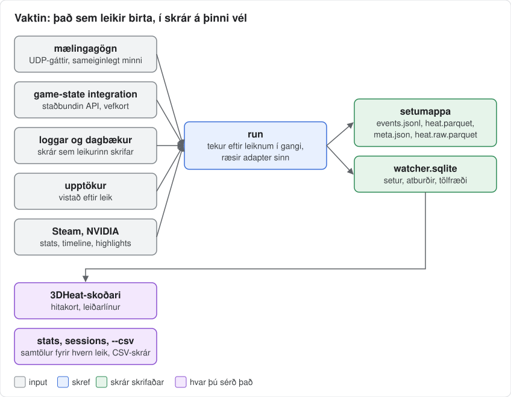

# 3DHeat Watcher {#dheat-watcher}

**Hvað er þetta?** Þú spilar leik. Þetta forrit skrifar hljóðlega niður hvert þú fórst og hvað gerðist.
Síðar geturðu skoðað það sem litað kort í 3DHeat-skoðaranum.

**Hvers vegna ætti ég að nota það?** Til að halda eigin skrá yfir hverja setu - hvar þú ókst, flaugst eða barðist,
samtölur þínar fyrir hvern leik - án nokkurs vefs og án þess að breyta leiknum.

**Dæmi:** þú ekur hring í kappakstursleik með vaktina (watcher) í gangi; á eftir geymir skrá í
`sessions\<game>\` línuna sem þú fórst, og skoðarinn teiknar hana.

Nánar: 3DHeat Watcher er bakgrunnsforrit sem skráir það sem leikir birta um leik þinn - hvert þú
fórst, hvað gerðist hvar, og tölurnar á bak við það - í skrár á þinni eigin vél. Skrárnar eru
fyrir þína eigin tölfræði og fyrir hitakort og leiðarlínur 3DHeat-skoðarans.

Það keyrir hljóðlega, tekur eftir hvaða leik þú ræstir og les eigin úttak þess leiks: mælingagátt (telemetry port)
eða sameiginlegt minni sem leikurinn birtir fyrir mælaborð, game-state integration, dagbókina eða logginn sem
leikurinn skrifar, upptökuna sem hann vistar eftir leik, tölfræðina sem Steam heldur utan um, bútana sem NVIDIA App
vistar. Upptökur haldast á þinni vél. Forritið hefur samband við aðeins tvær utanaðkomandi þjónustur, og aðeins í
þessum tilvikum: GitHub, til að leita að nýrri útgáfu (sjá [Uppfærslur](../updates.md)), og Match-V5 API frá Riot,
og aðeins ef þú slærð inn þinn eigin Riot API lykil (sjá [League of Legends upptökur](../game-lol-replays.md)).



## Hvað það skráir {#what-it-records}

- **Staðsetningar**: bílinn, flugvélina, hetjuna eða leikmanninn, nokkrum sinnum á sekúndu þar sem leikurinn birtir
  þær, með hraða, stefnu og öllu öðru sem leikurinn sendir með.
- **Atburði**: spawn, dauðsföll, dráp, hringi, áfanga, lotur, mörk, verkefni, flugtök og lendingar, breytingar á
  svæði, afrek, hápunkta. Hver atburður er geymdur með tíma sínum, og með stað sínum þegar
  leikurinn gefur hann.
- **Tölfræði fyrir hverja setu**: dráp, dauðsföll, hringi, besta hring, vegalengd, hámarkshraða, spilatíma, og
  eigin tölfræði leiksins þar sem hann heldur hana.

Hvað hver leikur gefur, og hvaðan, er á sinni eigin síðu undir [Leikir](../games.md). Ein heimild getur ekki
skráð allt: fjölspilunarleikir eru skráðir aðeins gegnum það sem þeir birta, og vaktin
les aldrei minni þeirra (sjá [Heimildir og reglur](../sources-and-rules.md)).

## Uppsetning {#install}

Ertu ný/r í skipanalínunni? Lestu fyrst [Áður en þú byrjar](before-you-start.md).

Vaktin er Python-forrit fyrir Windows (Python 3.10 eða nýrra). Margar heimildir hennar eru aðeins til á Windows: sameiginlegt
minni, registry, Windows-tilkynningar.

```bash
git clone https://github.com/Holdi601/3DHeat-Watcher.git
cd 3DHeat-Watcher
pip install -r requirements.txt
```

Niðurhalað útgáfusafn virkar eins: pakkaðu því upp og keyrðu síðan `pip install -r requirements.txt`
inni í möppunni. Nánari upplýsingar, og aukapakkana sem sumir leikir þurfa, eru í
[Uppsetning og keyrsla](../installing-and-running.md).

## Fljótleg byrjun {#quick-start}

```bash
python -m heat3d_watch games            # what each game gives, and from where
python -m heat3d_watch setup all        # what would have to be switched on (nothing is changed)
python -m heat3d_watch setup f1-25 --apply   # switch one game's output on (the original file is backed up)
python -m heat3d_watch run              # watch; leave it running while you play
python -m heat3d_watch stats            # totals per game
python -m heat3d_watch stats --csv out  # sessions, events and stats as CSV files
```

Þú ættir að sjá: eftir `games`, töflu með einni línu fyrir hvern leik; `run` heldur áfram þar til þú ýtir á
Ctrl+C eða lokar glugganum.

Allt er skrifað í `%LOCALAPPDATA%\3DHeat\Watcher`. Til að nota aðra möppu, stilltu
umhverfisbreytuna `HEAT3D_WATCH_HOME` eða keyrðu `python -m heat3d_watch config --set data=D:\somewhere`.

- `sessions\<game>\<date>_<adapter>\` - ein mappa fyrir hverja setu, sem geymir `events.jsonl` (hvern atburð
  um leið og hann gerist), `heat.parquet` (raðirnar með staðsetningu, tilbúnar fyrir 3DHeat-skoðarann) og
  `meta.json` (leikur, heimild, ásar, talningar, tölfræði)
- `watcher.sqlite` - tölfræði hverrar setu, í þremur venjulegum töflum
- `watcher.log` - það sem vaktin gerði

Skoðarinn opnar `heat.parquet` setu beint, án þess að nokkuð þurfi að stilla (ásar hennar og einingar eru í
skránni). Umbreyttar upptökur eru skrifaðar sem töflur og leikskjöl við hliðina; snið skoðarans með einni skrá
fyrir hvern leik er lýst á síðunni um [`.3dheat` gáminn](https://holdi601.github.io/3DHeat/container.html),
og dálkar hverrar töflu í [Gögnin](../the-data.md).

## Skjölin {#the-documentation}

| Síða | Hvað hún fjallar um |
|---|---|
| [Áður en þú byrjar](before-you-start.md) | Python, skipanalína, staðgenglar, hvernig árangur og algengar villur líta út |
| [Uppsetning og keyrsla](../installing-and-running.md) | kröfur, keyrsla í bakgrunni, ræsing með Windows, læsingarskráin, loggurinn, hver stilling og umhverfisbreyta |
| [Leikir](../games.md) | ein síða fyrir hvern leik: hvað er skráð, hvaðan, hvernig á að kveikja á því, hvernig það virkar, ásar, tölfræði, hvað var staðfest |
| [Gögnin](../the-data.md) | setumöppur, `events.jsonl`, `heat.parquet` og fótur hennar, `meta.json`, `watcher.sqlite`, endurheimt eftir hrun, CSV-útflutningur, að opna setu í 3DHeat-skoðaranum |
| [Skipanir](../commands.md) | hver skipun og valkostur `python -m heat3d_watch` |
| [Heimildir og reglur](../sources-and-rules.md) | heimildirnar sex gerðir, fjölspilunarreglurnar, hvaða leikjum er sleppt og hvers vegna |
| [NVIDIA Highlights](../nvidia-highlights.md) | hvað NVIDIA Highlights getur og getur ekki skilað, og hvernig hápunktur fær staðsetningu |
| [Þjónsmod til skráningar](../server-mods.md) | Arma 3 og Arma Reforger þjónsmodin sem skrá heil verkefni fyrir skoðarann |
| [Lestur minnis](../memory-reading.md) | minnisprófílar fyrir einspilun: sniðið, athuganirnar, hvernig á að skrifa og sannprófa einn |
| [Uppfærslur](../updates.md) | hvernig vaktin leitar að nýjum útgáfum og uppfærir sig sjálf |
| [Þróun](../development.md) | að skrifa adapter: API, prófanir, heiðarlegt `verified`, að endurgera leikjasíðurnar |
| [Allir leikir í einni töflu](../watcher.md) | hver leikur í einni töflu, eins og `games --markdown` prentar hana, auk leikjanna sem eru rannsakaðir en ekki enn smíðaðir |
| [Skipanayfirlit](../cli-reference.md) | `--help` hverrar skipunar, búið til úr kóðanum |
| [Viðhald](../maintaining.md) | útgáfugátlisti fyrir þessar síður |

## Hluti af 3DHeat {#part-of-3dheat}

3DHeat Watcher er eitt af ókeypis tólunum í kringum 3DHeat-skoðarann (vaktin notar 3DHeat CS2
til að umbreyta CS2 demo). Hvert er sitt eigið verkefni, með sínar eigin útgáfur og leyfi:

| Tól | Hvað það gerir | Skjöl |
|---|---|---|
| [3DHeat](https://github.com/Holdi601/3DHeat) | skoðarinn: hitakort, kappakstursgreining og leikjayfirlit í 3D | [vefur](https://holdi601.github.io/3DHeat/) |
| [GameFiles](https://github.com/Holdi601/3DHeat-GameFiles) | brautir og borð úr skrám sem leikir senda með, sem 3D líkön | [vefur](https://holdi601.github.io/3DHeat-GameFiles/) |
| [GameCapture](https://github.com/Holdi601/3DHeat-GameCapture) | hringmælingagögn úr kappakstursleikjum; borð endurbyggð úr leikmyndbandi | [vefur](https://holdi601.github.io/3DHeat-GameCapture/) |
| [Unreal Exporter](https://github.com/Holdi601/3DHeat-UnrealExporter) | viðbót fyrir Unreal Editor sem flytur borð út sem eitt 3D líkan | [vefur](https://holdi601.github.io/3DHeat-UnrealExporter/) |
| [CS2](https://github.com/Holdi601/3DHeat-CS2) | Counter-Strike 2 demo í töflur og leikskjöl; kort í 3D líkön | [vefur](https://holdi601.github.io/3DHeat-CS2/) |
| [Watcher](https://github.com/Holdi601/3DHeat-Watcher) | skráir í bakgrunni það sem leikir birta um leik þinn | [vefur](https://holdi601.github.io/3DHeat-Watcher/) |
| [Ext-WarThunder](https://github.com/Holdi601/3DHeat-Ext-WarThunder) | War Thunder upptökur í töflur og leikskjöl | [vefur](https://holdi601.github.io/3DHeat-Ext-WarThunder/) |
| [Ext-WoT](https://github.com/Holdi601/3DHeat-Ext-WoT) | World of Tanks upptökur í töflur og leikskjöl | [vefur](https://holdi601.github.io/3DHeat-Ext-WoT/) |
| [Ext-WoWs](https://github.com/Holdi601/3DHeat-Ext-WoWs) | World of Warships upptökur í töflur og leikskjöl | [vefur](https://holdi601.github.io/3DHeat-Ext-WoWs/) |
| [Ext-Squad](https://github.com/Holdi601/3DHeat-Ext-Squad) | Squad þjónadem í töflur og leikskjöl | [vefur](https://holdi601.github.io/3DHeat-Ext-Squad/) |
| [Ext-DCS](https://github.com/Holdi601/3DHeat-Ext-DCS) | DCS World kort í 3D líkön | [vefur](https://holdi601.github.io/3DHeat-Ext-DCS/) |
| [Ext-IL2](https://github.com/Holdi601/3DHeat-Ext-IL2) | IL-2 Sturmovik kort í 3D líkön | [vefur](https://holdi601.github.io/3DHeat-Ext-IL2/) |

Leyfi: MIT ([LICENSE](https://github.com/Holdi601/3DHeat-Watcher/blob/main/LICENSE)). Leyfi
pakka þriðju aðila sem það notar, og það sem leikirnir sem það les krefjast, eru talin upp í
[LICENSES.md](https://github.com/Holdi601/3DHeat-Watcher/blob/main/LICENSES.md).
