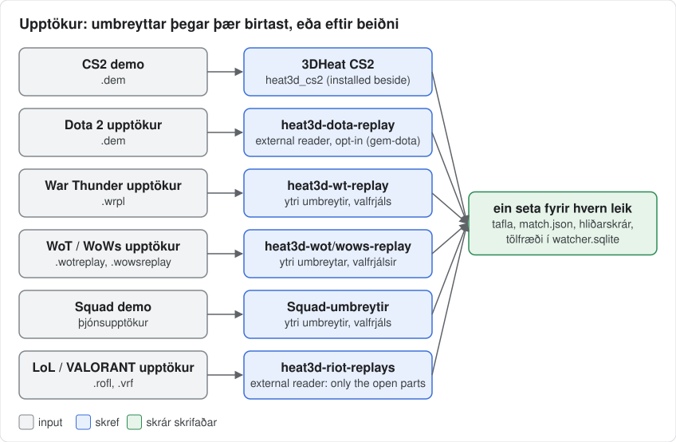

# Uppsetning og keyrsla {#installing-and-running}

## Kröfur {#requirements}

- **Windows.** Watcher er skrifaður fyrir Windows, og flestar heimildir hans eru aðeins til þar: samnýtt
  minni sem leikir búa til (`Local\...` varpanir), nýskráningin (registry, þar sem Steam er), Windows-
  tilkynningar, ferlalistinn með slóðum keyrsluskráa. Á öðru kerfi ræsist forritið, en
  þessar heimildir finna ekkert, tilkynningar eru aðeins skráðar í logg og minnislestur neitar („only
  implemented on Windows“).
- **Python 3.10 eða nýrra**, frá <https://www.python.org/downloads/>: hakaðu við **Add python.exe to PATH**
  í uppsetningarforritinu og athugaðu svo með `python --version` í nýrri skipanalínu. Ertu ný/r í þessu? Lestu fyrst
  [Áður en þú byrjar](before-you-start.md).
- **Pakkar** (`requirements.txt`): `psutil>=6.0` (hvaða leikir eru í gangi, hvaða forrit heldur
  gátt, tengingar leiks; eldri psutil virkar enn, með eldra nafni sínu á tengingum ferlis),
  `pyarrow>=15` (til að skrifa `heat.parquet`), `numpy>=1.24`, og
  `pytest>=8.0` fyrir prófanirnar. `requirements-optional.txt` telur nú enga pakka upp.

Án `pyarrow` eru lotur enn skráðar: `events.jsonl` er skráin sjálf, og töfluna er hægt að
byggja seinna með [`table`](commands.md#table).

### Aukahlutir sem sumir leikir þurfa {#extras-some-games-need}

| Leikur | Hvað hann þarf |
|---|---|
| Counter-Strike 2 demó | [3DHeat CS2](https://github.com/Holdi601/3DHeat-CS2) og kröfur þess (`demoparser2`). Watcher leitar að því í `HEAT3D_CS2`, svo í möppu `3DHeat-CS2` eða `cs2` við hliðina á eigin möppu watcher, svo hvar sem Python getur flutt inn `heat3d_cs2`. Án þess telur `games` millistykkið ótiltækt. |
| Microsoft Flight Simulator 2020 / 2024 | `SimConnect.dll` - fylgir ekki með. MSFS 2020 hefur eina í uppsetningarmöppu sinni; fyrir MSFS 2024, settu upp MSFS 2024 SDK. `MSFS_SDK` / `MSFS2024_SDK` vísa á SDK-möppuna. |
| Euro Truck Simulator 2, American Truck Simulator | RenCloud `scs-telemetry.dll` viðbótin (útgáfa 12) í `<game>\bin\win_x64\plugins` |
| BeamNG.drive | `heat3d` samskiptareglumóddið, sett upp með `python -m heat3d_watch setup beamng --apply` |
| League of Legends (í beinni) | valfrjálst: rótarskírteini Riot sem `<data>\riotgames.pem`, svo staðbundna tengingin sé staðfest |
| Minecraft | mappan `%APPDATA%\.minecraft` (Java Edition) |

Síða hvers leiks undir [Leikir](games.md) segir hvað þarf að kveikja á í leiknum sjálfum.
`python -m heat3d_watch games` merkir millistykki `[unavailable: ...]` þegar eitthvað sem það þarf vantar
á þessari vél.

## Uppsetning {#installing}

Ertu ný/r í skipanalínunni? Lestu fyrst [Áður en þú byrjar](before-you-start.md). Ef `pip` finnst ekki,
notaðu `python -m pip install -r requirements.txt` í staðinn.

Úr klóni:

```bash
git clone https://github.com/Holdi601/3DHeat-Watcher.git
cd 3DHeat-Watcher
pip install -r requirements.txt
```

Úr útgáfu: sæktu skjalasafnið af útgáfusíðu geymslunnar, pakkaðu því upp og keyrðu svo
`pip install -r requirements.txt` inni í möppunni. Báðar gerðir eintaka uppfæra sig sjálfar
(sjá [Uppfærslur](updates.md)).

Keyrðu hverja skipun úr möppu geymslunnar: `python -m heat3d_watch` flytur pakkann inn þaðan,
og uppfærslan (`heat3d_update`) er við hliðina á honum.

## Keyrsla {#running}

```bash
python -m heat3d_watch run        # watch until stopped
python -m heat3d_watch run -v     # the same, with debug lines in the log
python -m heat3d_watch run --once # one look at the games running now, then stop and exit
```

Þegar `run` ræsist:

1. skrifar það [læsingarskrána](#the-lock-file);
2. lýkur það lotum sem fyrri keyrsla skildi eftir opnar, til dæmis eftir hrun
   (sjá [Endurheimt](the-data.md#recovery-after-a-crash));
3. les það á `scan_seconds` fresti (2 s) ferlalistann (aðeins nöfn og slóðir, ekkert ferli er opnað)
   og ræsir millistykki, í sérstökum þræði, fyrir hvern leik sem það finnur. Þegar ferli leiks
   er horfið er millistykki hans stöðvað og lotunum sem það hafði opnar lokað, sem skrifar töflu þeirra og
   línu þeirra í tölfræðina. Millistykki sem bíða ekki eftir leik (Steam-tölfræði, Steam
   Timeline, NVIDIA hápunktar, endursýningarmöppurnar) keyra allan tímann;
4. meðan enginn leikur er í gangi leitar það að nýrri útgáfu í mesta lagi einu sinni á klukkustund (svarið sjálft er geymt í sex tíma) og, með `auto_update`
   kveikt, setur hana upp og ræsir sig aftur (sjá [Uppfærslur](updates.md)).

Millistykki sem bilar er skráð í logg og stöðvar ekki hin. Ef könnun millistykkis mistekst 20 sinnum í
röð, eða ræsing þess mistekst, er millistykkið stöðvað og ekki ræst aftur fyrr en leikurinn er ræstur á ný (nýtt
ferlisauðkenni).

Stöðvaðu watcher með Ctrl+C. Millistykkin loka lotum sínum áður en það hættir. Ef watcher er
drepinn í staðinn (Task Manager, hrun, rafmagnsleysi) tapast ekkert af því sem var þegar skrifað: næsta
`run` lýkur þeim lotum.

`--once` lítur einu sinni: það ræsir millistykkin fyrir leikina sem eru í gangi á því augnabliki (og þau sem eru
alltaf í gangi), lætur hvert kanna einu sinni - bíður í mesta lagi 10 sekúndur eftir því - og stöðvar þau svo
eins og þegar leikur endar, svo loturnar sem þau opnuðu eru lokaðar, töflur þeirra skrifaðar og línur þeirra
taldar í tölfræðinni áður en það hættir. Notaðu það til að athuga að leikur finnist, ekki til að skrá.

### Endursýningar sem eru þegar á disknum {#replays-already-on-disk}



Í fyrsta sinn sem endursýningarmillistykki sér eina af möppum sínum skráir það aðeins endursýningarnar sem eru þegar í henni:
spilari með ára gömul demó myndi annars finna watcher önnum kafinn við umbreytingar í heilan dag. Eftir það
er hver ný endursýning umbreytt þegar leikurinn hefur lokið við að skrifa hana. Gömlu eru umbreyttar
að beiðni með [`replays`](commands.md#replays):

```bash
python -m heat3d_watch replays cs2-demos              # every demo in CS2's folders and replay_folders
python -m heat3d_watch replays lol-replays D:\Old     # the replays in one folder
```

### Keyrsla í bakgrunni {#running-in-the-background}

Watcher hefur engan eigin glugga; hann er skipanalínuforrit sem keyrir þar til það er stöðvað. Það
skrifar allt í `watcher.log`, svo það þarf ekki sýnilegan glugga. Leiðir til að hafa það úr vegi:

- ræstu það í glugga og smækkaðu hann: `start "" /min python -m heat3d_watch run` úr
  `cmd`, í möppu geymslunnar;
- ræstu það án glugga: `pythonw -m heat3d_watch run`. Úttak í glugga tapast, en `watcher.log`
  er samt skrifaður. Til að stöðva það skaltu enda ferlið `pythonw.exe`; næsta ræsing lýkur þá
  lotunum sem það skildi eftir opnar. Verkefnið hefur ekki prófað þessa leið til að keyra.

### Ræsing með Windows (hugmynd) {#starting-with-windows-an-idea}

Watcher setur sig ekki upp til að ræsast með Windows. Til að ræsa það sjálfkrafa:

- **Task Scheduler**: búðu til verkefni með kveikjunni *At log on* og aðgerðinni *Start a program*,
  forrit `pythonw.exe` (eða `python.exe`), færibreytur `-m heat3d_watch run`, *Start in* stillt á
  möppu geymslunnar;
- **Startup mappa**: settu flýtileið í `shell:startup` með sama forriti, sömu færibreytum og sömu *Start in*
  möppu.

Hvorugt er hluti af watcher né prófað af honum. [Læsingarskráin](#the-lock-file) tryggir að annað eintak
sem er ræst fyrir mistök hættir strax.

## Læsingarskráin {#the-lock-file}

`<data>\watcher.lock` geymir ferlisauðkenni watcher sem er í gangi. Þegar `run` ræsist og læsingarskráin
nefnir ferli sem er enn til og nafn þess inniheldur `python`, prentar það

```text
A watcher is already running (process 12345) for C:\Users\...\3DHeat\Watcher.
```

og hættir með kóðann 1. Tveir watcher á einni gagnamöppu myndu skrá hvern leik tvisvar, og sá seinni
myndi líta á opnar lotur þess fyrri sem leifar eftir hrun. Læsingarskrá sem ferli hennar er
horfið, eða tilheyrir öðru forriti, er skrifað yfir. Þegar `run` endar fjarlægir það læsingarskrána ef
skráin nefnir enn eigið ferli þess.

## Loggurinn {#the-log}

`<data>\watcher.log` er aðeins skrifaður af `run`; hinar skipanirnar prenta í gluggann. Hver lína hefur
tímann, stigið og skilaboð:

```text
2026-05-01 20:15:01,123 INFO watching; data in C:\Users\...\AppData\Local\3DHeat\Watcher
2026-05-01 20:15:03,456 INFO f1-25: starting (EA SPORTS F1 25)
2026-05-01 21:02:11,789 INFO f1-25: stopping
```

Millistykki skrá hvað þau geta ekki og hvers vegna: „UDP 20777 is in use by ...; not taking it from that program“,
„not reading memory: the game is played online“, „could not start“, „poll failed (3)“ með
rakningunni. `run -v` bætir við villuleitarlínum. Bætt er aftan við skrána og watcher snýr henni aldrei né tæmir;
eyddu henni hvenær sem þú vilt. Sömu línur fara líka í gluggann.

## Hvar allt er {#where-everything-is}

Heimamappan er `%LOCALAPPDATA%\3DHeat\Watcher`, eða `HEAT3D_WATCH_HOME` þegar hún er stillt (án
`LOCALAPPDATA`, til dæmis á öðru kerfi, `~/.local/share/3DHeat/Watcher`). `settings.json` er
alltaf í heimamöppunni. Allt annað fer í gagnamöppuna, sem er heimamappan nema stillingin
`data` nefni aðra:

| Slóð | Hvað það er |
|---|---|
| `<home>\settings.json` | stillingarnar |
| `<data>\sessions\` | upptökurnar, ein mappa fyrir hverja lotu ([Gögnin](the-data.md)) |
| `<data>\watcher.sqlite` | tölfræðigagnagrunnurinn |
| `<data>\watcher.log` | loggur `run` |
| `<data>\watcher.lock` | læsingarskráin, meðan `run` keyrir |
| `<data>\state\` | það sem alltaf-í-gangi millistykkin og endursýningarmillistykkin hafa þegar séð (`steam-stats.json`, `replays-cs2-demos.json`, ...), svo endurræsing skráir ekkert tvisvar |
| `<data>\profiles\*.json` | minnissnið sem þú skrifaðir ([Minnislestur](memory-reading.md)) |
| `<data>\riotgames.pem` | valfrjálst, rótarskírteini Riot fyrir League of Legends millistykkið í beinni |
| `%LOCALAPPDATA%\3DHeat\update-check-3DHeat-Watcher.json` | geymda svarið við síðustu útgáfuleit |

Watcher eyðir engu í þessum möppum, nema lotumöppu þar sem ekkert var skráð
(leikur sem var skilinn eftir í valmyndum).

## Stillingar {#settings}


`python -m heat3d_watch config` sýnir stillingarnar; `config --set key=value ...` breytir þeim og vistar
`settings.json` (sjá [config](commands.md#config)). Skráin er venjulegt JSON og má líka breyta
í höndunum meðan watcher er ekki í gangi. Óþekktir lyklar í henni eru hunsaðir. Stillingar eru lesnar þegar skipun
ræsist, svo endurræstu `run` eftir að þú breytir þeim.

| Stilling | Sjálfgefið | Hvað hún gerir |
|---|---|---|
| `data` | `""` | Gagnamappan. Tóm: heimamappan. |
| `disabled` | `[]` | Auðkenni millistykkja sem keyra aldrei, til dæmis `config --set disabled=steam-stats,nvidia-highlights`. Öll önnur millistykki keyra þegar þau finna leikinn sinn. |
| `auto_update` | `true` | Meðan enginn leikur er í gangi, setja upp nýrri útgáfu og endurræsa (sjá [Uppfærslur](updates.md)). `false`: aðeins tilkynning í loggnum. |
| `scan_seconds` | `2.0` | Sekúndur á milli þess sem litið er á ferlalistann. |
| `memory` | `false` | Leyfa minnismillistykkjum (einspilunarleikir með snið sem þú skrifaðir) að keyra. Slökkt sjálfgefið; sjá [Minnislestur](memory-reading.md). |
| `replays` | `true` | Keyra `replay` millistykkin: öll (sjá `python -m heat3d_watch replays` og [Leikir](games.md)) - CS2 demó, Dota 2, War Thunder, World of Tanks, World of Warships, Squad, League of Legends og VALORANT endursýningar, IL-2 Tacview upptökur. |
| `replay_folders` | `{}` | Aukamöppur eftir auðkenni millistykkis, til dæmis `{"cs2-demos": ["D:\\Demos"]}`. Endursýningarmillistykki vakta þær til viðbótar við eigin möppur leiksins; `il2-tacview` tekur líka við uppsetningarmöppum (það leitar þá í `data\Tracks` þeirra); fyrir `elite` kemur fyrsta mappan í stað dagbókarmöppunnar. Stilltu möppur eins millistykkis með `config --set replay_folders.cs2-demos=D:\Demos,E:\More`, eða alla orðabókina sem JSON. |
| `riot_id` | `""` | Riot ID þitt (`Name#TAG`), svo þín eigin lína í League of Legends endursýningu verði tölfræðin þín. Tómt: lína hvers leikmanns er geymd, engin er merkt sem þín. |
| `riot_api_key` | `""` | Þinn eigin Riot developer API-lykill, til að sækja opinbera tímalínu hvers endurspilaðs League-leiks (staðsetningar á hverri mínútu, dráp þar sem þau gerðust). Tómt: ekkert er sótt. |
| `riot_platform` | `"EUW1"` | Platform-auðkenni League-þjónsins þíns (`EUW1`, `EUN1`, `NA1`, `KR`, ...), notað til að finna svæðisbundna Match-V5 hýsilinn. |
| `player_names` | `{}` | Nafn þitt í leikjum þar sem viðmótið nefnir hvern leikmann en segir ekki hver þú ert, eftir auðkenni millistykkis: `warthunder-webmap` (línur dráparununnar um þig verða dráp þín og dauðsföll) og `rocketleague-stats` (raðir þínar verða `me`; án þess, leikmaðurinn sem myndavél leiksins fylgir). Stilltu með `config --set player_names.warthunder-webmap=Name`. |

`settings.json` með öllum sjálfgefnum gildum:

```json
{
  "data": "",
  "disabled": [],
  "auto_update": true,
  "scan_seconds": 2.0,
  "memory": false,
  "replays": true,
  "replay_folders": {},
  "riot_id": "",
  "riot_api_key": "",
  "riot_platform": "EUW1",
  "player_names": {}
}
```

## Umhverfisbreytur {#environment-variables}

| Breyta | Áhrif |
|---|---|
| `HEAT3D_WATCH_HOME` | heimamappan (stillingar, og gögnin nema `data` segi annað) |
| `HEAT3D_NO_UPDATE` | hvaða gildi sem er nema tómt, `0`, `false` eða `no` slekkur á útgáfuleitinni og sjálfvirku uppfærslunni |
| `HEAT3D_NO_TOAST` | hvaða gildi sem er sem er ekki tómt: engar Windows-tilkynningar, aðeins logglínur |
| `HEAT3D_CS2` | mappa 3DHeat CS2, fyrir CS2 demó |
| `HEAT3D_CS2_GSI_PORT` | leikstöðugátt CS2 (sjálfgefið 3311); cfg-skráin sem `setup` skrifar notar hana |
| `HEAT3D_DOTA_GSI_PORT` | leikstöðugátt Dota 2 (sjálfgefið 3312) |
| `MSFS_SDK`, `MSFS2024_SDK` | MSFS SDK-möppurnar, þar sem leitað er að `SimConnect SDK\lib\SimConnect.dll` |

Windows-tilkynningar eru aðeins notaðar fyrir uppfærslur: „Updating to 1.2.0“, eða „1.2.0 is out; not updated:
...“ þegar ekki tókst að setja uppfærsluna á. Þær eru sýndar í gegnum eigið tilkynninga-API PowerShell,
svo ekkert þarf að setja upp. Titillinn og textinn eru sendir til PowerShell sem umhverfisbreytur,
aldrei sem hluti af skriftunni.
