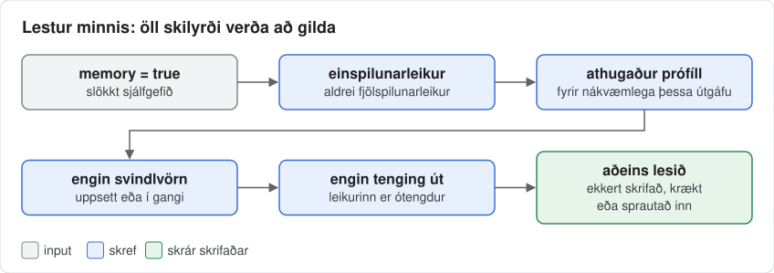

# Minnislestur {#reading-memory}

Sumir einspilunarleikir segja engu öðru forriti neitt. Fyrir þá getur watcher - ef þú kveikir á því og skrifar
snið sjálf/ur - flett upp hvar þú ert í minni leiksins, aðeins lesið.

Fyrir einspilunarleiki sem birta ekkert getur watcher lesið staðsetningar og gildi úr
minni leiksins, með **sniði** (profile) sem þú skrifar fyrir þína eigin útgáfu leiksins. Af öllum heimildunum er þetta
sú eina sem leikurinn lét ekki af hendi, svo hún er girt meira af en hinar:

- hún er **slökkt sjálfgefið** (`python -m heat3d_watch config --set memory=true` kveikir á henni);
- hún les, og hefur enga leið til að skrifa;
- **engin snið fylgja verkfærunum.**

Snið fylgja ekki því offset er aðeins rétt fyrir útgáfuna sem það fannst á. Eftir uppfærslu
les snið sem var rétt áður rusl, og rusl lítur alveg út eins og tölur. Snið þarf að vera
athugað á útgáfunni sem spilarinn hefur, af þeim spilara.

## Athuganirnar, í röð {#the-checks-in-order}



Allar athuganirnar hér á eftir verða að standast. Fyrstu fjórar eru gerðar **áður** en leikurinn er opnaður, því að opna
varinn leik til lestrar er einmitt það sem svindlvörn tekur eftir, og að neita á eftir væri of seint.

1. **Stillingin**: `memory` er true. Annars eru minnismillistykki aldrei ræst.
2. **Snið fyrir leikinn**, þar sem `exe` nefnir ferlið sem er í gangi. Snið segir hvort
   hægt er að spila leikinn á netinu yfirleitt (`"online"`); snið sem sleppir þessu er hafnað.
3. **Engin svindlvörn nálægt**:
   - engin svindlvarnarskrá í möppu leiksins eða allt að þremur möppum fyrir ofan hana (stoppað við `common` möppu
     Steam-safns, eða við möppu með `steamapps` í, því aðrir leikir eru fyrir ofan
     hana): `EasyAntiCheat`, `EasyAntiCheat_EOS_Setup.exe`, `start_protected_game.exe`, `BattlEye`,
     `BEClient_x64.dll`, `BEService_x64.exe`, `EAAntiCheat.GameServiceLauncher.exe`, `AntiCheatExpert`,
     `SGuard64.exe`, `GameGuard`, `GameMon.des`, `XIGNCODE`, `xhunter1.sys`, `Vanguard`, `FACEIT`
     (borið saman með litlum stöfum, líka sem upphaf nafns). Ef mappa leiksins er óþekkt er leiknum
     hafnað;
   - enginn svindlvarnarrekill eða þjónusta í gangi á vélinni yfirleitt, eins og
     `sc query type= driver state= active` og `sc query type= service state= active` telja upp: EasyAntiCheat,
     EasyAntiCheat_EOS, BEService, BEDaisy, vgk, vgc, ACE-BASE, ACE-GAME, xhunter1, FACEIT,
     FACEITService, EAAntiCheatService, Denuvo Anti-Cheat, npggsvc, Ricochet. Svindlvörn í kjarna
     sem er sett upp fyrir annan leik fylgist samt með hverju ferli. Ef ekki er hægt að telja þjónusturnar upp
     er leiknum hafnað.
4. **Ekki á netinu**: leikur þar sem sniðið segir `"online": true` er aðeins lesinn meðan hann hefur enga tengingu
   við neitt nema þessa vél (hvaða fjarlægt vistfang sem er annað en `127.x`, `::1`). Ef ekki er hægt að lesa tengingar hans
   er honum hafnað.
5. Svo, þegar millistykkið ræsist:
   - **nákvæm útgáfa**: stærð keyrsluskrárinnar, eða SHA-256 hennar, verður að passa við útgáfu sem sniðið
     telur upp. Óþekkt útgáfa er ekki lesin;
   - **einingarnar aftur**: einingar leiksins sem eru hlaðnar eru taldar upp (Toolhelp snapshot, sem biður
     ekki um nein eigin aðgangsréttindi) og athugaðar með tilliti til svindlvarnarforrits (`BEClient_x64.dll`,
     `BEClient.dll`, `EasyAntiCheat_x64.dll`, `EasyAntiCheat.dll`, `EOSAntiCheat...`). Varið
     ferli neitar snapshot, sem er líka höfnun;
   - aðeins þá er ferlið opnað, með `PROCESS_VM_READ | PROCESS_QUERY_LIMITED_INFORMATION` og
     engu öðru.

Athuganir 1 til 4 eru endurteknar við hverja skönnun (á 2 s fresti) meðan leikurinn keyrir. Ef ein byrjar að mistakast (leikurinn
tengist þjóni, svindlvarnarþjónusta ræsist) er millistykkið stöðvað í næstu skönnun. Höfnun er
skráð: `mem-<id>: not reading memory: <reason>`. Bilun við ræsingu (óþekkt útgáfa,
svindlvarnareining, mynstur fannst ekki) er skráð sem `mem-<id>: could not start`, og millistykkið
er ekki reynt aftur fyrr en leikurinn er ræstur á ný.

Það er engin skrift, engin úthlutun í hinu ferlinu, enginn þráður ræstur í því, ekkert safn hlaðið inn í
það, engin villuleitarréttindi og engin hækkun réttinda. Próf (`test_memory_reading_cannot_write` í
`tests/test_core.py`) fellur ef einhver köll sem skrifa í, úthluta í eða keyra kóða í öðru ferli -
`WriteProcessMemory`, `VirtualAllocEx`, `CreateRemoteThread`, `PROCESS_VM_WRITE`, `SeDebugPrivilege`,
`LoadLibrary`, ... - birtast hvar sem er í pakkanum.

Aldrei lesið, hvað sem snið segir: leikir sem eru spilaðir á netinu, og leikir þar sem einspilunarhamurinn keyrir
undir svindlvörn, eins og GTA V, eða Elden Ring ræstur í gegnum ræsiforrit sitt. Athuganirnar hér að ofan hafna
þeim samt.

## Snið sniðsins {#the-profile-format}

Snið er JSON-skrá í `<data>\profiles\` (`<data>` er gagnamappan, sjá
[Uppsetning og keyrsla](installing-and-running.md#where-everything-is)), eitt fyrir hvern leik, hvaða skráarnafn sem er
sem endar á `.json`. Gervidæmi:

```json
{
  "schema": "heat3d.memprofile/1",
  "id": "mygame",
  "game": "My Game",
  "exe": "MyGame.exe",
  "online": false,
  "versions": [ { "label": "1.06", "size": 123456789 } ],
  "anchors": {
    "World": { "aob": "48 8B 05 ?? ?? ?? ?? 48 85 C0", "rip": [3, 7] }
  },
  "values": {
    "pos": { "type": "vec3f", "base": "World", "chain": ["0x10", "0x68", "0x70"] },
    "hp":  { "type": "i32",   "base": "World", "chain": ["0x10", "0x138"] },
    "map": { "type": "u32",   "base": "World", "chain": ["0x10", "0x1C0"] }
  },
  "events": [
    { "event": "death", "value": "hp",  "when": "to_zero" },
    { "event": "zone",  "value": "map", "when": "change" }
  ],
  "axes": { "up": "y", "units": "metres" },
  "rate": 10,
  "provenance": [ { "source": "https://example.com/my-notes", "verified_on": "1.06" } ]
}
```

| Lykill | Nauðsynlegt | Hvað það er |
|---|---|---|
| `schema` | já | nákvæmlega `heat3d.memprofile/1` |
| `id` | já | stutt og stöðugt; millistykkið heitir `mem-<id>` |
| `game` | já | nafn leiksins, sem lotumappan er nefnd eftir |
| `exe` | já | skráarnafn keyrsluskrárinnar, sem segir líka að leikurinn sé í gangi |
| `online` | já | `true` ef hægt er að spila leikinn á netinu yfirleitt; hann er þá aðeins lesinn án nets |
| `versions` | já | útgáfurnar sem sniðið var athugað á: hver með `label`, og `size` (stærð keyrsluskrárinnar í bætum) og/eða `sha256`. Þegar bæði eru gefin verða bæði að passa. Færsla án hvors tveggja passar við ekkert. |
| `anchors` | já | nefnd vistföng í aðaleiningunni. `aob`: bætamynstur, sextándakerfisbæti aðgreind með bilum, `?` eða `??` fyrir hvaða bæti sem er; það verður að koma fyrir **nákvæmlega einu sinni** í einingarmyndinni (mörg samsvörun teljast bilun, eins og engin). `rip: [d, n]`: mynstrið bendir á skipun með 32 bita RIP-afstæðri færslu við bæti `d` og lengd `n`; akkerið verður vistfangið sem sú skipun vísar til. `offset`: bætt við á eftir (sextándakerfis- eða tugatexti). Í stað `aob` gefur `module_offset` fast offset frá grunni einingarinnar. |
| `values` | já | það sem er lesið í hverri könnun: `type` (`i32`, `u32`, `i64`, `u64`, `u8`, `f32`, `f64`, `vec3f`, `vec3d`), `base` (nafn akkeris), `chain` (offset sem sextándakerfis- eða tugatexti) |
| `events` | nei | reglur sem breyta breytingum í atburði: `when` `change` (gildið er frábrugðið síðustu könnun) eða `to_zero` (tala fellur úr yfir 0 í 0 eða lægra) |
| `axes` | nei | `up` (sjálfgefið `y`), `units` (sjálfgefið `game units`), `scale` (einingakvarði skoðarans, sem margfaldar hverja staðsetningu; sjálfgefið 1, eigin einingar leiksins) |
| `rate` | nei | kannanir á sekúndu, 1 til 60 (sjálfgefið 10) |
| `provenance` | nei | hvaðan offsetin koma og á hvaða útgáfu þú staðfestir þau; það er afritað í `meta.json` hverrar lotu |

**Hvernig gildi er lesið.** Vistfang akkerisins er upphafið. Ef `chain` er tómt er gildið lesið
þar. Annars er bendillinn sem er geymdur í akkerinu lesinn fyrst. Svo, fyrir hvert offset nema
það síðasta, er bendillinn á `address + offset` lesinn. Síðasta offsetið er lagt við til að gefa vistfang gildisins.
Núllbendill á leiðinni (leikurinn er milli borða eða í valmynd) skilur gildið eftir tómt í
þeirri könnun.

**Hvað er skráð.** Gildi sem heitir `pos` (`vec3f` eða `vec3d`) verður `position` röð leikmannsins
`me` í hverri könnun. Hver atburðarregla skrifar `event` röð sína, með nýja gildinu og, þar sem `pos`
er þekkt, staðsetningunni, og bætir 1 við tölfræði með sama nafni. Einingarmyndin er lesin einu sinni við ræsingu
til að finna akkerin, í 64 KiB blokkum; blokkir sem ekki er hægt að lesa teljast núll. `meta.json`
lotunnar nefnir sniðið, útgáfumerkið og uppruna gagnanna.

Snið sem ekki er hægt að nota (ógilt JSON, rangt `schema`, nauðsynlegan lykil vantar) er sleppt
og skráð sem `profile <file> not used: <reason>`. Snið eru hlaðin þegar watcher ræsist, svo endurræstu
`run` eftir að þú bætir við eða breytir einu.

## Að skrifa og staðfesta snið {#writing-and-verifying-a-profile}

1. **Aðeins fyrir einspilunarleik án svindlvarnar.** Ef leikurinn hefur svindlvörn, eða þú spilar hann
   á netinu, stoppaðu hér: watcher mun hafna honum, og á að gera það.
2. **Finndu gildin á þinni eigin útgáfu.** Vinndu án nets. Notaðu þín eigin villuleitartól, eða útgefnar athugasemdir
   um leikinn, til að finna staðsetningu leikmannsins og gildin sem þér er annt um, og bendilsleið að
   hverju frá föstum stað í keyrsluskránni. Veldu frekar bætamynstur (`aob`) en fast
   `module_offset`: mynstur finnur enn stað sinn þegar kóði hreyfist aðeins.
3. **Gerðu mynstrið einstakt.** Það verður að passa nákvæmlega einu sinni í einingunni. Notaðu algildistákn fyrir bætin sem
   breytast (vistföng, færslur) og hafðu nóg af föstum bætum í kringum þau.
4. **Festu útgáfuna.** Settu nákvæma stærð keyrsluskrárinnar í `versions`; PowerShell
   `(Get-Item .\MyGame.exe).Length` gefur hana, og `Get-FileHash .\MyGame.exe -Algorithm SHA256` gefur
   tætigildið. Eftir uppfærslu hættir sniðið einfaldlega að vera notað þar til þú athugar það aftur og bætir við
   nýju útgáfunni.
5. **Segðu hvort leikurinn fer á netið** (`online`), af hreinskilni.
6. **Prófaðu það**: kveiktu á lestri (`config --set memory=true`), settu skrána í `<data>\profiles\`, og
   athugaðu að `python -m heat3d_watch games` telji upp `mem-<id>`. Ræstu leikinn og keyrðu
   `python -m heat3d_watch run -v`. Í `watcher.log` skaltu leita að `mem-<id>: starting`, eða að ástæðunni fyrir
   því að því var hafnað eða það gat ekki ræst.
7. **Berðu tölurnar saman við leikinn.** Gakktu á þekktan stað og skoðaðu `position` raðirnar í
   `events.jsonl` lotunnar. Hreyfast þær eins og þú hreyfir þig, um rétta vegalengd, eftir réttum ásum? Opnaðu
   `heat.parquet` í skoðaranum og athugaðu að leiðin passi við hvert þú fórst. Kallaðu fram hvern atburð
   (týndu öllu lífi, skiptu um svæði) og athugaðu að hann birtist einu sinni. Rusl lítur út eins og tölur, og aðeins
   þessi samanburður greinir á milli.
8. **Skrifaðu niður hvað þú staðfestir** í `provenance`: heimild offsetanna og útgáfuna sem þú
   athugaðir þau á.

`verified` texti minnismillistykkis, eins og `games` prentar hann, er alltaf „af höfundi sniðsins, fyrir
útgáfurnar sem það telur upp“. Watcher getur ekki vitað meira en það.
