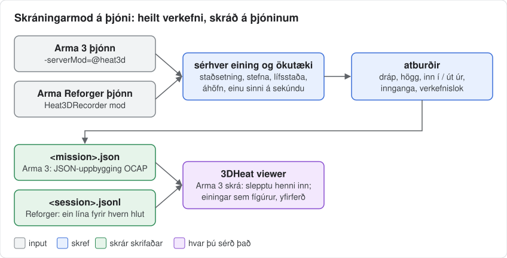

# Netþjónamod fyrir upptöku (Arma 3, Arma Reforger) {#server-recorder-mods-arma-3-arma-reforger}

Flesta leiki tekur watcher upp á tölvu spilarans sjálfs. Arma er öðruvísi: netþjónn getur
tekið upp heilt verkefni - hverja einingu og hvert ökutæki, ekki aðeins þitt eigið - með mod sem keyrir á
netþjóninum. Spilarar þurfa ekkert að setja upp: Arma 3 modið er aðeins fyrir netþjóninn, og Reforger sækir mod netþjóns
til spilaranna sjálfkrafa þegar þeir tengjast (modið gerir ekkert á tölvum þeirra). Geymslan hefur tvö slík mod, í
[`mods/arma3`](https://github.com/Holdi601/3DHeat-Watcher/tree/main/mods/arma3)
og [`mods/reforger`](https://github.com/Holdi601/3DHeat-Watcher/tree/main/mods/reforger).
README-skrár þeirra eru full skjölun; þessi síða er yfirlitið.

**Staða: hvorugt er prófað í leiknum.** Arma 3 viðbótin var smíðuð og
keyrð eins og Arma kallar í viðbætur, og úttak hennar lesið af 3DHeat; SQF-skriftur hennar
hafa ekki enn keyrt í Arma 3. Reforger modið var skrifað eftir útgefnu
script API Bohemia og hefur aldrei verið þýtt. Settu hvorugt á opinberan
netþjón áður en prófunarskrefin í README þess ganga upp.

## Arma 3 {#arma-3}

1. Smíðaðu viðbótina einu sinni fyrir hvern vettvang (`mods/arma3/extension`). Til þess þarf C-þýðanda: Visual
   Studio Build Tools á Windows, gcc á Linux; ef þú hefur aldrei þýtt neitt, spurðu netþjónahýsilinn þinn.
   - Windows, í "x64 Native Tools Command Prompt for VS":
     `cl /nologo /O2 /LD heat3d.c /Fe:heat3d_x64.dll`
   - Linux: `gcc -O2 -shared -fPIC -o heat3d_x64.so heat3d.c -ldl`
2. Smíðaðu modið: `python mods/arma3/build.py` skrifar `mods/arma3/@heat3d/`
   (Arma 3 Tools er ekki þörf).
3. Afritaðu `@heat3d` í möppu netþjónsins og ræstu netþjóninn með
   `-serverMod=@heat3d`.
4. `.rpt` annáll netþjónsins segir `Heat3D recorder 0.1.0: recording <file> every 1 s`.

| Stilling | Sjálfgefið | Hvað hún gerir |
|---|---|---|
| `captureDelay` | 1 | sekúndur milli ramma |
| `recordHits` | 1 | 0 slekkur á skotatburðum |
| `recordShots` | 1 | 0 slekkur á talningu skota |
| `minPlayers` | 0 | taka aðeins upp þegar svona margir spilarar eru inni |

Verkefni getur breytt einni þeirra í `init.sqf` sínu (`heat3d_captureDelay = 0.5;`).
Upptökur fara í `recordings/` inni í `@heat3d`, eða í `HEAT3D_DIR`.

**Úttak:** ein skrá fyrir hvert verkefni í JSON-uppsetningu OCAP (snið OCAP2
upptökutækisins), nefnd `<date>__<time>_<mission>.json`. Meðan verkefnið stendur er hún
dagbók (`.heat3d.part`), skoluð við hverja skrift; dagbók verkefnis sem hrundi
er kláruð næst þegar verkefni ræsist.

## Arma Reforger {#arma-reforger}

Modið (`Heat3DRecorder.gproj`) er opnað og smíðað í Workbench frá Bohemia
(Arma Reforger Tools), prófað á staðbundnum sérþjóni, gefið út úr
Workbench (ekki á lista meðan á prófun stendur) og bætt á `mods` lista `config.json`
netþjónsins - skref fyrir skref í README þess. Á hverri sekúndu skrifar það stöðu, stefnu,
lífsstöðu, ökutæki og spilaraauðkenni hverrar persónu, og stöðu, stefnu,
ástand og áhöfn hvers ökutækis; og dráp (drápsmaður, vopn, fjarlægð), skot, að fara inn og
út, spilara sem koma og fara, og lok verkefnisins.

**Úttak:** einn JSON-hlutur í hverri línu, `$profile:heat3d/<UTC date>_<UTC time>_<world>.jsonl`:
`header` lína (snið `heat3d-reforger`, ásar x austur, y upp, z norður), síðan
`entity`, `frame` og `event` línur eftir því sem þær gerast, og `end` lína. Raðir eininga
eru `[id, x, y, z, dir, alive, vehicleId, playerId]`, raðir ökutækja
`[id, x, y, z, dir, alive, [crew ids]]`; atburðir fylgja uppsetningu atburða OCAP2.

## Í skoðaranum {#in-the-viewer}

Slepptu Arma 3 upptöku á [3DHeat-skoðarann](https://holdi601.github.io/3DHeat/):
eitt verkefni er ein lota, einingar verða hermenn, ökutæki gerð sína, og
dráp og skot fara í yfirlitslista viðureignarinnar. Vefspilari OCAP2 spilar hana líka. Reforger-skráin er
eigið línusnið modsins, með atburðauppsetningu OCAP2.
