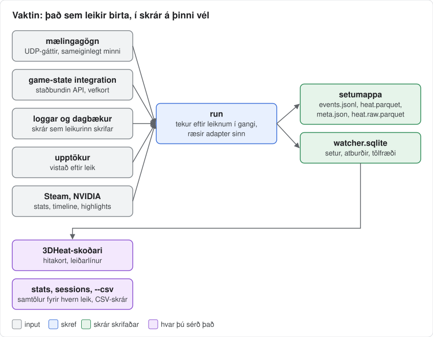

# Heimildir og reglur {#sources-and-rules}

Watcher skráir aðeins það sem leikir og vettvangar láta spilaranum í té. Þessi síða útskýrir hvaða
heimildir það nær yfir, hvað watcher má gera við hverja, og hvaða leiki eða hluta leikja það sleppir
viljandi.

## Sex gerðir heimilda {#the-six-kinds-of-source}

Hvert millistykki hefur `kind` (gerð), og gerðin ræður hvað millistykkið má gera:

| Gerð | Hvað það er | Fjölspilunarleikir |
|---|---|---|
| `telemetry` | UDP-gátt eða samnýtt minni sem leikurinn birtir fyrir mælaborð, hreyfipalla og stýrisbotna (Forza Data Out, F1 UDP, samnýtt minni Kunos og iRacing, SimConnect, UDP-viðmót X-Plane, SCS SDK viðbótin) | já - það er eigið úttak leiksins |
| `gsi` | game-state integration eða staðbundið vef-API sem leikurinn þjónar til vélar spilarans sjálfs (Valve GSI, Live Client Data API League, Stats API Rocket League, vefkort War Thunder) | já, innan þess sem API-ið sýnir spilaranum |
| `log` | skrár sem leikurinn skrifar meðan hann keyrir: dagbækur, annálar, tölfræði, vistanir (Elite Dangerous, Minecraft, Path of Exile, Hearthstone, Star Citizen, EVE Online) | já |
| `replay` | demó og endursýningar sem leikurinn vistar fyrir spilara sína, umbreytt eftir viðureignina (CS2, Dota 2, War Thunder, World of Tanks, World of Warships, Squad, League of Legends, VALORANT, IL-2 Tacview) | já, nema þau séu dulkóðuð, og aðeins hlutarnir sem eru í opnu |
| `platform` | það sem Steam og skjákortsreklarinn geyma: tölfræði, afrek, tímalínur, klippur og highlights | já |
| `memory` | minni leiksins, aðeins lesið, með sniði sem þú skrifaðir | **aldrei** - aðeins einspilun |

Aðeins `memory` opnar annað ferli, og aðeins til lestrar. Hinar fimm gerðirnar lesa það sem leikurinn,
Steam eða NVIDIA App hefur þegar skrifað út eða sendir.

## Hvernig heimildirnar eru lesnar {#how-the-sources-are-read}

- **Engu er sprautað inn, krækt í eða breytt í neinum leik.** Enginn kóði er hlaðinn inn í leik, enginn gluggi eða
  inntak er krækt í, engin leikjaskrá er löguð. Einu skrárnar sem watcher skrifar utan gagnamöppu sinnar
  eru þær sem [`setup --apply`](commands.md#setup) skrifar þegar þú biður um það: eigin stillingarskrá
  leiks (með frumritið geymt sem `<file>.heat3d-backup`), cfg-skrá fyrir game-state, DCS-krókaskriftan,
  BeamNG-samskiptamódið.
- **Samnýtt minni er opnað eingöngu til lestrar og aldrei búið til.** Venjulega Python-leiðin til að opna nafngreinda
  vörpun býr til eina þegar hún er ekki til enn. Leikur sem ræsir eftir það myndi finna tóma vörpun watcher
  sem er aðeins til lestrar í stað þess að búa til sína eigin, og fjarmæling hans væri dauð. Watcher
  opnar vörpun aðeins með `OpenFileMappingW` (sem finnur aðeins til staðar), varpar þeim með
  `FILE_MAP_READ`, og reynir aftur síðar ef leikurinn hefur ekki búið þær til enn.
- **Gáttir eru fengnar að láni, aldrei yfirteknar.** UDP-fjarmælingargátt sem annað forrit hlustar þegar á
  (FH Companion, SimHub, mælaborðsforrit) er látin það forrit eftir. Ef annað forrit byrjar að
  hlusta á gátt sem watcher heldur, sleppir watcher henni innan fárra sekúndna. Forza-millistykki
  bíða 15 s eftir að leikurinn ræsir áður en þau taka gátt 5300, og senda hvern pakka áfram óbreyttan
  á 127.0.0.1:5301, svo annað Data Out forrit geti enn tekið upp.
- **Aðeins staðbundið.** Game-state þjónarnir sem watcher keyrir (CS2, Dota 2) hlusta á 127.0.0.1 og hvergi
  annars staðar. Þegar cfg-skrá leiksins geymir token (það sem `setup` skrifar gerir það), verður hver póstur að bera
  það; póstar án þess eru taldir sem `bad_auth` og felldir niður. Án cfg-skrár með token er hvaða
  staðbundni póstur sem er tekinn við, og annállinn segir frá því. Staðbundnu API-in sem það spyr (League á gátt 2999, War Thunder á
  8111, Rocket League á 49123, X-Plane á 49000) eru á 127.0.0.1.
- **Annálaskrár eru samnýttar, aldrei læstar.** Hver lestur opnar skrána með öllum deilifánum sem Windows hefur
  og lokar henni aftur, svo leikurinn geti haldið áfram að skrifa, endurnefnt eða skipt út annálnum sínum.
- **Tvær ytri þjónustur, og aðeins í þessum tilvikum.** Útgáfuathugunin spyr GitHub
  (`api.github.com`) í mesta lagi á sex klukkustunda fresti og hægt er að slökkva á henni (sjá [Uppfærslur](updates.md)). 
  Endursýningamillistykki League spyr Match-V5 API Riot aðeins þegar þú hefur slegið inn þinn eigin `riot_api_key`.
  Ekkert annað er sent neitt.
- **Að kveikja á heimild er þín ákvörðun.** `setup` án `--apply` segir aðeins hvað það myndi
  breyta.

## Reglur um fjölspilun {#multiplayer-rules}

- Leikur sem er spilaður á netinu er aðeins skráður í gegnum það sem hann birtir: fjarmælingu, game-state API, annála,
  endursýningar, vettvangsskrár. Innan þeirra skráir watcher það sem leikurinn sýnir spilaranum, og
  ekkert reiknað umfram það:
  - **CS2 game-state integration** sendir spilarann sem er fylgst með (þú sjálfur meðan á lífi, liðsfélagi
    eftir dauða). Staða annarra spilara (`allplayers_*`) er aðeins send til áhorfenda og GOTV, svo
    watcher biður ekki um hana.
  - **Live Client Data API í League of Legends** hefur engar staðsetningar. Stefna Riot leyfir verkfærum að sýna
    það sem spilarinn gæti vitað úr leiknum sjálfum, og ekkert reiknað umfram það (engir tímar óvina).
    Watcher skráir drápsstrauminn og stigatöfluna sem spilarinn sér, og eigin tölur spilarans.
  - **Stats API í Rocket League** hefur engar bílastaðsetningar (staða bíla er aðeins send til áhorfenda). Það sem hefur
    stað er boltinn, þar sem hann var sleginn, skoraði eða skall í slána.
  - **Vefkort War Thunder** sýnir það sem smákortið sýnir, án nafna eða auðkenna.
  - **F1 23/24/25** setja stöðu hvers bíls í Motion-pakkann sinn, líka á netinu. Leikurinn gefur þau
    sjálfur út, og heldur aðeins eftir gögnum spilara þar sem "Your Telemetry" er takmarkað.
  - **DCS World**: fjölspilunarþjónn getur bannað útflutning gagna eigin loftfars; lotan
    hefur þá atburði en engar staðsetningar, og segir frá því.
- **Minni er aldrei lesið í fjölspilunarleik.** Minnismillistykki fyrir leik sem er merktur spilaður á netinu
  er hafnað, og snið verður að tilgreina hvort hægt sé yfirhöfuð að spila leikinn á netinu. Einspilunarleikur
  sem hefur líka netham er aðeins lesinn meðan hann hefur enga tengingu nema við þessa
  vél. Leikir þar sem einspilunarhamurinn keyrir undir svindlvörn eru heldur aldrei lesnir. Sjá
  [Minnislestur](memory-reading.md).
- Merkið `multiplayer` á millistykki (sýnt sem "Online play" af `games --markdown`) ræður aðeins
  minnislestri. Það stöðvar ekki hinar gerðirnar frá því að skrá netspilun.

## Hvað er hafnað og hvers vegna {#what-is-declined-and-why}

Sumir leikir, og sumir hlutar leikja, eru ekki skráðir: gögn þeirra eru varin, ekki birt eða alls ekki
á vél spilarans:

| Leikur | Hvað er sleppt | Hvers vegna |
|---|---|---|
| VALORANT | staðsetningar, nöfn, stig í endursýningum; lockfile-endapunktar biðlarans | Leikjastraumur endursýningarinnar er dulinn með gildum úr keyrsluskrá hverrar útgáfu. Leikurinn keyrir undir Vanguard. Lockfile-endapunktar Riot-biðlarans eru ekki útgefið API. **Lesið:** það sem endursýningin ber í opnu - kort, viðureignarauðkenni, agents, tímalína dráps og lotna frá þjóninum. |
| League of Legends | augnabliksþáttur `.rofl` endursýninga; lockfile-endapunktar biðlarans | Dulið gegn svindli, á annan hátt í hverri uppfærslu, og ekki afkóðað. **Lesið:** lokastigatöflu leiksins sem hver endursýning ber sem venjulegt JSON, Live Client Data API meðan á viðureign stendur, og - með þínum eigin þróunarlykli - opinbera Match-V5 tímalínu (staðsetningar einu sinni á mínútu, dráp þar sem þau gerðust). |
| Fortnite | endursýningar | Dulkóðaðar. |
| World of Tanks, World of Warships | endursýningar, í watcher | Dulritaðar. Watcher les þær ekki; aðskildir umbreytar utan þess gera það (`exporters/ext/wot-replay`, `exporters/ext/wows-replay`), hvor um sig sjálfstætt verkefni. **Lesið, með umbreyti uppsettum:** staða hvers farartækis eða skips meðan upptökubiðlarinn vissi af því, og dráp. |
| Gran Turismo 7 | fjarmæling | Aðeins leikjatölva, og fjarmæling hans er dulkóðuð með lykli sem var endurheimtur úr leiknum. |
| Apex Legends | allt | LiveAPI hans sendir full atvik aðeins í einkasölum og sérsniðnum sölum; ekkert er tiltækt staðbundið annars. |
| Overwatch 2, Call of Duty, Battlefield 6, Hunt: Showdown 1896 | lifandi gögn | Engin staðbundin endursýning, annáll eða game-state úttak til að lesa. Tölfræði þeirra kemur inn þar sem Steam geymir hana ([Steam statistics](game-steam-stats.md), [Steam Timeline](game-steam-timeline.md)), og klippur þeirra sem [NVIDIA highlights](nvidia-highlights.md). |
| Star Citizen | allt umfram `Game.log` | Keyrir Easy Anti-Cheat; watcher les aðeins annálaskrána sem leikurinn skrifar og fer aldrei nálægt ferli leiksins. |
| osu! | endursýningar | Utan umfangs: 2D leikur, með ekkert til að setja á kort. |
| Hvaða fjölspilunarleikur sem er | minni | Aldrei. Einspilunarleikir þar sem hamurinn keyrir undir svindlvörn (GTA V, Elden Ring í gegnum ræsi sinn) eru heldur ekki lesnir. |

Dulkóðaðar endursýningar eru ekki opnaðar: VALORANT-lesarinn athugar dulkóðunarfána endursýningarinnar og
hafnar dulkóðaðri skrá ("this replay is encrypted; it is not read").

Leikir sem hafa verið rannsakaðir en ekki smíðaðir enn (Deadlock endursýningar, Rocket League `.replay` skrár,
StarCraft II, Team Fortress 2, Rainbow Six Siege, Beat Saber, Trackmania, nokkrir kappaksturshermar) eru
taldir upp með heimildum sínum í [Allir leikir í einni töflu](watcher.md#researched-not-yet-built). Hver og einn
þarf sýnisskrár til að bera saman við áður en hann er gefinn út.
