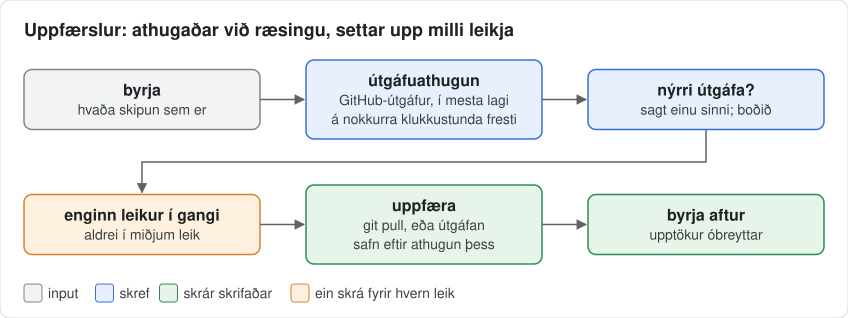

# Uppfærslur {#updates}

Watcher heldur sjálfum sér uppfærðum út frá útgáfum
[Holdi601/3DHeat-Watcher](https://github.com/Holdi601/3DHeat-Watcher/releases). Uppfærslan er
`heat3d_update` pakkinn við hlið `heat3d_watch` í geymslunni.

## Athugunin {#the-check}

- **Hvenær**: hver skipun nema `update` athugar þegar hún ræsist. `run` athugar líka meðan það er í gangi,
  í mesta lagi einu sinni á klukkustund og aðeins meðan enginn leikur er í gangi.
- **Hvernig**: ein HTTPS-beiðni á `https://api.github.com/repos/Holdi601/3DHeat-Watcher/releases/latest`,
  með 5 sekúndna tímamörkum. Svarið er geymt í skyndiminni í sex klukkustundir í
  `%LOCALAPPDATA%\3DHeat\update-check-3DHeat-Watcher.json`, svo flestar ræsingar spyrja ekki um neitt. "Engin útgáfa
  enn" (HTTP 404) er geymd eins og svar. Án nets, með beiðnatakmörkun eða á bak við milliþjón mistekst athugunin
  hljóðlega og skipunin heldur áfram með útgáfuna sem hún hefur.
- **Útgáfur**: uppsetta útgáfan er `VERSION` skráin í möppu geymslunnar.
  Merki útgáfu (`v1.2.0` eða `1.2.0`) er borið saman sem tölur, hluta fyrir hluta; allt
  á eftir `-` eða `+` er hunsað.
- **Slökkt**: `HEAT3D_NO_UPDATE=1` (hvaða gildi sem er nema tómt, `0`, `false` eða `no`) slekkur bæði á
  athuguninni og sjálfvirku uppfærslunni. Hvert 3DHeat-verkfæri geymir sína eigin skyndiminnisskrá, svo svar eins verkfæris kemur aldrei
  í stað svars annars.

## Hvað gerist þegar nýrri útgáfa er komin {#what-happens-when-a-newer-release-is-out}

- **`run`** prentar tilkynningu þegar það ræsist og heldur áfram að keyra:
  `[heat3d_watch] 3DHeat Watcher 1.2.0 is out (this is 1.0.2). <release page>`. Meðan það keyrir, með
  `auto_update` kveikt (sjálfgefið) og engan leik í gangi, uppfærir það sig sjálft: annálslínan
  `3DHeat Watcher 1.2.0 is out (this is 1.0.2); updating`, Windows-tilkynning "Updating to 1.2.0",
  uppfærslan, öll millistykki stöðvuð og lotur þeirra lokaðar, og sama skipun ræst aftur á
  nýja kóðanum. Watcher uppfærir sig aldrei í miðjum leik. Ef ekki er hægt að beita uppfærslunni
  segir tilkynningin það ("1.2.0 is out; not updated: ...") og watcher heldur áfram að
  keyra gömlu útgáfuna. Með `auto_update` slökkt kemur aðeins tilkynningin.
- **Aðrar skipanir** spyrja `Update now? [Y/n]` þegar þær keyra í terminal. Enter, `y`, `yes`, `j` eða
  `ja` uppfærir og keyrir síðan sömu skipun aftur á nýju útgáfunni. Án terminals (tímasett keyrsla, pípa)
  prenta þær hvernig á að uppfæra og halda áfram.
- **Eftir beiðni**: `python -m heat3d_watch update` (eða `python -m heat3d_update`) spyr GitHub án
  skyndiminnis og uppfærir. `--check` segir aðeins hvort nýrri útgáfa er komin. Þetta virkar jafnvel með
  `HEAT3D_NO_UPDATE` stillt.

## Hvernig uppfærslu er beitt {#how-an-update-is-applied}

Það fer eftir því hvernig eintakið var sett upp:

- **Git-klón** (mappan hefur `.git` og `git` er á PATH): `git pull --ff-only`. Þessu er hafnað
  meðan klónið hefur breytingar á skrám sem git fylgist með (`git status --porcelain --untracked-files=no` er ekki
  tómt): þær breytingar eru vinna einhvers, og uppfærsla ákveður ekki hvað verður um þær. Vistaðu þær með commit
  eða stash, og sæktu síðan.
- **Niðurhalað eintak**: frumkóðaskjalasafn útgáfunnar er sótt og afpakkað í tímabundna
  möppu. Færslur sem myndu lenda utan hennar eru sniðgengnar. `VERSION` í skjalasafninu verður að vera útgáfan
  sem útgáfan segist vera, annars er engu afritað. Síðan eru skrár þess afritaðar yfir möppu geymslunnar.
  Skrár sem eru ekki hluti af útgáfu - upptökur, stillingar, sýndarumhverfi, útflutningur, allt sem þú
  bjóst til - eru ekki snertar. Python-eining sem eldri útgáfa hafði og sú nýja sleppti er
  fjarlægð úr eigin pökkum útgáfunnar (`heat3d_watch`, `heat3d_update`), svo engin gömul millistykkiseining
  hlaðist eftir uppfærslu; ekkert utan þessara pakka er fjarlægt.

Upptökur og stillingar eru venjulega hvort eð er utan möppu geymslunnar
(`%LOCALAPPDATA%\3DHeat\Watcher`), svo uppfærsla kemur aldrei nálægt þeim.

Eftir uppfærslu er sama skipun ræst aftur. Á Windows ræsir watcher nýja ferlið,
bíður eftir því og skilar útgöngukóða þess áfram, svo að stjórnborðið hegðar sér eins og fyrsta ferlið hefði
unnið verkið.
