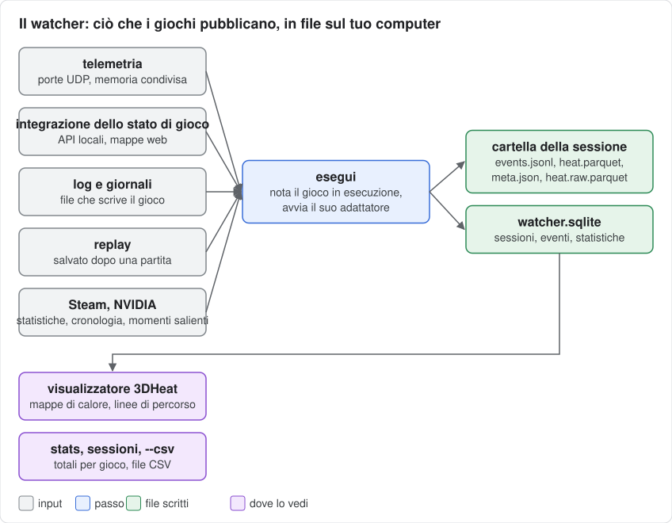
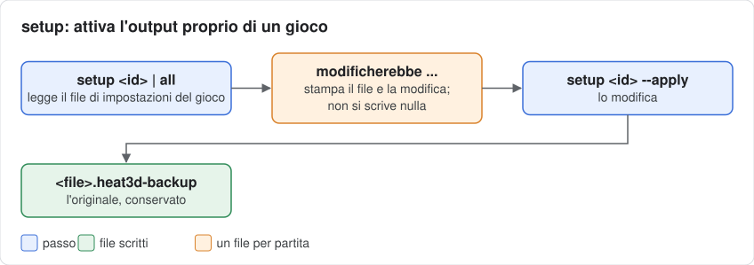
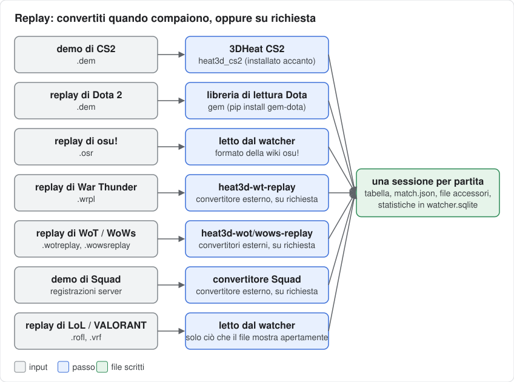
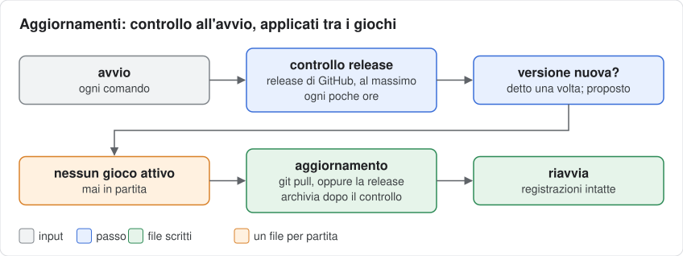

# Comandi {#commands}

Non hai mai usato la riga di comando? Leggi prima [Prima di iniziare](before-you-start.md). Ogni comando si scrive in un terminale aperto nella cartella in cui hai estratto o clonato il programma (in Esplora file, scrivi `powershell` nella barra dell'indirizzo), così:

```bash
python -m heat3d_watch <comando> [opzioni]
```


| Comando | Cosa fa |
|---|---|
| [`run`](#run) | osserva in background e registra ogni gioco che viene avviato |
| [`games`](#games) | cosa fornisce ogni gioco e da dove |
| [`setup`](#setup) | attiva l'output proprio di un gioco |
| [`status`](#status) | quali giochi sono in esecuzione ora, e quali adattatori partirebbero |
| [`sessions`](#sessions) | le registrazioni finora |
| [`stats`](#stats) | totali per gioco, oppure le tabelle in CSV |
| [`table`](#table) | ricostruisce il `heat.parquet` di una sessione dal suo `events.jsonl` |
| [`replays`](#replays) | converte i replay già presenti sul disco |
| [`dota-replay`](#dota-replay) | scarica il replay di una partita pubblica di Dota 2 tramite il suo id |
| [`update`](#update) | aggiorna all'ultima versione |
| [`config`](#config) | mostra o cambia le impostazioni |

Opzioni valide per ogni comando: `-h` / `--help` mostra l'aiuto, e `python -m heat3d_watch --version` mostra la versione (il file `VERSION`).

Le immagini di questa pagina sono esecuzioni su sessioni di esempio sintetiche (`Example Racer`, `Example Arena`), non su registrazioni reali.

Ogni comando tranne `update` cerca prima una versione più recente (al massimo ogni sei ore; la ricerca si salta con `HEAT3D_NO_UPDATE=1`, vedi [Aggiornamenti](updates.md)). `run` si limita a stampare un avviso. Gli altri comandi chiedono `Update now? [Y/n]` quando vengono eseguiti in un terminale, e quando non lo sono stampano come aggiornare. L'output è in UTF-8, quindi i nomi dei giochi in qualsiasi alfabeto si stampano correttamente in ogni console.

## run {#run}

```bash
python -m heat3d_watch run [--once] [-v]
```



Osserva finché non lo fermi (Ctrl+C): ogni `scan_seconds` legge la lista dei processi ed esegue un adattatore per ogni gioco trovato, più gli adattatori sempre attivi. Prima del primo controllo chiude le sessioni che una esecuzione precedente aveva lasciato aperte. Mentre nessun gioco è in esecuzione, può aggiornarsi da solo (con `auto_update` attivo). I dettagli sono in [Installazione e avvio](installing-and-running.md#running).

| Opzione | Effetto |
|---|---|
| `--once` | un solo controllo dei giochi in esecuzione, poi esce. Vengono avviati gli adattatori dei giochi in esecuzione ora (e quelli sempre attivi), ognuno interroga una volta (si attendono al massimo 10 secondi per questo), poi tutti vengono fermati come quando un gioco termina: le loro sessioni vengono chiuse, scritte e conteggiate. Serve a verificare il rilevamento, non a registrare. |
| `-v`, `--verbose` | righe di debug in `watcher.log` e sulla console |

`run` scrive `<data>\watcher.lock` e rifiuta di partire una seconda volta per la stessa cartella dei dati (codice di uscita 1); vedi [Il file di lock](installing-and-running.md#the-lock-file).

## games {#games}

```bash
python -m heat3d_watch games [--markdown]
```


Elenca ogni adattatore raggruppato per gioco: il nome, l'id e il tipo, da dove legge, cosa registra e come attivarlo. Un adattatore che non può girare su questo computer è segnato come `[unavailable: <motivo>]`: SimConnect.dll non trovato, nessuna cartella di Minecraft, 3DHeat CS2 non installato, Steam o l'app NVIDIA non trovati. Un modulo di adattatore che non si è importato è indicato alla fine, con l'errore.

```text
EA SPORTS F1 25  (f1-25, telemetry)
    from: UDP telemetry 127.0.0.1:20777 (Documents\My Games\F1 25\hardwaresettings\hardware_settings_config.xml)
    - every car's position (world XYZ, m) at 10 Hz, by driver name, team, own car marked, ...
    switch on: In the game: Settings > Telemetry Settings > UDP Telemetry On, IP 127.0.0.1, port 20777 - ...
```

`--markdown` stampa lo stesso contenuto come un'unica tabella Markdown (gioco, cosa viene registrato, da dove, come attivarlo, gioco online, verificato). La tabella in [Tutti i giochi in una tabella](watcher.md) è questo output. Le celle sono sottoposte a escape per Markdown: il testo tra backtick resta un blocco di codice, e fuori da essi `<`, `>`, `&`, `*`, `|` e una barra rovesciata prima della punteggiatura vengono scritti in modo che si vedano come digitati (`<CS2>` altrimenti sparirebbe come tag HTML in kramdown). L'unico pezzo di HTML è il `<br>` tra le voci di "Cosa viene registrato".

## setup {#setup}

```bash
python -m heat3d_watch setup <id adattatore | all> [--apply]
```




Attiva l'output proprio di un gioco, quando il gioco richiede di cambiare un file per farlo. Senza `--apply` non si cambia nulla: ogni riga dice cosa cambierebbe, e quando c'è qualcosa da cambiare l'ultima riga dice `Nothing was changed. Run again with --apply to make these changes.` Quando non c'è nulla da cambiare dice `<id>: nothing to change` (`Nothing to change.` per `all`). Con `--apply` le modifiche vengono fatte, e prima della prima modifica a un file il suo originale viene salvato come `<file>.heat3d-backup`. Un backup già esistente non viene mai sovrascritto, quindi contiene sempre il file come era prima che il watcher lo toccasse per la prima volta.

```text
f1-25: would change: hardware_settings_config.xml <udp>: enabled="false" -> "true"
Nothing was changed. Run again with --apply to make these changes.
```

`all` esegue la configurazione di ogni adattatore che ne ha una. Un adattatore senza configurazione, indicato da solo, stampa `<id>: nothing for setup to change; ` seguito da come si attiva il gioco (il suo testo `enable`, oppure che non serve nulla). Un id sconosciuto stampa `no adattatore '<id>'; games lists them` ed esce con codice 2. Gli adattatori che hanno qualcosa da configurare:

| Adattatore | Cosa cambia `--apply` |
|---|---|
| `beamng` | installa la mod di protocollo `heat3d` nella cartella `mods` dell'utente di BeamNG (solo se non c'è); poi attiva in gioco Opzioni > Altro > Protocolli > "others" |
| `cs2-gsi` | scrive `<CS2>\game\csgo\cfg\gamestate_integration_heat3d.cfg`: invia lo stato di gioco a `http://127.0.0.1:3311/` con un token casuale che il watcher poi richiede (un token già presente nel file viene mantenuto); CS2 lo legge all'avvio |
| `dota2-gsi` | lo stesso per Dota 2: `<Dota>\game\dota\cfg\gamestate_integration\gamestate_integration_heat3d.cfg`, porta 3312 |
| `dcs` | aggiunge `Scripts\Hooks\heat3d-watch.lua` a ogni cartella `%USERPROFILE%\Saved Games\DCS*`. La sua copia più vecchia viene aggiornata; un file con quel nome che il watcher non ha scritto viene lasciato stare. Riavvia DCS. |
| `dirt-rally-2` | `hardware_settings_config.xml`: `<udp enabled="true" extradata="3" ip="127.0.0.1" port="20777">`; avvia prima il gioco una volta, così il file esiste |
| `ea-wrc` | `Documents\My Games\WRC\telemetry\config.json`: il pacchetto `session_update` della struttura `wrc` attivato, verso questo computer |
| `f1-23`, `f1-24`, `f1-25` | `hardware_settings_config.xml`: `<udp enabled="true" ip="127.0.0.1" port="20777">`; il gioco deve essere chiuso |
| `hearthstone` | aggiunge una sezione `[Power]` (`LogLevel=1`, `FilePrinting=true`) a `%LOCALAPPDATA%\Blizzard\Hearthstone\log.config`; riavvia il gioco |
| `il2` | `<game>\data\startup.cfg`, `[KEY = telemetrydevice]`: una destinazione in più `addrN = "127.0.0.1:41995"` e `enable = true` (la sezione viene aggiunta, a 10 Hz, se non c'è); riavvia IL-2 |
| `il2-tacview` | `<game>\data\startup.cfg`, `[KEY = track_record]`: `tacviewrecord = 1` |
| `rocketleague-stats` | `TAStatsAPI.ini` (o `DefaultStatsAPI.ini` se il primo non esiste) in `<RL>\TAGame\Config`: `PacketSendRate=30` quando l'API è spenta, e `Port` quando non ne è impostata nessuna; letto all'avvio di Rocket League |

`richard-burns-rally` non ha configurazione: la sua telemetria è del plugin RSF/NGP, che si attiva a mano in `RichardBurnsRally.ini` (vedi [la sua pagina](game-richard-burns-rally.md)); `setup richard-burns-rally` lo dice. Ogni altro gioco o non richiede nulla oppure si attiva nel gioco stesso; la pagina di ogni gioco dice come.

## status {#status}

```bash
python -m heat3d_watch status
```

```text
3DHeat Watcher 1.0.2; data in C:\Users\...\AppData\Local\3DHeat\Watcher
Games running: EA SPORTS F1 25 (f1-25)
Always on: il2-tacview, steam-stats, steam-timeline, nvidia-highlights, cs2-demos, osu-replays, lol-replays, valorant-replays
```

Dice quali adattatori un `run` avvierebbe adesso, secondo le stesse regole: il processo del gioco è in esecuzione, l'adattatore non è in `disabled`, non manca nulla di cui ha bisogno, gli adattatori dei replay solo con `replays` attivo, gli adattatori di memoria solo con `memory` attivo e ogni controllo di memoria superato. Non avvia niente.

## sessions {#sessions}

```bash
python -m heat3d_watch sessions [--game NAME] [--limit N]
```


Le sessioni più recenti da `watcher.sqlite`, una riga ciascuna: inizio (ora locale), gioco, minuti, eventi, posizioni, cartella.

| Opzione | Effetto |
|---|---|
| `--game NAME` | solo questo gioco, con il nome esatto come nella lista (`"EA SPORTS F1 25"`) |
| `--limit N` | al massimo N sessioni (predefinito 40) |

## stats {#stats}

```bash
python -m heat3d_watch stats [--game NAME] [--csv DIR]
```


Senza opzioni: una tabella di tutti i giochi (sessioni, ore, eventi, posizioni, ultima partita), dal più giocato, poi per ogni gioco i suoi 25 eventi più frequenti e ogni statistica numerica con il numero di sessioni che la hanno, il totale, il valore migliore (`best`) e la media. `best` sa in quale direzione è meglio: il valore più basso per i tempi tenuti come migliori (`best_lap`, `best_stage` e ogni altra chiave che inizia con `best_`) e per i piazzamenti (`race_position`, `grid_position`, ogni chiave che finisce con `_position`), il più alto per tutto il resto (uccisioni, distanza, velocità massima, i contatori propri di un gioco).

| Opzione | Effetto |
|---|---|
| `--game NAME` | solo gli eventi e le statistiche di questo gioco, senza la panoramica |
| `--csv DIR` | scrive `sessions.csv`, `events.csv` e `stats.csv` (ogni riga delle tre tabelle) in `DIR`; `--game` non lo restringe |

## table {#table}

```bash
python -m heat3d_watch table <cartella della sessione>
```


Ricostruisce `heat.parquet` in una cartella di sessione dal suo `events.jsonl`, con gli assi del suo `meta.json`. Stampa il percorso della tabella, oppure `no positions in this session`. Usalo per una sessione registrata mentre `pyarrow` mancava, oppure dopo aver modificato a mano `events.jsonl`.

## replays {#replays}

```bash
python -m heat3d_watch replays <id adattatore> [cartella] [-v]
```



Converte i replay già presenti sul disco, ora, uno dopo l'altro, ognuno in una sessione come lo farebbe la sorveglianza del watcher. La prima volta che il watcher vede una cartella di replay si limita a prendere nota di cosa c'è dentro (vedi [Installazione e avvio](installing-and-running.md#replays-already-on-disk)); con questo comando quelli vecchi si convertono su richiesta. Senza `cartella` si leggono le cartelle proprie dell'adattatore (quelle del gioco, più `replay_folders`); con essa, i replay di quella cartella. Ogni replay convertito viene segnato come già visto, così il watcher in esecuzione non lo converte di nuovo. Un replay che non si converte viene registrato nel log e saltato.

| Adattatore | Replay |
|---|---|
| `cs2-demos` | demo di Counter-Strike 2 (`*.dem`), tramite 3DHeat CS2 |
| `lol-replays` | replay di League of Legends (`*.rofl`) |
| `osu-replays` | replay di osu! (`*.osr`) |
| `valorant-replays` | replay di VALORANT (`*.vrf`) |
| `warthunder-replays` | replay di War Thunder (`*.wrpl`), tramite il convertitore esterno `heat3d-wt-replay` (exporters/ext/warthunder-replay) |
| `wot-replays` | replay di World of Tanks (`*.wotreplay`), tramite il convertitore esterno `heat3d-wot-replay` (exporters/ext/wot-replay) |
| `wows-replays` | replay di World of Warships (`*.wowsreplay`), tramite il convertitore esterno `heat3d-wows-replay` (exporters/ext/wows-replay) |
| `dota-replays` | replay di Dota 2 (`*.dem`), tramite gem (`pip install gem-dota`) |

```text
osu-replays: converted 12 replay(s); `sessions --game` lists them
```

Un id che non è uno di questi stampa `no replay adattatore '<id>'` con la lista ed esce con codice 2; lo stesso vale per una `cartella` che non esiste. Un adattatore che qui non può girare (3DHeat CS2 non installato) stampa il motivo ed esce con codice 1. Le tracce Tacview di IL-2 non sono nella lista: quell'adattatore converte da solo ogni traccia finita che trova.

## dota-replay {#dota-replay}

```bash
python -m heat3d_watch dota-replay <id partita> [<id partita> ...] [-o CARTELLA] [--convert] [-v]
```

Scarica il replay di una partita pubblica di Dota 2 dai server di replay di Valve. Serve internet. L'id partita è il numero nella pagina della partita nel client di Dota (i dettagli della partita) o nel sito di OpenDota; Valve conserva un replay per qualche settimana, dopodiché il download fallisce. Il server e il sale del replay vengono dal registro di OpenDota della partita (`api.opendota.com/api/matches/<id>`, senza chiave), il file da `replay<cluster>.valve.net/570/<id>_<salt>.dem.bz2`; viene decompresso mentre arriva (Valve serve sotto quel nome sia bzip2 sia Zstandard) e salvato come `<id partita>.dem`. Senza `-o` va nella cartella dei replay di Dota 2 quando Dota 2 è installato - dove un watcher in esecuzione lo converte - altrimenti in `<data>/replays/dota`. Un file già presente viene mantenuto. `--convert` converte subito i replay scaricati, come farebbe `replays dota-replays`, e li segna come visti.

```text
match 9000000000: C:\Program Files (x86)\Steam\steamapps\common\dota 2 beta\game\dota\replays\9000000000.dem
```

Valve conserva i replay per qualche settimana; una partita più vecchia stampa `Valve no longer has the replay of match <id>` ed esce con codice 1. Una partita che OpenDota non ha ancora visto non ha sale: il messaggio dice di chiederlo a OpenDota (`curl -X POST https://api.opendota.com/api/request/<id>`) e riprovare qualche minuto dopo. Le lobby private e le partite con un profilo nascosto non sono affatto sui server di replay.

## update {#update}

```bash
python -m heat3d_watch update [--check]
```



Chiede a GitHub l'ultima versione, ignorando la risposta in cache, e aggiorna questa copia se è più recente (vedi [Aggiornamenti](updates.md)). `--check` dice soltanto se è uscita una versione più recente. Questo comando funziona anche con `HEAT3D_NO_UPDATE` impostato: chiederlo è già la decisione. `python -m heat3d_update [--check]` fa lo stesso.

## config {#config}

```bash
python -m heat3d_watch config [--set CHIAVE=VALORE ...]
```


Stampa ogni impostazione come `chiave = valore`. Con `--set` cambia prima quelle indicate e salva `settings.json` (`saved <path>`). I valori si leggono in base al tipo dell'impostazione:

- impostazioni vero/falso: `1`, `true`, `yes`, `on` o `ja` è vero; `0`, `false`, `no`, `off`, `nein` o niente è falso;
- numeri: un numero decimale (`scan_seconds=5`);
- liste: separate da virgola oppure una lista JSON (`disabled=steam-stats,steam-timeline`; un valore vuoto svuota la lista);
- dizionari (`replay_folders`, `player_names`): l'intero dizionario come JSON, oppure una voce come `CHIAVE.ID=VALORE` - `replay_folders.cs2-demos=D:\Demos,E:\More Demos` imposta le cartelle di quell'adattatore (separate da virgola), `player_names.warthunder-webmap=Name` il nome di quell'adattatore; un valore vuoto rimuove la voce;
- testo: così come è scritto (`data=D:\Heat`, `riot_id=Name#TAG`).

```bash
python -m heat3d_watch config --set memory=true scan_seconds=5
python -m heat3d_watch config --set riot_id=Name#TAG riot_platform=EUW1
python -m heat3d_watch config --set replay_folders.cs2-demos=D:\Demos player_names.rocketleague-stats=Name
```

Una chiave sconosciuta stampa `no setting '<chiave>'`, e un valore che non è del tipo dell'impostazione (`memory=perhaps`, `scan_seconds=often`, un dizionario che non è JSON) stampa `not saved: ...`; entrambi escono con codice 2 senza salvare nulla. Un `settings.json` modificato a mano viene letto allo stesso modo: un valore scritto come testo dove l'impostazione è un numero, un vero/falso o un dizionario viene letto così come è scritto, e uno che non si può leggere resta al suo valore predefinito. Ogni impostazione è descritta in [Installazione e avvio](installing-and-running.md#settings).
