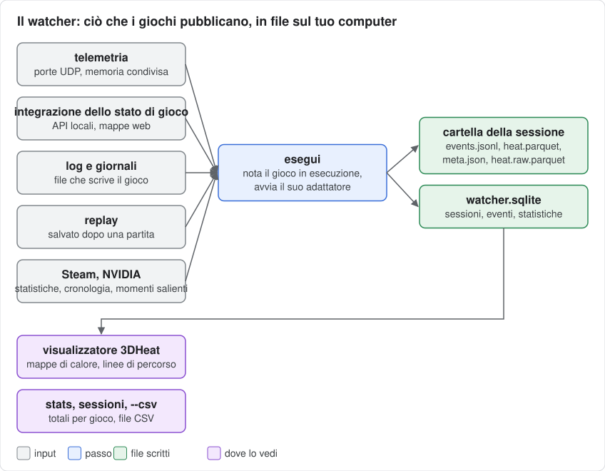

# 3DHeat Watcher {#dheat-watcher}

**Che cos'è?** Tu giochi a un gioco. Questo programma annota in silenzio dove sei andato e cosa è successo.
Più tardi puoi guardarlo come una mappa colorata nel visualizzatore 3DHeat.

**A cosa serve?** Per tenere una tua registrazione di ogni sessione - dove hai guidato, volato o combattuto,
i tuoi totali per gioco - senza alcun sito web e senza modificare il gioco.

**Esempio:** guidi un giro in un gioco di corse con il watcher in esecuzione; dopo, un file in
`sessions\<gioco>\` contiene la linea che hai seguito, e il visualizzatore la disegna.

Più in dettaglio: 3DHeat Watcher è un programma in background che registra ciò che i giochi pubblicano sul
tuo gioco - dove sei andato, cosa è successo dove, e i numeri che ci stanno dietro - in file sul tuo computer.
I file servono alle tue statistiche personali e alle mappe di calore e alle linee di percorso del visualizzatore
3DHeat.

Lavora in silenzio, nota quale gioco hai avviato, e legge gli output propri di quel gioco: una porta di
telemetria o una memoria condivisa che il gioco pubblica per le dashboard, un'integrazione dello stato di gioco,
il giornale o il log che il gioco scrive, il replay che salva dopo una partita, le statistiche che Steam conserva,
le clip che salva NVIDIA App. Le registrazioni restano sul tuo computer. Il programma contatta solo due servizi
esterni, e solo in questi casi: GitHub, per cercare una release più recente (vedi [Aggiornamenti](updates.md)), e
l'API Match-V5 di Riot, e solo se inserisci la tua chiave API Riot (vedi [Replay di League of Legends](game-lol-replays.md)).



## Cosa registra {#what-it-records}

- **Posizioni**: l'auto, l'aereo, l'eroe o il giocatore, più volte al secondo dove il gioco le pubblica, con
  velocità, direzione e tutto ciò che il gioco invia insieme.
- **Eventi**: comparse, morti, uccisioni, giri, tappe, round, gol, incarichi, decolli e atterraggi, cambi di
  zona, obiettivi, momenti salienti. Ogni evento è salvato con il suo tempo, e con il suo punto quando il gioco
  lo fornisce.
- **Statistiche per sessione**: uccisioni, morti, giri, miglior giro, distanza, velocità massima, tempo di
  gioco, e le statistiche proprie del gioco dove le conserva.

Ciò che ogni gioco fornisce, e da dove, è nella sua pagina sotto [Giochi](games.md). Una sola fonte non può
registrare tutto: i giochi multigiocatore vengono registrati solo attraverso ciò che pubblicano, e il watcher
non legge mai la loro memoria (vedi [Fonti e regole](sources-and-rules.md)).

## Installazione {#install}

Non hai mai usato la riga di comando? Leggi prima [Prima di iniziare](before-you-start.md).

Il watcher è un programma Python per Windows (Python 3.10 o successivo). Molte delle sue fonti esistono solo
su Windows: memoria condivisa, registro di sistema, notifiche di Windows.

```bash
git clone https://github.com/Holdi601/3DHeat-Watcher.git
cd 3DHeat-Watcher
pip install -r requirements.txt
```

Un archivio di release scaricato funziona allo stesso modo: decomprimilo, poi esegui `pip install -r requirements.txt`
dentro la cartella. I dettagli, e le estensioni che alcuni giochi richiedono, sono in
[Installazione ed esecuzione](installing-and-running.md).

## Avvio rapido {#quick-start}

```bash
python -m heat3d_watch games            # cosa dà ogni gioco, e da dove
python -m heat3d_watch setup all        # cosa andrebbe attivato (non si cambia nulla)
python -m heat3d_watch setup f1-25 --apply   # attiva l'output di un gioco (il file originale viene copiato in backup)
python -m heat3d_watch run              # osserva; lascialo in esecuzione mentre giochi
python -m heat3d_watch stats            # totali per gioco
python -m heat3d_watch stats --csv out  # sessioni, eventi e statistiche come file CSV
```

Dovresti vedere: dopo `games`, una tabella con una riga per gioco; `run` continua finché non premi Ctrl+C o
chiudi la finestra.

Tutto viene scritto in `%LOCALAPPDATA%\3DHeat\Watcher`. Per usare un'altra cartella, imposta la variabile
d'ambiente `HEAT3D_WATCH_HOME` oppure esegui `python -m heat3d_watch config --set data=D:\somewhere`.

- `sessions\<gioco>\<data>_<adattatore>\` - una cartella per sessione, con `events.jsonl` (ogni evento
  nel momento in cui accade), `heat.parquet` (le righe con una posizione, pronte per il visualizzatore 3DHeat) e
  `meta.json` (gioco, fonte, assi, conteggi, statistiche)
- `watcher.sqlite` - le statistiche di ogni sessione, in tre tabelle semplici
- `watcher.log` - cosa ha fatto il watcher

Il visualizzatore apre direttamente il `heat.parquet` di una sessione, senza impostazioni (i suoi assi e le sue
unità sono nel file). I replay convertiti sono scritti come tabelle e documenti di partita accanto ad esso; il
formato del visualizzatore con un file per partita è descritto nella sua pagina
[contenitore `.3dheat`](https://holdi601.github.io/3DHeat/container.html), e le colonne di ogni tabella in
[I dati](the-data.md).

## La documentazione {#the-documentation}

| Pagina | Cosa contiene |
|---|---|
| [Prima di iniziare](before-you-start.md) | Python, un terminale, i segnaposto, come sono il successo e gli errori comuni |
| [Installazione ed esecuzione](installing-and-running.md) | requisiti, esecuzione in background, avvio con Windows, il file di blocco, il log, ogni impostazione e variabile d'ambiente |
| [Giochi](games.md) | una pagina per gioco: cosa viene registrato, da dove, come attivarlo, come funziona, assi, statistiche, cosa è stato verificato |
| [I dati](the-data.md) | cartelle di sessione, `events.jsonl`, `heat.parquet` e il suo footer, `meta.json`, `watcher.sqlite`, recupero dopo un arresto anomalo, esportazione CSV, apertura di una sessione nel visualizzatore 3DHeat |
| [Comandi](commands.md) | ogni comando e opzione di `python -m heat3d_watch` |
| [Fonti e regole](sources-and-rules.md) | i sei tipi di fonte, le regole per il multigiocatore, quali giochi sono esclusi e perché |
| [NVIDIA Highlights](nvidia-highlights.md) | cosa NVIDIA Highlights può e non può fornire, e come un momento saliente ottiene una posizione |
| [Mod per server registratori](server-mods.md) | le mod per server di Arma 3 e Arma Reforger che registrano intere missioni per il visualizzatore |
| [Lettura della memoria](memory-reading.md) | profili di memoria per giocatore singolo: il formato, i controlli, come scriverne e verificarne uno |
| [Aggiornamenti](updates.md) | come il watcher cerca nuove release e si aggiorna da solo |
| [Sviluppo](development.md) | come scrivere un adattatore: l'API, i test, un `verified` onesto, la rigenerazione delle pagine dei giochi |
| [Tutti i giochi in una tabella](watcher.md) | ogni gioco in una tabella, come la stampa `games --markdown`, più i giochi studiati ma non ancora realizzati |
| [Riferimento dei comandi](../cli-reference.md) | il `--help` di ogni comando, generato dal codice |
| [Manutenzione](maintaining.md) | la lista di controllo del rilascio per queste pagine |

## Parte di 3DHeat {#part-of-3dheat}

3DHeat Watcher è uno degli strumenti gratuiti intorno al visualizzatore 3DHeat (il watcher usa 3DHeat CS2
per convertire le demo di CS2). Ciascuno è un progetto a sé, con le proprie release e la propria licenza:

| Strumento | Cosa fa | Documentazione |
|---|---|---|
| [3DHeat](https://github.com/Holdi601/3DHeat) | il visualizzatore: mappe di calore, analisi di gara e revisione delle partite in 3D | [sito](https://holdi601.github.io/3DHeat/) |
| [GameFiles](https://github.com/Holdi601/3DHeat-GameFiles) | percorsi e livelli dai file che i giochi distribuiscono, come modelli 3D | [sito](https://holdi601.github.io/3DHeat-GameFiles/) |
| [GameCapture](https://github.com/Holdi601/3DHeat-GameCapture) | telemetria dei giri dai giochi di corsa; livelli ricostruiti dal video di gioco | [sito](https://holdi601.github.io/3DHeat-GameCapture/) |
| [Unreal Exporter](https://github.com/Holdi601/3DHeat-UnrealExporter) | un plugin dell'editor Unreal che esporta un livello come un unico modello 3D | [sito](https://holdi601.github.io/3DHeat-UnrealExporter/) |
| [CS2](https://github.com/Holdi601/3DHeat-CS2) | demo di Counter-Strike 2 in tabelle e documenti di partita; mappe in modelli 3D | [sito](https://holdi601.github.io/3DHeat-CS2/) |
| [Watcher](https://github.com/Holdi601/3DHeat-Watcher) | registra ciò che i giochi pubblicano sul tuo gioco, in background | [sito](https://holdi601.github.io/3DHeat-Watcher/) |
| [Ext-WarThunder](https://github.com/Holdi601/3DHeat-Ext-WarThunder) | replay di War Thunder in tabelle e documenti di partita | [sito](https://holdi601.github.io/3DHeat-Ext-WarThunder/) |
| [Ext-WoT](https://github.com/Holdi601/3DHeat-Ext-WoT) | replay di World of Tanks in tabelle e documenti di partita | [sito](https://holdi601.github.io/3DHeat-Ext-WoT/) |
| [Ext-WoWs](https://github.com/Holdi601/3DHeat-Ext-WoWs) | replay di World of Warships in tabelle e documenti di partita | [sito](https://holdi601.github.io/3DHeat-Ext-WoWs/) |
| [Ext-Squad](https://github.com/Holdi601/3DHeat-Ext-Squad) | demo dei server di Squad in tabelle e documenti di partita | [sito](https://holdi601.github.io/3DHeat-Ext-Squad/) |
| [Ext-DCS](https://github.com/Holdi601/3DHeat-Ext-DCS) | mappe di DCS World in modelli 3D | [sito](https://holdi601.github.io/3DHeat-Ext-DCS/) |
| [Ext-IL2](https://github.com/Holdi601/3DHeat-Ext-IL2) | mappe di IL-2 Sturmovik in modelli 3D | [sito](https://holdi601.github.io/3DHeat-Ext-IL2/) |

Licenza: MIT ([LICENSE](https://github.com/Holdi601/3DHeat-Watcher/blob/main/LICENSE)). Le licenze dei
pacchetti di terze parti che usa, e ciò che richiedono i giochi che legge, sono elencate in
[LICENSES.md](https://github.com/Holdi601/3DHeat-Watcher/blob/main/LICENSES.md).
