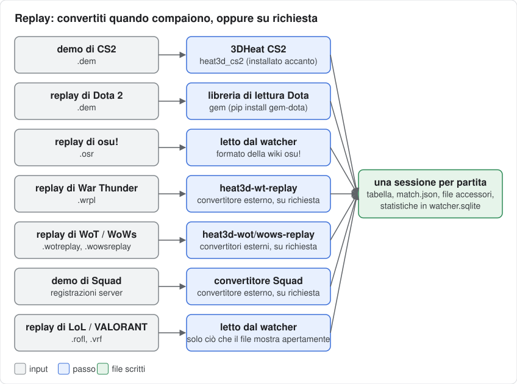

# Installazione e avvio {#installing-and-running}

## Requisiti {#requirements}

- **Windows.** Il watcher è scritto per Windows, e la maggior parte delle sue fonti esiste solo lì: la memoria condivisa che i giochi creano (mappature `Local\...`), il registro (dove si trova Steam), le notifiche di Windows, la lista dei processi con i percorsi degli eseguibili. Su un altro sistema il programma si avvia, ma quelle fonti non trovano nulla, le notifiche vengono solo registrate nel log, e la lettura della memoria si rifiuta ("only implemented on Windows").
- **Python 3.10 o successivo**, da <https://www.python.org/downloads/>: nel programma di installazione spunta **Add python.exe to PATH**, poi verifica con `python --version` in un nuovo terminale. Non hai mai usato questi strumenti? Leggi prima [Prima di iniziare](before-you-start.md).
- **Pacchetti** (`requirements.txt`): `psutil>=6.0` (quali giochi sono in esecuzione, quale programma tiene una porta, le connessioni di un gioco; una psutil più vecchia funziona ancora, tramite il suo nome precedente per le connessioni di un processo), `pyarrow>=15` (scrittura di `heat.parquet`), `numpy>=1.24`, e `pytest>=8.0` per i test. `requirements-optional.txt` al momento non elenca pacchetti.

Senza `pyarrow` le sessioni vengono comunque registrate: `events.jsonl` è la registrazione, e la tabella si può costruire in seguito con [`table`](commands.md#table).

### Extra che alcuni giochi richiedono {#extras-some-games-need}

| Gioco | Cosa serve |
|---|---|
| Demo di Counter-Strike 2 | [3DHeat CS2](https://github.com/Holdi601/3DHeat-CS2) e i suoi requisiti (`demoparser2`). Il watcher lo cerca in `HEAT3D_CS2`, poi in una cartella `3DHeat-CS2` o `cs2` accanto alla cartella del watcher, poi ovunque Python possa importare `heat3d_cs2`. Senza di esso, `games` elenca l'adattatore come non disponibile. |
| Microsoft Flight Simulator 2020 / 2024 | `SimConnect.dll` - non incluso. MSFS 2020 ce l'ha nella sua cartella di installazione; per MSFS 2024, installa l'SDK di MSFS 2024. `MSFS_SDK` / `MSFS2024_SDK` indicano la cartella dell'SDK. |
| Euro Truck Simulator 2, American Truck Simulator | il plugin RenCloud `scs-telemetry.dll` (revisione 12) in `<gioco>\bin\win_x64\plugins` |
| BeamNG.drive | la mod di protocollo `heat3d`, installata con `python -m heat3d_watch setup beamng --apply` |
| League of Legends (in diretta) | facoltativo: il certificato radice di Riot come `<data>\riotgames.pem`, così la connessione locale viene verificata |
| Minecraft | una cartella `%APPDATA%\.minecraft` (edizione Java) |

La pagina di ogni gioco sotto [Giochi](games.md) dice cosa va attivato nel gioco stesso. `python -m heat3d_watch games` segna un adattatore con `[unavailable: ...]` quando manca qualcosa di cui ha bisogno su questo computer.

## Installazione {#installing}

Non sai come si usa la riga di comando? Leggi prima [Prima di iniziare](before-you-start.md). Se `pip` non viene trovato, usa invece `python -m pip install -r requirements.txt`.

Da un clone:

```bash
git clone https://github.com/Holdi601/3DHeat-Watcher.git
cd 3DHeat-Watcher
pip install -r requirements.txt
```

Da una versione rilasciata: scarica l'archivio dalle release del repository, estrailo, poi esegui `pip install -r requirements.txt` dentro la cartella. Entrambi i tipi di copia si aggiornano da soli (vedi [Aggiornamenti](updates.md)).

Esegui ogni comando dalla cartella del repository: `python -m heat3d_watch` importa il pacchetto da lì, e l'aggiornatore (`heat3d_update`) sta accanto a esso.

## Avvio {#running}

```bash
python -m heat3d_watch run        # watch until stopped
python -m heat3d_watch run -v     # the same, with debug lines in the log
python -m heat3d_watch run --once # one look at the games running now, then stop and exit
```

All'avvio, `run`:

1. scrive il [file di lock](#the-lock-file);
2. chiude le sessioni che una esecuzione precedente aveva lasciato aperte, per esempio dopo un crash (vedi [Recupero](the-data.md#recovery-after-a-crash));
3. ogni `scan_seconds` (2 s) legge la lista dei processi (solo nomi e percorsi, nessun processo viene aperto) e avvia un adattatore, in un thread proprio, per ogni gioco trovato. Quando il processo di un gioco scompare, il suo adattatore viene fermato e le sessioni che aveva aperte vengono chiuse, il che scrive la loro tabella e la loro riga nelle statistiche. Gli adattatori che non aspettano un gioco (statistiche di Steam, Timeline di Steam, highlight NVIDIA, le cartelle dei replay) girano sempre;
4. mentre nessun gioco è in esecuzione, cerca una versione più recente al massimo una volta all'ora (la risposta stessa è in cache per sei ore) e, con `auto_update` attivo, la installa e riparte da solo (vedi [Aggiornamenti](updates.md)).

Un adattatore che fallisce viene registrato nel log e non ferma gli altri. Se l'interrogazione di un adattatore fallisce 20 volte di seguito, oppure il suo avvio fallisce, l'adattatore viene fermato e non riavviato finché il gioco non viene avviato di nuovo (un nuovo id di processo).

Ferma il watcher con Ctrl+C. Gli adattatori chiudono le loro sessioni prima di uscire. Se il watcher viene terminato invece (Gestione attività, un crash, un'interruzione di corrente), nulla di ciò che era già scritto va perso: il `run` successivo termina quelle sessioni.

`--once` fa un solo controllo: avvia gli adattatori dei giochi in esecuzione in quel momento (e quelli sempre attivi), lascia che ognuno interroghi una volta - attendendo al massimo 10 secondi per questo - e poi li ferma come succederebbe alla chiusura di un gioco, così le sessioni che hanno aperto vengono chiuse, le loro tabelle scritte e le loro righe conteggiate nelle statistiche prima di uscire. Usalo per verificare che un gioco venga rilevato, non per registrare.

### Replay già presenti sul disco {#replays-already-on-disk}



La prima volta che un adattatore di replay vede una delle sue cartelle, si limita a notare i replay già presenti: un giocatore con anni di demo altrimenti troverebbe il watcher occupato a convertire per un giorno intero. Da quel momento ogni nuovo replay viene convertito una volta che il gioco ha finito di scriverlo. Quelli vecchi si convertono su richiesta con [`replays`](commands.md#replays):

```bash
python -m heat3d_watch replays cs2-demos              # every demo in CS2's folders and replay_folders
python -m heat3d_watch replays osu-replays D:\Old     # the replays in one folder
```

### Esecuzione in background {#running-in-the-background}

Il watcher non ha una finestra propria; è un programma da console che gira finché non lo fermi. Scrive tutto in `watcher.log`, quindi non ha bisogno di una console visibile. Modi per tenerlo fuori dai piedi:

- avvialo in una console e riduci a icona la console: `start "" /min python -m heat3d_watch run` da `cmd`, nella cartella del repository;
- avvialo senza console: `pythonw -m heat3d_watch run`. L'output della console va perso, ma `watcher.log` viene comunque scritto. Per fermarlo, termina il processo `pythonw.exe`; il successivo avvio chiude le sessioni che ha lasciato aperte. Il progetto non ha testato questo modo di eseguirlo.

### Avvio con Windows (un'idea) {#starting-with-windows-an-idea}

Il watcher non si installa da solo per partire con Windows. Per avviarlo automaticamente:

- **Utilità di pianificazione**: crea un'attività con il trigger *All'accesso* e l'azione *Avvia un programma*, programma `pythonw.exe` (oppure `python.exe`), argomenti `-m heat3d_watch run`, *Avvia in* impostato sulla cartella del repository;
- **Cartella Esecuzione automatica**: metti un collegamento in `shell:startup` con lo stesso programma, gli stessi argomenti e la stessa cartella *Avvia in*.

Nessuno dei due fa parte del watcher, né viene testato da esso. Il [file di lock](#the-lock-file) fa sì che una seconda copia avviata per errore esca subito.

## Il file di lock {#the-lock-file}

`<data>\watcher.lock` contiene l'id del processo del watcher in esecuzione. Quando `run` parte e il file di lock indica un processo che esiste ancora e il cui nome contiene `python`, stampa

```text
A watcher is already running (process 12345) for C:\Users\...\3DHeat\Watcher.
```

ed esce con codice 1. Due watcher sulla stessa cartella dei dati registrerebbero ogni gioco due volte, e il secondo tratterebbe le sessioni aperte del primo come residui di un crash. Un file di lock il cui processo non c'è più, o appartiene a un altro programma, viene sovrascritto. Quando `run` termina, rimuove il file di lock se il file indica ancora il suo stesso processo.

## Il log {#the-log}

`<data>\watcher.log` viene scritto solo da `run`; gli altri comandi stampano sulla console. Ogni riga ha l'ora, il livello e un messaggio:

```text
2026-05-01 20:15:01,123 INFO watching; data in C:\Users\...\AppData\Local\3DHeat\Watcher
2026-05-01 20:15:03,456 INFO f1-25: starting (EA SPORTS F1 25)
2026-05-01 21:02:11,789 INFO f1-25: stopping
```

Gli adattatori registrano ciò che non possono fare e perché: "UDP 20777 is in use by ...; not taking it from that program", "not reading memory: the game is played online", "could not start", "poll failed (3)" con il traceback. `run -v` aggiunge righe di debug. Il file viene solo aggiunto in coda e non viene mai ruotato né svuotato dal watcher; eliminalo quando vuoi. Le stesse righe vanno anche sulla console.

## Dove si trova tutto {#where-everything-is}

La cartella principale è `%LOCALAPPDATA%\3DHeat\Watcher`, oppure `HEAT3D_WATCH_HOME` quando è impostato (senza `LOCALAPPDATA`, per esempio su un altro sistema, `~/.local/share/3DHeat/Watcher`). `settings.json` si trova sempre nella cartella principale. Tutto il resto va nella cartella dei dati, che è la cartella principale salvo che l'impostazione `data` ne indichi un'altra:

| Percorso | Cos'è |
|---|---|
| `<home>\settings.json` | le impostazioni |
| `<data>\sessions\` | le registrazioni, una cartella per seduta ([I dati](the-data.md)) |
| `<data>\watcher.sqlite` | il database delle statistiche |
| `<data>\watcher.log` | il log di `run` |
| `<data>\watcher.lock` | il file di lock, mentre `run` è in esecuzione |
| `<data>\state\` | ciò che gli adattatori sempre attivi e dei replay hanno già visto (`steam-stats.json`, `replays-cs2-demos.json`, ...), così un riavvio non registra nulla due volte |
| `<data>\profiles\*.json` | i profili di memoria che hai scritto ([Lettura della memoria](memory-reading.md)) |
| `<data>\riotgames.pem` | facoltativo, il certificato radice di Riot per l'adattatore in diretta di League of Legends |
| `%LOCALAPPDATA%\3DHeat\update-check-3DHeat-Watcher.json` | la risposta in cache dell'ultimo controllo delle versioni |

Il watcher non elimina nulla in queste cartelle, tranne una cartella di sessione in cui non è stato registrato niente (un gioco fermo nei menu).

## Impostazioni {#settings}


`python -m heat3d_watch config` mostra le impostazioni; `config --set chiave=valore ...` le cambia e salva `settings.json` (vedi [config](commands.md#config)). Il file è JSON semplice e può essere modificato anche a mano mentre il watcher non è in esecuzione. Le chiavi sconosciute al suo interno vengono ignorate. Le impostazioni vengono lette all'avvio di un comando, quindi riavvia `run` dopo averle cambiate.

| Impostazione | Predefinito | Cosa fa |
|---|---|---|
| `data` | `""` | La cartella dei dati. Vuoto: la cartella principale. |
| `disabled` | `[]` | Id degli adattatori che non partono mai, per esempio `config --set disabled=steam-stats,nvidia-highlights`. Ogni altro adattatore parte quando trova il suo gioco. |
| `auto_update` | `true` | Mentre nessun gioco è in esecuzione, installa una versione più recente e riavvia (vedi [Aggiornamenti](updates.md)). `false`: solo un avviso nel log. |
| `scan_seconds` | `2.0` | Secondi tra un controllo della lista dei processi e il successivo. |
| `memory` | `false` | Permette agli adattatori di memoria (giochi per giocatore singolo con un profilo che hai scritto) di girare. Disattivato di default; vedi [Lettura della memoria](memory-reading.md). |
| `replays` | `true` | Esegue gli adattatori `replay`: tutti (vedi `python -m heat3d_watch replays` e [Giochi](games.md)) - demo di CS2, Dota 2, osu!, War Thunder, World of Tanks, World of Warships, Squad, i replay di League of Legends e di VALORANT, le registrazioni Tacview di IL-2. |
| `replay_folders` | `{}` | Cartelle in più per id di adattatore, per esempio `{"cs2-demos": ["D:\\Demos"]}`. Gli adattatori di replay le sorvegliano in aggiunta alle cartelle del gioco; `il2-tacview` accetta anche le cartelle di installazione (cerca poi in `data\Tracks`); per `elite`, la prima cartella sostituisce quella del giornale. Imposta le cartelle di un adattatore con `config --set replay_folders.cs2-demos=D:\Demos,E:\More`, oppure l'intero dizionario come JSON. |
| `riot_id` | `""` | Il tuo Riot ID (`Nome#TAG`), così la tua riga nel replay di League of Legends diventa le tue statistiche. Vuoto: ogni riga di giocatore viene mantenuta, nessuna è segnata come tua. |
| `riot_api_key` | `""` | La tua chiave API per sviluppatori di Riot, per scaricare la timeline ufficiale di ogni partita replicata di League (posizioni ogni minuto, uccisioni dove sono avvenute). Vuoto: non si scarica nulla. |
| `riot_platform` | `"EUW1"` | L'id di piattaforma del tuo server di League (`EUW1`, `EUN1`, `NA1`, `KR`, ...), usato per trovare l'host regionale Match-V5. |
| `player_names` | `{}` | Il tuo nome nei giochi la cui interfaccia nomina ogni giocatore ma non dice quale sei tu, per id di adattatore: `warthunder-webmap` (le righe del flusso di uccisioni su di te diventano le tue uccisioni e morti) e `rocketleague-stats` (le tue righe diventano `me`; senza di esso, il giocatore seguito dalla telecamera del gioco). Si imposta con `config --set player_names.warthunder-webmap=Name`. |

Un `settings.json` con tutti i valori predefiniti:

```json
{
  "data": "",
  "disabled": [],
  "auto_update": true,
  "scan_seconds": 2.0,
  "memory": false,
  "replays": true,
  "replay_folders": {},
  "riot_id": "",
  "riot_api_key": "",
  "riot_platform": "EUW1",
  "player_names": {}
}
```

## Variabili d'ambiente {#environment-variables}

| Variabile | Effetto |
|---|---|
| `HEAT3D_WATCH_HOME` | la cartella principale (impostazioni, e i dati salvo che `data` dica altrimenti) |
| `HEAT3D_NO_UPDATE` | qualsiasi valore diverso da vuoto, `0`, `false` o `no` disattiva il controllo delle versioni e l'aggiornamento automatico |
| `HEAT3D_NO_TOAST` | qualsiasi valore non vuoto: nessuna notifica di Windows, solo righe di log |
| `HEAT3D_CS2` | la cartella di 3DHeat CS2, per le demo di CS2 |
| `HEAT3D_CS2_GSI_PORT` | la porta dello stato di gioco di CS2 (predefinita 3311); il file cfg che scrive `setup` la usa |
| `HEAT3D_DOTA_GSI_PORT` | la porta dello stato di gioco di Dota 2 (predefinita 3312) |
| `MSFS_SDK`, `MSFS2024_SDK` | le cartelle degli SDK di MSFS, dove si cerca `SimConnect SDK\lib\SimConnect.dll` |

Le notifiche di Windows vengono usate solo per gli aggiornamenti: "Updating to 1.2.0", oppure "1.2.0 is out; not updated: ..." quando l'aggiornamento non è stato possibile. Passano per l'API di notifica di PowerShell, quindi non c'è nulla da installare. Titolo e testo vengono passati a PowerShell come variabili d'ambiente, mai come parte dello script.
