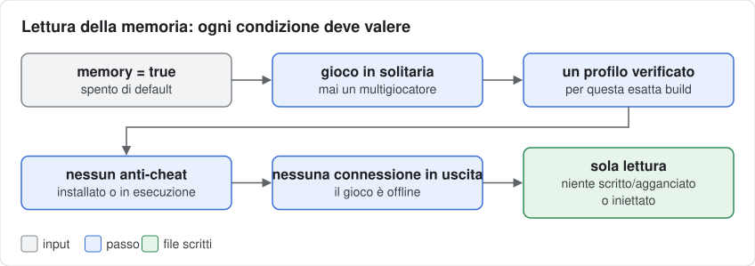

# Lettura della memoria {#reading-memory}

Alcuni giochi per giocatore singolo non dicono nulla agli altri programmi. Per quelli, il watcher può - se lo attivi e scrivi tu un profilo - cercare dove ti trovi nella memoria del gioco, in sola lettura.

Per i giochi per giocatore singolo che non pubblicano nulla, il watcher può leggere posizioni e valori dalla memoria del gioco, tramite un **profilo** che scrivi tu per la tua versione del gioco. Tra tutte le fonti, questa è l'unica che il gioco non ha consegnato da sé, quindi è recintata più delle altre:

- è **disattivata di default** (`python -m heat3d_watch config --set memory=true` la attiva);
- legge, e non ha modo di scrivere;
- **nessun profilo viene distribuito con gli strumenti.**

I profili non vengono distribuiti perché un offset è giusto solo per la build su cui è stato trovato. Dopo una patch, un profilo che era giusto prima legge spazzatura, e la spazzatura sembra proprio numeri. Un profilo va verificato sulla build che il giocatore ha, dal giocatore stesso.

## I controlli, in ordine {#the-checks-in-order}



Ogni controllo qui sotto deve passare. I primi quattro vengono fatti **prima** che il gioco venga aperto, perché aprire un gioco protetto per leggerlo è proprio ciò che un anti-cheat nota, e rifiutare dopo sarebbe troppo tardi.

1. **L'impostazione**: `memory` è vero. Altrimenti gli adattatori di memoria non partono mai.
2. **Un profilo per il gioco**, il cui `exe` indica il processo in esecuzione. Un profilo dichiara se il gioco si può giocare online affatto (`"online"`); uno che non lo indica viene rifiutato.
3. **Nessun anti-cheat nelle vicinanze**:
   - nessun file anti-cheat nella cartella del gioco o fino a tre cartelle sopra di essa (fermandosi alla cartella `common` di una libreria di Steam, oppure a una cartella con `steamapps` dentro, perché sopra ci sono altri giochi): `EasyAntiCheat`, `EasyAntiCheat_EOS_Setup.exe`, `start_protected_game.exe`, `BattlEye`, `BEClient_x64.dll`, `BEService_x64.exe`, `EAAntiCheat.GameServiceLauncher.exe`, `AntiCheatExpert`, `SGuard64.exe`, `GameGuard`, `GameMon.des`, `XIGNCODE`, `xhunter1.sys`, `Vanguard`, `FACEIT` (confrontati in minuscolo, anche come inizio di un nome). Se la cartella del gioco non è nota, il gioco viene rifiutato;
   - nessun driver o servizio anti-cheat in esecuzione sulla macchina, come elencato da `sc query type= driver state= active` e `sc query type= service state= active`: EasyAntiCheat, EasyAntiCheat_EOS, BEService, BEDaisy, vgk, vgc, ACE-BASE, ACE-GAME, xhunter1, FACEIT, FACEITService, EAAntiCheatService, Denuvo Anti-Cheat, npggsvc, Ricochet. Un anti-cheat a livello di kernel installato per un altro gioco controlla comunque ogni processo. Se i servizi non si possono elencare, il gioco viene rifiutato.
4. **Non online**: un gioco il cui profilo dice `"online": true` viene letto solo mentre non ha connessioni verso nulla che non sia questa macchina (qualunque indirizzo remoto diverso da `127.x`, `::1`). Se le sue connessioni non si possono leggere, viene rifiutato.
5. Poi, mentre l'adattatore parte:
   - **la build esatta**: la dimensione del file dell'eseguibile, oppure il suo SHA-256, deve corrispondere a una versione che il profilo elenca. Una build sconosciuta non viene letta;
   - **i moduli ancora una volta**: i moduli caricati dal gioco vengono elencati (un'istantanea Toolhelp, che non chiede diritti di accesso propri) e controllati per un client anti-cheat (`BEClient_x64.dll`, `BEClient.dll`, `EasyAntiCheat_x64.dll`, `EasyAntiCheat.dll`, `EOSAntiCheat...`). Un processo protetto rifiuta l'istantanea, il che è anch'esso un rifiuto;
   - solo allora il processo viene aperto, con `PROCESS_VM_READ | PROCESS_QUERY_LIMITED_INFORMATION` e nient'altro.

I controlli da 1 a 4 vengono ripetuti a ogni scansione (ogni 2 s) mentre il gioco è in esecuzione. Se uno comincia a fallire (il gioco si connette a un server, parte un servizio anti-cheat), l'adattatore viene fermato alla scansione successiva. Un rifiuto viene registrato: `mem-<id>: not reading memory: <reason>`. Un errore all'avvio (build sconosciuta, un modulo anti-cheat, un pattern non trovato) viene registrato come `mem-<id>: could not start`, e l'adattatore non viene riprovato finché il gioco non viene avviato di nuovo.

Non c'è scrittura, nessuna allocazione nell'altro processo, nessun thread avviato al suo interno, nessuna libreria caricata dentro di esso, nessun privilegio di debug e nessuna elevazione. Un test (`test_memory_reading_cannot_write` in `tests/test_core.py`) fallisce se nel pacchetto compare una qualsiasi chiamata che scrive in un altro processo, alloca in esso o vi esegue codice - `WriteProcessMemory`, `VirtualAllocEx`, `CreateRemoteThread`, `PROCESS_VM_WRITE`, `SeDebugPrivilege`, `LoadLibrary`, ...

Mai letti, qualunque cosa dica un profilo: i giochi giocati online, e i giochi la cui modalità per giocatore singolo gira sotto un anti-cheat, come GTA V, o Elden Ring avviato dal suo launcher. I controlli sopra li rifiutano comunque.

## Il formato del profilo {#the-profile-format}

Un profilo è un file JSON in `<data>\profiles\` (`<data>` è la cartella dei dati, vedi [Installazione e avvio](installing-and-running.md#where-everything-is)), uno per gioco, con un nome di file qualsiasi che termini con `.json`. Un esempio sintetico:

```json
{
  "schema": "heat3d.memprofile/1",
  "id": "mygame",
  "game": "My Game",
  "exe": "MyGame.exe",
  "online": false,
  "versions": [ { "label": "1.06", "size": 123456789 } ],
  "anchors": {
    "World": { "aob": "48 8B 05 ?? ?? ?? ?? 48 85 C0", "rip": [3, 7] }
  },
  "values": {
    "pos": { "type": "vec3f", "base": "World", "chain": ["0x10", "0x68", "0x70"] },
    "hp":  { "type": "i32",   "base": "World", "chain": ["0x10", "0x138"] },
    "map": { "type": "u32",   "base": "World", "chain": ["0x10", "0x1C0"] }
  },
  "events": [
    { "event": "death", "value": "hp",  "when": "to_zero" },
    { "event": "zone",  "value": "map", "when": "change" }
  ],
  "axes": { "up": "y", "units": "metres" },
  "rate": 10,
  "provenance": [ { "source": "https://example.com/my-notes", "verified_on": "1.06" } ]
}
```

| Chiave | Obbligatoria | Cos'è |
|---|---|---|
| `schema` | sì | esattamente `heat3d.memprofile/1` |
| `id` | sì | breve e stabile; l'adattatore si chiama `mem-<id>` |
| `game` | sì | il nome del gioco, da cui prende il nome la cartella di sessione |
| `exe` | sì | il nome file dell'eseguibile, che indica anche che il gioco è in esecuzione |
| `online` | sì | `true` se il gioco si può giocare online affatto; viene letto allora solo mentre è offline |
| `versions` | sì | le build su cui il profilo è stato verificato: ognuna con una `label`, e una `size` (la dimensione dell'eseguibile in byte) e/o uno `sha256`. Quando sono indicati entrambi, devono corrispondere entrambi. Una voce con nessuno dei due non corrisponde a nulla. |
| `anchors` | sì | indirizzi con nome nel modulo principale. `aob`: un pattern di byte, byte esadecimali separati da spazi, `?` o `??` per qualsiasi byte; deve comparire **esattamente una volta** nell'immagine del modulo (più corrispondenze contano come un errore, come nessuna). `rip: [d, n]`: il pattern punta a un'istruzione con uno spostamento RIP-relativo a 32 bit al byte `d` e di lunghezza `n`; l'ancora diventa l'indirizzo a cui quell'istruzione si riferisce. `offset`: aggiunto dopo (testo esadecimale o decimale). Al posto di `aob`, `module_offset` dà un offset fisso dalla base del modulo. |
| `values` | sì | ciò che viene letto a ogni interrogazione: `type` (`i32`, `u32`, `i64`, `u64`, `u8`, `f32`, `f64`, `vec3f`, `vec3d`), `base` (il nome di un'ancora), `chain` (offset come testo esadecimale o decimale) |
| `events` | no | regole che trasformano i cambiamenti in eventi: `when` `change` (il valore è diverso dall'ultima interrogazione) oppure `to_zero` (un numero scende da sopra 0 a 0 o sotto) |
| `axes` | no | `up` (predefinito `y`), `units` (predefinito `game units`), `scale` (la scala di unità del visualizzatore, che moltiplica ogni posizione; predefinito 1, le unità del gioco) |
| `rate` | no | interrogazioni al secondo, da 1 a 60 (predefinito 10) |
| `provenance` | no | da dove vengono gli offset e su quale build li hai verificati; viene copiato nel `meta.json` di ogni sessione |

**Come si legge un valore.** L'indirizzo dell'ancora è il punto di partenza. Se `chain` è vuoto, il valore si legge lì. Altrimenti si legge prima il puntatore memorizzato all'ancora. Poi, per ogni offset tranne l'ultimo, si legge il puntatore a `indirizzo + offset`. L'ultimo offset si aggiunge per ottenere l'indirizzo del valore. Un puntatore nullo lungo la strada (il gioco è tra due livelli o in un menu) lascia il valore vuoto per quella interrogazione.

**Cosa viene registrato.** Un valore chiamato `pos` (un `vec3f` o `vec3d`) diventa una riga `position` del giocatore `me` a ogni interrogazione. Ogni regola di evento scrive la sua riga `event`, con il nuovo valore e, quando `pos` è noto, la posizione, e aggiunge 1 a una statistica con lo stesso nome. L'immagine del modulo viene letta una volta all'avvio per trovare le ancore, a blocchi di 64 KiB; i blocchi che non si possono leggere contano come zeri. Il `meta.json` della sessione indica il profilo, l'etichetta della build e la provenienza.

Un profilo che non si può usare (JSON errato, `schema` sbagliato, una chiave obbligatoria mancante) viene saltato e registrato come `profile <file> not used: <reason>`. I profili vengono caricati all'avvio del watcher, quindi riavvia `run` dopo averne aggiunto o cambiato uno.

## Scrivere e verificare un profilo {#writing-and-verifying-a-profile}

1. **Solo per un gioco per giocatore singolo senza anti-cheat.** Se il gioco ha un anti-cheat, o lo giochi online, fermati qui: il watcher lo rifiuterà, e fa bene.
2. **Trova i valori sulla tua build.** Lavora offline. Usa i tuoi strumenti di debug, oppure appunti pubblicati sul gioco, per trovare la posizione del giocatore e i valori che ti interessano, e un percorso di puntatori verso ognuno a partire da un punto fisso nell'eseguibile. Preferisci un pattern di byte (`aob`) a un `module_offset` fisso: un pattern trova ancora il suo punto anche se il codice si sposta un po'.
3. **Rendi il pattern unico.** Deve corrispondere esattamente una volta nel modulo. Metti dei jolly sui byte che cambiano (indirizzi, spostamenti) e lascia abbastanza byte fissi intorno a loro.
4. **Fissa la build.** Metti la dimensione esatta dell'eseguibile in `versions`; `(Get-Item .\MyGame.exe).Length` in PowerShell la dà, e `Get-FileHash .\MyGame.exe -Algorithm SHA256` dà l'hash. Dopo una patch, il profilo semplicemente smette di essere usato finché non lo ricontrolli e aggiungi la nuova build.
5. **Di' se il gioco va online** (`online`), onestamente.
6. **Provalo**: attiva la lettura (`config --set memory=true`), metti il file in `<data>\profiles\`, e controlla che `python -m heat3d_watch games` elenchi `mem-<id>`. Avvia il gioco ed esegui `python -m heat3d_watch run -v`. In `watcher.log` cerca `mem-<id>: starting`, oppure il motivo per cui è stato rifiutato o non è potuto partire.
7. **Controlla i numeri contro il gioco.** Cammina verso un punto noto e guarda le righe `position` nel `events.jsonl` della sessione. Si muovono quando ti muovi, della quantità giusta, lungo gli assi giusti? Apri `heat.parquet` nel visualizzatore e controlla che il percorso corrisponda a dove sei andato. Attiva ogni evento (perdi tutta la salute, cambia zona) e controlla che compaia una volta sola. La spazzatura sembra numeri, e solo questo confronto distingue i due casi.
8. **Annota ciò che hai verificato** in `provenance`: la fonte degli offset e la build su cui li hai controllati.

Il testo `verified` di un adattatore di memoria, come lo stampa `games`, è sempre "by the profile's author, for the builds it lists". Il watcher non può sapere di più di questo.
