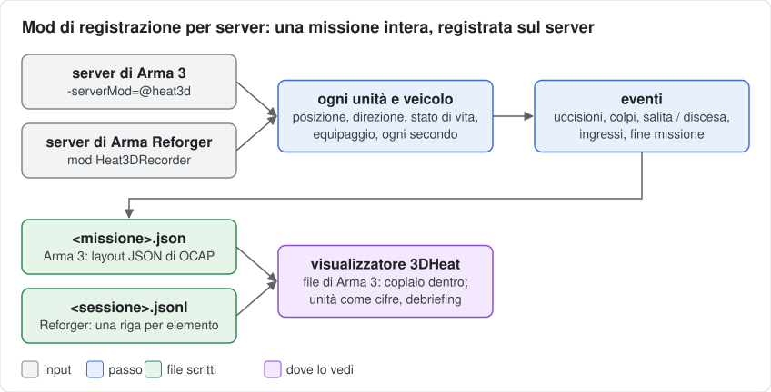

# Mod di registrazione per server (Arma 3, Arma Reforger) {#server-recorder-mods-arma-3-arma-reforger}

La maggior parte dei giochi viene registrata dal watcher sulla macchina del giocatore. Arma è
diverso: un server può registrare un'intera missione - ogni unità e veicolo, non solo il tuo - con un mod
che gira sul server. I giocatori non devono configurare nulla: il mod di Arma 3 è solo per il server, e Reforger
scarica da solo ai giocatori i mod di un server quando si uniscono (il mod non fa nulla sulle loro macchine). Il repository contiene due di questi mod, in
[`mods/arma3`](https://github.com/Holdi601/3DHeat-Watcher/tree/main/mods/arma3)
e [`mods/reforger`](https://github.com/Holdi601/3DHeat-Watcher/tree/main/mods/reforger).
I loro README sono la documentazione completa; questa pagina è la panoramica.

**Stato: entrambi non sono ancora stati provati nel gioco.** L'estensione di Arma 3 è stata compilata e fatta
girare come la chiamano le estensioni di Arma, e il suo output è stato letto da 3DHeat; i suoi script SQF
non sono ancora stati eseguiti in Arma 3. Il mod di Reforger è stato scritto a partire dall'API di script pubblicata
da Bohemia e non è mai stato compilato. Non metterne nessuno su un server pubblico prima che passino i passi di prova nel
suo README.

## Arma 3 {#arma-3}

1. Compila una volta l'estensione per ogni piattaforma (`mods/arma3/extension`). Serve un compilatore C:
   Visual Studio Build Tools su Windows, gcc su Linux; se non hai mai compilato nulla, chiedi al fornitore
   di hosting del server.
   - Windows, in un "x64 Native Tools Command Prompt for VS":
     `cl /nologo /O2 /LD heat3d.c /Fe:heat3d_x64.dll`
   - Linux: `gcc -O2 -shared -fPIC -o heat3d_x64.so heat3d.c -ldl`
2. Compila il mod: `python mods/arma3/build.py` scrive `mods/arma3/@heat3d/`
   (non servono gli Arma 3 Tools).
3. Copia `@heat3d` nella cartella del server e avvia il server con
   `-serverMod=@heat3d`.
4. Il log `.rpt` del server dice `Heat3D recorder 0.1.0: recording <file> every 1 s`.

| Impostazione | Predefinito | Cosa fa |
|---|---|---|
| `captureDelay` | 1 | secondi tra un fotogramma e l'altro |
| `recordHits` | 1 | 0 disattiva gli eventi di colpo |
| `recordShots` | 1 | 0 disattiva il conteggio dei tiri |
| `minPlayers` | 0 | registra solo quando sono connessi almeno questo numero di giocatori |

Una missione la sovrascrive nel suo `init.sqf` (`heat3d_captureDelay = 0.5;`).
Le registrazioni vanno in `recordings/` dentro `@heat3d`, oppure in `HEAT3D_DIR`.

**Output:** un file per missione nel formato JSON di OCAP (il formato del registratore OCAP2),
chiamato `<giorno>__<ora>_<missione>.json`. Durante la missione è un diario (`.heat3d.part`), salvato a ogni
scrittura; il diario di una missione interrotta viene completato alla prossima partenza di una missione.

## Arma Reforger {#arma-reforger}

Il mod (`Heat3DRecorder.gproj`) si apre e si compila in Workbench di Bohemia (Arma Reforger Tools),
si prova su un server dedicato locale, si pubblica da Workbench (non in elenco durante le prove) e si aggiunge
alla lista `mods` del `config.json` del server - passo per passo nel suo README. Ogni secondo scrive la posizione,
la direzione, lo stato di vita, il veicolo e l'id del giocatore di ogni personaggio, e la posizione, la direzione,
lo stato e l'equipaggio di ogni veicolo; e le uccisioni (assassino, arma, distanza), i colpi, il salire e
scendere dai mezzi, i giocatori che entrano ed escono, e la fine della missione.

**Output:** un oggetto JSON per riga, `$profile:heat3d/<giorno UTC>_<ora UTC>_<mondo>.jsonl`:
una riga `header` (formato `heat3d-reforger`, assi x est, y alto, z nord), poi righe `entity`, `frame` ed `event`
man mano che avvengono, e una riga `end`. Le righe delle unità sono `[id, x, y, z, dir, alive, vehicleId, playerId]`,
quelle dei veicoli `[id, x, y, z, dir, alive, [id dell'equipaggio]]`; gli eventi seguono il formato eventi di OCAP2.

## Nel visualizzatore {#in-the-viewer}

Trascina una registrazione di Arma 3 nel [visualizzatore 3DHeat](https://holdi601.github.io/3DHeat/):
una missione è una sessione, le unità diventano soldati, i veicoli il loro tipo, e
uccisioni e colpi finiscono nell'elenco del resoconto. Anche il lettore web di OCAP2 la riproduce.
Il file di Reforger è in formato a righe proprio del mod, con il layout degli eventi di OCAP2.
