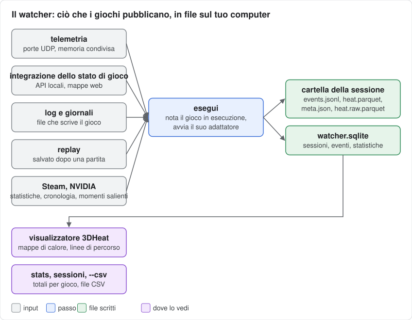

# Fonti e regole {#sources-and-rules}

Il watcher registra solo ciò che giochi e piattaforme consegnano al giocatore. Questa pagina spiega quali fonti sono coperte, cosa il watcher può fare con ognuna, e quali giochi o parti di giochi lascia fuori di proposito.

## I sei tipi di fonte {#the-six-kinds-of-source}

Ogni adattatore ha un `kind`, e il kind decide cosa l'adattatore può fare:

| Tipo | Cos'è | Giochi multigiocatore |
|---|---|---|
| `telemetry` | una porta UDP o una memoria condivisa che il gioco pubblica per dashboard, simulatori di movimento e volanti (Forza Data Out, UDP di F1, memoria condivisa di Kunos e iRacing, SimConnect, l'interfaccia UDP di X-Plane, il plugin SDK di SCS) | sì - è l'output stesso del gioco |
| `gsi` | un'interfaccia di stato del gioco o un'API web locale che il gioco serve alla macchina del giocatore (Valve GSI, Live Client Data API di League, Stats API di Rocket League, la mappa web di War Thunder) | sì, entro ciò che l'API mostra al giocatore |
| `log` | file che il gioco scrive mentre gira: giornale, log, statistiche, salvataggi (Elite Dangerous, Minecraft, Path of Exile, Hearthstone, Star Citizen, EVE Online) | sì |
| `replay` | demo e replay che il gioco salva per i suoi giocatori, convertiti dopo la partita (CS2, Dota 2, War Thunder, World of Tanks, World of Warships, Squad, League of Legends, VALORANT, IL-2 Tacview) | sì, a meno che non siano cifrati, e solo le parti in chiaro |
| `platform` | ciò che Steam e il driver grafico conservano: statistiche, obiettivi, timeline, clip e highlight | sì |
| `memory` | la memoria del gioco, in sola lettura, tramite un profilo che hai scritto | **mai** - solo giocatore singolo |

Solo `memory` apre un altro processo, e solo per leggere. Gli altri cinque tipi leggono ciò che il gioco, Steam o l'app NVIDIA hanno già scritto o inviano.

## Come vengono lette le fonti {#how-the-sources-are-read}

- **Non viene iniettato, agganciato o modificato nulla in un gioco.** Nessun codice viene caricato in un gioco, nessuna finestra o input viene agganciato, nessun file di gioco viene modificato. Gli unici file che il watcher scrive fuori dalla sua cartella dati sono quelli che [`setup --apply`](commands.md#setup) scrive quando lo chiedi: il file di impostazioni di un gioco (con l'originale conservato come `<file>.heat3d-backup`), un file cfg di game-state, lo script hook di DCS, la mod di protocollo di BeamNG.
- **La memoria condivisa viene aperta in sola lettura e non viene mai creata.** Il modo tipico in Python di aprire un mapping con nome ne crea uno quando non esiste. Un gioco avviato dopo troverebbe la mappa vuota e in sola lettura del watcher invece di crearne una propria, e la sua telemetria sarebbe morta. Il watcher apre i mapping solo con `OpenFileMappingW` (che trova solo quelli esistenti), li mappa con `FILE_MAP_READ`, e riprova più tardi se il gioco non li ha ancora creati.
- **Le porte si prendono in prestito, non si rubano.** Una porta UDP di telemetria su cui un altro programma è già in ascolto (FH Companion, SimHub, un'app dashboard) resta a quel programma. Se un altro programma inizia ad ascoltare su una porta che il watcher tiene, il watcher la lascia entro pochi secondi. Gli adattatori Forza aspettano 15 s dopo l'avvio del gioco prima di prendere la porta 5300, e inoltrano ogni pacchetto invariato a 127.0.0.1:5301, così una seconda app Data Out può ancora registrare.
- **Solo in locale.** I server di game-state che il watcher gestisce (CS2, Dota 2) ascoltano su 127.0.0.1 e da nessun'altra parte. Quando il file cfg del gioco contiene un token (quello che scrive `setup`), ogni post deve portarlo; i post senza vengono contati come `bad_auth` e scartati. Senza un file cfg con un token, qualsiasi post locale viene accettato, e il log lo dice. Le API locali che il watcher richiede (League sulla porta 2999, War Thunder su 8111, Rocket League su 49123, X-Plane su 49000) sono su 127.0.0.1.
- **I file di log sono condivisi, mai bloccati.** Ogni lettura apre il file con tutti i flag di condivisione che Windows ha e lo richiude subito, così il gioco può continuare a scrivere, rinominare o sostituire il suo log.
- **Due servizi esterni, e solo in questi casi.** Il controllo delle versioni chiede a GitHub (`api.github.com`) al massimo ogni sei ore, e può essere disattivato (vedi [Aggiornamenti](updates.md)). L'adattatore dei replay di League chiede l'API Match-V5 di Riot solo quando hai inserito la tua `riot_api_key`. Non viene inviato nient'altro da nessuna parte.
- **Attivare una fonte è una tua decisione.** `setup` senza `--apply` dice solo cosa cambierebbe.

## Regole del multigiocatore {#multiplayer-rules}

- Un gioco giocato online viene registrato solo tramite ciò che pubblica: telemetria, API di game-state, log, replay, file di piattaforma. Entro questi, il watcher registra ciò che il gioco mostra al giocatore, e nient'altro calcolato oltre a questo:
  - **La game-state integration di CS2** invia il giocatore osservato (te stesso mentre sei vivo, un compagno di squadra dopo la morte). Le posizioni degli altri giocatori (`allplayers_*`) vengono inviate solo a spettatori e GOTV, quindi il watcher non le richiede.
  - **La Live Client Data API di League of Legends** non ha posizioni. La politica di Riot consente agli strumenti di mostrare ciò che il giocatore potrebbe sapere dal gioco stesso, e nient'altro di calcolato (niente timer dei nemici). Il watcher registra il feed delle uccisioni e il tabellone che il giocatore vede, e i numeri propri del giocatore.
  - **La Stats API di Rocket League** non ha posizioni delle auto (lo stato delle auto viene inviato solo agli spettatori). Ciò che ha un luogo è la palla: dove è stata colpita, segnata o ha colpito la traversa.
  - **La mappa web di War Thunder** mostra ciò che mostra la minimappa, senza nomi né id.
  - **F1 23/24/25** mettono la posizione di ogni auto nel loro pacchetto Motion, anche online. Il gioco li consegna da solo, e trattiene solo i dati dei giocatori con "Your Telemetry" limitata.
  - **DCS World**: un server multigiocatore può vietare l'esportazione dei dati del proprio velivolo; la sessione allora ha eventi ma nessuna posizione, e lo dice.
- **La memoria non viene mai letta in un gioco multigiocatore.** Un adattatore di memoria per un gioco segnato come giocato online viene rifiutato, e un profilo deve dire se il suo gioco può essere giocato online. Un gioco per giocatore singolo che ha anche una modalità online viene letto solo mentre non è collegato a nulla che non sia questa macchina. I giochi la cui modalità per giocatore singolo gira sotto un anti-cheat non vengono mai letti. Vedi [Lettura della memoria](memory-reading.md).
- Il flag `multiplayer` di un adattatore (mostrato come "Online play" da `games --markdown`) decide solo la lettura della memoria. Non impedisce agli altri tipi di registrare il gioco online.

## Cosa viene escluso e perché {#what-is-declined-and-why}

Alcuni giochi, e alcune parti di giochi, non vengono registrati: i loro dati sono protetti, non pubblicati o del tutto assenti dalla macchina del giocatore:

| Gioco | Cosa viene lasciato fuori | Perché |
|---|---|---|
| VALORANT | posizioni, nomi, punteggi nei replay; gli endpoint del lockfile del client | Il flusso di gioco del replay è offuscato con valori ricavati dall'eseguibile di ogni build. Il gioco gira sotto Vanguard. Gli endpoint del lockfile del client Riot non sono un'API pubblicata. **Letto:** ciò che il replay porta in chiaro - mappa, id della partita, agenti, la timeline di uccisioni e round del server. |
| League of Legends | la parte momento per momento dei replay `.rofl`; gli endpoint del lockfile del client | Offuscata contro i cheat, in modo diverso a ogni patch, e non decodificata. **Letto:** il tabellone di fine partita che ogni replay porta come JSON semplice, la Live Client Data API durante una partita e - con una tua chiave per sviluppatori - la timeline ufficiale Match-V5 (posizioni una volta al minuto, uccisioni dove sono avvenute). |
| Fortnite | replay | Cifrati. |
| World of Tanks, World of Warships | replay, nel watcher | Cifrati. Il watcher non li legge; li leggono convertitori separati al di fuori di esso (`exporters/ext/wot-replay`, `exporters/ext/wows-replay`), ciascuno un progetto a sé. **Letto, con un convertitore installato:** la posizione di ogni veicolo o nave mentre il client di registrazione ne era a conoscenza, e le uccisioni. |
| Gran Turismo 7 | telemetria | Solo console, e la sua telemetria è cifrata con una chiave recuperata dal gioco. |
| Apex Legends | tutto | La sua LiveAPI invia eventi completi solo nelle lobby private e personalizzate; altrimenti nulla è disponibile in locale. |
| Overwatch 2, Call of Duty, Battlefield 6, Hunt: Showdown 1896 | dati in tempo reale | Nessun replay, log o output di game-state locale da leggere. Le loro statistiche arrivano dove le conserva Steam ([Statistiche Steam](game-steam-stats.md), [Steam Timeline](game-steam-timeline.md)), e i loro clip come [NVIDIA highlights](nvidia-highlights.md). |
| Star Citizen | tutto ciò che va oltre `Game.log` | Gira con Easy Anti-Cheat; il watcher legge solo il file di log che il gioco scrive e non si avvicina mai al processo del gioco. |
| osu! | replay | Fuori campo: un gioco 2D, senza nulla da collocare su una mappa. |
| Qualsiasi gioco multigiocatore | memoria | Mai. Anche i giochi per giocatore singolo la cui modalità gira sotto un anti-cheat (GTA V, Elden Ring tramite il suo launcher) non vengono letti. |

I replay cifrati non vengono aperti: il lettore di VALORANT controlla il flag di cifratura del replay e rifiuta un file cifrato ("this replay is encrypted; it is not read").

I giochi studiati ma non ancora realizzati (replay di Deadlock, file `.replay` di Rocket League, StarCraft II, Team Fortress 2, Rainbow Six Siege, Beat Saber, Trackmania, diversi simulatori di corsa) sono elencati con le loro fonti in [Tutti i giochi in una tabella](watcher.md#researched-not-yet-built). Ognuno richiede file di esempio con cui essere verificato prima di essere distribuito.
