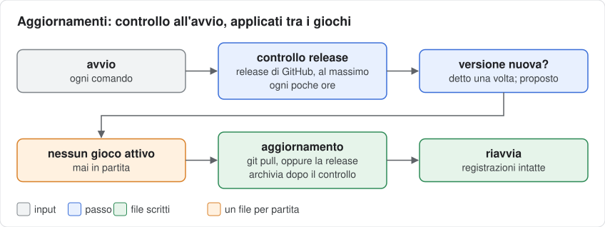

# Aggiornamenti {#updates}

Il watcher si mantiene aggiornato con le versioni pubblicate in
[Holdi601/3DHeat-Watcher](https://github.com/Holdi601/3DHeat-Watcher/releases). L'aggiornatore è il
pacchetto `heat3d_update`, accanto a `heat3d_watch` nel repository.

## Il controllo {#the-check}

- **Quando**: ogni comando tranne `update` controlla all'avvio. `run` controlla anche mentre è in esecuzione,
  al massimo una volta all'ora e solo mentre non è in esecuzione nessun gioco.
- **Come**: una sola richiesta HTTPS a `https://api.github.com/repos/Holdi601/3DHeat-Watcher/releases/latest`,
  con un timeout di 5 secondi. La risposta viene tenuta in cache per sei ore in
  `%LOCALAPPDATA%\3DHeat\update-check-3DHeat-Watcher.json`, quindi la maggior parte degli avvii non chiede nulla. "Nessuna
  versione ancora" (HTTP 404) viene messa in cache come una risposta. Senza connessione, con limite di richieste raggiunto o dietro un
  proxy, il controllo fallisce in silenzio e il comando va avanti con la versione che ha.
- **Versioni**: la versione installata è il file `VERSION` nella cartella del repository.
  Il tag di una versione (`v1.2.0` o `1.2.0`) si confronta come numeri, parte per parte; tutto ciò
  che segue un `-` o un `+` viene ignorato.
- **Disattivato**: `HEAT3D_NO_UPDATE=1` (qualsiasi valore tranne vuoto, `0`, `false` o `no`) disattiva sia il
  controllo sia l'aggiornamento automatico. Ogni strumento 3DHeat tiene il proprio file di cache, quindi la risposta di uno
  strumento non vale mai per un altro.

## Cosa succede quando esce una versione più recente {#what-happens-when-a-newer-release-is-out}

- **`run`** stampa un avviso all'avvio e continua a girare:
  `[heat3d_watch] 3DHeat Watcher 1.2.0 is out (this is 1.0.2). <pagina della versione>`. Mentre gira, con
  `auto_update` attivo (il predefinito) e nessun gioco in esecuzione, si aggiorna da solo: la riga di log
  `3DHeat Watcher 1.2.0 is out (this is 1.0.2); updating`, una notifica di Windows "Updating to 1.2.0",
  l'aggiornamento, ogni adattatore fermato e le sue sessioni chiuse, e lo stesso comando riavviato sul
  nuovo codice. Il watcher non si aggiorna mai nel mezzo di una partita. Se l'aggiornamento non può
  essere applicato, la notifica lo dice ("1.2.0 is out; not updated: ...") e il watcher continua
  con la versione vecchia. Con `auto_update` disattivato resta solo l'avviso.
- **Gli altri comandi** chiedono `Update now? [Y/n]` quando girano in un terminale. Invio, `y`, `yes`, `j` o
  `ja` aggiorna e poi esegue di nuovo lo stesso comando sulla nuova versione. Senza terminale (un'esecuzione
  programmata, una pipe), stampano come aggiornare e continuano.
- **Su richiesta**: `python -m heat3d_watch update` (o `python -m heat3d_update`) chiede a GitHub senza la
  cache e aggiorna. `--check` dice soltanto se è uscita una versione più recente. Funziona anche con
  `HEAT3D_NO_UPDATE` impostato.

## Come viene applicato un aggiornamento {#how-an-update-is-applied}

Dipende da come è stata installata la copia:

- **Un clone git** (la cartella ha `.git` e `git` è nel PATH): `git pull --ff-only`. Viene rifiutato
  finché il clone ha modifiche ai file tracciati (`git status --porcelain --untracked-files=no` non è
  vuoto): quelle modifiche sono lavoro di qualcuno, e un aggiornamento non decide che fine fanno. Fai commit o stash,
  poi esegui il pull.
- **Una copia scaricata**: l'archivio dei sorgenti della versione viene scaricato e decompresso in una
  cartella temporanea. Le voci che finirebbero fuori da essa vengono saltate. Il `VERSION` dell'archivio deve essere la
  versione che la release dichiara, altrimenti non viene copiato nulla. Poi i suoi file vengono copiati sulla
  cartella del repository. I file che non fanno parte di una versione - registrazioni, impostazioni, ambienti virtuali,
  esportazioni, tutto ciò che hai creato - non vengono toccati. Un modulo Python che una versione più vecchia
  aveva e la nuova ha eliminato viene rimosso dai pacchetti della versione (`heat3d_watch`, `heat3d_update`),
  così nessun modulo di adattatore vecchio viene caricato dopo l'aggiornamento; fuori da quei pacchetti non si rimuove nulla.

Registrazioni e impostazioni di solito stanno comunque fuori dalla cartella del repository
(`%LOCALAPPDATA%\3DHeat\Watcher`), quindi un aggiornamento non le tocca mai.

Dopo un aggiornamento, lo stesso comando viene avviato di nuovo. Su Windows, il watcher avvia il nuovo processo,
lo aspetta e ne passa il codice di uscita, così il terminale si comporta come se il primo processo avesse fatto
il lavoro.
