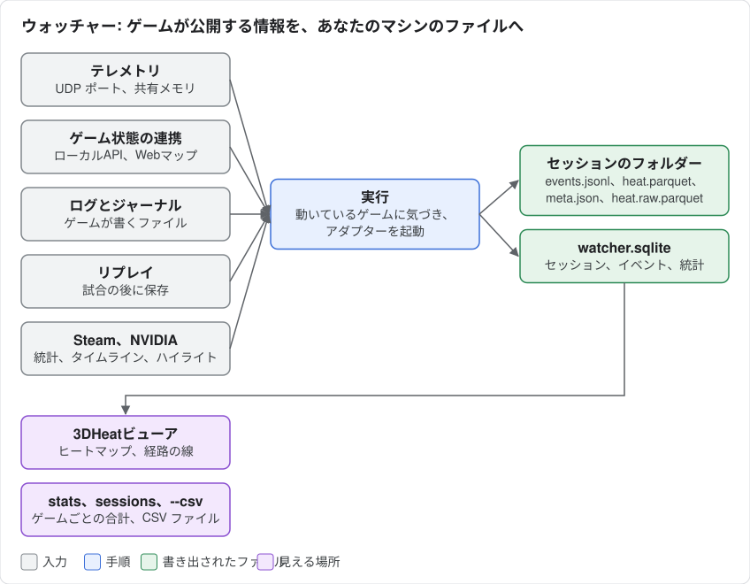

# 3DHeat Watcher {#dheat-watcher}

**これは何？** ゲームをプレイすると、このプログラムが、どこに行ったか、どこで何が起きたかを、静かに書き留めます。あとで、それを 3DHeat ビューアで色のついたマップとして見られます。

**何に使うの？** どのセッションについても、自分だけの記録を持つためです。どこを運転し、飛び、戦ったか。ゲームごとの合計。ウェブサイトも使わず、ゲームも変えずに済みます。

**例:** Watcher を動かしたままレースゲームで1周走ります。その後、`sessions\<game>\` のファイルに、あなたの走ったラインが入り、ビューアがそれを描きます。

もう少し詳しく言うと、3DHeat Watcher は、ゲームが公開している、あなたのプレイについての情報を記録するバックグラウンドのプログラムです。どこに行ったか、どこで何が起きたか、その背後にある数値を、あなたのマシンのファイルに書き出します。ファイルは、あなた自身の統計と、3DHeat ビューアのヒートマップや経路の線のためのものです。

このプログラムは静かに動き、起動されたゲームに気づき、そのゲーム自身の出力を読みます。ダッシュボード用にゲームが公開するテレメトリのポートや共有メモリ、ゲーム状態の連携、ゲームが書くジャーナルやログ、試合後に保存されるリプレイ、Steam が保持する統計、NVIDIA App が保存するクリップです。記録はあなたのマシンに残ります。プログラムが外部と通信するのは、次の2つのサービスだけで、しかも次の場合だけです。GitHub: より新しいリリースを確認するため（[アップデート](../updates.md) を参照）。Riot の Match-V5 API: あなた自身の Riot API キーを入力した場合だけ（[League of Legends のリプレイ](../game-lol-replays.md) を参照）。



## 記録する内容 {#what-it-records}

- **位置**: 車、航空機、ヒーロー、プレイヤー。ゲームが公開している場合は毎秒数回。速さ、向き、ゲームが一緒に送るその他のもの。
- **出来事**: スポーン、死亡、キル、ラップ、ステージ、ラウンド、ゴール、ジョブ、離陸と着陸、ゾーンの変化、実績、ハイライト。各出来事は、その時刻とともに保存され、ゲームが場所を示す場合はその場所も保存されます。
- **セッションごとの統計**: キル、デス、ラップ、ベストラップ、距離、最高速度、プレイ時間。ゲームが保持している場合は、ゲーム自身の統計。

各ゲームが何を提供し、どこから来るかは、[ゲーム](../games.md) の下にそれぞれのページがあります。1つの情報源ではすべてを記録できません。マルチプレイヤーのゲームは、公開されるものを通してのみ記録されます。ウォッチャーはそのメモリを決して読みません（[情報源とルール](../sources-and-rules.md) を参照）。

## インストール {#install}

コマンドラインは初めてですか？ まず [始める前に](before-you-start.md) を読んでください。

ウォッチャーは Windows 向けの Python プログラムです（Python 3.10 以降）。多くの情報源は Windows でしか使えません。共有メモリ、レジストリ、Windows の通知などです。

```bash
git clone https://github.com/Holdi601/3DHeat-Watcher.git
cd 3DHeat-Watcher
pip install -r requirements.txt
```

ダウンロードしたリリースのアーカイブも同じように使えます。展開してから、フォルダーの中で `pip install -r requirements.txt` を実行してください。詳細と、一部のゲームが必要とする追加のものは、[インストールと実行](../installing-and-running.md) にあります。

## クイックスタート {#quick-start}

```bash
python -m heat3d_watch games            # ゲームごとに、何を提供するか、どこから来るか
python -m heat3d_watch setup all        # 何をオンにする必要があるか（何も変更されません）
python -m heat3d_watch setup f1-25 --apply   # 1つのゲームの出力をオンにする（元のファイルはバックアップされます）
python -m heat3d_watch run              # 監視。プレイ中は動かしたままにします
python -m heat3d_watch stats            # ゲームごとの合計
python -m heat3d_watch stats --csv out  # セッション、出来事、統計を CSV ファイルで
```

次のように表示されるはずです: `games` の後に、ゲームごとに1行の表。`run` は、Ctrl+C を押すか、ウィンドウを閉じるまで動き続けます。

すべては `%LOCALAPPDATA%\3DHeat\Watcher` に書かれます。別のフォルダーを使うには、`HEAT3D_WATCH_HOME` 環境変数を設定するか、`python -m heat3d_watch config --set data=D:\somewhere` を実行します。

- `sessions\<game>\<date>_<adapter>\`: セッションごとに1つのフォルダー。中身は `events.jsonl`（起きたすべての出来事）、`heat.parquet`（位置のある行。3DHeat ビューア用）、`meta.json`（ゲーム、情報源、軸、件数、統計）
- `watcher.sqlite`: すべてのセッションの統計。3つの単純な表
- `watcher.log`: ウォッチャーが行ったこと

ビューアはセッションの `heat.parquet` を、何も設定せずに直接開きます（軸と単位はファイルの中にあります）。変換されたリプレイは、その隣に表と試合ドキュメントとして書かれます。ビューア自身の1試合1ファイルの形式は、その [`.3dheat` コンテナ](https://holdi601.github.io/3DHeat/container.html) のページに説明があり、各表の列は [データ](../the-data.md) にあります。

## ドキュメント {#the-documentation}

| ページ | 内容 |
|---|---|
| [始める前に](before-you-start.md) | Python、ターミナル、置き換え用の場所、成功時とよくあるエラーの見え方 |
| [インストールと実行](../installing-and-running.md) | 必要なもの、バックグラウンドでの実行、Windows の起動時の開始、ロックファイル、ログ、すべての設定と環境変数 |
| [ゲーム](../games.md) | ゲームごとに1ページ: 何を記録するか、どこから来るか、どうやってオンにするか、どう動くか、軸、統計、確認したこと |
| [データ](../the-data.md) | セッションのフォルダー、`events.jsonl`、`heat.parquet` とそのフッター、`meta.json`、`watcher.sqlite`、クラッシュ後の回復、CSV の書き出し、ビューアでセッションを開く |
| [コマンド](../commands.md) | `python -m heat3d_watch` のすべてのコマンドとオプション |
| [情報源とルール](../sources-and-rules.md) | 6種類の情報源、マルチプレイヤーのルール、除外されるゲームとその理由 |
| [NVIDIA Highlights](../nvidia-highlights.md) | NVIDIA Highlights にできることとできないこと、そしてハイライトがどう位置を得るか |
| [サーバー記録 MOD](../server-mods.md) | ミッション全体をサーバーで記録し、ビューア用にする Arma 3 と Arma Reforger のサーバー MOD |
| [メモリの読み取り](../memory-reading.md) | シングルプレイヤーのメモリのプロファイル: 形式、確認、書き方と検証 |
| [アップデート](../updates.md) | ウォッチャーが新しいリリースをどう確認し、どう自己更新するか |
| [開発](../development.md) | アダプターの書き方: API、テスト、正直な `verified`、ゲームのページの再生成 |
| [すべてのゲームの一覧](../watcher.md) | `games --markdown` が表示する、すべてのゲームの一覧。調査済みだがまだ作っていないゲームも |
| [コマンドリファレンス](../cli-reference.md) | すべてのコマンドの `--help`。コードから生成 |
| [保守](../maintaining.md) | これらのページのリリースチェックリスト |

## 3DHeat の一部 {#part-of-3dheat}

3DHeat Watcher は、3DHeat ビューアの周りにある無料のツールの一つです（ウォッチャーは CS2 のデモを変換するために 3DHeat CS2 を使います）。それぞれ独自のプロジェクト、リリース、ライセンスを持ちます:

| ツール | 内容 | ドキュメント |
|---|---|---|
| [3DHeat](https://github.com/Holdi601/3DHeat) | ビューア: 3Dでのヒートマップ、レース分析、試合の振り返り | [サイト](https://holdi601.github.io/3DHeat/) |
| [GameFiles](https://github.com/Holdi601/3DHeat-GameFiles) | ゲームが同梱するファイルから、コースとレベルを3Dモデルとして | [サイト](https://holdi601.github.io/3DHeat-GameFiles/) |
| [GameCapture](https://github.com/Holdi601/3DHeat-GameCapture) | レースゲームの周回テレメトリ。ゲーム映像から再構築したレベル | [サイト](https://holdi601.github.io/3DHeat-GameCapture/) |
| [Unreal Exporter](https://github.com/Holdi601/3DHeat-UnrealExporter) | レベルを1つの3Dモデルとして書き出す Unreal Editor のプラグイン | [サイト](https://holdi601.github.io/3DHeat-UnrealExporter/) |
| [CS2](https://github.com/Holdi601/3DHeat-CS2) | Counter-Strike 2 のデモを表と試合ドキュメントに。マップを3Dモデルに | [サイト](https://holdi601.github.io/3DHeat-CS2/) |
| [Watcher](https://github.com/Holdi601/3DHeat-Watcher) | ゲームが公開する情報から、あなたのプレイについて、バックグラウンドで記録 | [サイト](https://holdi601.github.io/3DHeat-Watcher/) |
| [Ext-WarThunder](https://github.com/Holdi601/3DHeat-Ext-WarThunder) | War Thunder のリプレイを表と試合ドキュメントに | [サイト](https://holdi601.github.io/3DHeat-Ext-WarThunder/) |
| [Ext-WoT](https://github.com/Holdi601/3DHeat-Ext-WoT) | World of Tanks のリプレイを表と試合ドキュメントに | [サイト](https://holdi601.github.io/3DHeat-Ext-WoT/) |
| [Ext-WoWs](https://github.com/Holdi601/3DHeat-Ext-WoWs) | World of Warships のリプレイを表と試合ドキュメントに | [サイト](https://holdi601.github.io/3DHeat-Ext-WoWs/) |
| [Ext-Squad](https://github.com/Holdi601/3DHeat-Ext-Squad) | Squad のサーバーのデモを表と試合ドキュメントに | [サイト](https://holdi601.github.io/3DHeat-Ext-Squad/) |
| [Ext-DCS](https://github.com/Holdi601/3DHeat-Ext-DCS) | DCS World のマップを3Dモデルに | [サイト](https://holdi601.github.io/3DHeat-Ext-DCS/) |
| [Ext-IL2](https://github.com/Holdi601/3DHeat-Ext-IL2) | IL-2 Sturmovik のマップを3Dモデルに | [サイト](https://holdi601.github.io/3DHeat-Ext-IL2/) |

ライセンス: MIT（[LICENSE](https://github.com/Holdi601/3DHeat-Watcher/blob/main/LICENSE)）。使用しているサードパーティのパッケージのライセンスと、読み取るゲームが求めることは、[LICENSES.md](https://github.com/Holdi601/3DHeat-Watcher/blob/main/LICENSES.md) に一覧があります。
